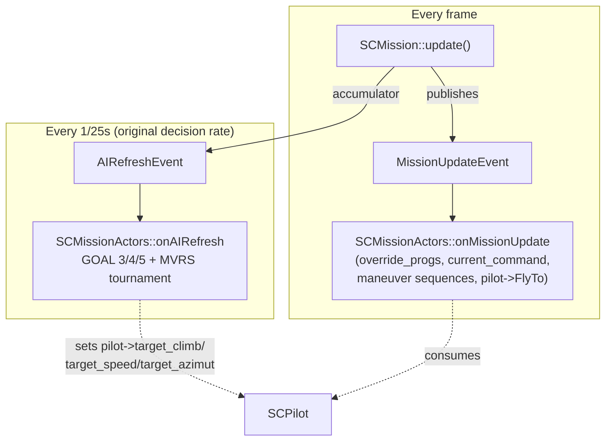

# Implementation specification — the Strike Commander AI engine
in libRealSpace

*Each function below is a real method of `SCMissionActors`,
`SCMission`, `SCPilot` or `RSProf`. The algorithms come from reverse
engineering the original binary (`AI_SYSTEM.md`, referenced for
anyone who wants to trace a formula back to its source) — this
specification only documents what must be written, not the earlier
state of the code.*

---

> **Update 2026-09-25.** The corrections to apply to the current code (`SCAIBrain`,
> `SCMissionActors`, `SCPilot`) based on the assembly readings of 2026-09-24/25 (ground
> attack, autopilot, roll/pitch commands, lock-on and evasion) are grouped
> in `analysis/IMPL_SCAIBRAIN_CORRECTIONS.md`. On the physics side: `IMPL_SCJETPPLANE_CORRECTIONS.md`.

## 0. Architecture — two events, two frequencies



`onMissionUpdate` remains the priority cascade for the `GOAL` selector
`2` (mission execution). `onAIRefresh` handles selectors
`3`/`4`/`5`, at the original decision rate (~25 Hz)
rather than at the port's actual framerate — without this throttle, a port
running at a framerate above 25 fps would run the `MVRS` tournament more often
than the original binary, hence more random draws per real second and an AI
statistically stronger/more reactive than the original (defect noted in `AI_SYSTEM.md` §6).

---

## 1. Data loading — `RSProf`

### 1.1 Chunk hierarchy

```
FORM "PROF"
├── VERS                       → parsePROF_VERS
├── FORM "RADI"                → parsePROF_RADI
│   ├── INFO/SPCH/OPTS/MSGS
│   └── ASKS                   → PLAYER profile only
└── FORM "_AI_"                → parsePROF__AI_
    ├── "AI\0_" → isAI=true, MVRS, GOAL, ATRB
```

### 1.2 `parsePROF__AI_MVRS`

```cpp
struct AI_STATE {
    uint8_t node_id;
    int8_t  value;
};

void RSProf::parsePROF__AI_MVRS(uint8_t *data, size_t size) {
    ByteStream stream;
    if (data == nullptr) { return; }
    stream.Set(data, size);
    while (stream.GetPosition() < data + size) {
        uint8_t id = stream.ReadByte();
        int8_t  value = (int8_t) stream.ReadByte();
        this->ai.mvrs.push_back(AI_STATE{id, value});
    }
}
```

### 1.3 `parsePROF__AI_ATRB`

```cpp
void RSProf::parsePROF__AI_ATRB(uint8_t *data, size_t size) {
    ByteStream stream;
    if (data == nullptr) { return; }
    if (size == 1) {
        this->ai.atrb.TH = 8;  this->ai.atrb.CN = 8;  this->ai.atrb.VB = 8;
        this->ai.atrb.LY = 8;  this->ai.atrb.FL = 10; this->ai.atrb.AG = 10;
        this->ai.atrb.AA = 10; this->ai.atrb.SM = 8;  this->ai.atrb.AR = 8;
        return;
    }
    stream.Set(data, size);
    this->ai.atrb.TH = stream.ReadByte(); this->ai.atrb.CN = stream.ReadByte();
    this->ai.atrb.VB = stream.ReadByte(); this->ai.atrb.LY = stream.ReadByte();
    this->ai.atrb.FL = stream.ReadByte(); this->ai.atrb.AG = stream.ReadByte();
    this->ai.atrb.AA = stream.ReadByte(); this->ai.atrb.SM = stream.ReadByte();
    this->ai.atrb.AR = stream.ReadByte();
}
```

### 1.4 `NUMS` — companion file (`INTEL.IFF`), on `SCMission`

```cpp
struct NUMSConstants {
    float unusedA, unusedB;
    Vec3 formationOffset;
    Vec3 secondaryOffset;
    float distanceThreshold1800;
    float distanceThreshold15_625;
    float distanceThreshold175;     // detection threshold (§3.2)
    float distanceThreshold7;
    float distanceThreshold69;      // Scissors/Rollaway sequence (§4)
    float distanceThresholdPriority;
    float distanceThreshold97;      // Immelmann/Split S sequence (§4)
    float baseSpeedReference;
};
NUMSConstants nums;

void SCMission::loadNums(uint8_t *data, size_t size) {
    IFFSaxLexer lexer;
    std::unordered_map<std::string, std::function<void(uint8_t*, size_t)>> handlers;
    handlers["INTL"] = [this](uint8_t *d, size_t s) {
        ByteStream stream; stream.Set(d, s);
        auto readFixed = [&]() { return (int32_t)stream.ReadLong() / 256.0f; };
        this->nums.unusedA = readFixed();
        this->nums.unusedB = (float)(int16_t)stream.ReadShort() / 256.0f;
        stream.ReadShort();
        this->nums.formationOffset = { readFixed(), readFixed(), readFixed() };
        this->nums.secondaryOffset = { readFixed(), readFixed(), readFixed() };
        this->nums.distanceThreshold1800     = readFixed();
        this->nums.distanceThreshold15_625   = readFixed();
        this->nums.distanceThreshold175      = readFixed();
        this->nums.distanceThreshold7        = readFixed();
        this->nums.distanceThreshold69       = readFixed();
        this->nums.distanceThresholdPriority = readFixed();
        this->nums.distanceThreshold97       = readFixed();
        this->nums.baseSpeedReference        = readFixed();
    };
    lexer.InitFromRAM(data, size, handlers);
}
```

### 1.5 `ATRB` — two distinct copies on the entity, not one

*Major correction following an in-depth verification session
(`AI_SYSTEM.md` §6ter).* There are **two separate copies** of `ATRB`
on the AI entity:

1. **Tuning/loading copy** (`entity+0x96` to `+0x9E`) — the direct buffer read from the file.
2. **Direct consumption copy** (`entity+0xB0` to `+0xB8`) — the one the decision logic actually reads, via a
   family of skill-check functions (random roll 1-16 compared to `stat + modifier`):

```cpp
bool SCMissionActors::skillCheck(uint8_t statValue, int modifier) {
    int roll = (std::rand() % 16) + 1;
    return roll <= (int)statValue + modifier;
}
```

| Offset | `ATRB` trait | Confirmed by |
|---|---|---|
| `+0xB0` | `FL` (corrected 2026-09-25: not `TH`) | piloting roll, checked by the tournament |
| `+0xB1` | `TH` (corrected 2026-09-25: not `CN`) | roll (`Pilot_SkillCheck_B1`, from `AI_WeaponRecoveryBusy_9027`) |
| `+0xB2` | `VB` | `canPlayRadioMessage` (§5.2) |
| `+0xB3` | `CN` (corrected 2026-09-25: not `LY`) | morale computation (`AI_ComputeMorale_CD4A`) |
| `+0xB4` | `LY` (corrected 2026-09-25: not `FL`) | discipline (`AI_MoraleDisciplineCheck_CA93`), `> 14` condition in the message dispatcher |
| `+0xB5` | `AG` | skill roll |
| `+0xB6` | `AA` | division-based comparison, called from the tournament itself |
| `+0xB7` | `SM` | skill roll |
| `+0xB8` | `AR` | skill roll |

### 1.6 Rescaling `FL`/`AG`/`AA` by difficulty

> 2026-10-03: applies only to **enemy-side aircraft** (`Cockpit_ReadControlsFrame_8F720`: category 6 and side
> +0x50 == 0xFF), always from the file values (+0xA0..+0xA2). `word_7235F`: 0 = unchanged, 1 = half,
> 2 = quarter. Ported in `SCMission::applyDifficulty` (`RSProf::ai.atrb_file`). `word_70466` is not the
> difficulty but the mission's frame counter.

Concerns only the tuning copy, distinct from the direct consumption copy above:

```cpp
int difficulty_level{0};

void RescaleSkillByDifficulty(RSProf &profile, int difficultyLevel) {
    profile.ai.atrb.FL = (uint8_t)(profile.ai.atrb.FL >> difficultyLevel);
    profile.ai.atrb.AG = (uint8_t)(profile.ai.atrb.AG >> difficultyLevel);
    profile.ai.atrb.AA = (uint8_t)(profile.ai.atrb.AA >> difficultyLevel);
}
```

---

## 2. The `AIRefresh` event

### 2.1 Event

```cpp
class AIRefreshEvent : public EventMessage {
public:
    SCMission *mission{nullptr};
};
```

### 2.2 `SCMission` — accumulator

```cpp
float ai_refresh_accumulator{0.0f};
// The original game runs the MVRS tournament without any throttling (AI_SYSTEM.md
// §6): the AI's decision rate scales directly with the framerate,
// which targeted ~25 fps on the original DOS binary (same reference as the
// camera, cf. CAMERA_SYSTEM.md/DATA_MODEL.md). This is NOT an arbitrary
// stability choice for the port: on a port running at a different framerate
// (often well above 25), letting the tournament run on
// every frame would make the AI statistically stronger/more reactive
// than the original (more random draws per real second). This throttle
// explicitly puts the AI back at the original decision rate.
static constexpr float AI_REFRESH_INTERVAL = 1.0f / 25.0f;

float dt = this->tps > 0 ? 1.0f / (float)this->tps : 1.0f / 30.0f;
this->ai_refresh_accumulator += dt;
if (this->ai_refresh_accumulator >= AI_REFRESH_INTERVAL) {
    this->ai_refresh_accumulator -= AI_REFRESH_INTERVAL;
    AIRefreshEvent ai_refresh_event;
    ai_refresh_event.mission = this;
    this->messageBus.publish(std::make_unique<AIRefreshEvent>(ai_refresh_event));
}
```

### 2.3 `SCMissionActors` — declarations

**The `MVRS` identifier `enum` has been fully re-verified** —
a previous session contained a systematic offset on
almost all values. Each identifier has been confirmed by
a full reading of its score function:

```cpp
enum class GoalSelector : uint8_t {
    Empty                = 1,
    ExecuteAction        = 2,
    WanderRandom         = 3,
    BehaviorStateMachine = 4,
    ActiveWingman        = 5,
};

enum class MVRSInstinct : uint8_t {
    None                   = 0,
    PursuitBase            = 1,  // full angular, winner also applies GeometricUtility
    PursuitAlwaysTen       = 2,  // CORRECTED 2026-10-11: score MVRS_ID2_Score_3FCB, zero for an aircraft; application = directional break
    PursuitSimple          = 3,  // simplified angular, FL adjustment
    PursuitExtended        = 4,  // extended angular, application = interception solution
    PursuitImmelmannSplitS = 5,  // triggers the 8-phase aerobatic sequence
    PursuitSensorGated     = 6,  // range guard, its own sub-mode and sequence
    PursuitSkillGatedFL    = 7,  // flags_75 bit6 / FL guard, writes intercept position
    // 8,9,10,11,12: zero score in the only code path read so far.
    // DO NOT treat as empty shells / unimplemented: the search for
    // their true consumer is incomplete, not closed
    // (see AI_SYSTEM.md §3.7/§3.8, explicit correction following
    // Remi's disagreement). ID=21 below has the same profile (zero score
    // in the tournament) and turned out to have a confirmed real role
    // outside the tournament (§4bis): 8-12 must be implemented as soon as their real role
    // is found, not set aside based on the score alone.
    Unresolved8            = 8,
    Unresolved9            = 9,
    Unresolved10           = 10,
    Unresolved11           = 11,
    Unresolved12           = 12,
    ScissorsRollaway       = 13, // triggers the 5-phase aerobatic sequence
    Intercept              = 14, // full trigonometric computation, binary 0/10
    ThreatSensor           = 15, // binary 0/10
    ThGateBinary           = 16, // CORRECTED: binary 0/1 on FL<12 (entity+0xB0) only
    WeaponReady            = 19,
    GeometricUtility       = 20, // zero score in the tournament; real geometric tool outside the tournament (§3.6)
    NavCommandCarrier      = 21, // zero score in the tournament; real carrier of navigation command
                                  // outside the tournament, consumed by AI_NavSolutionToPoint (AI_SYSTEM.md §4bis)
                                  // — formerly named "Trivial", corrected following this discovery
};

virtual bool tryActiveWingman();
virtual bool tryWanderRandom();
virtual void runMVRSTournament();

void onAIRefresh(const AIRefreshEvent &event);
void executeFireControlSolution();
void armWeaponEngagement();
int  selectBestWeapon();
int  weaponEffectiveRange(int hpt_id);
bool targetDetectedBySensor();
bool interceptTrajectoryFeasible();
float computeSensorSecondaryAngle();
void applyBreakDirection();
void applyPursuitTracking();
void applyGeometricUtility();
int  weaponFiringConeAngle(int hpt_id);
void tickManeuverSequence(float dt);
int  computeMVRSScore(MVRSInstinct id);
int  scoreAngularFamily(MVRSInstinct id);
int  scoreWeaponReady();
bool skillCheck(uint8_t statValue, int modifier);
void applyMVRSInstinct(MVRSInstinct id);

MVRSInstinct mvrs_current_winner{MVRSInstinct::None};
float mvrs_maneuver_timer{0.0f};
int mvrs_maneuver_phase{0};
bool mvrs_break_right{false};
bool threat_modulator_active{false};
bool weapon_task_busy{false};
SCMissionActors *weapon_engagement_target{nullptr};
float weapon_engagement_timer{0.0f};
```

### 2.4 `SCMissionActors::onEvent`

```cpp
void SCMissionActors::onEvent(const EventMessage &event) {
    if (auto eventData = dynamic_cast<const MissionEventActorHit*>(&event)) {
        this->onGettingHit(*eventData);
        return;
    }
    if (auto eventData = dynamic_cast<const MissionUpdateEvent*>(&event)) {
        this->onMissionUpdate(*eventData);
        return;
    }
    if (auto eventData = dynamic_cast<const AIRefreshEvent*>(&event)) {
        this->onAIRefresh(*eventData);
        return;
    }
}
```

### 2.5 `SCMissionActors::onAIRefresh`

*Note (2026-09-19): this pseudocode does not reflect the actual order of `AI_TopLevelThink` (priority reactions, current object, ground bypass) — see §2.9 and `AI_SYSTEM.md` §4.2.*

```cpp
void SCMissionActors::onAIRefresh(const AIRefreshEvent &event) {
    if (!this->is_active || this->is_destroyed) return;
    if (this->profile == nullptr || !this->profile->ai.isAI) return;
    if (this->plane == nullptr || this->pilot == nullptr) return;

    for (uint8_t rawSel : this->profile->ai.goal) {
        GoalSelector sel = (GoalSelector)rawSel;
        switch (sel) {
            case GoalSelector::ActiveWingman:
                if (this->tryActiveWingman()) return;
                break;
            case GoalSelector::WanderRandom:
                if (this->override_progs.empty() && this->on_update.empty()) {
                    if (this->tryWanderRandom()) return;
                }
                break;
            case GoalSelector::BehaviorStateMachine:
                this->runMVRSTournament();
                return;
            default:
                break;
        }
    }
}
```

### 2.6 `SCMissionActors::tryActiveWingman`

```cpp
bool SCMissionActors::tryActiveWingman() {
    if (this->mission->player == nullptr) return false;
    bool escortingPlayer = (this->current_target != 0
                            && this->target == this->mission->player);
    if (escortingPlayer) {
        this->override_progs.clear();
        this->override_progs.push_back({prog_op::OP_SET_OBJ_FOLLOW_ALLY,
                                         this->mission->player->actor_id});
        return true;
    }
    return false;
}
```

### 2.7 `SCMissionActors::tryWanderRandom`

```cpp
bool SCMissionActors::tryWanderRandom() {
    if (this->current_target != 0) return false;
    Vector3D wander;
    wander.x = this->plane->x + (float)(std::rand() % 20000 - 10000);
    wander.y = this->plane->y;
    wander.z = this->plane->z + (float)(std::rand() % 20000 - 10000);
    this->pilot->SetTargetWaypoint(wander);
    this->pilot->target_speed = -10;
    return true;
}
```

*Note (actual implementation, libRealSpace, 2026-09-13): the version
actually shipped picks a random existing `SPOT` from the mission
(`std::rand() % spots.size()`) and sets it via the already existing
`current_command`/`flyToWaypoint` mechanism, rather than a 3D point computed
on the fly — see §2.8 below for the broader context on how `current_command` fits
into the `GOAL` loop.*

**Reading of `Goal_WanderRandom` (2026-09-20).**
1. If the AI entity's current object exists, it delegates to it (`vtable+0xC`) and returns true. Its guard is therefore **not** "an attack target is engaged" but "an object is current" (nature still unknown).
2. Otherwise it draws two values `rand() % 20000 − 10000`, takes them as the horizontal direction, **normalizes** this vector and multiplies it by **30 000**: the point is 30 000 units away in a random direction (not ±10 000 as in the example above).
3. Altitude: that of the terrain under the point, plus the cruise altitude read from the entity (constant from `NUMS`), minus the current altitude, bounded to ±1000, added to the current position.
4. It writes the point (target position) and the desired speed (direction × `NUMS` cruise speed) into the state block shared by the player and the AI, as well as into the entity's mission-point coordinates, then applies the controller's execution node (the one from the `ExecuteFlightCommand` path) and returns true.
5. A test on two bytes of the state (`+0x1A` zero and code `0x15` at `+0x19`) may skip point generation: role not read.
6. Called by `Goal_ExecuteAction` (the "no order" case) and by `AI_EngageAttackerReaction_E246`.

**Difference with libRealSpace**: the shipped version picks a `SPOT` from the mission rather than a point 30 000 units away. Its guard is `current_target != NO_TARGET` (mission target engaged).

**Correction of 2026-09-20: `current_target` uses `NO_TARGET = -1`.** The player has identifier 0. With 0 as "no target", an actor ordered to destroy the player kept `current_target = 0`: the guard of `tryWanderRandom` did not stop it, `tryWanderRandom` overwrote `current_command` and the waypoint set by `destroyTarget`, and the plane flew away instead of fighting. The sentinel `-1` (constant `SCMissionActors::NO_TARGET`) fixes this; combat against the player has been validated in-game.

### 2.8 `SCMissionActors::executeGoalAction` (`GOAL_EXECUTE_ACTION`) —
navigation vs combat, one point still open

**Actual implementation, retained after discussion with Rémi (2026-09-13)** —
differs from the spirit of the `onAIRefresh` pseudocode above (§2.5), which
let `runMVRSTournament()` run as soon as selector `4` is reached. In practice, `executeGoalAction()` (selector
`2`, `GOAL_EXECUTE_ACTION`) translates `current_command` into a method call — but
its return value is **not** a simple `current_command != OP_NOOP`:

```cpp
bool SCMissionActors::executeGoalAction() {
    this->protectSelf();
    switch (this->current_command) {
        case OP_SET_WAIT_FOR_SECONDS:
        case OP_SET_OBJ_TAKE_OFF:
        case OP_SET_OBJ_LAND:
        case OP_SET_OBJ_FLY_TO_WP:
        case OP_SET_OBJ_FLY_TO_AREA:
        case OP_SET_OBJ_FOLLOW_ALLY:
            /* executes the corresponding method, updates
               current_command_executed */
            return true;   // pure navigation objective: wins the tick
        case OP_SET_OBJ_DESTROY_TARGET:
        case OP_SET_OBJ_DEFEND_TARGET:
        case OP_SET_OBJ_DEFEND_AREA:
            /* still executes the method (the plane keeps approaching/firing
               at the target) */
            return false;  // combat objective: does NOT win the tick
        default:
            return false;  // nothing to do
    }
}
```

**Why this split**: `runGoalSelectors()` (§4bis of `AI_SYSTEM.md`
for the ASM equivalent, `AI_TopLevelThink`) stops at the first selector
that "wins" the tick. In **all** the sample `PROF` files
(Billy `[5,2,1,4,3]`, Hammer `[2,1,4,3]`, Gwen, cargo), selector `2`
always precedes `4`. If `2` won the tick for any non-empty `current_command`
(including `DESTROY_TARGET`, which can stay active for a very long time — until the target
is destroyed), the `MVRS` tournament (selector `4`) would **never** run in combat, exactly
when it must take over for tactical maneuvering. By excluding the three
combat objectives from "winning the tick" (while still executing them), `4`
remains reachable in the same pass as soon as it is wired up.

**Status: working hypothesis, not an ASM certainty.** `AI_SYSTEM.md`
§4.4 (`Goal_MoraleReaction_878F`, selector `5`) shows that at least one selector
internally delegates to `AI_BehaviorStateMachine` at the end of its own processing — which suggests that the real link between `Goal_ExecuteAction` and the `MVRS`
tournament may not be a simple mutual exclusion at the `GOAL` loop level, but an
internal delegation within certain native handlers. **To be reconfirmed in ASM during the dedicated `MVRS`
tournament session** (§3 below) before considering this split final.

### 2.9 What the ASM does around the `GOAL` loop (not yet reproduced)

Source: corrected `AI_SYSTEM.md` §4.2, `AI_TICK_CALL_GRAPH.md` (citations). Actual
order of AI decision-making, on each tick of the entity:

1. **Priority reactions** (threat, escort, damage): if one reacts, stop there — this is "protect self" which comes before "obey order".
2. **Current object** (`entity+0x0D`, nature unknown): if it exists, it goes before the tournament and before the objectives.
3. **Plane on the ground: direct `Goal_ExecuteAction`**, regardless of the `GOAL` table. Plane in flight: walk through the file's slots.

Current gaps between libRealSpace and this order:

| ASM rule | Status in `runGoalSelectors()` |
|---|---|
| On the ground, `Goal_ExecuteAction` runs without consulting `GOAL` | **implemented** (2026-09-19): `runGoalSelectors()` calls `executeGoalAction()` first if `plane->on_ground`, which takes off an actor whose `GOAL` contains only 1 |
| The value `1` occupies no slot | treated as `GOAL_EMPTY` and skipped when reading the loop: equivalent, but the actor remains a "with `GOAL`" actor |
| Priority reactions before objectives | **absent**; `protectSelf()` is a stopgap called inside `executeGoalAction()`, hence tied to selector `2` |
| Current object (`entity+0x0D`) before `GOAL` | **absent**, nature of the object not established |
| Handlers called with `(entity, 0)` | not applicable here |

The ground bypass is reproduced: if `plane->on_ground`,
`runGoalSelectors()` calls `executeGoalAction()` before walking through `profile->ai.goal`.

---

### 2.10 The brain state (`SCAIBrain`) — field map of the AI entity

The actor (`SCMissionActors`) plays the role of the world node, the brain (`SCAIBrain`) that of the original AI entity (the world node points to it). This table lists what the AI entity carries, with what is established. **Only the "known" fields are candidates for declaration in `SCAIBrain.h`.** The others stay here until their role is read.

Columns: **status** = known (read in the ASM), partial, unknown; **`SCAIBrain`** = already declared, to declare, or not; **equivalent** = what libRealSpace already has.

**Targets and threats**

| Field (offset) | Role | Status | `SCAIBrain` | libRealSpace equivalent |
|---|---|---|---|---|
| air target (`+0x287`) | normal combat target: fire, pursuit, tournament | known | `air_target` (declared) | `SCMissionActors::target` (mixed) |
| ground target (`+0x283`) | target handled by the permanent ground-attack node | known | `ground_target` (declared) | — |
| missile aimed at me (`+0x281`) | missile threat designated by targeting | known | `missile_threat` (declared) | `weapon_shooted_at_me` |
| threat state (`+0x27F`, 0 to 2) | 2 = a missile wins targeting this tick; the role of 1 is unknown | partial | `threat_state` (declared) | — |
| bonus reference A (`+0x285`) | gives A +10, skill +5 to the designated candidate; writer unknown | unknown | no | — |
| bonus reference B (`+0x289`) | gives skill +3, B +5; writer unknown | unknown | no | — |
| mission target (`+0x137`) | target of the destroy / defend orders set by the script | known | no (stays on the actor) | `current_target`, `target` |
| ally reference (`+0x145`) | followed ally (`Goal_FollowAllyExec`) | known | to declare later | — |
| weak references (`+0x10F`, `+0x147`) | role not established | unknown | no | — |

**Objective and execution**

| Field (offset) | Role | Status | `SCAIBrain` | Equivalent |
|---|---|---|---|---|
| current objective (`+0x11D`) | state code set by `Goal_SetObjective_A307` | known | to declare later | `current_command` (actor) |
| mission point coordinates (`+0x11F`, `+0x12B`) | target point, shared script / `GOAL` | known | to declare later | `current_command_arg` (partial) |
| executed objective | no identified counterpart in the original | — | no | `current_command_executed` (specific to libRealSpace) |
| current object (`+0x0D`) | notifiable reference; its nature is unknown | unknown | no | — |
| permanent node (`+0xD9`) | applied directly when a ground target is set without an air target; role not read | partial | no | — |
| special nodes (`+0xC1` ID 20, `+0xD1` ID 21) | `MVRS` nodes reused outside the tournament | known | no | — |

**Firing and pursuit** (read in `AI_BehaviorSelector`)

| Field (offset) | Role | Status | `SCAIBrain` | Equivalent |
|---|---|---|---|---|
| remaining burst length (`+0x280`) | decremented on each burst tick | known | to declare later | — |
| firing state (`+0x10D`, value `0x800`) | records that a burst is in progress | partial | no | — |
| maneuver results (`+0x1A0`, `+0x1A2`) | outputs of `AI_ComputeFireSolutionQuality_91DF` and `AI_SelectWeaponMask_9665` | partial | no | — |
| state flags (`+0x28B`, `+0x28D`) | bit 0x02 set by fire control; bit 3 escort; bit 7 triggered behavior; `+0x28D` bit 0x08 cleared at the start of targeting | partial | no | — |

**Traits, lists and timers**

| Field (offset) | Role | Status | `SCAIBrain` | Equivalent |
|---|---|---|---|---|
| `ATRB` traits (`+0xB0` to `+0xB8`, consumption copy) | `FL`, `TH`, `VB`, `CN`, `LY`, `AG`, `AA`, `SM`, `AR` (memory order, corrected 2026-09-25; file: TH, CN, VB, LY, FL, …) | known | no (read by `owner->profile`) | `profile->ai.atrb` |
| `GOAL` table (`+0x1B0`, 8 bytes per slot) | profile selectors | known | no (read by `owner->profile`) | `profile->ai.goal` |
| `MVRS` nodes (`+0x200` counter, `+0x202` table, 5 bytes each) | tournament | known | no (read by `owner->profile`) | `profile->ai.mvrs` |
| targeting cadence (`+0x174` bits, `+0x175` clock, `+0x179` mask depending on `FL`) | limits the callbacks of `Targeting_AcquireBestThreat`: every 16/8/4 s (tournament) or 8/4/2 s (attacker) depending on `FL` — `IMPL_SCAIBRAIN_CORRECTIONS.md` §0bis | known | to declare later | — |
| timer (`+0x175`) | prepared by `AIEntity_MasterTick_5ACC` | partial | no | — |
| arrival radius (`+0x139`), cruise speed (`+0x141`), `+0x13D` | constants from `NUMS` | known | no | `NUMS` on `SCMission` |
| formation offset (`+0x14A`, `+0x14E`, `+0x152`) | (300, 0, 0) in 24.8 | known | no | `formation_pos_offset` (actor) |
| vector (`+0x1A4`, `+0x1A8`, `+0x1AC`) | (0, −800, 0); direction unknown | unknown | no | — |

**Links to other objects**

| Field (offset) | Role | Status | `SCAIBrain` | Equivalent |
|---|---|---|---|---|
| linked world node (`+0x102`) | position and object of my plane | known | no (`owner->object`) | `owner->object` |
| weapon loading (`+0x104`) | 35-byte weapon stations | known | no | plane weapons / `RSEntity::weaps` |
| plane (`+0xB`) and state block (`+0x7`) | plane flags; controls shared by player and AI | known | no (`owner->plane`, `owner->pilot`) | `PlaneControlEvent` |
| pointer to the object carrying the weapon loading (`+0x22`) | read by `GroundAttack_CanEngage_77000` (`node+0x22` of the ground-attack node) | partial | no | — |

**Progress status (2026-09-20)**: `SCAIBrain` (`SCAIBrain.h/.cpp`, in `src/strike_commander/`) exists and is created by `SCMission` for any actor whose profile is AI. The `GOAL` loop (`runGoalSelectors`, `executeGoalAction`, `tryWanderRandom`, `tryActiveWingman`) was moved there as is; `SCMissionActors::onAIRefresh` keeps its guards then calls `brain->tick()`. Validated in-game: compiles, the AI reacts as before. The targeting fields are declared but not yet used; the objective state remains on the actor.

**Progress status, firing and pursuit (2026-09-20)**: firing (`updateFireControl`) and pursuit (`updatePursuit`) are driven by `SCAIBrain` (flags `fire_control_enabled` and `pursuit_enabled`, active). Firing: weapon mask, solution quality, threshold `2 × quality ≥ AA`, cannon burst `((rand & 3) + 4) × quality / 10`; `SCPilot::Fire` → `SCPlane::ShootDirect` (without the `rand % 16 <= AA` precision nor the predictive aiming of the old code). Pursuit: anticipation point (target position plus its speed inferred from the movement between two ticks, over `distance / my speed` capped at 3 s), inclination bounded to ±45°, setpoint to `SCPilot` (heading, altitude, speed); outside cannon range the MiG accelerates, inside it matches the target's speed. `aim_trim`: integral correction that compensates the permanent error of the altitude loop of `SCPilot` (up to about 300 units depending on the plane); it will disappear with option B (the pilot receives angle errors, not an altitude). Validated from logs: `STERN` shoots down a MiG with the cannon at about 1777 with aim 0.3° off the target. Units: `vz` is the speed per tick with 50 ticks per second; `vz = -6` corresponds to about 300 units per second. Missile firing has no lock-on control (not read). Next step: missile evasion (`AI_MissileEvasionReaction_9A77`).

**Retained rule**: the brain does not copy what the actor, the profile or the pilot already carry. It reads that data through `owner`. It carries only the state that is its own (targets, threat, and later bursts and timers). The current objective will migrate into the brain when the `GOAL` loop is moved there.

**Next candidate fields** (all "known"): `+0x145` (ally), `+0x11D` with its coordinates, `+0x280` (burst), `+0x174` (timer). They are declared together with the layer that uses them, not before.

## 3. The `MVRS` tournament

### 3.1 `SCMissionActors::runMVRSTournament`

*Correction (2026-09-19): the ASM noise is ±1, never 0 (`test ax, 1`). This pseudocode only shows the score loop; the entry conditions (target `entity+0x287`, `AI_BehaviorSelector` before scoring, current object at `entity+0x0D`) are in `AI_TICK_CALL_GRAPH.md`.*

```cpp
void SCMissionActors::runMVRSTournament() {
    if (this->profile->ai.mvrs.empty()) return;

    int best = INT_MIN;
    MVRSInstinct winner{};
    bool hasWinner = false;
    for (auto &e : this->profile->ai.mvrs) {
        MVRSInstinct id = (MVRSInstinct)e.node_id;
        int score = this->computeMVRSScore(id);
        score += e.value;
        score += (std::rand() & 1) ? 1 : -1;
        if (score > best) { best = score; winner = id; hasWinner = true; }
    }
    if (!hasWinner) return;
    this->mvrs_current_winner = winner;
    this->applyMVRSInstinct(winner);
}
```

### 3.2 `SCMissionActors::computeMVRSScore`

```cpp
int SCMissionActors::computeMVRSScore(MVRSInstinct id) {
    switch (id) {
        case MVRSInstinct::PursuitBase:
        case MVRSInstinct::PursuitAlwaysTen:
        case MVRSInstinct::PursuitSimple:
        case MVRSInstinct::PursuitExtended:
        case MVRSInstinct::PursuitImmelmannSplitS:
        case MVRSInstinct::PursuitSensorGated:
        case MVRSInstinct::PursuitSkillGatedFL:
        case MVRSInstinct::ScissorsRollaway:
            return this->scoreAngularFamily(id);
        case MVRSInstinct::Intercept:
            return this->interceptTrajectoryFeasible() ? 10 : 0;
        case MVRSInstinct::ThreatSensor:
            return this->targetDetectedBySensor() ? 10 : 0;
        case MVRSInstinct::ThGateBinary:
            // The original function initializes its working variable to
            // zero BEFORE any computation, making any later capping
            // unreachable. The only test that matters is FL < 12 -> 0 or 1.
            return (this->profile->ai.atrb.FL < 12) ? 1 : 0;
        case MVRSInstinct::WeaponReady:
            return this->scoreWeaponReady();
        case MVRSInstinct::Unresolved8:
        case MVRSInstinct::Unresolved9:
        case MVRSInstinct::Unresolved10:
        case MVRSInstinct::Unresolved11:
        case MVRSInstinct::Unresolved12:
            // TODO find the real role before final implementation —
            // do not leave at 0 by assuming "not implemented", see
            // the note on the enum above and AI_SYSTEM.md §3.7/§3.8.
            return 0;
        case MVRSInstinct::GeometricUtility:
        case MVRSInstinct::NavCommandCarrier:
            // Zero score in the tournament by confirmed design (these are
            // carriers consumed directly outside the tournament, §3.6/§4bis) —
            // this return 0 is not a gap, unlike 8-12 above.
        default:
            return 0;
    }
}

int SCMissionActors::scoreAngularFamily(MVRSInstinct id) {
    if (this->target == nullptr || this->target->plane == nullptr) return 0;

    float pursuitAngle = this->computeSensorSecondaryAngle();

    int base = 5;
    if (id == MVRSInstinct::PursuitSensorGated) base = 3;
    if (id == MVRSInstinct::ScissorsRollaway || id == MVRSInstinct::PursuitSkillGatedFL) base = 1;

    int score = base;
    if (pursuitAngle < 90.0f) score -= 3;
    if (pursuitAngle < 45.0f) score -= 6;

    if (id == MVRSInstinct::PursuitSensorGated && !this->targetDetectedBySensor()) return 0;

    if (id == MVRSInstinct::PursuitSkillGatedFL
        && !this->skillCheck(this->profile->ai.atrb.FL, -7)) return 0;

    if (id == MVRSInstinct::ScissorsRollaway) {
        float fl = (float)this->profile->ai.atrb.FL;
        score += (int)((fl - 2) * (fl - 2) * 3.0f / 2.0f + 3.0f);
    }
    return std::max(0, std::min(9, score));
}

float SCMissionActors::computeSensorSecondaryAngle() {
    if (this->target == nullptr || this->target->plane == nullptr) return 180.0f;
    Vector3D toTarget = {this->target->plane->x - this->plane->x, 0.0f,
                          this->target->plane->z - this->plane->z};
    float bearingToTarget = atan2f(toTarget.z, toTarget.x) * 180.0f / (float)M_PI;
    float delta = bearingToTarget - this->plane->yaw / 10.0f;
    while (delta > 180.0f) delta -= 360.0f;
    while (delta < -180.0f) delta += 360.0f;
    return std::abs(delta);
}

bool SCMissionActors::targetDetectedBySensor() {
    if (this->threat_modulator_active) return true;
    if (this->target == nullptr) return false;
    float dist = (float)this->getDistanceToTarget(0);
    if (dist < this->mission->nums.distanceThreshold175) return true;
    return this->computeSensorSecondaryAngle() < 30.0f;
}

bool SCMissionActors::interceptTrajectoryFeasible() {
    if (this->target == nullptr || this->target->plane == nullptr) return false;
    if (!this->targetDetectedBySensor()) return false;

    Vector3D toTarget = {this->target->plane->x - this->plane->x, 0.0f,
                          this->target->plane->z - this->plane->z};
    Vector3D targetVel = {this->target->plane->speed_x, 0.0f, this->target->plane->speed_z};
    float targetSpeed = sqrtf(targetVel.x * targetVel.x + targetVel.z * targetVel.z);
    if (targetSpeed < 1.0f) return true;

    float mySpeed = (float)this->pilot->target_speed;
    if (mySpeed <= targetSpeed) return false;

    float distToTarget = sqrtf(toTarget.x * toTarget.x + toTarget.z * toTarget.z);
    if (distToTarget < 0.01f) return true;
    float cosAngle = (toTarget.x * targetVel.x + toTarget.z * targetVel.z)
                      / (distToTarget * targetSpeed);
    return cosAngle > -0.5f;
}

int SCMissionActors::scoreWeaponReady() {
    if (this->weapon_task_busy) return 0;
    if (this->current_target == 0 || this->target == nullptr) return 0;
    if (this->target->is_destroyed) return 0;
    if (this->target->plane->object_type != OBJECT_TYPE_AIRCRAFT) return 0;
    if (this->selectBestWeapon() < 0) return 0;
    return 5;
}

bool SCMissionActors::skillCheck(uint8_t statValue, int modifier) {
    int roll = (std::rand() % 16) + 1;
    return roll <= (int)statValue + modifier;
}
```

### 3.3 `SCMissionActors::applyMVRSInstinct`

```cpp
void SCMissionActors::applyMVRSInstinct(MVRSInstinct id) {
    switch (id) {
        case MVRSInstinct::PursuitBase:
            this->applyPursuitTracking();
            this->applyGeometricUtility();
            break;
        case MVRSInstinct::PursuitAlwaysTen:
            this->applyBreakDirection();
            break;
        case MVRSInstinct::PursuitSimple:
        case MVRSInstinct::PursuitExtended:
        case MVRSInstinct::PursuitSkillGatedFL:
            this->applyPursuitTracking();
            break;
        case MVRSInstinct::PursuitImmelmannSplitS:
            this->mvrs_maneuver_timer = 5.0f;
            this->mvrs_maneuver_phase = 1;
            break;
        case MVRSInstinct::PursuitSensorGated:
            this->mvrs_maneuver_timer = 6.0f;
            this->mvrs_maneuver_phase = 1;
            break;
        case MVRSInstinct::ScissorsRollaway:
            this->mvrs_maneuver_timer = 4.0f;
            this->mvrs_maneuver_phase = 1;
            break;
        case MVRSInstinct::WeaponReady:
            this->armWeaponEngagement();
            break;
        case MVRSInstinct::GeometricUtility:
            this->applyGeometricUtility();
            break;
        default:
            break;
    }
}

void SCMissionActors::applyPursuitTracking() {
    if (this->target == nullptr || this->target->plane == nullptr) return;
    Vector3D toTarget = {this->target->plane->x - this->plane->x,
                          this->target->plane->y - this->plane->y,
                          this->target->plane->z - this->plane->z};
    this->pilot->target_azimut = atan2f(toTarget.z, toTarget.x) * 180.0f / (float)M_PI;
    this->pilot->target_climb = (int)this->target->plane->y;
}

void SCMissionActors::applyGeometricUtility() {
    if (this->target == nullptr || this->target->plane == nullptr) return;
    float angle = this->computeSensorSecondaryAngle();
    if (angle >= 45.0f) {
        float dist = (float)this->getDistanceToTarget(0);
        if (dist < 256.0f) {
            // proximity/collision warning — hook into §5
        }
    }
}

void SCMissionActors::armWeaponEngagement() {
    this->weapon_engagement_target = this->target;
    this->weapon_engagement_timer = 390.0f;
    this->executeFireControlSolution();
}

void SCMissionActors::applyBreakDirection() {
    float lateral = this->attack_pos_offset.x;
    if (lateral > 3.0f) this->mvrs_break_right = true;
    else if (lateral < -3.0f) this->mvrs_break_right = false;
    else this->mvrs_break_right = (std::rand() % 2) == 0;

    float breakAzimuth = this->plane->yaw / 10.0f + (this->mvrs_break_right ? 60.0f : -60.0f);
    this->pilot->target_azimut = breakAzimuth;
}
```

### 3.4 Order vs execution — `destroyTarget` and the fire solution

```cpp
bool SCMissionActors::destroyTarget(uint8_t arg) {
    SCMissionActors *newTarget = this->mission->getActorById(arg);
    if (newTarget == nullptr) return false;
    this->target = newTarget;
    this->current_target = arg;
    this->current_objective = prog_op::OP_SET_OBJ_DESTROY_TARGET;
    this->pilot->SetTargetWaypoint({this->target->plane->x,
                                     this->target->plane->y,
                                     this->target->plane->z});
    return false;
}

void SCMissionActors::executeFireControlSolution() {
    if (this->target == nullptr || this->target->plane == nullptr) return;

    int hpt_id = this->selectBestWeapon();
    if (hpt_id < 0) return;

    float dist = (float)this->getDistanceToTarget(0);
    if (dist > (float)this->weaponEffectiveRange(hpt_id)) return;

    if (this->computeSensorSecondaryAngle() > this->weaponFiringConeAngle(hpt_id)) return;

    if (this->skillCheck(this->profile->ai.atrb.FL, 0)) {
        this->plane->Shoot(hpt_id, this->target, this->mission);
    }
}

int SCMissionActors::weaponFiringConeAngle(int hpt_id) {
    auto &station = this->plane->weapon_stations[hpt_id];
    return station.is_gun ? 5 : 20;
}

int SCMissionActors::selectBestWeapon() {
    bool targetIsGround = (this->target->plane->object_type == OBJECT_TYPE_GROUND);
    int bestStation = -1;
    int bestAmmo = -1;
    for (int i = 0; i < this->plane->weapon_station_count; i++) {
        auto &station = this->plane->weapon_stations[i];
        if (station.ammo_remaining <= 0) continue;
        bool matches = targetIsGround ? station.is_air_to_ground : station.is_air_to_air;
        if (!matches) continue;
        if (station.ammo_remaining > bestAmmo) { bestAmmo = station.ammo_remaining; bestStation = i; }
    }
    return bestStation;
}

int SCMissionActors::weaponEffectiveRange(int hpt_id) {
    auto &station = this->plane->weapon_stations[hpt_id];
    bool targetIsGround = (this->target->plane->object_type == OBJECT_TYPE_GROUND);
    float skill = targetIsGround ? (float)this->profile->ai.atrb.AG : (float)this->profile->ai.atrb.AA;
    return station.base_effective_range + (int)(500.0f * skill / 16.0f);
}
```

---

### 3.5 Target choice and threats (`Targeting_AcquireBestThreat`) — specification read from the ASM

This point conditions the tournament: it requires a target, and this function is what sets it. Details and citations: `AI_TICK_CALL_GRAPH.md`, section "Target choice and threat handling".

**Object category** = chunk present in its `OBJECTS\<name>.IFF` (the first one found in the order `BOBJ, ORNT, TRCR, AFTB, MOBL, OMOB, GUID, ARMG, JETP, XMIT, WEAP, MISS, PODR, BOMB, DURD, DECY, SWPN, GRND, RNWY`):

| Chunk | Category | Role |
|---|---|---|
| `JETP` | 6 | jet aircraft |
| `MISS` | 8 | missile |
| `SWPN` | 0x13 | fixed defenses (AA, battery, SAM, ship) |
| `WEAP` 7, `BOMB`/`DURD` 9, `PODR` 0x0A, `TRCR` 0x0D, `AFTB` 0x0E, `DECY` 0x10, `GRND` 0x14, `XMIT` 0x15, `MOBL` 2, `OMOB` 3, `GUID` 4, `ARMG` 5 | | not tested by the function |

**Correspondence with `EntityType` (`RSEntity.h`, field `entity_type`; the identifiers are specific to libRealSpace, only the class matters)**:

| IFF chunk | ASM category | `EntityType` |
|---|---|---|
| `JETP` | 6 | `jet` |
| `MISS` | 8 | `missiles` |
| `SWPN` | 0x13 | `swpn` |
| `BOMB` / `DURD` | 9 | `bomb` |
| `TRCR` | 0x0D | `tracer` |
| `AFTB` | 0x0E | `aftb` |
| `PODR` | 0x0A | `podr` |
| `GRND` | 0x14 | `ground` |
| `ORNT` | 0 ? | `ornt` (scenery object: building, etc.) |
| `RNWY` | not read | `rnwy` (runway) |
| `MOBL` / `OMOB` | 2 / 3 | `object_mobile` (not used in Strike Commander, set aside) |

The ASM's hostile side (`+0x50` of opposite sign) corresponds to libRealSpace's `team_id`. The range `object+0x3E` of a fixed defense probably corresponds to `swpn_data->detection_range` or `effective_range` (to be confirmed on the data side).

**Processing order** (on each call, for each active actor):
1. `+0x27F == 2` → 0. Search among all world objects, excluding self.
2. **Candidate**: missile whose target is me; hostile aircraft (side of opposite sign); hostile object "`+0x11 = 2`" only if the call allows a new target and an air-to-air weapon is loaded.
3. **Scores A, B and skill `si`**: distance bands (`NUMS` 72020/24/28/2C/30), aspect angles (30°, 45°, 60°, 90°, 135°), loaded weapons (masks `1` = AIM-9J, `3` = AIM-9J or AIM-9M, `0x700` = AIM-120, SA-2 or SA-6, `0x83C` = AGM-65D, LAU-3, MK-20, MK-82 or 20 mm cannon; bit = `weapon_id` − 1), persistence of the current target (+3/+5), bonus if the plane is already aiming at me.
4. **Gate**: `roll = (rand() & 15) + 1`; the candidate is kept if `roll <= FL + si` (`FL` = `ATRB` stored at `+0xB0`, signed byte). Redone for each candidate, on each call. Failure = candidate ignored.
5. **Final score** `= (AR − FL + 16)·A + (FL − AR + 16)·B` (`AR` = `+0xB8`, `FL` = `+0xB0`); the best starts from −5000.
6. **Result**: aircraft → target `+0x287`; fixed defense → `+0x283`; **missile aimed at me → `+0x281`, targets cleared, `+0x27F = 2`**. With no winner, nothing is modified.

**Reading of the traits (Rémi's working hypothesis)**: the weights `AR − FL + 16` and `FL − AR + 16` always add up to 32. An aggressive pilot favors A (well-placed targets in front of him, in range) and closes in on his target; an easy-trigger pilot favors B (targets threatening him) and fires quickly. The target choice is read from the ASM; "closing in" and "firing quickly" still need checking in `AI_GuidanceSolution_Major`, `AI_FireWeaponTrigger` and `Pilot_ReactionThreshold_B6` (not read).

**Ground targets and missile aimed at me (implemented 2026-09-20 in `SCAIBrain`)**:
- **Ground candidate**: `target_type == 2`, hostile side, a ground weapon loaded (mask `0x83C`), and `allow_new_target`. Score: mission target A +6 / skill +3; for a fixed defense with ammunition, `B = 10·(1 − d/R) + 5` if `d ≤ R`, with `R = swpn_data->effective_range` (the assembler's `+0x3E`, confirmed by `SwpnModel_LoadDataChunk_A0A00`); beyond `range_ground` skill −4, otherwise angle `ahead` < 45°: skill +5 and A +6, between 45° and 90°: skill +3 and A +3. A ground winner sets `ground_target` and clears `air_target`.
- **Missile aimed at me**: only if its target is me, its `entity_type` is `missiles` and its `target_domain` equals 1 (the assembler tests `object+0x4E == 1`, this is the second class byte of the `WDAT` chunk, 1 for air-to-air guided missiles). Its approach angle `aims` (missile nose against the direction toward me) must be ≤ 90° and the distance less than `range_far`. Long-range missile (`weapon_id` AIM-120, SA-2, SA-6): `B = 16·(1 − d/range_far) + 24`; otherwise it needs `d ≤ range_long` and `B = 16·(1 − d/range_long) + 24`; skill += `FL²/16 − 8`, and −4 if `ahead` > 135° without fire control. A successful dice roll sets the missile in `missile_threat` even if it does not win; if it wins, `air_target` and `ground_target` are cleared and `threat_state` goes to 2 (reset to 0 on the next call).
- **Not implemented**: the `+4` if the aimed plane is the missile's launcher (the exact meaning of the node's `vtable+0x38` method is unknown), the rear-cone test and the class term.

**Interaction with script orders (read 2026-09-20)**: `Goal_SetObjective_A307` writes, for "destroy the target" as for "defend the target", **only the mission target** (`SetReference` on its sole field); it writes neither the air target nor the ground target, which are filled in by targeting. The two mechanisms intersect at three points:
1. **Score bonus** in `Targeting_AcquireBestThreat`: candidate = mission target → ground target: A +6 and skill +3; aircraft: A +2 and skill +4. A preference, not an obligation.
2. **Ground attack**: `GroundAttack_CanEngage_77000` uses the acquired ground target, otherwise the mission target (details: `AI_TICK_CALL_GRAPH.md`, "Ground attack").
3. **Execution**: `Goal_ExecuteAction`, for a ground-type mission target, directly applies the permanent ground-attack node, without going through targeting.

**Ground targets: never acquired alone from `AI_TopLevelThink`.** This path calls targeting with "new target" at 0, and a ground candidate is only kept if this argument is non-zero (an enemy aircraft does not need it). The AI therefore acquires aircraft and missiles on its own; ground targets come from the script. The tournament passes a non-zero argument in certain cases, to be checked.

**For the implementation**: the mission target remains what `setObjective` sets (the actor's `current_target`, `target`); it enters `acquireBestThreat` as a bonus. `destroyTarget` keeps navigation toward the target and its current firing until the brain's fire control exists. What links the order to combat (read): `Goal_ExecuteAction`, for the "destroy the target" case, routes to `AI_BehaviorStateMachine_WeightedOptionSelector_9D05` (`arg_4` = 0) for an air target and to the ground-attack node for a ground target; see `AI_TICK_CALL_GRAPH.md`. For air, nothing other than the score bonus forces the choice of the mission target.

**To keep in mind for the implementation**:
- A missile aimed at me **interrupts the attack**: no target, no firing, no tournament this tick. The defensive reaction (decoys, turn) is not in this function; it remains to be found (readers of `+0x281` and of `+0x27F == 2`).
- Fixed defenses count when the plane is **within their range** (`object+0x3E`).
- Firing is not here: it is done by `AI_BehaviorSelector`, before the tournament (see §3.1).
- `object+0x11` is `RSEntity::target_type` (`TRGT` chunk, 1st byte); the value 2 = ground target (target attacked with non-anti-aircraft weapons). This field must be read for all classes (today only `parseREAL_OBJT_JETP_TRGT` fills it).
- Not read: the readers of `+0x281/+0x283/+0x285/+0x289`.

## 4. Aerobatic maneuver sequences

Three distinct triggers, each with its own timer:
`PursuitImmelmannSplitS` (ID=5, 5.0s, 8 phases), `ScissorsRollaway`
(ID=13, 4.0s, 5 phases), `PursuitSensorGated` (ID=6, 6.0s, its own
sequence not detailed phase by phase).

### 4.1 Call from `onMissionUpdate`

```cpp
if (this->mvrs_maneuver_phase > 0) {
    float dt = this->mission->tps > 0 ? 1.0f / this->mission->tps : 1.0f / 30.0f;
    this->tickManeuverSequence(dt);
}
```

### 4.2 `SCMissionActors::tickManeuverSequence`

```cpp
void SCMissionActors::tickManeuverSequence(float dt) {
    this->mvrs_maneuver_timer -= dt;

    if (this->mvrs_current_winner == MVRSInstinct::PursuitImmelmannSplitS) {
        switch (this->mvrs_maneuver_phase) {
            case 1:
                this->pilot->target_climb = (int)(this->plane->y + 2000.0f);
                this->mvrs_maneuver_phase = 2;
                break;
            case 2:
                this->pilot->targetRoll = -30.0f;
                this->mvrs_maneuver_phase = 3;
                break;
            case 3:
                this->pilot->targetRoll = 0.0f;
                this->mvrs_maneuver_phase = 4;
                break;
            case 4:
                this->pilot->targetRoll = 90.0f;
                this->mvrs_maneuver_phase = 0;
                break;
        }
    } else if (this->mvrs_current_winner == MVRSInstinct::ScissorsRollaway) {
        switch (this->mvrs_maneuver_phase) {
            case 1:
                this->pilot->targetRoll = 45.0f;
                this->mvrs_maneuver_phase = 2;
                break;
            case 2:
                this->pilot->targetRoll = 0.0f;
                this->mvrs_maneuver_phase = 0;
                break;
        }
    }
    if (this->mvrs_maneuver_timer <= 0.0f) {
        this->mvrs_maneuver_phase = 0;
    }
}
```

---

## 5. Radio — frequency limiter and threat alert

### 5.1 Declarations

```cpp
struct ThreatRecord {
    SCMissionActors *source{nullptr};
    bool locked{false};
    bool isMissile{false};
};
std::vector<ThreatRecord> tracked_threats;

int last_message_code{-1};
float last_message_timestamp{0.0f};
int follow_mode{0};

virtual bool canPlayRadioMessage(int category, int messageCode);
virtual void checkMissileThreatWarning();
```

### 5.2 `SCMissionActors::canPlayRadioMessage`

`entity+0xB2` is now confirmed to be `ATRB.VB` directly
(§1.5), no longer a thematic hypothesis:

```cpp
bool SCMissionActors::canPlayRadioMessage(int category, int messageCode) {
    float elapsed = this->mission->elapsedTime - this->last_message_timestamp;
    int effective = (int)this->profile->ai.atrb.VB;
    if (category < 0 || category >= 6) effective = 16;

    if (messageCode == this->last_message_code && messageCode != -1 && effective > 3) {
        effective -= 3;
    }

    if (effective <= 0) return true;
    if (this->follow_mode == 2) return true;

    float threshold;
    if (effective >= 12)      threshold = 20.0f;
    else if (effective >= 8)  threshold = 40.0f;
    else if (effective >= 4)  threshold = 60.0f;
    else                      threshold = 80.0f;

    return elapsed > threshold;
}
```

### 5.3 `SCMissionActors::checkMissileThreatWarning`

```cpp
void SCMissionActors::checkMissileThreatWarning() {
    if (this->tracked_threats.empty()) return;

    int lockedCount = 0;
    for (auto &t : this->tracked_threats) if (t.locked) lockedCount++;
    int ratio = (lockedCount * 100) / (int)this->tracked_threats.size();
    if (ratio <= 80) return;

    bool threatensPlayer = false;
    bool isMissileType = false;
    for (auto &t : this->tracked_threats) {
        if (t.locked && t.source != nullptr && t.source == this->mission->player) {
            threatensPlayer = true;
            isMissileType = t.isMissile;
            break;
        }
    }
    if (!threatensPlayer) return;

    int code = isMissileType ? 9 : 10;
    if (this->canPlayRadioMessage(1, code)) {
        this->setMessage((uint8_t)code);
        this->last_message_code = code;
        this->last_message_timestamp = this->mission->elapsedTime;
    }
}
```

### 5.4 Call from `onMissionUpdate`

```cpp
if (ai_actor->profile != nullptr && ai_actor->profile->ai.isAI) {
    ai_actor->checkMissileThreatWarning();
}
```

---

## 6. Suggested build order

1. **Loading** (§1) — validate with the available samples.
2. **`AIRefreshEvent`** (§2.1-2.4) without decision logic.
3. **`runMVRSTournament` limited to `WeaponReady`** (§3.1-3.2, §3.4).
4. **Rest of the tournament** (§3.2-3.3). `20` and `21` have a zero score in the tournament by confirmed design but a real role outside it (geometric tool / navigation command carrier) — implement them in their real place, not in the tournament. **`8`-`12` remain to be implemented as soon as their real role is found in the assembler** (see `AI_SYSTEM.md` §3.7/§3.8) — do not set them aside on the sole basis of an observed zero score in the path read so far, as this reading is incomplete.
5. **`tryActiveWingman`/`tryWanderRandom`** (§2.6-2.7).
6. **Maneuver sequences** (§4), `PursuitSensorGated` last.
7. **`canPlayRadioMessage`/`checkMissileThreatWarning`** (§5).
8. **Verify `AI_REFRESH_INTERVAL` in-game** (§2.2, `1/25s`) — this is a rescaling to the original decision rate, not a value to tune for comfort; do not increase/decrease it without new data on the target framerate of the DOS binary.
