# Strike Commander — AI Decision System and PROF Format

Self-contained reference document, consolidating all findings on the
artificial intelligence decision system and the `PROF` file format
(pilot profile). Written from the disassembly analysis of `STRIKE.EXE`
and empirically validated on 8 real `.IFF` files from the game
(7 `PROF` profiles + 1 `NUMS` constants file).

**Status of claims**: each section states its confidence level —
*confirmed* (read line by line and/or validated empirically),
*strongly inferred* (consistent pattern, not read exhaustively), or
*open hypothesis* (plausible lead, not verified).

---

## 1. Overview

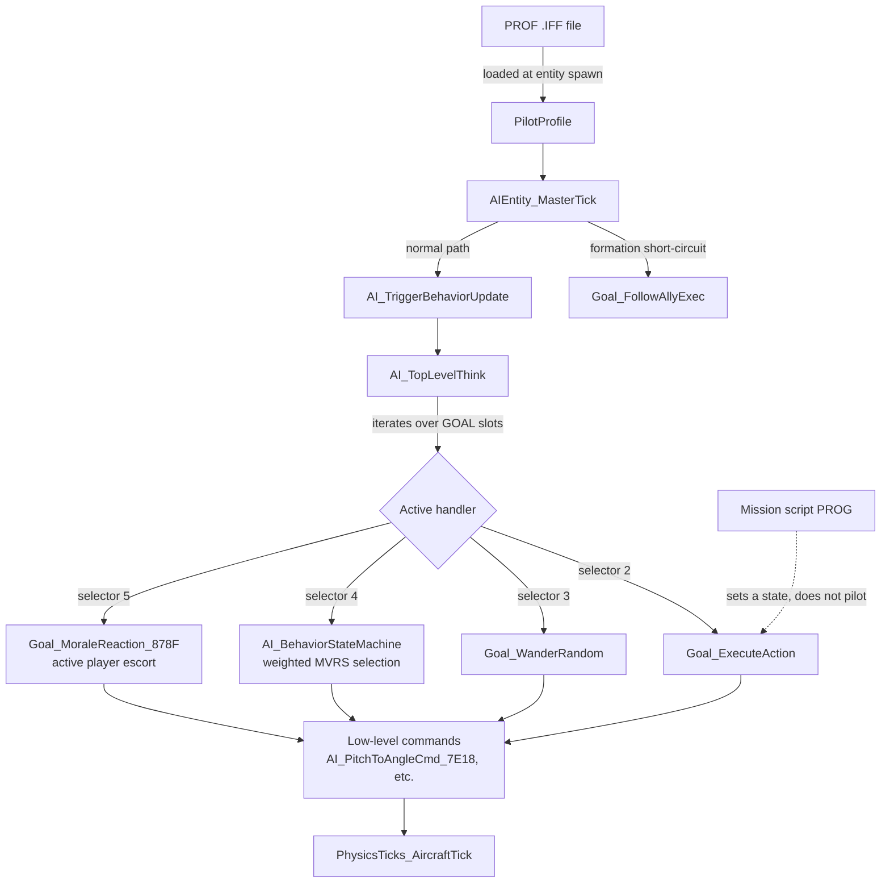

The mission script never drives the AI directly: it **sets a persistent
state** on the entity, which the tick loop consults and honors at its own
pace. This is a clean decoupling between script and execution.

---

## 2. The `PROF` File Format

### 2.1 Container format (IFF)

Standard IFF: each chunk = 4-byte ASCII tag + 4-byte **big-endian** length
+ data (padded to an even length if needed). `FORM` is a container chunk
whose first 4 data bytes are a type, followed by sub-chunks.

### 2.2 Full structure, confirmed by reading the loader and
validated on 7 real PROF files

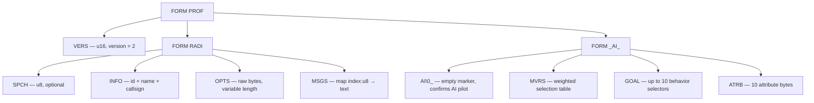

| Chunk | Content | Status |
|---|---|---|
| `VERS` | `u16` big-endian, always `2` in the 7 PROF samples | confirmed |
| `SPCH` | Single `u8`. **Optional** — absent in some files (e.g., one of the two cargo files). If present and a global memory condition is met, triggers loading of an `INTEL\SPEECH\*.PAK` file | confirmed (reading), open hypothesis (exact role of the value) |
| `INFO` | `u16` id + C string (name) + C string (callsign) | confirmed |
| `OPTS` | Sequence of ASCII lowercase letters, length 0 to 8+ depending on the file — **list of questions/orders that can be asked of this character by radio** (one letter per available option) | confirmed (information from Rémi + traced consumer, see §2.4) |
| `MSGS` | Series of `(u8 index, C string)` — radio lines. Indices form a **fixed vocabulary shared across the whole game** (e.g., index `0x11` always corresponds to "incoming missile!"); each file only provides the lines relevant to that character | confirmed |
| `AI\0_` | Empty chunk (length 0), presence marker only | confirmed |
| `MVRS` | See §3 | confirmed (structure and consumer) |
| `GOAL` | See §4 | confirmed |
| `ATRB` | 10 bytes **read sequentially** from the file — 9 correspond to named statistics documented in the official game manual (confirmed by Rémi), on a 0-16 scale each. The 10th byte has no known name (see §2.3). If absent or wrong size → non-zero defaults applied by the engine | confirmed, names validated by the manual |

### 2.3 `ATRB` detail — named statistics and reading order

**Confirmed by the official game manual** (provided by Rémi): the first 9
bytes of the chunk correspond to named personality/skill statistics, each
on a scale from 0 to 16:

| # | Code | Name | Meaning (0 → 16) |
|---|---|---|---|
| 0 | `TH` | Trigger Happy | cautious → spendthrift (fires readily) |
| 1 | `CN` | Confidence | easily scared → very hard to scare |
| 2 | `VB` | Verbosity | never talks → talks a lot (radio) |
| 3 | `LY` | Loyalty | never follows orders → always follows orders |
| 4 | `FL` | Flying | no skill → best skill |
| 5 | `AG` | Air-to-Ground | no skill → best skill |
| 6 | `AA` | Air-to-Air | no skill → best skill |
| 7 | `SM` | Showmanship | doesn't show off → very showy |
| 8 | `AR` | Aggressiveness | cautious → aggressive |

**Exact empirical validation**: the 9 values decoded for Billy
(`10,14,12,13,15,9,15,16,15`) match **position by position, without
exception**, those published in the game manual for "Billy "Primetime"
Parker". This confirms that the `ATRB` chunk is read in this exact order,
without rearrangement, which matches the direct reading confirmed in
`libRealSpace` (`ReadByte()` × 9, in this precise order).

> ⚠️ **Corrected 2026-09-25: memory order ≠ file order.** The file is read in
> this order, but `PilotProfile_LoadATRB_12E47` stores the bytes at profile
> `+0x97, +0x99, +0x98, +0x9A, +0x96, +0x9B, +0x9C, +0x9D, +0x9E, +0x9F`, and
> the profile lives at `entity+0x1A`. On the entity: `+0xB0` = **FL**, `+0xB1` =
> TH, `+0xB2` = VB, `+0xB3` = **CN**, `+0xB4` = **LY**, `+0xB5` = AG, `+0xB6` =
> AA, `+0xB7` = SM, `+0xB8` = AR. The table in §6ter (assumed sequential reading)
> is wrong for `+0xB0`, `+0xB1`, `+0xB3`, `+0xB4`. Details and consumers:
> `IMPL_SCAIBRAIN_CORRECTIONS.md` §0bis.

**The 10th byte** (value `1` for Billy) **has no name in this manual
excerpt** — either a statistic not documented on the page provided, or a
reserved/padding byte. Still open.

The game's internal loader (`PilotProfile_LoadATRB_12E47`, seg010, vtable
method) then copies these 10 bytes to **non-sequential** offsets in the
`PilotProfile` structure — an internal implementation detail of
`STRIKE.EXE`, with no bearing on understanding the **file format** itself:

| File byte | Stat | Internal memory offset | Default if absent |
|---|---|---|---|
| 0 | `TH` | `+0x97` | 8 |
| 1 | `CN` | `+0x99` | 8 |
| 2 | `VB` | `+0x98` | 8 |
| 3 | `LY` | `+0x9A` | 8 |
| 4 | `FL` | `+0x96` | 10 |
| 5 | `AG` | `+0x9B` | 10 |
| 6 | `AA` | `+0x9C` | 10 |
| 7 | `SM` | `+0x9D` | 8 |
| 8 | `AR` | `+0x9E` | 8 |
| 9 | (unnamed) | `+0x9F` (**clamped to a maximum of 3**) | 0 |

Bytes 4, 5, 6 (`FL`/`AG`/`AA`) are duplicated at `+0xA0`, `+0xA1`, `+0xA2`
(mirror storage, same pattern as the "current value + default value" system
found elsewhere).

**For a port**: reading 10 sequential bytes into an array is sufficient if
the original game's internal memory order does not need to be reproduced
exactly.

### 2.4 `OPTS` detail — the character's radio menu

Confirmed by external information from Rémi, then verified by tracing the
consumer in the disassembly: each lowercase letter in `OPTS` represents a
**question or order** that can be asked of this character by radio.

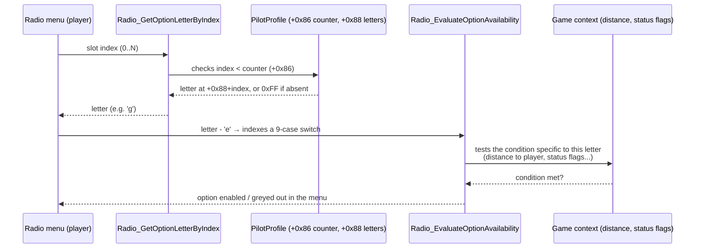

**Two distinct levels**:

1. **Static** (loaded from `PROF`): `OPTS` lists the options this character
   *supports in principle* — `Radio_GetOptionLetterByIndex_1F200` returns the
   letter at a given index (or `0xFF` if the index exceeds the character's
   number of options).
2. **Dynamic** (computed at each query): `Radio_EvaluateOptionAvailability_1642C`
   takes this letter, computes `letter - 'e'` to index a 9-case switch
   (letters `e` to `m`), and determines whether that specific option is
   **currently** available — for example, letter `f` (case 1) computes the 3D
   distance between the player and the entity and compares it to a threshold
   (`0x1388` = 5000, probably radio/visual range); letters `g`/`h`/`k` check
   global status flags (probably combat/lock-on mode).

**Consistency with real files**: Billy and Gwen (active teammates, §8) each
have 8 letters (`dihgjklm`) — a rich radio menu. Hammer (non-interactive NPC)
has an **empty** `OPTS` — no questions available, consistent with his
non-interactive status. Cargo pilots have only a handful. Unresolved point:
the letter `d`, present in Billy/Gwen, falls **outside** the range handled by
this switch (`e`-`m`) — probably handled by a separate mechanism (an
"always available" option, such as an acknowledgement/greeting).

---

## 3. `MVRS` — weighted random selection system

### 3.1 Real memory structure

**Important correction**: unlike earlier documentation, there are **not** two
separate mechanisms ("8 fixed fields" + "extensible list"). It is **a single
contiguous table**, with a 5-byte stride, starting at `PilotProfile+0x202`:

```
struct MvrsEntry {
    far_ptr  node;        // 4 bytes — pointer to an OBJECT (data), not a
                           // function. This object holds at its offset 0 a
                           // value later used to find a function table
                           // (mechanism not fully elucidated, see §3.7);
                           // only at call time, through [vtable+4]/[vtable+8],
                           // is a real function pointer reached and invoked.
    int8_t   raw_value;   // 1 byte  — signed value from the PROF file
};                          // 5 bytes per entry

MvrsEntry table[N];  // N = integer stored at PilotProfile+0x200
```

The first 8 slots of the table correspond to the identifiers the engine
recognizes natively (see §3.2) and are **always** built by the loader,
whether or not the file provides them. Any additional identifier present in
the file is appended to the same table (`PilotProfile+0x22A` and beyond), and
the counter `+0x200` (initialized to 8) is incremented at each addition.

### 3.2 The 8 always-built identifiers, and their bias field

Each identifier, when the default node is built
(`PilotProfile_ResolveNamedPropertyNode_742FC`, a 21-case switch — confirmed,
a single occurrence of this switch in the entire binary, exhaustive search
performed), receives a "tag" value (`node[0]`) which is later used as a direct
offset to resolve this node's virtual methods, in a descriptor table at seg339
(19 valid slots out of 21 possible; `ID=17`/`18` both point to the default
case — invalid).

**Mechanism confirmed by exhaustive reading of `PilotProfile_LoadFromPROF_73B4F`**:
these 8 identifiers are built **once, permanently and unconditionally**, early
in loading — regardless of the contents of the file's `MVRS` table. If the file
**also** lists one of these 8 identifiers, its value **does not create** a new
tournament entry — it is intercepted by a chain of special cases and stored as
a **configuration bias** in a dedicated field on the already-built node:

> **Clarification 2026-09-25**: this "bias field" is in fact **the weight byte of
> the node's entry in the tournament table** (entries 0 to 7, 5 bytes starting at
> `entity+0x202`). The 8 fixed nodes therefore always compete in the tournament,
> with weight 0 if the file does not cite them, and the sample files do cite them
> (Billy/Stern/Hammer list 1 to 13, including 4 and 7). See
> `AI_TICK_CALL_GRAPH.md`, "`GOAL` and the `MVRS` tournament".

| ID (dec) | Node tag | Bias field (if present in file) |
|---|---|---|
| 4 | `0x264` | `+0x229` |
| 7 | `0x228` | `+0x21F` |
| 14 | `0x19C` | `+0x20B` |
| 15 | `0x188` | `+0x210` |
| 16 | `0x174` | `+0x215` |
| 19 | `0x160` | `+0x224` |
| 20 | `0x14C` | `+0x206` |
| 21 | `0x138` | `+0x21A` |

**Only the remaining 13 identifiers** (`1,2,3,5,6,8,9,10,11,12,13`, plus the 2
invalid `17`/`18` with no effect) go through the **9th and last call site** of
the constructor — the dynamic one, in the loop reading the file's `MVRS` table —
to create genuinely new tournament entries. This is why the sample files
(Billy, Stern, Hammer: up to 13 entries; Gwen: 10; the C-130 cargo: only 3)
never list the 8 fixed identifiers — they don't need to in order to exist.

### 3.3 Full loading pseudocode — node construction and file reading

Reconstructed from a line-by-line reading of `PilotProfile_LoadFromPROF_73B4F`
(addresses such as `+0x202` are those of the unified table in §3.1).

```c
void LoadMVRS(PilotProfile* p, FileReader* file) {

    // ── PHASE 1: construction of the 8 default nodes ───────────────────
    // Unconditional — runs whether or not the file contains MVRS.
    // The 8 identifiers are HARD-CODED CONSTANTS in the program, never
    // read from the file at this stage. The code is fully unrolled (8
    // identical blocks repeated), not a loop.

    static const uint8_t KNOWN_IDS[8] = {0x14, 0xE, 0xF, 0x10, 0x15, 0x7, 0x13, 0x4};
    static const int PRIMARY_OFFSET[8]   = {0x202, 0x207, 0x20C, 0x211, 0x216, 0x21B, 0x220, 0x225};
    static const int SECONDARY_OFFSET[8] = {0xC1,  0xC5,  0xC9,  0xCD,  0xD1,  0xD5,  0xD9,  0xBD};

    for (int i = 0; i < 8; i++) {
        FarPtr node = PilotProfile_ResolveNamedPropertyNode(p, KNOWN_IDS[i]);
        *(FarPtr*)(p + PRIMARY_OFFSET[i])   = node;   // pointer, primary slot
        *(FarPtr*)(p + SECONDARY_OFFSET[i]) = node;   // same pointer, duplicated
    }

    // ── PHASE 2: reset of the 8 raw values ──────────────────────────────
    for (int i = 0; i < 8; i++) {
        *(uint8_t*)(p + RAW_VALUE_OFFSET[i]) = 0;   // +0x206, +0x20B, +0x210...
    }

    // ── PHASE 3: chunk presence check (non-blocking) ────────────────────
    bool found = ResourceRecord_SeekAndRead(file, "MVRS", &chunk_buffer);
    if (!found) {
        ReportDiagnostic(0x8001);   // logged warning, NOT an abort
    }
    // the rest ALWAYS runs, whether or not the chunk was found
    // (if absent, chunk_length is 0 and the loop below does nothing)

    int entry_count = chunk_length / 2;    // number of (id, value) pairs in the file
    FarPtr write_cursor = p + 0x22A;        // cursor for the extensible list
    p->mvrs_total_count = 8;                 // counter, starts at 8 (the fixed ones)

    // ── PHASE 4: sequential reading of pairs FROM THE FILE ──────────────
    for (int i = 0; i < entry_count; i++) {
        uint8_t id = ReadByte(file);          // actual read from the file

        // SEQUENTIAL comparison against the 8 known identifiers
        // (8 cmp/jnz in a chain in the disassembly, not an array search)
        int match = -1;
        for (int k = 0; k < 8; k++) {
            if (id == KNOWN_IDS[k]) { match = k; break; }
        }

        if (match >= 0) {
            // KNOWN ID: only overwrites the raw value of the already-built node
            uint8_t value = ReadByte(file);   // 2nd actual read from the file
            *(uint8_t*)(p + RAW_VALUE_OFFSET[match]) = value;
        } else {
            // UNKNOWN ID: builds a NEW node on the fly and
            // appends it to the end of the extensible list
            FarPtr node = PilotProfile_ResolveNamedPropertyNode(p, id);
            *(FarPtr*)write_cursor = node;               // pointer (4 bytes)
            uint8_t value = ReadByte(file);               // 2nd actual read
            *(uint8_t*)(write_cursor + 4) = value;         // value (1 byte)

            write_cursor += 5;              // size of one entry
            p->mvrs_total_count++;           // increments the global counter
        }
    }
}
```

**Key points**:

- The 8 "native" nodes **always** exist, with valid pointers, even if the file
  mentions no `MVRS` at all — only their raw value stays at `0` (default) if the
  file does not overwrite it.
- The file is **actually read** only from phase 4 onward — everything before
  (phases 1-2) uses only program constants.
- A file identifier matching one of the 8 known ones **does not build a new
  node** — it only overwrites the raw value of an existing node. An unknown
  identifier builds a **complete** node (pointer + value) and appends it to the list.
- Once in memory, the distinction disappears: `AI_BehaviorStateMachine` (§3.5)
  walks a single contiguous table, without knowing which entries were "fixed" and
  which were added dynamically.

### 3.4 The property node — what is written, what is read

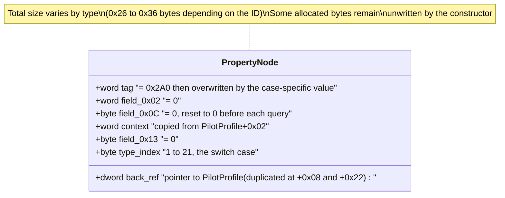

### 3.5 The consumer — `AI_BehaviorStateMachine` (`GOAL` handler, selector 4)

**This is the central discovery of this investigation**: the function
`AI_BehaviorStateMachine_WeightedOptionSelector_9D05` (one of the 4 handlers
selectable by `GOAL`) walks the **entirety** of the `MVRS` table and performs a
weighted random selection.

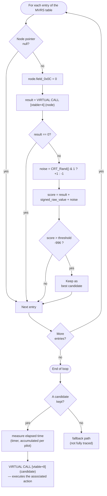

**Full reconstructed pseudocode:**

```c
// AI_BehaviorStateMachine_WeightedOptionSelector (GOAL handler, selector 4)
// TOURNAMENT mechanism precisely confirmed (true search for the best score):
int AI_BehaviorStateMachine(Entity* entity) {
    PropertyNode* best = NULL;
    int best_score = -996;   // starting floor (0xFC18 signed) — very low,
                              // accepts almost any valid candidate

    MvrsEntry* table = &entity->mvrs_table;  // base = PilotProfile+0x202
    int count = entity->mvrs_count;           // PilotProfile+0x200

    for (int i = 0; i < count; i++) {
        MvrsEntry* entry = &table[i];
        if (entry->node == NULL) continue;

        entry->node->field_0x0C = 0;
        int weight = call_virtual(entry->node, /*slot*/ 4);   // [vtable+4]
        if (weight == 0) continue;

        int noise = (rand() & 1) ? +1 : -1;
        int score = weight + entry->raw_value /* signed */ + noise;

        if (score > best_score) {           // the previous champion loses its
            if (best != NULL) {              // "selected" flag (field+2 = 0)
                best->field_0x02 = 0;
            }
            best_score = score;              // the threshold BECOMES the new
            best = entry->node;              // best score: true argmax,
        }                                     // not a fixed threshold
    }

    if (best != NULL) {
        int now = read_timer();                          // sub_27144
        int elapsed = now - last_sample_time;
        per_pilot_accumulator_table[pilot_id] += elapsed;  // word_704E6+0x5B56/+0x5B60

        call_virtual(best, /*slot*/ 8);   // [vtable+8] — applies/executes the option
        return 1;  // "I acted this tick"
    }

    // fallback path — not fully traced
    return fallback_behavior(entity);
}
```

**CORRECTED (2026-09-19)**: this pseudocode only shows the scoring loop.
The function starts with priority reactions, requires a **target**
(`entity+0x287`) or directly applies the node `entity+0xD9`, then calls
`AI_BehaviorSelector` (firing and guidance toward the target) before scoring.
Scoring only happens if this function returns 0 **and** `entity+0x0D` is
zero. Inside the loop, the noise is **±1** (`test ax, 1`, never 0), the
starting floor is **−1000**, and the score returned by `[vtable+4]` is a byte.
Details, with citations, are in `AI_TICK_CALL_GRAPH.md` (section "The `MVRS`
tournament: entry conditions").

**Interpretation**: each `MVRS` entry represents a **candidate behavior/maneuver
option**. Its selection score combines:

1. a **base weight computed dynamically**, depending on the option's type (the
   node's virtual method `[vtable+4]` — **the same method** consulted by
   `Entity_ProximityTest_ThreatGate` in a target-scanning context, confirming that
   `[vtable+4]` is a generic "score/weight" idiom reused throughout the engine);
2. a **pilot-specific modifier** — the signed value from the `PROF` file;
3. **random noise** (±1).

### 3.6 Another confirmed consumer: the target-scanning loop

Independently of the selection mechanism above, the node of property `ID=20`
(tag `0x14C`) specifically is **also** consulted during new-target scanning:

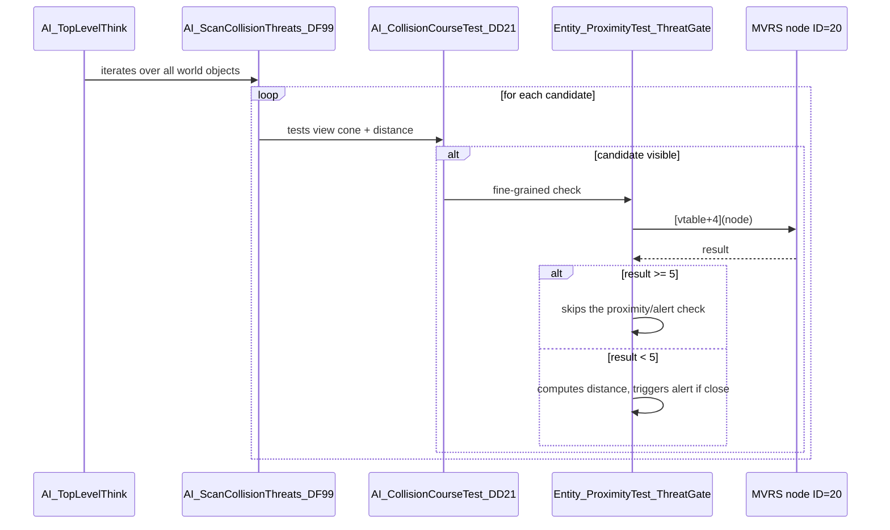

This same infrastructure (`AI_CollisionCourseTest_DD21`) is also invoked from
threat-evaluation code in `seg008`, suggesting it is **shared** between the AI's
target scanning and the reaction to incoming threats (missiles).

**Important methodological point**: for a given pilot, only the identifiers
**actually present in its `.IFF` file** are relevant to the dynamic `MVRS` table —
but `ID=20` is one of the **8 identifiers always built by default** (§3.2), so this
mechanism applies to all AI pilots regardless of the contents of their file.

**Important methodological point (2)**: the weighted selection mechanism of §3.5
does **not** trigger unconditionally on every tick — only when the `GOAL` loop
(§4.2) reaches a slot configured with selector `4`. If the pilot has no `4` in its
`GOAL` list, or if a higher-priority slot has already acted this tick, `MVRS` is
never consulted. `GOAL` therefore remains the top-level control structure; `MVRS`
is just one of the 4 behaviors that one of its slots can trigger.

### 3.6bis The full node class finally located — `ovr229`

**Major discovery**: starting from the generic constructor
(`PilotProfile_NamedPropertyNode_Construct_755A0`) and examining everything around
it in its overlay, the **full class** was found. `ovr229` contains only **5 functions,
161 lines in total** — confirming that a VROOMM overlay corresponds here precisely to
**a single source file / a single C++ class**:

| Function | Role |
|---|---|
| `PilotProfile_NamedPropertyNode_Construct_755A0` | Constructor (already documented, §3.3) |
| `Behavior_PopFinished_75612` | Copies fields, calls the target's `[vtable+0x1C]` **if a condition is true** (argument `1`) |
| `NotifiableRef_DetachTarget_75661` | Unconditional variant of the previous one (argument `0`), resets fields to zero |
| `Behavior_PushRunning_756A4` | Swap operation (reads then writes a field of the target) |
| `NotifiableRef_Destructor_756D5` | True destructor (Borland *ScalarDeletingDtor* convention) |

**The true destructor reveals the full lifecycle**: it sets `node[0]=0x2F8` (same
temporary tag as the constructor), calls `WeakRef_InvalidateFar` (the "release"
counterpart of `SetReference`, already documented in the weak-reference registry,
`seg081`) to invalidate the reference established at construction, then —
conditionally — calls `Memory_TypedFree_5C7B6` (tag `0x5C44`) to actually free the
memory. A classic, complete C++ lifecycle.

**Major, unexpected connection**: `NotifiableRef_DetachTarget_75661` is called via
`VROOMM_StubThunk_6AB54` — **the same thunk** that had been seen invoked repeatedly in
`AIEntity_MasterTick_5ACC` and `AI_ProximityGeometricWarning_315B` to "notify the
target", **without ever having made the link with the class of `MVRS` nodes**. This
reveals that this class is **not reserved for `MVRS` property nodes** — it is a
generic **notifiable reference** class, reused throughout the AI's target-tracking system.

**A newly discovered vtable slot**: `[vtable+0x1C]`, in addition to the `[vtable+4]`/
`[vtable+8]` already identified (§3.4/§3.5) — confirming that the class has at least
these three distinct virtual methods, not counting the destructor.

**Method that enabled this discovery** (to remember for later): start from a certain
anchor point (here, the constructor) and read **the entire overlay containing it**,
rather than searching by function name — the 4 sister functions still carried the old
erroneous name `TargetTrackObject_*` from an initial quick scan, never re-verified
since the constructor itself was corrected.

### 3.6ter The true constructor/destructor of the AI entity found —
a 4th vtable slot, and proof that `MVRS` is truly owned

Continuing the same method in `ovr228` (the overlay of the identifier selector
`sub_742FC`), a block of 30 functions massively misnamed by the quick scan
("AircraftDamageModel", "AircraftDamageComponent[Family]") turned out to be something
else entirely: **the actual constructor and destructor of the AI entity itself** — the
one holding `goal_state` (`+0x11D`), the `GOAL` table (`+0x1B0`) and the `MVRS` table
(`+0x200`/`+0x202`), and whose class vtable contains `AIEntity_MasterTick_5ACC` at
`+0xC` (confirmed: the data `unk_6D1B8` used by the constructor — 8 zero bytes — is
physically followed, in memory, by this same class vtable).

**`AIEntity_Construct_74B43`** (196 lines) — inherits from a base class `WorldObjectA`
(confirmed: first call to `WorldObjectA_Method_ClearField2_738DA`), then initializes
notably:

- `goal_state` (`+0x11D`) = **`0xFFFF`** — the sentinel value meaning "no active goal"
  for a freshly built entity, before any `PROF` loading.
- Default position (`+0x111/+0x115/+0x119`) = **(0, 0, 0x3E800)** — the same altitude
  offset (1000 in 24.8 fixed point) found in `Goal_MoraleReaction_878F` for formation
  positioning.
- `+0x200` (`MVRS` counter) = 0, `+0x202` (first `MVRS` pointer) = 0 — confirms the
  `MVRS` table starts **strictly empty**, before `PilotProfile_LoadFromPROF_73B4F`
  populates it.
- Weak references established on `+0x10F/+0x137/+0x145/+0x147` — the same target
  fields already encountered in `Goal_IsComplete` and `Goal_MoraleReaction_878F`.
- Three new undecoded constants: `+0x139=30000`, `+0x13D=512000`, `+0x141=64000`.
- Clears the first `GOAL` slot (`+0x1B0`, 8 bytes), and unpacks/repacks status bits at
  `+0x28B/+0x28C` — exactly the same pattern observed at the very start of
  `AIEntity_MasterTick_5ACC`.

**`AIEntity_Destruct_74E1C`** (142 lines) — the most important discovery in this section:

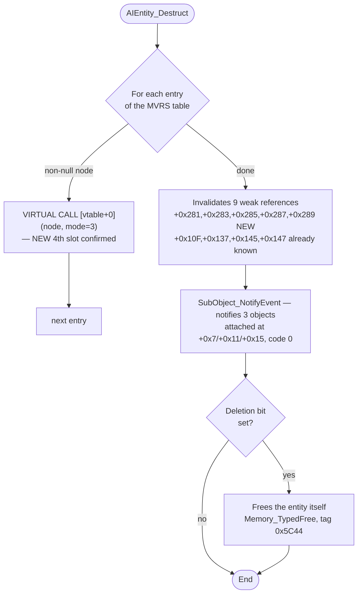

**What this definitively proves**: the AI entity truly **owns** its `MVRS` nodes (not
mere shared references) — it destroys them one by one, calling on each its own virtual
method `[vtable+0]` with argument `3` (deletion mode). This is the **fourth confirmed
vtable slot** on this node class, in addition to `+4` (score, §3.5), `+8` (application,
§3.5) and `+0x1C` (attach/detach, §3.6bis):

| Vtable slot | Confirmed role |
|---|---|
| `+0x00` | Per-type destructor (called in a loop by `AIEntity_Destruct_74E1C`) |
| `+0x04` | Score/weight computation (§3.5, `AI_BehaviorStateMachine`) |
| `+0x08` | Application/execution of the chosen option (§3.5) |
| `+0x1C` | Attach/detach (notification, §3.6bis) |

**Update**: this wall has since been breached (§3.7) — the body of these methods is not
in an untraceable dynamic pool, but in a **static table of vtables located directly in
`seg339`**, one per type, addressable as soon as the tag is known. The 8 score functions
and the generic destructor have been read in full; see §3.7 for full details and the
table of the 8 types.

### 3.6quater Third confirmed consumer: escort-squadron leader succession

`Escort_LeaderSuccession` (discovered while re-reading `seg006` in full) touches the
`MVRS` node in two distinct ways within its own internal switch:

- **"Leader dead/out-of-game" case**: computes the distance to the escort target (via
  `[vtable+0x3C]` on it, as in `Player_ShotDownSequence_7B035`, formerly
  `MissionRecord_LoadEntityDatabase_7B035`), compares against a threshold, then calls
  **`[vtable+8]` directly on the `ID=20` node** (`+0xC1`) — the same finalization idiom
  as `Entity_ProximityTest_ThreatGate` and `AI_BehaviorStateMachine`, in a third context
  unrelated to the first two.
- **"Periodic re-check" case**: verifies that a minimum delay has elapsed (60 units, same
  time fields as `AIEntity_MasterTick`) **before** calling
  `AI_BehaviorStateMachine_WeightedOptionSelector` — confirming an explicit rate-limit on
  `MVRS` solicitation from this specific entry point.

**Summary of confirmed consumers to date**: `AI_BehaviorStateMachine` (§3.5, via `GOAL`
selector 4), `Entity_ProximityTest_ThreatGate` (§3.6, target scanning), and
`Escort_LeaderSuccession` (above, leader succession) — three independent entry points,
all consulting `[vtable+4]` and/or `[vtable+8]` on the same nodes, confirming that this
mechanism is a genuine **shared service** in the engine, not a feature isolated to a
single subsystem.

### 3.7 ⭐⭐⭐⭐⭐⭐⭐⭐⭐⭐ THE WALL BREACHED — the score and application functions
finally located

After several days of fruitless searching (dynamic allocation pool not found,
neighboring overlays ruled out one by one), the key turned out to be a **misreading of
an assembly instruction**: the `call dword ptr [bx+4]` instruction (without an explicit
segment prefix) had been assumed to operate in the node's own segment — whereas without
a prefix, x86 uses **`DS` by default**, and `assume ds:seg339` applies in all the segments
concerned. **`node[0]` is therefore not an offset into a dynamic heap: it is a direct
static offset into `seg339`**, the same global data segment that contains the class
vtables already encountered.

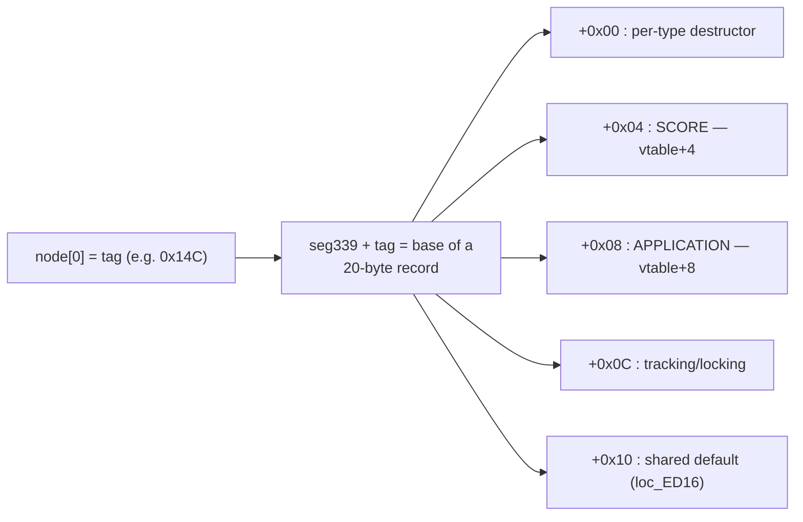

**Each property type has its own 20-byte record in `seg339`, at the exact offset given by
its tag.** No dynamic pool, no on-the-fly construction for this part — a genuine static
table of miniature vtables, one per type, directly addressable once the tag is known.

#### `ID=19` fully decoded — the ground-attack node (`GroundAttack_CanEngage_77000` / `GroundAttack_Start_7709A`) — rewritten 2026-09-25

*(Tag `0x160`, distinct from the `ID=20`/tag `0x14C` node discussed in §3.6.)*

> **Correction 2026-09-24/25.** The previous version of this section interpreted this node
> as "prepare/select a weapon" with a "100,000-unit lock timer". A full re-reading shows
> it is the entity's **permanent ground-attack node** (`entity+0xD9`), and that
> `node+0x30 = 100000` is a **sentinel distance** (the initial "miss"), not a timer.
> Full description: `AI_TICK_CALL_GRAPH.md`, section "Ground attack", and `NOTE_ATTAQUE_SOL.md`.

- **Method `+4`, `GroundAttack_CanEngage_77000`**: target = acquired ground target
  (`+0x283`), otherwise mission target (`+0x137`). Returns **5** if `node+0x13 == 0`
  (direction not traced), if the target is on the ground (`target_type == 2`) and if an
  air-to-ground weapon is loaded (`WeaponStation_FindLoadedCompatible(loadout, 0xFC)`:
  identifiers 3 to 8, **not the gun**); otherwise 0.
- **Method `+8`, `GroundAttack_Start_7709A`**: the node becomes the running behavior
  (`Behavior_PushRunning_756A4`, `entity+0x0D`); phase `node+0x26 = 0`, approach timer
  `node+0x0D = 2 s`, cached target `node+0x27`, weapon released `node+0x29 = 0`, chosen
  weapon `node+0x34 = 0`, sentinel distance `node+0x30 = 100000`; without a target:
  `Behavior_PopFinished_75612`. Then method `+0xC`.
- **Method `+0xC`, `GroundAttack_PhaseDispatch_77215`**: a 5-phase state machine (approach,
  return, handover to physical autopilot, release, disengage), called on every tick as long
  as the node is the running behavior.
- **Triggers**: `Goal_ExecuteAction_A8AC` (order "destroy the target" with a ground mission
  target) and `AI_BehaviorStateMachine_WeightedOptionSelector_9D05` (acquired ground target
  and "new target allowed").

#### Full, corrected summary of the 19 valid `MVRS` identifiers

*This table replaces an earlier version that contained a systematic attribution offset
(each function read had been associated with the wrong numeric identifier). Each row below
has been re-verified by direct anchoring on the absolute labels of the `seg339` table
(method: IDA's `off_6DXXX` labels give the real absolute address of each slot, allowing a
precise recalculation of which identifier corresponds to which function — not a deduction
by proximity or reading order), then each score **and** application function was read in
full.*

| ID | Tag | Score — actual content | Application — actual content |
|---|---|---|---|
| 1 | `0x2B4` | Angular, base 5, guards `byte_720C3`/`word_72093`, `sub_564A`/`sub_56E5` | Full geometric computation (3D position delta via `[vtable+0x3C]`/`[vtable+0x4C]`, length via `sub_5828E`), sets `node+0x26=0/1`, **directly calls the application of `ID=20`** (`entity+0x22→+0xC1→vtable+8`) (`loc_EEA0`) |
| 2 | `0x28C` | `MVRS_ID2_Score_3FCB` (corrected 2026-10-11: the "always 10" of `sub_EC22` is the base-class score, tag `0x2A0`): base 5, **zero if the entity is an aircraft** (`byte_720DF`), so never chosen by an AI aircraft | Left/right break, coin flip if ambiguous (`loc_F2C8`) |
| 3 | `0x278` | Simple angular (no `sub_564A`/`sub_56E5`), `TH` adjustment `/4` | Generic timer `0x400` (`loc_F6C2`) |
| 4 | `0x264` | Extended angular, double threat threshold (`dword_720CD` vs two thresholds) | **Complete interception solution**: `Angle_DeltaNormalized_A`, sets bit0/1 of `entity+0x32`, writes anticipated position into `node+0x26/2A/2E` (`loc_FCE1`) |
| 5 | `0x250` | Rich sub-mode, time window `dword_720D9`, reads `aircraft+0x8B` — **triggers the 8-phase Immelmann/Split S sequence** (`node+0x26=1` if `dword_72034` exceeded) | Timer `0x500` (5 s), phase set by the score (`loc_100B6`) |
| 6 | `0x23C` | Sensor range guard (`dword_7203D+0xFA000`), different sub-mode (`node+0x26=2`) | Timer `0x500` alone — the phases live in the tracking at `loc_10673` |
| 7 | `0x228` | Base 1 (floor), guard `flags_75` bit6/`TH`, sets `entity+0x32` bits, writes interception position | Reads these same bits to choose the timer (`0x100`/`0x200`/`0x400` depending on sensor) (`loc_10AF2`) |
| 8 | `0x214` | **Always 0** (re-read 2026-09-25: empty score, never chosen) | Complete maneuver "line up behind the target, 100 on its axis, at 900" (`MVRS_ID8_TickShadowTarget_111AE`), unreachable |
| 9 | `0x200` | **Always 0** (re-read 2026-09-25) | Empty: ends immediately |
| 10 | `0x1EC` | **Always 0** (re-read 2026-09-25) | Empty: ends immediately |
| 11 | `0x1D8` | **Always 0** (re-read 2026-09-25) | Empty: ends immediately |
| 12 | `0x1C4` | **Always 0** (re-read 2026-09-25) | Empty: ends immediately |
| 13 | `0x1B0` | Base 1: **altitude gain** (corrected 2026-09-25, not Scissors/Rollaway) — requires not being too slow and being below the `JDYN+0x86` ceiling; favored if faster than the target and far away (> 17,700 = `dword_7202C`) | Timer `0x400`, phase 1; tick `MVRS_ID13_TickZoomClimb_113FD`: heading toward the target then a 30–60° zoom climb |
| 14 | `0x19C` | **Ground avoidance** (corrected 2026-09-25) — `0` or `10`: no target, autopilot off, too close to the ground | Fixed node `entity+0xC5`, launched by the reflex `AI_GroundAvoidReflex_E06C` (level 4): pitch +30°, full throttle |
| 15 | `0x188` | **Nose-up recovery / stall recovery** (corrected 2026-09-25) — `0` or `10` | Fixed node `entity+0xC9`, launched by `AI_StallRecoveryReflex_E159` (level 5): idle or full throttle, pitch −30° |
| 16 | `0x174` | **CORRECTED, read in full**: `var_4` is hard-initialized to `0`, making the `0x900` capping branch unreachable — the final result depends on only one test (`TH < 12`) and the returned value is in fact **`0` or `1`** (reading a shifted byte, `[bp-3]`, not `[bp-4]`) — **not the continuous `0x100`-`0x900` scale documented earlier** | **Regain speed** (corrected 2026-09-25, not a return to baseline): max speed, pitch +5° |
| 19 | `0x160` | **Ground attack** (corrected 2026-09-25) — `GroundAttack_CanEngage_77000`: target `entity+0x283` otherwise `+0x137`, `target_type == 2`, `node+0x13 == 0`, air-to-ground weapon loaded (mask `0xFC`) → `5`, otherwise `0` | `GroundAttack_Start_7709A`: pushes the node as the running behavior and starts the phase machine (`GroundAttack_PhaseDispatch_77215`); `node+0x30 = 100000` is a sentinel distance, not a timer |
| 20 | `0x14C` | **Always 0** — but used as a **shared geometric tool outside the tournament**, referenced directly via `entity+0xC1`, consumed by `AI_ProximityGeometricWarning_315B` for a proximity/collision alert, **and directly by the application of `ID=1`** | `loc_1195A` |
| 21 | `0x138` | **Always 0** (never in the tournament) | **Physical autopilot navigation** (`MVRS_ID21_ApplyAutopilotNav_11AC4`), called directly via `entity+0xD1` (re-read 2026-09-25) |

`ID=17`/`18`: invalid — the constructor's jump table points both to the default case
(no node built).

> **Re-read 2026-09-25**: identifiers 8 to 12 have been traced in full (scores,
> applications, ticks, all access paths). Result and verified method table:
> `AI_TICK_CALL_GRAPH.md`, "The `MVRS` identifiers 8 to 12". In short: scores always zero
> (the tournament excludes them), IDs 9 to 12 empty, ID 8 = complete "line up behind the
> target" maneuver but unreachable.

**On identifiers `8,9,10,11,12` (correction — see methodological note below)**: in the only
path read so far, each calls `sub_EC22` (thus writes a position copy into
`node+0x15/0x19/0x1D`) then returns 0 with no further computation; the tournament loop
(`AI_BehaviorStateMachine_WeightedOptionSelector_9D05`) structurally excludes any entry with
an exactly zero score before even the random draw — **but this reading is incomplete, not a
definitive conclusion.** A search for a reader of the write to `node+0x15/0x19/0x1D` turned up
nothing, which — in line with this project's methodological rule ("if you can't find the
mechanism, you're searching wrong, not that it doesn't exist") — signals a search to resume
rather than proof of absence. Rémi explicitly disputes the previously drawn conclusion
"empty shell / never implemented": these identifiers remain to be traced before any claim about their real role (or absence). Verified on the 4 sample files (fact, not interpretation): Billy/Stern/Hammer list all 13 entries `1`-`13` (including `8`-`12` at value `0` in the file); Gwen references `1`-`7` then `11,12,13` (without `8,9,10`); the C-130 cargo has only `3,4,13`.

### 3.8 Beyond the 8 fixed ones — the "extensible" identifiers decoded
on a real case (Billy)

The 8 types of §3.7 are those **always built by default**, but `sub_742FC` actually
handles a switch with **21 cases** — one per possible identifier (1 to 21, minus 2 invalid
slots at 17/18), verified by exhaustive search (a single occurrence of this switch in the
whole binary). Billy's file uses identifiers `1` to `13` — see the complete, corrected table
in §3.7bis for the details of each. Of these 13, **7 have genuine graded scoring logic**
(`1,2,3,4,5,6,7`), `13` has a rich and distinct formula (altitude-gain trigger, re-read
2026-09-25), and the **next 5 (`8` to `12`) return 0 in the only code path read so far** —
see the correction note below; this last point is not a settled conclusion.

**Correction note (later session, following Rémi's explicit disagreement)**: an earlier
version of this section concluded here that these 5 identifiers (and `21`, see §3.7) "were
never actually implemented", describing them as empty shells structurally excluded from the
tournament. **That conclusion is withdrawn.** It violated this project's methodological rule
(never conclude "not implemented" from a branch that yields nothing), and is moreover
contradicted elsewhere in this same document: §4bis establishes that node `ID=21` — though
classified here as an "empty shell" — has a real, confirmed role as a generic navigation
command carrier, consumed directly by `AI_NavSolutionToPoint` outside the tournament
mechanism. Nothing guarantees that `8`-`12` have no comparable use, one not found for lack of
searching in the right place. Verified on the 4 available sample files (fact, not
interpretation): Billy/Stern/Hammer list the 13 entries sequentially; Gwen references `1`-`7`
then `11,12,13` (without `8,9,10`); the C-130 cargo has only `3,4,13`. This observation rules
out the hypothesis of a blindly generated tool template (which would produce the same entries
for everyone) — the selection seems deliberate, and its exact logic (why Gwen keeps `11`/`12`
while dropping `8,9,10`) remains to be explained, probably by finding their real consumer
rather than assuming they have no effect.

**Additional finding, valid for ALL types**: `sub_EC22` (called as the first line by
absolutely all score functions, and being itself the dedicated score of `ID=2`) copies a
reference position into `node+0x15/0x19/0x1D` on every call — including for identifiers
`8`-`12`. The reader of this copy has not yet been found — a lead to resume, not a closed
point. The tournament loop (`AI_BehaviorStateMachine_WeightedOptionSelector_9D05`) also
explicitly excludes any entry with an exactly zero score before the random draw and the
comparison with the current best score.

**Three important methodological points** (lessons learned from Rémi, to keep):

1. **A score of 0 does not mean "this type does nothing"** — a zero score in the
   *tournament* mechanism only means that this type cannot win *this* particular tournament;
   it proves nothing about possible direct consumption of the node elsewhere in the engine
   (cf. `ID=20` and `ID=21`, both with zero score but with a confirmed real role outside the
   tournament, §3.6 and §4bis). For `8`-`12`, the absence of any reader found for their write
   (`sub_EC22`) is at this stage an incomplete search, not proof of uselessness — see §3.8.
2. **The pursuit angle is a real geometric computation**, not an abstract notion — confirmed
   via `Targeting_ComputeBearingElevation_55B1A` (own position vs. target position).
3. **Every ID↔function attribution must be verified by anchoring on the absolute labels of the
   `seg339` table** (IDA's `off_6DXXX` labels give the real address), never by physical
   proximity in the file nor by an indirect correlation heuristic — an initial verification
   using the latter method proved insufficient and required a complete redo.

### 3.9 The APPLICATION functions — what happens when a type wins the tournament

All score **and** application functions for identifiers `1` to `13` have been read in full
(see §3.7bis for the complete table). They reveal a **three-stage architecture**:

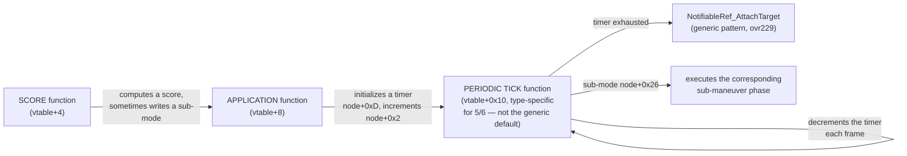

**A real shared state field between different types**: `entity+0x32` is a bitfield read and
written by several distinct `MVRS` types, creating a dependency chain:

- `ID=4` (application, `loc_FCE1`) computes a geometric delta
  (`Angle_DeltaNormalized_A`) and **sets bit 0** if the result is positive; it also writes an
  anticipated position into `node+0x26/2A/2E`.
- `ID=7` (application, `loc_10AF2`) **reads this same bit 0** to choose the duration of its own
  timer (`0x100` if set, `0x200` otherwise), and also tests bits 1 and 3 of the same field (set by
  the score of `ID=7` itself) to decide whether to call `sub_56E5` (cached sensor).
- `ID=2` (application, `loc_F2C8`) computes a **real turn decision** (left/right based on a
  lateral offset, with a **coin flip** — `CRT_Rand_70D` — as tie-breaker if ambiguous) and writes
  it into `node+0x2E`.

**The 8-phase Immelmann/Split S sequence — belongs to `ID=5`** (and not `ID=6` as documented in an
earlier version). The score of `ID=5` (`loc_434E`) sets `node+0x26=1` when `dword_72034`
(a `NUMS` constant) is exceeded; its application (`loc_100B6`) starts a `0x400` timer and phase 1;
the periodic tick (`loc_1011F`, read in full) executes the 8 phases — each phase (`node+0x26`,
1 to 8) commands a specific attitude (pitch, bank, heading) through the same low-level controllers
as normal navigation (`AI_PitchToAngleCmd_7E18`, `AI_RollToAngleCmd_8104`,
`AI_RollController_7E56`). Recognizable patterns: phases 0-2 correspond to an Immelmann (pull up,
adjust bank, roll level then adjust heading); phase 3 (90° bank) is consistent with the start of a
Split S. Phase 5 writes directly into `entity+7+0x1F` — the same field consumed alongside the
player's mouse input in `Player_MainUpdate` (§4bis).

> **Corrected 2026-09-25**: the tick of `ID=13` has been re-read; it is not a Scissors/Rollaway but
> a **long-range altitude gain** (heading toward the target, 30–60° zoom climb depending on the
> excess speed). Details: `AI_TICK_CALL_GRAPH.md`, "The confirmed actions of `MVRS` maneuvers".

**The 5-phase sequence — belongs to `ID=13`** (and not `ID=0xE` as previously documented). The
score of `ID=13` (`loc_4A99`) uses both `dword_72039` AND `dword_7202C` (the two `NUMS` constants
already associated with this sequence); its application (`loc_1138F`) starts a `0x400` timer and phase 1.

**`ID=6` has its own sequence, distinct from that of `ID=5`**: its score (`loc_45BE`) sets
`node+0x26=2` (not 1), its application (`loc_1060A`, `loc_10673`) starts a `0x500` timer (not
`0x400`) — the phases live entirely in the tick function, not yet detailed phase by phase.

**What remains open**: the phase-by-phase detail of the `ID=6` tick (`loc_10673`), and the precise
meaning of `sub_4F95` beyond its already-confirmed role as an angle computation.

---

## 4. `GOAL` — high-level behavior selection

### 4.1 Loading mechanism

Each byte of the file chunk (values `2` to `5`, or `1` for an empty slot) selects a **function
pointer** among 4, from a fixed engine table:

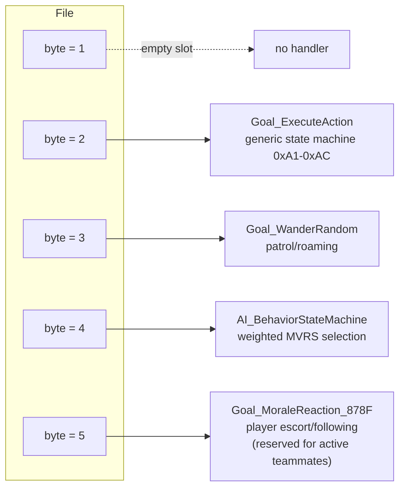

### 4.2 `AI_TopLevelThink` — reactions, current object, then objectives

**CORRECTED (2026-09-19)**: the previous version of this section described `AI_TopLevelThink`
as a simple loop over the `GOAL` slots. Reading the function (`seg004`, see `AI_TICK_CALL_GRAPH.md`
for citations) shows that objectives come **last**, after priority reactions and a current-object
test. The special case of the "generic flag on the linked aircraft" in the old version is in fact the
**"on the ground"** flag (byte `+0x20` of the aircraft sub-object, set by `PhysicsTicks`). The middle
of the function (threat handling, target chain `+0x287` / `+0x289`) has not been read in detail.

```c
// pseudocode of the structure read (actual order)
int AI_TopLevelThink(Entity* entity) {
    // 1. start
    if (byte_6E4D7 && entity->b0 >= 0xC) Targeting_AcquireBestThreat(entity, 0);
    AI_MessageDispatcher(entity);
    Radio_CombatChatterDispatch(entity);

    // 2. threat handling, SKIPPED if taking off/landing (+0x11D = 0xA1/0xA2),
    //    aircraft on the ground, or word_70466 <= 3 (frame counter: first 3 frames of the mission)

    // 3. priority reactions, before any objective
    int reacted = 0;
    if (entity->f281) {
        if (entity->obj0D == NULL && entity->f27F == 2)
            reacted = AI_EscortPriorityReactionHandler(entity);
        else
            AI_QueryTargetField4B(entity);
    }
    if (!reacted && entity->f27F <= 1)
        reacted = AI_EngageAttackerReaction_E246(entity);
    if (reacted) return;                      // "protect self" goes before "obey order"

    // 4. current object: goes before GOAL and the tournament (nature of the object not established)
    if (entity->obj0D != NULL && entity->f27F != 0) {
        entity->obj0D->vtable[0xC](entity->obj0D);   // cumulative time in word_704E6+0x5B56
        return;
    }

    // 5. objectives
    if (aircraft_on_ground(entity)) {         // [[[entity+0xB]]+0x20] != 0
        Goal_ExecuteAction(entity, 0);        // direct, GOAL table ignored
    } else {
        for (int i = 0; entity->goal_slots[i].handler != NULL; i++) {   // entity+0x1B0, 8 bytes
            if (entity->goal_slots[i].handler(entity, 0))               // first non-zero responder
                break;
        }
    }
    // 6. epilogue (+0x280, +0x10D, +0x28B bit2): not interpreted
}
```

Established points:
- **The handlers are alternatives**, chosen by the file byte (2 `Goal_ExecuteAction`, 3
  `Goal_WanderRandom`, 4 tournament, 5 `Goal_MoraleReaction_878F`): they do not chain.
- **The value `1` in the file occupies no slot** (dropped in `PilotProfile_LoadFromPROF`); `GOAL=1`
  alone gives an empty table.
- **On the ground, `Goal_ExecuteAction` runs regardless of the `GOAL` table**, which explains why a
  character with `GOAL=1` alone takes off but, once airborne, no longer executes anything.
- **The handler is called with `(entity, 0)`**, not with the slot index.

### 4.3 `Goal_ExecuteAction` — the generic state machine (selector 2)

Handles 11 persistent state codes (`0xA1` to `0xAC`, stored at offset `+0x11D` of the entity),
**confirmed identical to the opcodes of the mission scripting language** (see §5):

| Code | Meaning (confirmed by the external opcode table) | Completion condition |
|---|---|---|
| `0xA1` | Take off | Valid target of type `0x11` present |
| `0xA2` | Land | Target `+0x19 == 0x12` |
| `0xA4` | (fly to point/zone) | Distance ≤ 128000 |
| `0xA7` | Destroy the target | `target+0x137` becomes non-null |
| `0xA8` | Defend the target | Same test as `0xA7` |
| `0xA9` | Defend an area | Distance covered (delta of global counters) |
| `0xAA` | Follow an ally | `target+0x145 == 0` (reference lost) |
| `0xAC` | (immediate) | Always complete |
| other | — | Generic flag on the referenced target |

```c
int Goal_ExecuteAction(Entity* entity, int slot) {
    int state = entity->goal_state;  // +0x11D

    if (!Goal_IsComplete(entity, state)) {
        // execute the native action associated with this opcode
        MissionScript_CallNativeHandler(entity, state, /* operands */);
        return 1;
    } else {
        // objective reached: advance/clear depending on context
        return 0;
    }
}
```

### 4.4 `Goal_MoraleReaction_878F` — the handler for selector `5`: morale reaction (re-read 2026-09-25)

> **Correction 2026-09-25.** This handler was described as "active player escort". Read line by
> line, it is a **morale reaction**: flight, abandonment, turning against the player, or rejoining
> the player, depending on the pilot's morale and discipline. It does **not** perform formation
> following. The two functions it calls were also misnamed: `AI_ComputeMorale_CD4A` (formerly
> `Radio_SelectContextMessage`) and `AI_MoraleDisciplineCheck_CA93` (formerly `Voice_ExpressionTimer`).

**Morale** (`AI_ComputeMorale_CD4A`, stored in `entity+0xF5`): starting score 100, then
- fuel: `+ 51 × remaining / capacity − 50`;
- −100 if `DamageSys_SumDamage_43D0F` of the aircraft is non-zero (meaning of the attribute not established);
- −50 if the current order cannot be carried out (no weapon suited to the target, no target);
- as long as enemies are alive: −8 per living enemy, −32 per loss on its side, and a cap at 79;
- −50 if a reaction is active (`+0x27F ≠ 0`);
- confidence `CN` (`+0xB3`; "loyalty `LY`" before the 2026-09-25 correction): +0, +15, +30, +50 or +75
  (thresholds 3, 6, 12, 15); floor 25 if `CN > 9`; 0 if `CN ≤ 0`.

Result: **2** (≥ 80, good), **3** (≥ 50), **4** (≥ 25, shaken), **5** (< 25, panic).

**Discipline** (`AI_MoraleDisciplineCheck_CA93`, every 3 s): `LY + (+7, +4, −3, −5 depending on morale
2 to 5) > 7` (`LY` = loyalty, `+0xB4`; "`FL`" before the 2026-09-25 correction). A disciplined pilot holds his role.

**The handler** (at most every 5 s; returns 1 if it acted, otherwise the next `GOAL` handler takes over):

| Morale | Case | Action |
|---|---|---|
| 4 or 5 | pilot not on the player's side | **flight**: radio 8, "fly to a point" order (`0xA5`) locked against the script, current behavior abandoned, navigation (node ID 21) toward a point resolved from the global object `word_706A0`, 1000 m higher |
| 4 or 5 | disciplined-less wingman of the player, following: **the threat targeting him is the player** and no active enemy | **turns against the player**: air target = the player, combat, radio `0x20` |
| 4 or 5 | undisciplined wingman of the player, following, other case (only once, `+0x149 = 2`) | radio 8, "follow" order toward the player locked, navigation toward the same point raised by 1000 m |
| 4 or 5 | wingman of the player, otherwise, in combat against an attacker or under missile (level 1 or 2) | radio 6 to the player, does not take over |
| 2 or 3 | undisciplined wingman of the player, following, active enemies | radio `0x12`, `Goal_TransferToWingman` (mission target and navigation = the player, order locked) |

"Player's side" = byte `+0x50` of the world object set to 1 (0xFF = enemy side, 0 = neutral): inferred
from the branches where the leader is the player. **Lines** (`MSGS` chunk of `data/BILLY.IFF`,
vocabulary shared by all characters):

| Index | Billy's line | Branch |
|---|---|---|
| 6 | "This guy's good. Could someone give me a hand here?" | call for help (damage or missile) |
| 8 | "That's all for me. I'm outta here!" | **abandoning the fight**: an enemy fleeing, a wingman departing |
| `0x12` | "This one's all mine." | wingman takes initiative (`Goal_TransferToWingman`) |
| `0x20` | "Do you feel lucky? Well? Do you punk?" | provocation: wingman turned against the player (also played on firing by `AI_BehaviorSelector`) |

The point resolved from `word_706A0` is not traced.

**How these reactions are then expressed: the wingman's state `entity+0x149`** (read in
`Goal_SelectTransition`, re-read 2026-09-25). The morale reaction and entry into combat hardly execute
anything themselves: they write the objective (`+0x11D`), lock it against the script (bit 5 of `+0x28B`)
and change the state `+0x149`. It is then **`GOAL` 2** (`Goal_ExecuteAction_A8AC` →
`Goal_SelectTransition` for the "follow" order) that applies it on every tick, after
`Goal_FollowAllyExec` (formation flight):

| `+0x149` | Set by | What `Goal_SelectTransition` does |
|---|---|---|
| 0 | default | in formation; order unlocked. If the wingman is disciplined and an enemy is in the player's six o'clock (`word_722EE`, deduced): he engages it (state 3) and announces `0x10` "You've got one on your tail, Commander!" |
| 1 | `Goal_TransferToWingman` (line `0x12`) | **free combat around the leader**: order `0xAC` for the duration of a call to `Goal_ExecuteAction_A8AC` (combat, ground target allowed), then back to "follow" |
| 2 | `Goal_MoraleReaction_878F` (line 8) | **has left the combat**: navigation toward the point set by the morale reaction |
| 3 | `AI_EngageAttackerReaction_E246` (line `0x12`), defense of the player (`0x10`) | **engages a specific target** `+0x285`: ground target → ground attack; aircraft → `Escort_LeaderSuccession` (not re-read) |

Line `0x12` ("This one's all mine.") therefore indeed announces a switch to combat (state 1 or 3),
which Rémi observes in game.

**Observed use of the lines in game (Rémi, 2026-09-25)**: `0x12` ("This one's all mine.") comes at the
start of combat, when the wingman selects a target, alternating with `0x0C` ("Here we go, folks. It's
Primetime!"); `0x0D` ("Hasta la vista, baby.") when he has destroyed an enemy; `0x0F` ("Radical shot!")
as praise when the player shoots down a MiG with the gun. On the code side, `0x12` is played by this
handler (initiative branch) and especially by `AI_EngageAttackerReaction_E246` (formerly
`Formation_DamageReactionHandler`): hit, or an aircraft in his six o'clock (nose/target offset > 150°,
same direction within 30°, distance < `dword_7201C`), the wingman takes the attacker as mission target,
moves to reaction level 1 and announces `0x12`. The calls that play `0x0C`, `0x0D` and `0x0F` are not
localized (the message code is probably computed, not a constant).

**Billy's `GOAL`** (real file): `5, 2, 1, 4, 3` → morale reaction, then script order (including
following `0xAA`), then combat, then wandering; the `1` is ignored.

**What it does not do: formation following.** That goes through `Goal_FollowAllyExec`, called either by
`AIEntity_MasterTick_5ACC` (bit 3 of `entity+0x28B`, set and maintained by `Goal_FollowAllyExec` itself,
and bit 5 of the aircraft's `flags_75`), or by `Goal_ExecuteAction_A8AC` (order `0xAA`), or by
`Goal_SetObjective_A307`. **Verified in game (Rémi, 2026-09-25)**: with `GOAL = 5, 1`, the aircraft takes
off then no longer does anything (nose to the sky, no more piloting). This is what the code predicts: on
the ground, `AI_TopLevelThink` executes the script order (`Goal_ExecuteAction_A8AC`) without looking at
`GOAL`; in flight, only this handler runs, and it acts only on morale. **Following a "follow" order
requires the value `2` in `GOAL`.**

---

### 4.5 Target selection and threat handling — `Targeting_AcquireBestThreat` (read 2026-09-20)

Full details in `AI_TICK_CALL_GRAPH.md` (section of the same name). Summary:

- **Object categories**: read by `vtable+8` of the model class, set by the chunk present in
  `OBJECTS\<name>.IFF` (`IFF_LoadModelMain`). **6 = `JETP` (aircraft), 8 = `MISS` (missile), 0x13 = `SWPN`
  (fixed defenses: AA, batteries, SAM, ships; fact verified on the data side)**. The former comment
  "2 = aircraft, 6 = missile, 8 = countermeasure" was wrong.
- **Candidates**: missile targeting me (`node+0x55` = my aircraft), hostile aircraft (side `+0x50` of
  opposite sign), hostile object at `+0x11 = 2` (if `arg_4` is non-zero and weapon `0x83C` loaded).
- **Score**: two notes A and B weighted by `(AR − TH) + 16` and `(TH − AR) + 16` (copy of `ATRB`, `+0xB8` =
  `AR`, `+0xB0` = `TH`), distance bands (`NUMS`), aspect angles, persistence of the current target, skill
  gate `Pilot_SkillCheck_B0` (`roll 1-16 ≤ TH + aptitude`).
- **Result**: the winner is stored in `entity+0x287` (aircraft), `+0x283` (object at `+0x11 = 2`) or
  `+0x281` (missile). **A winning missile clears `+0x287` and `+0x283` and sets `+0x27F = 2`**: no more
  attack target, no firing (`AI_BehaviorSelector` requires `+0x27F` ≤ 1) and no tournament for this tick.
  The defensive reaction is not in this function.

## 4bis. How a decision becomes real movement — complete verified chain

**Question asked and resolved in this session**: once `GOAL`/`MVRS` decide *what* to do ("go to this
navigation point"...), how does it turn into actual aircraft movement? A first hypothesis (a `COMP` script
VM shared with the camera) was checked and then **ruled out** — the `COMP` tag exists only in the camera
loader (`Cinematic_LoadCameraDef`, `seg041`), with no trace on the `PROF`/aircraft side. The right lead
turned out to be a **classic geometric guidance chain**, fully traced and verified function by function:

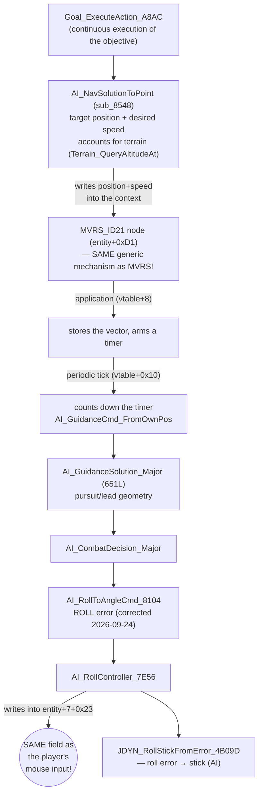

**The decisive point**: `AI_RollController_7E56` writes its result into `entity+7+0x23` — **exactly the
field that `Player_MainUpdate` reads alongside the value derived from the
player's mouse input, in the same comparison. This is not a coincidence of offsets: the AI and the player feed the **same entry point**, with interchangeable values. *(Corrected 2026-09-25: `JDYN_RollStickFromError_4B09D` is **not** downstream of this field. The AI calls it **before** writing `+0x23`, to convert its roll error into a stick input. Only `AI_RollController_7E56` and `AI_BankErrorCmd_7F34` call it. What the player shares with the AI is the flight model, which reads the stick afterwards.)*

**What this confirms and rules out**:
- **Rules out**: no separate movement VM like a scripted camera, and no teleport that would bypass the physics.
- **Confirms**: the AI computes a real **turn rate** through full pursuit geometry (angle to target, lead, ±180° angle normalization), then feeds that result into the **same aerodynamic physics pipeline** as the player's controls. It is a "virtual pilot pushing the stick" architecture, not a shortcut.
- **Role of node `MVRS_ID21`**: the type previously classified as a "disabled placeholder" (score always 0, never selected by the tournament) actually serves as a **generic navigation-command carrier**. It is built once by `PilotProfile_LoadFromPROF` (`push 15h` → `sub_742FC`, the same constructor as all `MVRS` nodes) and used DIRECTLY (outside the tournament) by `AI_NavSolutionToPoint`. This confirms that the generic node mechanism (tag `0x5C44`) serves both `MVRS` scoring and carrying navigation commands computed on the fly.
- **`entity+0x139`** (arrival radius) and **`entity+0x141`** (cruise speed), the last two constants of the entity constructor that were still unclear, are now fully explained: they are per-entity navigation parameters, consumed directly by `AI_NavSolutionToPoint`.

**`AI_GuidanceSolution_Major` (651 lines) read in full**: the central geometric link of the chain, a real pursuit guidance law with lead (proportional navigation / lead pursuit):

- Computes the angle delta between two approach vectors, with full ±180° wraparound handling.
- **Special case, diverging angle (>90°)**: switches to a simplified calculation instead of a direct angle-between-vectors, to avoid numerical artifacts on nearly opposite vectors.
- **Sensor range guard**: if the target is outside real detection range (comparison with `dword_7203D`), it jumps directly to a fixed maximum correction angle (±166°) instead of a fine calculation.
- **Turn-time estimate based on the aircraft's own maneuverability** (`[aircraft+0x67]`, the same field as the `MVRS_ID14b` sequences): a more maneuverable aircraft gets a more aggressive correction.
- **Reorients its own input vector** based on distance to the target (cosine factor × distance) before computing the final delta.
- **Does not decide by itself**: it tail-calls `AI_CombatDecision_Major`, passing it the computed final heading plus two intermediate deltas, confirming the full geometry → decision → execution triad.

**For a faithful reimplementation**: rather than setpoints (`target_climb`/`target_speed`) consumed by simplified physics for AI aircraft, the original game computes a heading delta through real guidance geometry, then injects it into the full flight model, just like a joystick input. Bit 4 of `flags_75` (`Aero_ComputeAoACommand_48862`) remains a real mechanism but a separate one, probably a fine aerodynamic adjustment, not the navigation mechanism itself.


---

## 5. Link with the mission script language

### 5.1 Overview of the interpreter

`Expr_VM_Interpreter_51106` dispatches on **209 opcode values** through a jump table indexed directly by the raw opcode byte (no offset). **119 of the 209 values (57%)** point to the same default handler (`loc_51C94`, which advances to the next opcode or ends the script), so only **80 truly distinct targets** remain to understand. All of them were decoded line by line.

Each instruction operates on a 5-field "token" at `[di]` (`di+6`, `di+8`, `di+0xA`, `di+0xC`, `di+0xE`, `di+0x12`...), with a "work register" at `[di+0xC]`, a bitwise comparison result register at `[di+0x16]`, and a shared script context (`[bp+var_2]`) giving access to two bounded arrays: a "general variables" array (`[bx+0x48]`=size, `[bx+0x4A]`=base) and a fixed bank of 8 "gameflow registers" (`[bx+0xA1]`).

### 5.2 Full table of the 80 decoded opcodes — names validated by an external implementation (`libRealSpace`)

Rémi provided the opcode table he uses today in his port, validated against the real game (except for case `208`). It allowed **correcting several overly generic interpretations** that came from reading the disassembly alone. Notably: what I called a "general variables array" is actually a **flags array**, and what I called an "accumulator register" is the **work register**.

| Opcode | Name (validated by `libRealSpace`, unless noted) | Role confirmed by the disassembly |
|---|---|---|
| `0` | `OP_NOOP` | No execution — confirmed (falls into the default handler) |
| `1` | `OP_EXIT_PROG` | Ends the script — *see note below: shares the same code as `0`* |
| `2` | `OP_EXEC_SUB_PROG` | **The real subroutine call mechanism**: checks an execution stack depth (max 16 levels), resolves a named subroutine (`Expr_LookupNamedValue_51E4A`), pushes the current context, then jumps to the start of the subroutine (`Expr_VM_PushValue_51033`) |
| *(3)* | *(addressing variant of `OP_EXEC_SUB_PROG`)* | Same code path as `2`, but reads `[di+0xC]`. Absent from the `libRealSpace` table; probably an alternative addressing mode of the same conceptual opcode |
| `8` | `OP_SET_LABEL` | No execution — confirmed (jump marker, falls into the default handler) |
| `9` | `OP_SPOT_DATA` | No execution — confirmed (inline data declaration, falls into the default handler) |
| **`16`** | **`OP_MOVE_VALUE_TO_WORK_REGISTER`** | Loads an immediate value into `[di+0xC]` — *confirmed* |
| `17` | `OP_MOVE_FLAG_TO_WORK_REGISTER` | Reads `flag[idx]` (bounds checked) → work register |
| *(18)* | *(conditional flag read+write)* | Read-then-conditional-write pattern — no dedicated entry on the `libRealSpace` side |
| *(19)* | *(variant of `16`)* | Reads `[di+0xE]` instead of `[di+8]` |
| **`20`** | **`OP_SAVE_VALUE_TO_GAMFLOW_REGISTER`** | Writes to one of the 8 gameflow registers — *confirmed* |
| *(21)* | *(`OP_RANDOM`)* | `(rand() × value) / 0x8000` — no dedicated entry on the `libRealSpace` side |
| *(32-45, except 35)* | *(full ALU family)* | ADD/SUB/OR/AND/XOR/MUL/DIV, immediate and flag variants — only `35` is named on the `libRealSpace` side |
| `35` | `OP_ADD_WORK_REGISTER_TO_FLAG` | `flag[idx] += work register` — **corrects my initial reading** (I had read "`variable[idx] += idx`"; the source operand is actually the work register, not the index itself) |
| `46` | `OP_MUL_VALUE_WITH_WORK` | Work register ×= immediate |
| `64` | `OP_CMP_WORK_WITH_VALUE` | Compare(work register, immediate) |
| `65` | `OP_CMP_VALUE_WITH_WORK` | Compare(immediate, work register) — reversed order |
| *(66-68)* | *(flag/register comparison variants)* | No dedicated entries on the `libRealSpace` side |
| `69` | `OP_TEST_FLAG` | Compares `flag[idx]` to `1` — **corrects my reading** ("compares variable to constant 1" over-generalized what is in fact a dedicated boolean test) |
| `70` | `OP_GOTO_IF_CURRENT_COMMAND_IN_PROGRESS` | Conditional jump on `[di+0xE]` — **corrects my reading**: not a generic field test; it is directly tied to the completion state of the current objective (`Goal_IsComplete`, §4.3) |
| *(71)* | *(jump if command completed)* | Symmetric to `70` |
| `72`/`73` | `OP_BRANCH_IF_EQUAL`/`_NOT_EQUAL` | Jumps on the "equal" bit — confirmed |
| `74`/`75` | `OP_BRANCH_IF_LESS`/`_GREATER` | Jumps on the "less"/"greater" bit — confirmed |
| *(76-78)* | *(combined ≤/≥ jumps, unconditional jump)* | No dedicated entries on the `libRealSpace` side |
| `79` | `OP_EXECUTE_CALL` | Native call (`sub_50FDB`) — confirmed |
| `80` | `OP_MOVE_WORK_REGISTER_TO_FLAG` | Writes the work register to `flag[idx]` — confirmed |
| *(81)* | *(flag write variant)* | No dedicated entry on the `libRealSpace` side |
| `82`/`83` | `OP_SET_FLAG_TO_TRUE`/`_FALSE` | `flag[idx] = 1` / `= 0` — confirmed |
| *(84)* | *(flag toggle, `^= 1`)* | No dedicated entry on the `libRealSpace` side |
| `85`/`86` | `OP_ADD_1_TO_FLAG`/`OP_REMOVE_1_TO_FLAG` | Increments/decrements `flag[idx]` in place — confirmed |
| **`128`/`129`** | **`OP_ENABLE_SCENE`/`OP_DISABLE_SCENE`** | Resolves a named node and sets/clears its flag — **corrects my generic reading** ("set/clear node flag"): this is the `is_enabled` flag of a **scene** (`SCNE` chunk, see `DATA_MODEL.md`), so the scene becomes playable or not. Activation (player input) is not triggered by the instruction |
| *(130)* | *(`OP_IS_SCENE_ENABLED`, proposed name: tests `is_enabled`)* | No dedicated entry on the `libRealSpace` side |
| **`144`** | **`OP_ACTIVATE_OBJ`** | Resolves a node, then calls `PartEntry_ResolveSpawnPositionAndActivate_51EDC` — **confirms and refines** the formation-spawn finding: it is the activation of an object/formation, not a generic "cluster spawn" |
| *(145)* | *(`Expr_Node_ClearDirtyAndNotify`)* | No dedicated entry on the `libRealSpace` side |
| **`146`** | **`OP_IF_TARGET_IN_AREA`** | Tests bit 0 of field `+0x39` of a resolved node — **resolves the exact meaning** of this flag bit |
| **`147`** | **`OP_IS_TARGET_ALIVE`** | Tests bit 1 of the same field `+0x39` — **resolves the exact meaning** of this second bit |
| **`148`** | **`OP_INSTANT_DESTROY_TARGET`** | Calls `Expr_Node_DetachChildAndRecompute_524EB` — **refines** the finding: detaching a node from the graph is the instant-destruction mechanism for a target |
| **`149`** | **`OP_DIST_TO_TARGET`** | 3D distance to the target, /1000 — confirmed |
| *(150)* | *(time calculation, constant `0x8CA00`)* | No dedicated entry on the `libRealSpace` side |
| **`151`** | **`OP_DIST_TO_SPOT`** | 3D distance to a named point ("spot"), /1000 — confirmed; clarifies the calculation target (a `spot`, see `OP_SPOT_DATA`, opcode `9`) |
| **`152`** | **`OP_IS_TARGET_ACTIVE`** | Tests field `+0x52` of a resolved node — **resolves the exact meaning** of this test |
| **`160`** | **`OP_SET_WAIT_FOR_SECONDS`** | Timer based on the global clock (`dword_70458`) — confirmed; clarifies the unit (seconds) |
| **`161`-`171`** | **`OP_SET_OBJ_TAKE_OFF`/`LAND`/`FLY_TO_WP`(165)/`FLY_TO_AREA`(166)/`DESTROY_TARGET`/`DEFEND_TARGET`/`DEFEND_AREA`/`FOLLOW_ALLY`/`SET_MESSAGE`(171)** | The whole family delegates to `MissionScript_CallNativeHandler_52513` — confirmed for all of them |
| *(178, 180, 177...)* | *(additional `OP_SET_OBJ_*` variants)* | Follow the same code structure; not all are named on the `libRealSpace` side |
| **`190`** | **`OP_DEACTIVATE_OBJ`** | Native call gated on a flag bit of the resolved node — **clarifies** that it is the counterpart of `OP_ACTIVATE_OBJ` (144) |
| *(192)* | *(`Expr_VM_OpcodeHelperA_53504`)* | No dedicated entry on the `libRealSpace` side |
| **`208`** | **`OP_SELECT_FLAG_208`** — unidentified behavior on the `libRealSpace` side | **Resolved by this analysis**: writes `[di+8]` (one byte) into the global variable `byte_6D559`, a simple "write a byte into a selected global register/flag", distinct from the gameflow register of opcode `20`. The exact in-game role of `byte_6D559` remains to be determined, but the **mechanism** is now known with certainty. |

**Note on opcodes `0`/`1`**: the disassembly shows that `0` and `1` take exactly the **same code path** (`loc_51143`: pops a value via `Expr_VM_PopValue_51096`, then falls into the default handler). If `libRealSpace` distinguishes them functionally (`NOOP` vs `EXIT_PROG`), then either the distinction happens **outside** this function (in the calling code, on the return value), or there is a nuance not captured by this reading. This is a point to verify if the distinction proves important in practice.

**Cross-check summary**: for the entries of the `libRealSpace` table that correspond to a truly distinct target in the disassembly (excluding `3`, `18`, `19`, `21`, etc., which appear to be unnamed addressing variants), **all matches agree** with the behavior observed in the code. No contradiction was found, only welcome precision on names I had to keep generic for lack of external context.

### 5.3 Confirmed match with the `GOAL` state codes

The 11 state codes handled by `Goal_ExecuteAction` (`0xA1`-`0xAC`) are **the same numeric values** as the opcodes above. They all converge on a common point (`loc_51C09`), which pushes opcode + operands + target and calls `MissionScript_CallNativeHandler_52513`.

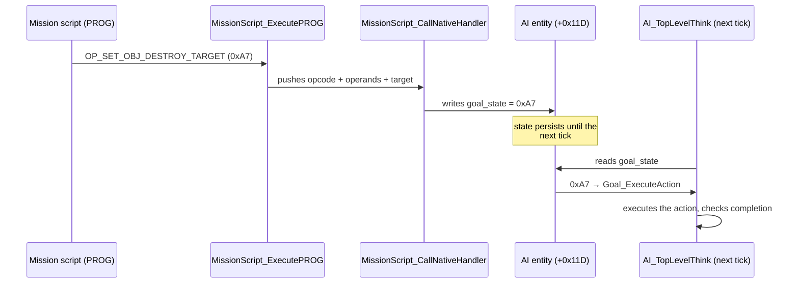

§5.2 above is now **fully updated with Rémi's `libRealSpace` reference table** (validated against the real game, except for case `208`, resolved by this analysis). Entries in parentheses are opcodes inferred from the disassembly alone, with no official name on the `libRealSpace` side.

**The mission script never drives the AI synchronously**: it sets a state, and the tick loop reads it and honors it at its own pace.

---

## 6. The per-entity master tick — `AIEntity_MasterTick`

Root entry point, called once per entity per frame (vtable method `+0xC` of the aircraft/pilot class). It was never documented before this investigation, despite a "100% coverage" claim for the file that in fact only covered explicit `proc` blocks.

**Important consequence, verified directly in the code (Rémi's question)**: the `MVRS` tournament (§3.5) resets each entry's score to zero and recomputes it **with no time condition** at every call (`mov byte ptr es:[bx+0Ch], 0` then `call [vtable+4]`, in the main loop of `AI_BehaviorStateMachine`). There is no `dt` accumulator and no cooldown. Since the tick is paced by the framerate, **the frequency of AI decisions (and therefore the number of random draws per real second: tournament noise via `CRT_Rand`, the "3d6" skill test in `AI_GunSnapAim_6977`) scales directly with the framerate**, unlike the physics, which is correctly synchronized to real time. A low-skill pilot on a fast machine would statistically get more attempts per second than an expert pilot on a slow machine: an unprotected logic/display coupling, plausible for an engine from 1993.

```c
void AIEntity_MasterTick(Entity* entity) {
    unpack_status_flags(entity);  // +0x28C / +0x28D

    // global threat/proximity thresholds, shared with other decision
    // functions (e.g. AI_GroundAvoidPullUp_6616)
    dword_7203D = RangeTest(entity) + SecondaryAngleSensor(entity);
    dword_72039 = weighted_cosine(entity);

    update_heading_tracking(entity);
    entity->hud_airbrake_flag = entity->aircraft->flags_75.bit0;

    int threat_score = compute_threat_score(entity);
    if (entity->aircraft->flags_75.bit6) {
        threat_score = adjust(threat_score);  // division or doubling depending on context
    }
    threat_score *= 2;
    word_6D3BC = threat_score;

    if (entity->aircraft->flags_75.bit5 && entity->status.bit3) {
        Goal_FollowAllyExec(entity);   // short-circuit: formation mode
    } else {
        AI_TriggerBehaviorUpdate(entity);  // normal path
    }
}
```

---

## 6ter. `ATRB` found — the real copy lives at `entity+0xB0`, not `entity+0x96`

*Major correction following a working session with Rémi. The previous search (kept below for reference) looked exclusively around `entity+0x96`-`+0x9E`, where `ATRB` is **loaded from the file**. But that area is only a loading buffer: the copy actually **consumed by the decision logic** lives elsewhere, at `entity+0xB0`.*

**The thread that led to the discovery**: while reading `MVRS_ID7` in detail with Rémi, a neighboring function outside the tournament (`loc_3FCB`) called a utility function different from the one used by `ID=7`. The two functions turned out to be a **family of skill checks**:

```asm
; common pattern, e.g. sub_8C1E (entity+0xB0):
mov al, es:[bx+0B0h]      ; reads a byte at a fixed offset on the entity
cbw
add ax, [bp+arg_4]         ; + a modifier passed as a parameter
call sub_70D                ; CRT_Rand
and ax, 0Fh
inc ax                       ; random roll 1-16
cmp ax, [previous result]
jg ...                        ; if roll > (stat + modifier): failure
mov ax, 1                     ; otherwise: success
```

**The roll scale (1-16) matches exactly the documented scale of `ATRB` (0-16)**, and nowhere else in the binary is there another value following that exact scale. Exhaustive search for this family of functions (same pattern, variable offset):

> ⚠️ **Wrong table for `+0xB0/+0xB1/+0xB3/+0xB4`** (assumed file order): reading `+0xB0` = FL, `+0xB1` = TH, `+0xB3` = CN, `+0xB4` = LY. See §2.3 and `IMPL_SCAIBRAIN_CORRECTIONS.md` §0bis.

| Offset | `ATRB` trait (file order) | Confirmed by |
|---|---|---|
| `entité+0xB0` | ~~`TH`~~ **`FL` (Flying)** | `sub_8C1E`, skill check called by `MVRS_ID7` (modifier `-7`) |
| `entité+0xB1` | ~~`CN`~~ **`TH` (Trigger Happy)** | `sub_8CA2`, skill check, called from `sub_9027` |
| `entité+0xB2` | `VB` (Verbosity) | **`Radio_CanPlayMessage`**: read in full earlier in this session; the link with `ATRB` had not been demonstrated at the time, now confirmed |
| `entité+0xB3` | ~~`LY`~~ **`CN` (Confidence)** | `AI_ComputeMorale_CD4A`: morale bonus by `CN` tiers (`3`, `6`, `0xC`, `0xF`), floor if `LY > 9`, zero morale if `LY ≤ 0` (§4.4) |
| `entité+0xB4` | ~~`FL`~~ **`LY` (Loyalty)** | `AI_MessageDispatcher`: compares `LY > 14` as a branch condition |
| `entité+0xB5` | `AG` (Air-to-Ground) | skill check (identical pattern, `sub_776FB`, near the `MVRS_ID19` area) |
| `entité+0xB6` | `AA` (Air-to-Air) | `sub_8CCE`, **called from `AI_BehaviorStateMachine_WeightedOptionSelector_9D05` itself** (the tournament): comparison by division, not a simple roll |
| `entité+0xB7` | `SM` (Showmanship) | `sub_8C4A`, skill check, called by `loc_3FCB` (the twin function outside the tournament that started this investigation) |
| `entité+0xB8` | `AR` (Aggressiveness) | skill check (identical pattern, called from `seg004`) |

**The 9 offsets exist with no gaps**, from `+0xB0` to `+0xB8`, each with at least one confirmed real consumption site: some through a simple skill check (comparison to a 1-16 random roll), one through a direct threshold comparison, one through a division. Two notable points:

1. **The difficulty rescaling mechanism** (`FL`/`AG`/`AA` via `+0xA0`-`+0xA2`, documented below) copies from the loading buffer (`+0x96`-`+0x9E`). It remains valid and distinct from this new copy at `+0xB0`. So there are **two copies** of `ATRB` on the entity: one for loading/tuning (`+0x96`), one consumed directly by the decision logic (`+0xB0`). Their exact link (which feeds which, and when) has not yet been traced.
2. **Correction to propagate**: several `MVRS` scoring functions documented in this session (`ID=3`, `6`, `7`, `13`, `16`) read `avion+0xB0` and were labeled as a "fuel/resource guard". That reading is probably **wrong**: `avion+0xB0` is very likely `TH` (Trigger Happy), not fuel. The affected sections of this document have not yet been corrected accordingly; this needs a dedicated pass.

---

### Earlier search (kept for reference, it looked in the wrong place)

*Rémi's question: which `ATRB` traits are actually consumed by a decision function, beyond their mere presence in the file format?*

**Two methodological weaknesses identified and corrected along the way** (pointed out by Rémi):
1. A first pass only read a 10-40 line window around the found point. That is insufficient if the value is only used further down in a long function (`sub_1450B`, 195 lines; `sub_76325`/`sub_80971`/`sub_8285A`, 190-219 lines each). The reading was redone, covering each candidate function in full rather than a window.
2. Using the name already present in `function_index.json` as corroborating evidence is circular: those names often come from a quick sweep and were never verified in depth.

**Result of this earlier search (around `entité+0x96`-`0x9E` only): no use found for `TH`, `CN`, `VB`, `LY`, `SM`, `AR`.** This result is not wrong in itself, it is simply **off topic**: these six traits are indeed consumed, but at another offset (`+0xB0`-`+0xB8`, see above) than the one searched at the time. The methodological lesson still holds: a rigorous search that finds nothing should cast doubt on the place searched, not conclude that there is no use. That is exactly what Rémi reminded us when relaunching this investigation.

**Confirmed real use: `FL`/`AG`/`AA`, difficulty rescaling (still valid, distinct from the `+0xB0` copy):**

`PilotProfile_RescaleSkillByDifficulty_12FC9` (25 lines, read in full) re-reads the duplicated cache of `FL`/`AG`/`AA` (`+0xA0`/`+0xA1`/`+0xA2`, set by `PilotProfile_LoadATRB_12E47`), applies a right shift by `word_7235F` (compared to `1` and `2` elsewhere in the code, probably a **difficulty level**), and writes the result back into the original fields. Called from `Cockpit_ReadControlsFrame_8F720`.

---

## 6bis. The RWR system: warning of danger, and the generic radio rate limiter

*Section added in response to a question from Rémi: "how does the AI respond to a radio message, brag about an exploit, warn of danger?" The following two functions were read in full, so the answer rests on certainty rather than extrapolation.*

**`AI_EjectDecision_50FF` (`sub_50FF`, 169 lines): the real danger-alert mechanism, fully decoded:**

- Computes a **threat ratio** via two sums over a list of records (`DamageSys_SumDamage_43D0F × 100 / DamageSys_SumMaxPoints_43CDC`), probably an active lock/pursuit percentage. If it is > 80%, or if the target enters the sensor threshold range (`dword_7203D`), the alert triggers.
- **Key point**: the radio alert triggers **only if the threat is specifically against the player** (a direct comparison of an identifier field against `word_722E6`, the global player reference). It is not a generic warning for any AI under threat.
- **Two alert subtypes** depending on a field of the resolved threatening object: missile inbound (updates a HUD visual indicator in addition to the audio alert, code `9`) vs. simple radar lock (audio alert only, code `0xA`). This is the classic two-level RWR.
- Always sets `flags_75` bit5 on the linked aircraft in case of a missile-type alert, the same bit documented elsewhere as linked to formation (§7). Either it is reused in several contexts, or there is a real link (breaking formation in reaction to a threat would be coherent). Not settled with certainty.

**`Radio_CanPlayMessage` (`sub_CC7A`, 104 lines): the generic frequency limiter, confirmed and refined:**

- Computes the time elapsed since the last message, and modulates the waiting threshold by the chattiness trait (`ATRB.VB`, offset `+0xB2`). The more talkative, the lower the threshold, so it can speak again sooner.
- Table of 6 message categories with a default threshold (16) if the category is not recognized.
- **Repeating the same message code as the last call makes repetition harder** (reduces the effective value by 3), not easier. This prevents an AI from looping on the same message.
- Immediate exits (always allowed) if the effective value drops to 0, or in a specific state (`entity+0x149==2`).

**Answer to the original question:**
1. *Warn of danger*: yes, a real mechanism exists (`AI_EjectDecision_50FF`), but specifically for missile or radar-lock threats against the player, going through `Radio_CanPlayMessage` as the frequency limiter common to the whole radio system.
2. *Respond to a radio message*: covered by `AI_MessageDispatcher` and `Radio_EvaluateOptionAvailability` (§2.4), already documented.
3. *Brag about an exploit*: **no function found in the binary links a target destruction to a radio boast trigger.** An explicit search (keywords kill/victory/downed/exploit) found nothing. This behavior has not been located in the disassembly so far, and should not be implemented without a new concrete lead.

---

## 7. `flags_75`: summary of confirmed bits

Offset `+0x75` of the **aircraft** object (distinct from the pilot/AI object, referenced from it via `+0xB`):

| Bit | Role |
|---|---|
| 0 | Air brake deployed |
| 1 | Flaps deployed |
| 2 | Landing gear down |
| 5 | Under formation/escort control: gates the master tick short-circuit and the availability of AI reasoning |
| 6 | Modulator of the threat score (`word_6D3BC`) in the master tick |

---

## 8. Empirical validation: 7 real files compared

| | Billy | Hammer | Gwen | Gwen-in-cargo | Cargo A | Cargo B | **Stern** |
|---|---|---|---|---|---|---|---|
| Role | Active teammate | Non-interactive NPC | Active teammate | (see note) | Transport | Transport | **Squadron commander** |
| Callsign | Primetime | Orca | Phoenix | Phoenix | Cargo | Whale | **Hawk** |
| `GOAL` | `[5,2,1,4,3]` | `[2,1,4,3]` | `[5,2,1,4,3]` | `[2]` | `[2,1,4,3]` | `[2,1,4,3]` | **`[5,2,1,4,3]`** |
| Selector `5` present | yes | no | yes | no | no | no | **yes** |
| `MVRS` (entries) | 13 (ID 1-13, all 0) | 13 (ID 1-13, all 0) | 10 (ID 1-7,B,C,D) | 3 (ID 3,4,D) | 3 (ID 3,4,D) | 3 (ID 3,4,D) | **13 (ID 1-13, all 0)** |
| `MVRS` notable value | — | — | — | `ID=3 → -2` | `ID=3 → -2` | `ID=3 → -2` | **—** |
| `ATRB` | `[10,14,12,13,15,9,15,16,15,1]` | `[10,16,16,10,15,12,15,8,16,0]` | `[8,14,14,12,10,14,12,9,12,1]` | `[0,5,10,10,0,0,0,0,0,0]` | `[0,5,10,10,0,0,0,0,0,0]` | `[0,5,10,10,0,0,0,0,0,0]` | **`[2,16,6,16,15,15,15,6,13,1]`** |
| `ATRB` zeros | 0/10 | 1/10 | 0/10 | 7/10 | 7/10 | 7/10 | **0/10** |
| `OPTS` | `dihgjklm` (8) | (empty) | `dihgjklm` (8) | `d` (1) | `d` (1) | (empty) | **`d` (1 letter only)** |

**Reminder of the names** (§2.3, confirmed by the official manual): the first 9 values of `ATRB` are, in order, `TH, CN, VB, LY, FL, AG, AA, SM, AR` (Trigger Happy, Confidence, Verbosity, Loyalty, Flying, Air-to-Ground, Air-to-Air, Showmanship, Aggressiveness). The 10th has no known name.

**Stern ("Hawk"), squadron commander**: `GOAL` and `MVRS` follow exactly the same "standard active pilot" template as Billy. Nothing in these two chunks is specific to the commander status. `ATRB`, however, is noticeably more **irregular** (it alternates high and low: `2, 16, 6, 16, 15, 15, 15, 6, 13, 1`) rather than uniformly high like Billy or Gwen. This fits a character individually characterized rather than a generic template. Notably, `OPTS` contains **only one letter** (`d`), the same one that appears in Billy and Gwen but falls **outside** the `'e'`-`'m'` range handled by the switch in `Radio_EvaluateOptionAvailability_1642C` (§2.4). Its constant but isolated presence in a character who has no other option reinforces the hypothesis of an option that is "always available" (an acknowledgment/greeting), distinct from the contextual mechanism of the other 9 letters.

**"Gwen-in-cargo" note**: a file named `C130.IFF` contains the character **"Gwen Forester"** (identical to `GWEN.IFF`), but with an `_AI_` block **bit-for-bit identical** to the cargo template. This shows that `RADI` (personality, radio) and `_AI_` (behavior, capabilities) are **two independent dimensions**, assembled according to which aircraft the character flies in a given mission rather than fixed per character.

**Two independent cargo files** ("Cargo A", callsign "Cargo", and "Cargo B", callsign "Whale") share a **bit-for-bit identical** `_AI_` block, confirming that this template is categorical (specific to the aircraft type), not individual.

### Additional empirical test (complete removal of `MVRS`)

After completely emptying the `MVRS` table of a pilot with the graphical editor, in-game behavior was observed to be **more decisive and aggressive** than normal (systematic engagement, firing both missiles then the gun, with no apparent hesitation). Interpretation consistent with the mechanism of §3.5: without candidates in the weighted selection table, the loop finds nothing to choose and probably falls back to a more direct path. **Not a "lifted brake"**, but a selection among several options that becomes pointless.

---

## 9. Associated tools (in this archive)

- `tools/decode_prof.py`: read-only decoder for a `PROF` file
- `tools/prof_editor.py`: full graphical editor (read/write, byte-exact fidelity verified by round-trip on the 7 PROF files)
- `analysis/sample_prof_files/`: the 6 real files used for the empirical validation of this document

## 10. Structure map of the Actor object: current state and method for next steps

This section consolidates what is known about the references held by the aircraft/pilot entity ("Actor"), and explicitly documents the preferred method for continuing. **Rather than searching by function name (unreliable, inherited from an initial quick sweep), start from a structural anchor known with certainty (a constructor, an offset, a reference) and read the assembly directly around that point**. Related functions often live in the same VROOMM segment, so each new localized reference increases the chance of landing on still undocumented, directly relevant code.

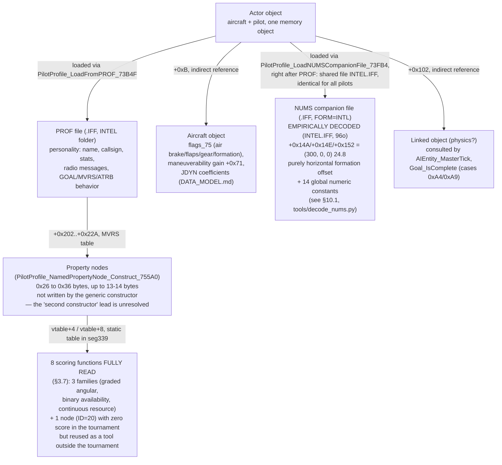

**What is solid**:
- The Actor object IS directly the `PilotProfile`: there is no separate substructure, confirmed by `AIAircraft_LoadProfileGuarded_73940`, which writes the `PROF` fields directly onto `this`.
- Three distinct file loads are confirmed on the same object, all in `INTEL`, all `.IFF`, but with **different internal formats** (`PROF`=`VERS`/`RADI`/`_AI_`, companion=`VERS`/`NUMS`). Do not assume that a shared folder name or extension implies a shared format.
- Two indirect references to other objects (`+0xB` = aircraft, `+0x102` = unidentified linked object, not identified with certainty). Lead to investigate: what precisely distinguishes these two references, and are they sometimes the same object?

### 10.1 `NUMS` decoded empirically: `INTEL.IFF`, shared constants file

Unlike `PROF` (one data set per character), `INTEL.IFF` is **the only file in the game containing a `NUMS` chunk** (a fact confirmed by Rémi, not a mere observation limited to this sample). Its generic name (not a character name) and its uniqueness confirm that it is a **shared constants file, loaded identically by all AI pilots**, not per-pilot customization.

Exact sequence of the 18 fields, confirmed (see `tools/decode_nums.py`, matches exactly the 65 bytes of the `NUMS` chunk in the real sample):

| Field | Raw value | Fixed point 24.8 |
|---|---|---|
| `dword_72016` (global) | -10240 | **-40.000** |
| `word_72014` (global) | 15 | 0.059 |
| `word_7201A` (global) | 25 | 0.098 |
| `entity+0x14A` (vector X) | 76800 | **300.000** |
| `entity+0x14E` (vector Y, altitude) | 0 | **0.000** |
| `entity+0x152` (vector Z) | 0 | **0.000** |
| `entity+0x1A4` | 0 | 0.000 |
| `entity+0x1A8` | -204800 | **-800.000** |
| `entity+0x1AC` | 0 | 0.000 |
| `dword_7201C` (global) | 460800 | **1800.000** |
| `dword_72020` (global) | 4000 | 15.625 |
| `dword_72024` (global) | 45000 | 175.781 |
| `dword_72028` (global) | 1800 | 7.031 |
| `dword_7202C` (global) | 17700 | 69.141 |
| `dword_72030` (global) | 5000 | 19.531 |
| `dword_72034` (global) | 25000 | 97.656 |
| `dword_6D184` (global) | 512000 | **2000.000** |
| final byte → `entity+0x28B` bit0 | 1 | (flag set) |

**The most significant value**: the vector `+0x14A/+0x14E/+0x152` = **(300, 0, 0)**, purely horizontal, altitude unchanged. Such a clean round number excludes an absolute world position (which would have realistic coordinates, not a simple round figure) and supports the hypothesis of a **formation offset** (300 units to the side, same altitude), consistent with everything deduced from the code (`Mission_GetSpotWorldPosition_5305A`, dynamic relative position calculation).

Several other round values (-40, -800, 1800, 2000) suggest **thresholds for distance/speed** in a consistent game unit; the non-round values (15.6, 175.8, 7.0, 69.1, 19.5, 97.7) remain unidentified in nature, possibly coefficients or percentages unrelated to the distance thresholds.

## 11. Investigation status and next leads

*Consolidated section: replaces the earlier scattered lists at the end of §10 and §11, several items of which are now resolved.*

### What is done

Most of what was sought at the start of this investigation is now in place:

- **The full `PROF` format** (§2), `ATRB` names validated by the official game manual.
- **`MVRS` from the wall to full resolution** (§3.7-3.9): the weighted selection mechanism is fully understood, the static table of vtables is located in `seg339`, **21 scoring functions read** (the 8 fixed types + the 13 extensible identifiers from Billy's file), 7 application functions read in detail, the three-phase architecture (score → application → periodic tick) discovered and documented, shared state fields between types identified.
- **`GOAL` and `Goal_SetObjective`** (§4): the complete dispatcher of the 31 `OP_SET_OBJ_*` codes traced, with a direct link to the radio command system confirmed.
- **`MissionScript_ExecutePROG`** (§5): the 80 real targets of the 209-entry jump table decoded and validated against the `libRealSpace` reference table.
- **`NUMS`/`INTEL.IFF`** (§10.1) decoded empirically, links confirmed with several thresholds of the angular family (`dword_7201C`, `dword_72034` for `ID=5`, `dword_72039`/`dword_7202C` for `ID=13`).
- **The aerobatic maneuver sequence** (§3.9): the phase switches of `MVRS_ID5` (8 phases) and `MVRS_ID13` (5 phases) fully decoded (vertical climb plus rollover for one, long-range altitude gain for the other; re-read 2026-09-25, the Scissors/Rollaway hypothesis is abandoned). Each phase commands an attitude through the same low-level controllers as navigation, with `ID=13` even computing a roll delay based on the aircraft's own capability.
- **The decision → real movement chain** (§4bis): `Goal_ExecuteAction` → `AI_NavSolutionToPoint` → node `MVRS_ID21` (reused outside the tournament) → `AI_GuidanceSolution_Major` → **`AI_CombatDecision_Major`** (a 4-branch tree based on the angle magnitude, writes the final command) → `AI_RollToAngleCmd_8104` → `AI_RollController_7E56` → `JDYN_RollStickFromError_4B09D` (error → stick, AI-specific), then the same flight model as the player via the shared command field (`entity+7+0x23`/`+0x1F`).
- **The non-round `NUMS` constants** (`dword_72020/24/28/2C`): identified as distance classification thresholds in 4 bands, with two distinct sets of thresholds depending on the target type (`AI_ClassifyDistanceBand_98BD`, called by `Targeting_AcquireBestThreat`).
- **`sub_4F95`/`sub_56E5`** read in full: the first is a real angle calculation between two vectors (not a dot product); the second is a **cached sensor** (a freshness bit on the entity), explaining its low cost as a repeated guard in several scoring functions.
- **`AI_ResolveNodePosition_54274` vs `CameraScript_ExecuteCOMP_781D0`**: confirmed as TWO distinct mechanisms, not the same family. The first resolves a named position (expression system + geometric hierarchy) and is indeed used by the AI (`Goal_MoraleReaction_878F`). The second (renamed: the "shared with AI" hypothesis from an external analysis, not re-verified, proved false on direct reading: it operates on offsets and an abort global specific to the camera context, with no link to the AI entity structure) is very probably **purely camera**, with no confirmed AI use.
- **`Player_MainUpdate`** examined structurally (full list of the 38 calls): confirmed entirely player-specific (HUD, joystick, kneeboard). No further reading needed, the only AI contact point is the one already documented in §4bis.
- **The global entity structure** (§10, constructor/destructor): `goal_state` sentinel, `GOAL`/`MVRS` tables initialized empty, all weak references of the destructor now explained: `+0x281` = **missile threat** (missile targeting me, set by `Targeting_AcquireBestThreat`, handled by `AI_MissileEvasionReaction_9A77`); `+0x283` = **acquired ground target** (fixed defense `target_type == 2`); `+0x287` = air target. *(Corrected 2026-09-25: earlier versions saw an escort reference in `+0x281` and a "confirmed weapon engagement" in `+0x283`: two errors.)* The permanent dedicated node `entity+0xD9` (built at load, `push 0x13` before `sub_742FC` in `PilotProfile_LoadFromPROF_73B4F`, tag `0x160`, `ID=19`) is the **ground attack node** (`GroundAttack_CanEngage_77000` / `GroundAttack_Start_7709A`, §3.7). `+0x285`/`+0x287` via `Goal_SelectTransition`, `+0x289` via `AI_ProximityRadioCalloutTrigger_A002`. Notable finding along the way: these three references (`+0x281`/`+0x283`/`+0x287`) form a **priority cascade above the `MVRS` tournament**: if one is active, `AI_BehaviorStateMachine` short-circuits the normal tournament in favor of a priority reaction.
- **Tools**: file decoders, character portrait, technical automaton schema and intent-language schema (`AI_TACTICAL_GLOSSARY.md`), all generating diagrams validated with a real Mermaid parser.

### What remains really open

In order of probable value:

*(List updated 2026-09-25.)*

1. ~~`AI_GuidanceSolution_Major`, `AI_CombatDecision_Major`, `JDYN_RollStickFromError_4B09D`~~: **read 2026-09-25**: the full steering law is in `IMPL_SCAIBRAIN_CORRECTIONS.md` §7.
2. Role of bits 7-8 of `flags_75` (3-value state, roll rate × 0.6 in state 2) and nature of `JDYN+0x59` (speed, not altitude? See `IMPL_SCAIBRAIN_CORRECTIONS.md` §7).
3. **`Targeting_FilterByWeaponType`**: which candidate the seeker retains within its cone (exact cone and lock range).
4. AGM-65D lock test (function not yet named, `loc_42F71`, method `+0x14` of the `MISS` model) and field `+0x13` of the ground attack node.
5. `BombModel_PredictImpact_41311`: the drop height passed by the caller (see `NOTE_ATTAQUE_SOL.md` §6).
6. Role of the threshold `dword_7203D` (computed by `AIEntity_MasterTick_5ACC`, used by evasion and pursuit).

**Settled since**: bit 4 of `flags_75` does not belong to the AI guidance chain; it is a condition of the physics load law (`Aero_ComputeAoACommand_48862`, `PHYSICS.md` §5.7). The physical autopilot mode used by the AI (`JDYN+0x68`, `Autopilot_FlyToPointKinematic_49C2E`) is described in `PHYSICS.md` §9.

**No longer a priority** (resolved or recontextualized during this session): locating the `MVRS` descriptor table (§3.7), decoding the opcodes of `MissionScript_ExecutePROG` (§5.2, complete), the "second constructor" of `MVRS` nodes (obsolete framing since the static table was discovered), and the role of the 3 constants of the entity constructor (`+0x139`/`+0x13D`/`+0x141`, mechanism understood via `Goal_SetObjective_A307`).

## 12. Fixed SWPN defenses (category 0x13): read 2026-10-15

Path for creating a mission object (PART), whatever its class: `Expr_VM_Interpreter_51106` (opcode 0x90) or `Scene_EnsureUnitsSpawned_530FF` → `PartEntry_ResolveSpawnPositionAndActivate_51EDC` → `AIAircraft_SpawnAndConditionalLoadProfile_53363` (sole caller), which instantiates the model named by `ObjectPrototype_FindOrLoadAndInstantiate_38B70` without testing its class. Despite its name, it also creates the SWPNs placed as PARTs. Objects placed by the terrain (object lists of the theater PAK) do not go through this path: `TerrainCell_LoadPlacedObjects_9A95A` instantiates them directly via `ObjectPrototype_FindOrLoadAndInstantiate_38B70` (no PROF test, no possible mission orders), then adds them to the world objects. A SWPN placed by the terrain therefore gets the same update `SwpnInstance_Update_43491`.

A SWPN instance (vtable seg339 0x6FB50) has no AI entity: its update is `SwpnInstance_Update_43491` (slot +0x10), a fixed automaton that reads neither GOAL nor MVRS. In `AIAircraft_SpawnAndConditionalLoadProfile_53363`, the PROF is only loaded if `(instance+4 & 0x6F) == 0x4E`. The SWPN constructor read (`PlayerComponent_SubHelperX_A0B8B` → `PlayerComponent_RegisterAndInitPulses_A0B40`) sets bits 0x10 and 0x40, not bit 0x08 which the AI aircraft constructor sets (`Camera_Helper3_9D490`, wrong name).

PROG opcodes passed to the instance: `MissionScript_CallNativeHandler_52513` passes the opcode to the instance's slot +0x88, `SwpnInstance_OnOrder_43CBB`: opcode 0xBE (190) → munitions = 0 (the defense no longer fires, remains targetable and destructible), returns 1; any other opcode passed is ignored (returns 0).

Tick (`SwpnInstance_Update_43491`), data = DATA chunk of the SWPN model:
1. Timer +0x5B (value 1,000,000 s set at construction, used for its pulses).
2. Delay between shots +0x57 > 0: decremented by dt; nothing else this tick.
3. Otherwise, **one frame in 10** (pulse +0x63): target search within the detection range, all directions: the nearest aircraft (`World_FindNearestInCone_22A7D`, TRGT 1, category 6), then the next ones (`World_SelectTargetInCone_22795`) until the first from a **different side** than mine and, for an aircraft, whose pilot has not ejected. None → no target. Side 0xFF sets `byte_6E4C2` (role not established).
4. With a target: fire only if the distance is below the firing range **and** if the target is not too close to the horizon: with u = unit direction, it requires ux² + uz² ≤ cos 15° (0.966), i.e. an elevation of at least ~10.6°. Otherwise the target is dropped.
5. Fire if munitions > 0:
   - missile launcher: the target must be more than 305 m above ground (`cmp …, 13100h`); ceiling on missiles for the AI side (`word_70479`, +1); missile created at my position, altitude + 2 × DATA offset, nose toward the target, target = mine, launcher = me, guidance active;
   - gun: `Effect_SpawnPeriodicAtAttach` (not detailed);
   - missile: munitions −1, delay = DATA rate.
6. Dead → returns 0 (removed); otherwise altitude is reset to the terrain and returns 1.
