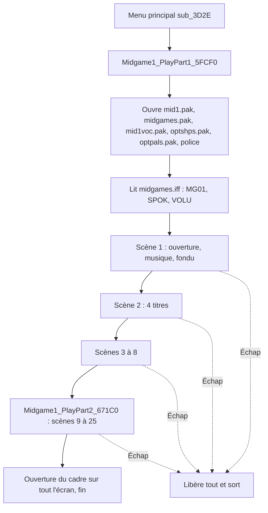
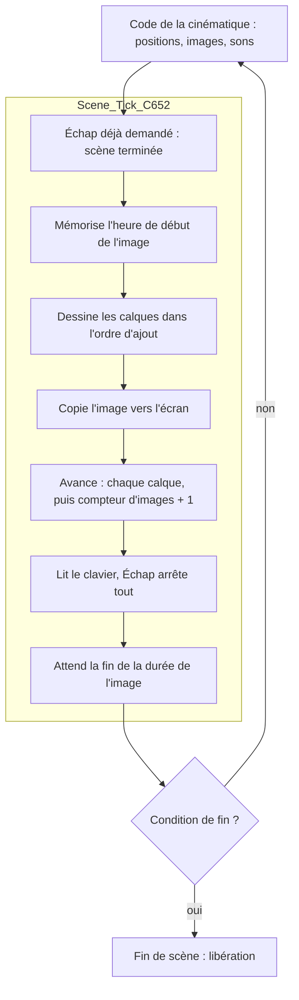
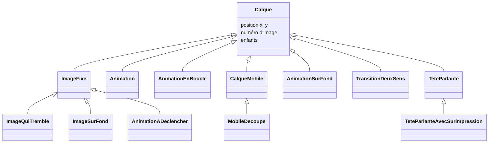

# Cinématiques (« midgames ») d'OPTEST.EXE — comment elles sont jouées

Lu le 2026-10-17 dans `OPTEST.EXE` (`source/optest.asm`, segments annotés dans
`analysis/optest/annotated_segments/`). Noms de fonctions : `analysis/optest/known_functions.json`.

**But de ce document.** Comprendre comment le jeu décrit et joue une cinématique, pour compléter
le format de libRealSpace (`SCAnimationArchive`, fichiers `MID_*.IFF`, lecteur
`SCAnimationPlayer`). Il décrit le moteur commun à toutes les cinématiques, puis **mid1** scène
par scène. Les 10 autres cinématiques restent à décoder avant de figer le format : la dernière
section liste ce qu'il faudra y chercher.

**Niveau de lecture.**
- Le moteur (scène, calques, cadence, palettes, fondus, touches) et les 12 types de calques : lus
  ligne à ligne.
- mid1 : les 25 scènes des deux fonctions (`Midgame1_PlayPart1_5FCF0`,
  `Midgame1_PlayPart2_671C0`) ont été lues ligne à ligne. Les valeurs données ici (numéros
  d'entrée, positions, numéros d'image, durées, déclencheurs) sont celles du code.
- Aucun fichier de cinématique n'est dans `data/` : on ne sait pas ce que représentent les
  images, seulement leur numéro d'entrée.

Conventions : valeurs en décimal ; coordonnées d'écran en pixels, écran 320 × 200, **x vers la
droite, y vers le bas** ; « image » désigne soit une image d'une ressource, soit une image de
scène (un passage de la boucle) — le texte précise lequel. « `mid1` 6 » = entrée 6 de
`mid1.pak` ; « `midgames` 19 » = entrée 19 de `midgames.pak` ; « `optshps` 116 » = entrée 116 de
`gameflow\optshps.pak` ; « réplique 9 » = entrée 9 de `mid1voc.pak`.

---

## 1. L'idée générale en une page

Une cinématique **n'est pas un fichier de données** : c'est **une fonction C++ du jeu**, très
longue (5 000 à 16 655 lignes d'assembleur), une par cinématique (mid1 en a deux qui
s'enchaînent). La fonction enchaîne des **scènes**. Pour chaque scène, elle :

1. charge des **ressources** (images, animations, palettes, sons) par leur **numéro d'entrée**
   dans un `.pak` ;
2. crée une **scène** avec une **cadence** (images par seconde) ;
3. y empile des **calques** (une image ou une animation chacun) à des **positions fixes** ;
4. tourne une ou plusieurs **boucles** : à chaque image de scène, elle modifie elle-même ce qui
   doit changer (position d'un calque, numéro d'image, déclenchement d'un son), puis demande au
   moteur de dessiner l'image et d'attendre ;
5. sort de la boucle sur une **condition** (nombre d'images, fin d'une animation, fin d'une
   réplique, position atteinte) ou si le joueur appuie sur Échap.



> **Avertissement : `source/optest.asm` vient d'un exécutable modifié par Rémi.** Les deux
> chaînes de nom de visage de mid1 (dseg 7900 et 7988, utilisées par les scènes 9 et 18) valent
> « pri » dans le désassemblage parce que Rémi a édité les octets de l'exécutable ; **dans le jeu
> d'origine, elles valent « air »**, et c'est « air » qu'utilise `MID_1.IFF` de libRealSpace. Ce
> document donne la valeur d'origine. Toute autre valeur lue dans `optest.asm` qui ne
> correspond pas aux données du jeu doit faire penser à une modification de ce genre.

### Où sont les données qui pilotent une cinématique

C'est la réponse à la question « en dur ou dans une structure ? » : **presque tout est en dur**.

| Donnée | Où elle est | Exemple dans mid1 |
|---|---|---|
| Quelle ressource charger (image, animation, palette, voix) | constante dans le code : numéro d'entrée passé à `Pak_LoadEntry_C40A` | animation = `mid1` 3 |
| Quel personnage, quelle palette d'ambiance | constante : nom passé à `sub_C13D` (élément de `convdata.iff`, pas encore lu) | visage « air », palette « normal » |
| Position d'un calque | constante passée au constructeur du calque | image 22 de `mid1` 11 en (169, 109) |
| Cadence d'une scène | constante passée à `Scene_Create_C55E` ou `Scene_SetFps_2DE27` | 10, 15 ou 20 images par seconde |
| Durée d'une scène, moment d'un son | constante comparée au compteur d'images | fin à l'image 40, son à l'image 20 |
| Trajectoires, suites d'images, état d'un rebond | **tableaux du segment de données** de l'exécutable (initialisés dans le `.EXE`, aucun fichier) | 41 positions (x, y), 41 numéros d'image |
| Cycles d'images, bornes de rebond, vitesses | constantes dans le code | images 16 à 20 en boucle ; bornes X 136 / 185 |
| Images, animations, palettes, sons | `.pak` (listes numérotées, sans description de scène) | `mid1.pak`, `midgames.pak`, `mid1voc.pak` |
| Titres et sous-titres | `midgames.iff` | FORM `MG01`, FORM `SPOK` |
| Durée d'une animation | la ressource elle-même : son nombre d'images | — |

Aucune structure générique « liste de scènes » n'est lue ni passée à une fonction : chaque
cinématique est un programme. libRealSpace, qui décrit les cinématiques en données (`MID_*.IFF`),
doit donc **traduire chaque fonction en données** ; ce document dit quels mécanismes il faut
pouvoir exprimer.

---

## 2. Le temps : horloge à 60 Hz et cadence de scène

- Une routine de minuterie (`Stopwatch_TickISR_3EF0B`) incrémente un compteur de tics
  (`dword_47ABB`) **60 fois par seconde** (`Stopwatch_RegisterTickModule_3EE35` règle la
  fréquence à 60 par `AIL_set_timer_frequency`).
- Une scène a une **cadence** en images par seconde. `Scene_SetFps_2DE27` en déduit la
  **durée d'une image de scène** : `60 / cadence` tics, au moins 1 tic.

| Cadence demandée | Durée d'une image | Scènes de mid1 |
|---|---|---|
| 10 images/s | 6 tics = 100 ms | 1, 8, 9, 16, 18, 19, 21, 23 |
| 15 images/s | 4 tics ≈ 67 ms | 11 |
| 20 images/s | 3 tics = 50 ms | 3 (scène 1 repassée à 20), 4, 5, 6, 7, 10, 12, 13, 14, 15, 17, 20, 22, 24, 25 |

- Chaque scène a un **compteur d'images** (champ +29 de la scène), remis à 0 à la création et
  augmenté de 1 à chaque image. La cinématique le compare à des constantes pour déclencher un
  son, changer une animation ou finir la scène ; elle le **remet parfois à 0 elle-même** entre
  deux phases d'une même scène (scènes 3, 8, 16, 23, 25).
- Les **titres** (scène 2) et l'**ouverture finale** ne passent pas par le moteur de scène : ils
  utilisent directement un chronomètre (début, durée en tics) et `Stopwatch_WaitElapsed_3F023`.

---

## 3. Le moteur de scène

### 3.1 Une image de scène

`Scene_Tick_C652` joue **une** image de scène. La cinématique l'appelle dans sa boucle, après
avoir fait ses propres modifications.



Ordre important pour reproduire exactement le jeu : **la cinématique modifie d'abord** (avec la
valeur actuelle du compteur), **le moteur dessine, puis avance** (les animations gagnent une image,
les calques mobiles se déplacent, et le compteur augmente de 1).

### 3.2 Les calques

Une scène est une **liste de calques**. Un calque peut lui-même contenir des calques enfants.

```
Scène (cadence, surface de dessin)
 ├── calque 1  ← ajouté en premier = dessiné en premier = au fond
 ├── calque 2
 │    ├── enfant 2a   (dessiné à : position du parent + sa propre position)
 │    └── enfant 2b
 └── calque 3  ← ajouté en dernier = au premier plan
```

Chaque calque contient :

| Champ | Rôle |
|---|---|
| ressource d'images | un bloc chargé depuis un `.pak` (descripteur au champ +17) |
| position x, y | en pixels (+12, +14) ; un enfant est placé par rapport à son parent |
| numéro d'image | l'image de la ressource à dessiner (+27) ; -1 = rien |
| liste d'enfants | (+4) |

**Une ressource d'images** est une table de décalages suivie des images. Le nombre d'images est
lu dans l'en-tête : `Struct_GetElementCountMinusOne_33352` renvoie `(premier décalage ÷ 4) − 1`,
valeur utilisée comme **limite** par les animations. Malgré son nom, c'est le **nombre d'images** : le
premier décalage vaut 4 + 4 × n (taille, puis table de n décalages), d'où (4 + 4n) ÷ 4 − 1 = n. Chaque image est dessinée par `sub_32CD8`
(nom repris de STRIKE `Render_MeasureOrDrawTextString_32CD8`, faux ici) en (x, y).

**La surface de dessin des cinématiques (relu le 2026-10-21).** Les calques ne sont pas dessinés
directement à l'écran. Midgame1 prépare deux descripteurs de surface (6 mots : segment, table des
lignes, gauche, haut, droite, bas) :

- l'**image hors écran** (`var_1E4`) : rectangle (0, 0) – (319, 199), tampon de 320 × 200 réservé
  par `TextRenderer_ApplyFormatChange_2EA21`, mise en surface de dessin courante (`word_46F44`) par
  `SmallObject_RegisterInList_2CB40` ;
- l'**écran** (`var_1D6`) : copie du descripteur de l'écran (`word_46F46`) dont le rectangle est
  remplacé par (0, 24) – (319, 151) (`mov [bp+var_1D0], 18h` / `mov [bp+var_1CC], 97h`). C'est la
  surface passée à `Scene_Create_C55E`.

`Scene_Tick_C652` dessine chaque calque dans l'image hors écran, en (x, y) de la scène, puis la
recopie à l'écran (`UI_ApplyEncodingHelper_2EC65` → `Rect_BlitOverlapRegion_31FCA`). Cette copie
part de la **ligne du haut de chaque rectangle** : `mov cx, [si+6] / shl cx, 1 / add cx, di` pour la
destination (ligne 24), même calcul pour la source (ligne 0) ; largeur et hauteur = la plus petite
des deux (320 × 128). **La ligne 0 de l'image hors écran arrive à la ligne 24 de l'écran.**

Conséquences :
- **l'origine (0, 0) des calques est le coin haut gauche de la bande visible, à la ligne 24 de
  l'écran** ; seules les lignes 0 à 127 de l'image hors écran sont visibles ;
- les titres (scène 2) suivent la même règle : dessinés hors écran, copiés par
  `UI_ApplyEncodingHelper_2EC4A`, qui appelle la même copie ;
- la préparation dessine les deux fonds **directement sur l'écran** (`var_1D6`) en (0, 24) : même
  place à l'écran que le (0, 0) de la scène 1 qui suit ;
- l'ouverture finale du cadre donne aux deux rectangles la même ligne du haut (24 − i) : là, une
  ligne hors écran arrive à la même ligne de l'écran.

**Pour libRealSpace** (origine en haut à gauche de l'écran) : y_libRealSpace = y_calque + 24 ; x
inchangé ; même chose pour les rectangles de découpe. Les bandes noires de libRealSpace couvrent
les lignes 0 à 22 (`CONV_TOP_BAR_HEIGHT` = 23) et 152 à 199 (`CONV_BOTTOM_BAR_HEIGHT` = 48) : la
ligne 23 y est visible, elle ne l'est pas dans le jeu.

### 3.3 Les types de calques

Chaque type de calque diffère par deux méthodes : **« dessiner »** et **« avancer d'une image »**
(appelée par le moteur après le dessin). Deux types n'ont pas de constructeur à eux : la
cinématique les fabrique directement (allocation, calque de base, puis table de méthodes).

| Type (constructeur) | Dessin | À chaque image de scène |
|---|---|---|
| Calque simple `Layer_Construct_2DF9B` | image n | rien (avance seulement ses enfants) |
| Image fixe `ImageLayer_Construct_2E02C` | image n (donnée à la création) | rien |
| Animation `AnimLayer_Construct_2E5CF` | image n, départ 0 | n + 1 tant que n < limite (`AnimLayer_Advance_2E607`), puis reste sur l'image « limite », qui n'existe pas : **rien n'est dessiné** (voir § 6.1) |
| **Animation en boucle** (fabriquée dans la cinématique, table de méthodes 4958) | image n, départ 0 | mode 0 : n + 1, et retour à 0 quand n atteint la limite ; mode 1 : n − 1 (`LoopAnimLayer_Advance_2E6D6`) |
| **Calque mobile** (fabriqué dans la cinématique, table de méthodes 6519) | image n | x += vx, y += vy (`MovingLayer_Advance_2E2D1`) |
| Image qui tremble `JitterImageLayer_Construct_B12E` | image n | x et y bougent au hasard de 0 ou 1 pixel |
| Mobile découpé `ClippedMovingLayer_Construct_B3F8`, `ClippedMovingImageLayer_Construct_B45E` | image n limitée à un rectangle | x += vx, y += vy |
| Image sur fond `OverlayImageLayer_Construct_A9D6` | image 0 dessous, image n dessus | rien |
| Animation sur fond `OverlayAnimLayer_Construct_A505` | image 0 dessous, image n dessus, départ 1 | n + 1 jusqu'à limite − 1 |
| Animation à déclencher `TriggeredAnimLayer_Construct_B068` | image n | n + 1 jusqu'à limite − 1, **seulement après déclenchement** |
| Transition à deux sens `ToggleLayer_Construct_B57B` | voir § 6.5 | étape + 1 jusqu'à 13, ou − 1 jusqu'à 0 |
| Tête parlante `TalkingHead_Construct_98F4`, `TalkingHeadOverlay_Construct_B20F` | tête + image de base + bouche | bouche choisie d'après une lettre de texte ou d'après la voix (§ 6.6) |

Le calque mobile peut aussi porter une **image fixe** : la cinématique construit alors une image
fixe (`ImageLayer_Construct_2E02C`) et lui donne la table de méthodes du calque mobile.



---

## 4. Anatomie d'une scène dans le code

Toutes les scènes de mid1 suivent ce modèle (pseudo-code, valeurs prises dans la scène 4) :

```
palette  = composer(mid1 54, mid1 42)                           ; § 7
scène    = Scene_Create(cadence = 20)
ajouter(scène, Calque(optshps 116, x = 0, y = -24))             ; fond
ajouter(scène, AnimationEnBoucle(mid1 20, x = 0, y = -40))
...                                                             ; 13 autres calques
jouer réplique 9 (avec voix) ou effet d'indice 2 (sans voix)    ; au début de la scène

tant que compteur < 40 et pas Échap :
    si compteur impair : faire tourner deux cycles d'images      ; § 6.3
    position(calque A) = table_positions[compteur] + base        ; § 5.2
    position(calque B) += vitesse, rebond aux bornes             ; § 5.3
    image(calque C)    = table_images[compteur]                  ; § 6.2
    Scene_Tick(scène)                                            ; dessin, avance, attente
libérer la scène
si Échap : sortir de la cinématique
```

### Les conditions de fin rencontrées

| Condition | Scènes de mid1 |
|---|---|
| compteur d'images atteint une valeur (5, 20, 30, 40, 41, 50) | presque toutes |
| une animation est arrivée à sa dernière image (`AnimLayer_IsFinished_2E654`) | 1, 3, 6, 11, 13, 25 (phase 3) |
| la réplique parlée est finie (méthode +0 du lecteur de voix, ou `sub_84CC` dans la scène 8) | dialogues avec voix : 8, 9, 16, 21, 22, 23, 24 |
| un calque a atteint une position (méthode « y absolu ») | 3 |
| le y de la scène atteint une valeur | 24 (phase 2) |
| Échap (`byte_495FC`) | toujours |

Une scène peut enchaîner **plusieurs boucles** (phases). Exemples : « attendre 20 images, ajouter
l'animation, puis boucler jusqu'à la fin de l'animation » (scène 1) ; « réplique jusqu'à sa fin,
compteur remis à 0, puis 10 images d'attente » (scène 16).

### Les événements à une image donnée

Dans la boucle, la cinématique compare le compteur à des constantes pour :

- jouer une réplique ou un effet sonore (scène 1 : images 20 et 35 ; scène 3 : image 65 ;
  scène 12 : image 15 ; scène 13 : image 22) ;
- **remplacer une animation par une autre** : retirer le calque (`LayerGroup_Remove_2DBC1`, qui
  le détruit) et en ajouter un nouveau (`LayerGroup_Add_2DB84`) — scène 12 : 16 → 18 à l'image 20 ;
  scène 14 : 21 → 29 → 35 aux images 14 et 27 ; scène 15 : 30 → 31 → 32 aux images 50 et
  65, dans l'animation `mid1` 17 qui les porte ; scène 25 : 33 → 34 à l'image 10, 9 → 14 à
  l'image 20 ;
- forcer le numéro d'image d'un calque (scène 19 : image 9 dès l'image de scène 9) ;
- ajouter un calque après un délai (scène 1 : l'animation n'est ajoutée qu'après 20 images).

---

## 5. Les déplacements X/Y

Six mécanismes ont été vus. Dans tous les cas, l'unité est le **pixel par image de scène** : à
20 images par seconde, une vitesse de 5 vaut 100 pixels par seconde.

### 5.1 Position fixe, et position relative au parent

La plupart des calques gardent la position donnée à la création. Un calque enfant est dessiné à
la position de son parent plus la sienne : déplacer le parent déplace tout le groupe.

### 5.2 Vitesse constante (calque mobile)

Le calque mobile ajoute sa vitesse (champs +29, +31) à sa position à chaque image, **sans
position de fin** ; la cinématique change la vitesse quand elle veut arrêter ou relancer le
mouvement. **Un enfant mobile garde sa propre vitesse en plus de celle de son parent** : la
vitesse à l'écran s'additionne.

Scène 3 : quatre calques mobiles, tous à la vitesse (0, -1), mais imbriqués.

```
optshps 44 (0, 17), vitesse (0,-1)                 → monte de 1 pixel par image à l'écran
 └── midgames 19 image 1 (0, 200), vitesse (0,-1)  → monte de 2 pixels par image à l'écran
      └── midgames 19 image 2 (0, 43), vitesse (0,-1) → monte de 3 pixels par image à l'écran
midgames 19 image 0 (0, 150), vitesse (0,-1)       → monte de 1 pixel par image
optshps 116 et midgames 20 (de la scène 1), vitesse (0,-1)
```

La montée s'arrête quand le dernier calque (y absolu = 17 + 200 + 43 = 260 au départ) arrive à
y ≤ 60 ; toutes les vitesses sont alors remises à 0.

Scène 14 : défilement horizontal à deux vitesses (§ 9, scène 14).

### 5.3 Trajectoire image par image (table de positions)

La cinématique copie une **table de positions** depuis le segment de données, puis à chaque image
de scène n :

```
position(calque) = table[n] + base
```

Scènes 4, 7 et 10 : 41 couples (x, y) et une base (0, -50). Les trois tables (`unk_44B02`,
`aImmjFDA_YWVTSn`, `unk_44DF6`) contiennent **les mêmes positions**. La boucle s'arrête à 40 :
les entrées 0 à 39 sont utilisées, la 41ᵉ ne l'est pas.

```
n :   0         1         2         3         4    ...   39        40
     (169,109) (172,106) (176,102) (178,100) (180,97) ... (155,103) (162,106)
 + base (0,-50)  →  le calque est dessiné en (169,59), (172,56), (176,52), ...
```

Table complète (x, y) :
(169,109) (172,106) (176,102) (178,100) (180,97) (183,95) (185,93) (186,91) (187,89) (186,87)
(185,86) (182,84) (178,83) (173,80) (169,79) (165,78) (161,77) (159,78) (160,81) (162,84)
(165,90) (167,92) (171,97) (173,101) (175,106) (174,107) (169,108) (161,106) (152,104) (141,101)
(134,97) (128,94) (125,92) (123,93) (127,94) (130,95) (135,97) (141,99) (148,101) (155,103)
(162,106).

C'est une **courbe libre**, pas une droite : elle ne peut pas s'écrire avec une vitesse et une
position de fin.

### 5.4 Rebond dans un cadre

```
chaque image :   x += vx      y += vy
                 si x ≥ 185 ou x ≤ 136 : vx = -vx
                 si y ≥ 62  ou y ≤ 14  : vy = -vy
```

```
 y=14  ┌──────────────────────┐
       │  ↘                   │      départ (140, 55) dans les scènes 4 et 10,
       │     ↘           ↗    │      (170, 15) dans la scène 7 ;
       │        ↘     ↗       │      vitesse (5, 4)
       │           ↘↗         │
 y=62  └──────────────────────┘
      x=136                 x=185
```

Position et vitesse sont des **variables globales** du segment de données, une copie par scène :
`word_44BFC` à `word_44C02` (scène 4), `word_44D02` à `word_44D08` (scène 7), `word_44EF0` à
`word_44EF6` (scène 10). Elles sont modifiées sur place et la fonction ne les remet pas à leur
valeur initiale. Les bornes sont des constantes du code. Le calque qui rebondit est un **calque
découpé** : il n'est visible que dans le rectangle (131, 9) – (190, 67).

### 5.5 Poursuite (scène 10)

Le calque qui rebondit dans les scènes 4 et 7 **rejoint** ici le calque qui suit la trajectoire :

```
images 0 à 7   : rebond (§ 5.4)
images 8 à 17  : vitesse = (position de la cible − position) ÷ 2     (division entière vers 0)
images 18 à 39 : vitesse = position de la cible − position            (il la rejoint d'un coup)
                 et clignotement : image impaire → images 23 / 22 / 21 sur les trois calques,
                                    image paire   → image 25 sur les trois
position += vitesse   (à chaque image, après le calcul)
```

La cible est le calque qui suit la trajectoire (§ 5.3), à sa position de l'image en cours.

### 5.6 Tremblement

L'image qui tremble (`JitterImageLayer_Advance_B16F`), à chaque image, pour y puis pour x : une
fois sur deux, elle ajoute ou retire (une fois sur deux) 0 ou 1 pixel. La position **n'est jamais
ramenée** : c'est une marche aléatoire, qui peut dériver. Dans mid1, elle sert de **parent** aux
plans de dialogue : ses enfants tremblent avec elle.

---

## 6. Les suites d'images

### 6.1 Animation simple et animation en boucle

L'animation simple avance d'une image par image de scène jusqu'à l'image numéro « nombre d'images »,
qui n'existe pas (relu le 2026-10-21) : `Render_MeasureOrDrawTextString_32CD8` ne dessine rien quand
(image + 1) × 4 ≥ premier décalage (`inc bx / shl bx, 1 / shl bx, 1 / cmp [si+4], bx`). Une
animation laissée dans la scène **disparaît donc après sa dernière image** ; `AnimLayer_IsFinished_2E654`
est vrai à ce moment-là (image = nombre d'images), et les boucles qui l'attendent sortent avant de
dessiner cette image vide. Les animations sur fond et à déclencher, elles, s'arrêtent sur l'image
n − 1, dessinée ; sa
durée dépend de son nombre d'images et de la cadence. L'animation en boucle (mode 0) revient à
l'image 0 quand elle atteint la limite. Variantes : départ à 1 avec l'image 0 comme fond permanent
(animation sur fond), départ seulement quand la cinématique pose le drapeau de lecture (animation
à déclencher).

### 6.2 Table d'images, une valeur par image de scène

À la suite de chaque table de positions, le segment de données contient 41 numéros d'image. À
l'image de scène n, un calque découpé affiche l'image `table[n]` :

```
scènes 4 et 7 (dseg 7050 et 7312) :
0 0 4 4 5 5 5 6 6 6 6 5 5 4 4 0 0 1 1 1 0 0 4 5 5 6 6 5 4 0 1 1 2 3 3 3 2 2 2 1 1
scène 10 (dseg 7806) :
0 0 1 1 2 2 2 3 3 3 3 2 2 1 1 0 0 4 4 4 0 0 1 2 2 3 3 2 1 0 4 4 5 6 6 6 5 5 5 4 4
```

Un **second calque** en déduit son image par un test écrit dans le code : 1 si la valeur dépasse 3,
2 si elle est non nulle, 0 sinon. Ce genre de dépendance entre calques est du code, pas une
donnée.

### 6.3 Cycles programmés

Deux compteurs écrits dans la boucle, avec un départ, un pas et un retour :

| Scène | Fréquence | Calque en (185, 22) (`mid1` 11) | Calque en (135, 22) (`mid1` 11) |
|---|---|---|---|
| 4 | image de scène impaire | départ 16, +1, après 20 → 16 : 17 18 19 20 16 17 … | départ 7, −1, après 7 → 15 : 15 14 … 8 7 15 … |
| 7 | chaque image | départ 16, −1, après 16 → 20 : 20 19 18 17 16 20 … | départ 7, +1, après 15 → 7 : 8 9 … 15 7 8 … |
| 10 | image de scène impaire | départ 16, +1, après 20 → 16 : 17 18 19 20 16 … | départ 7, +1, après 15 → 7 : 8 9 … 15 7 8 … |

### 6.4 Oscillation et alternance

- **Oscillation** (scènes 4, 7, 10) : le calque en (195, 107) (`mid1` 12) oscille entre 3 et 5.
  Valeur de départ 3, pas 1 ; à chaque image la valeur est augmentée du pas avant le dessin, puis
  le pas change de signe si elle vaut 5 ou plus, ou 3 ou moins : l'image affichée est
  4, 5, 4, 3, 4, 5…
- **Alternance par parité du compteur** (dialogues) : image = `compteur & 1` (0 / 1) ou
  `13 + (compteur & 1)` (13 / 14), à chaque image, pendant que la réplique ou le sous-titre dure.
  C'est le mouvement de bouche des plans de dialogue de mid1 (scènes 8, 21, 22, 23, 24).

### 6.5 Transition à deux sens

`ToggleLayer_*` : une étape de 0 à 13, qui avance si un drapeau est posé et recule sinon. Dessin
selon l'étape t :

| Étape | Image dessous | Image dessus |
|---|---|---|
| 0 à 3 | 0 | t |
| 4 à 8 | — | t |
| 9 à 11, 13 | 13 | t |
| 12 | 13 | **1** |

Utilisée une fois dans mid1 (scène 18, `midgames` 0, en (160, 128), vers l'avant).

### 6.6 La bouche de la tête parlante

La tête parlante dessine, dans l'ordre : l'image 0 de sa ressource (la tête), une **image de
base**, une **image de bouche**, ses enfants. La tête simple (table 1883h, mid2) ajoute ensuite
l'**image 1** (coiffure) et l'**image 34** (habits) : `TalkingHead_DrawDressed_9E5E`, champ +848h
toujours 34. La tête de mid1 (`TalkingHeadOverlay`) ajoute à la place les images 35 et 38.

- **Image de base.** Fixée par `TalkingHead_SetBaseFrame_9D32` (mid1 : 31 ou 27). Une fois sur 30
  en moyenne, elle est remplacée par l'image 12 (clignement), mais seulement si le clignement est
  permis et si l'image de base vaut 20 au plus. Avec 31 ou 27, il n'y a donc jamais de clignement
  dans mid1.
- **Bouche en mode texte.** La tête reçoit un **texte de lèvres** (`TalkingHead_SetLipText_9C4F`),
  mis en minuscules. À chaque image de scène, elle en lit **une lettre** :

```
lettre :  a b c d e f g h i j k  l m n o p q r s t u v w x y z
chiffre : 0 6 8 9 1 5 9 9 0 9 8  7 6 9 3 6 2 9 9 9 2 5 2 9 9 9
bouche = chiffre + 2        (table word_445AC : "06891599098769362999252999")

cas particuliers :  "er" → bouche 6 ;  "th" → bouche 9 ;  "ch" → bouche 6   (2ᵉ lettre sautée)
                    "h"  → saute le caractère qui suit
                    "e" suivi d'un caractère qui n'est pas une lettre → ce caractère est lu à la
                         place (un « e » final ne fait pas bouger la bouche)
                    tout autre caractère (espace, ponctuation) → pas de bouche
```

- **Bouche en mode voix** (lu le 2026-10-21, utilisé par mid2). `TalkingHead_AttachVoice_9CF7`
  charge la réplique dans le lecteur de la tête et calcule sa table de bouches
  (`VoicePlayer_LoadWithLipSync_7D52`), pour la cadence de la scène :
  1. le son (VOC, premier bloc, octets non signés) est découpé en tranches d'une image de scène :
     fréquence ÷ cadence échantillons, fréquence = 1 000 000 / (256 − octet 1Eh du VOC) ;
  2. valeur d'une tranche = moyenne des échantillons − 128, × 1000 ;
  3. référence = la plus grande valeur absolue, **sans** compter la tranche la plus haute ni la plus
     basse ; p = (référence − |valeur|) × 100 / référence ;
  4. bouche : p ≥ 95 → aucune, ≥ 78 → image 8, ≥ 65 → 3, ≥ 42 → 2, ≥ 25 → 10, sinon 11.

  La boucle d'attente de la cinématique est `tant que TalkingHead_StartVoiceAndIsSpeaking_9C64` :
  le premier appel lance la réplique, puis la fonction reste vraie jusqu'à ce que
  `TalkingHead_Advance_9F5A` coupe le mode voix (réplique finie, `AIL_VOC_playback_status` ≠ en
  cours, ou fin de table). À chaque image, la bouche = table[temps écoulé × cadence ÷ 60 tics]
  (`VoicePlayer_GetLipFrame_8466`), 512 valeurs au plus.
- **Dans mid1** (scène 9), la tête reçoit le texte « Back off, almost got tone. Blah blah blah »
  et le passage en mode voix n'a été vu nulle part : la bouche suit ce texte de remplissage
  pendant que la vraie réplique est jouée par un autre lecteur de voix. Dans la scène 18, aucun
  texte n'est donné : la bouche n'est pas dessinée. Les chaînes sans voyelles des autres
  cinématiques (`mybeyogttagethlot`, `brakngupizardtodo`…) sont probablement leurs textes de lèvres
  (à vérifier).

---

## 7. Palettes et fondus

- Chaque scène **compose sa palette de 256 couleurs** à partir de palettes partielles, chacune
  avec son premier indice et son nombre de couleurs (`Palette_CopyInto_2CF80`), puis l'envoie à la
  carte VGA (`Palette_Upload_2CDE1`). Une scène qui ne compose rien **garde la palette de la scène
  précédente** (scènes 13 et 14 dans mid1 ; la scène 14 charge la palette `mid1` 51 mais ne
  l'applique pas).
- Palettes chargées une fois et réutilisées par plusieurs scènes : avant la scène 1, `optpals` 21,
  `optpals` 24, `midgames` 22, `mid1` 48, `mid1` 59 et « normal » (élément de type 2 de
  `convdata.iff`, `sub_C3A6` → `sub_C13D`) ; avant la scène 4, `mid1` 42 ; avant la scène 5,
  `mid1` 44 et 38 ; avant la scène 8, `mid1` 45 et 39 ; scène 9, `mid1` 43 (réutilisée scène 18) ;
  scène 20, `midgames` 23 (réutilisée scène 25).
- **Constaté dans les données (2026-10-21, `BIGTRE.TRE`)** : aucune palette de mid1 n'a 256 couleurs.
  Premier indice et nombre : `optpals` 21 = 0 et 48, `midgames` 22 = 48 et 48, `optpals` 24 = 96 et 32,
  `midgames` 23 = 128 et 128, `mid1` 38 = 205 et 51, `mid1` 39 = 198 et 58, `mid1` 42, 48 et 51 =
  128 et 128, `mid1` 43 = 48 et 80, `mid1` 44 = 48 et 131, `mid1` 45 = 48 et 144, `mid1` 46 = 137 et
  119, `mid1` 59 = 239 et 16 (les 16 couleurs translucides des titres), « normal » (`CONVPALS` 46) =
  128 et 128. `mid1` 60 fait exactement 65 536 octets (16 étapes × 16 niveaux × 256).
- **Fondus.** `Palette_FadeFromColor_2D165` (apparition depuis une couleur unie) et
  `Palette_FadeToColor_2D09C` (disparition vers une couleur unie). Le nombre d'étapes est le plus
  grand écart entre une composante et sa cible ; toutes les composantes arrivent ensemble ; chaque
  étape est envoyée à la carte VGA sur un nombre de balayages d'écran donné par le pas.
  **mid1 n'a qu'un fondu** : l'apparition depuis le noir de la scène 1 (pas 2, 256 couleurs).
- **Titres (scène 2).** Voir § 9, scène 2.

---

## 8. Le son

| Élément | Avec voix numérisée | Sans voix numérisée |
|---|---|---|
| Musique | entrée 0 de `rmusic.pak` (Roland) ou `amusic.pak` (AdLib), démarrée à la scène 1 ; arrêtée (`AIL_stop_sequence`) au début de la dernière phase de la scène 25 | idem |
| Sons d'ambiance | VOC de `mid1voc.pak` | une des 6 séquences d'effets de `rsoundfx.pak` / `asoundfx.pak`, préparées au début (indices 0 à 5) |
| Répliques des dialogues | VOC de `mid1voc.pak`, la scène attend leur fin | sous-titre `SPOK` affiché un nombre fixe d'images, dans une couleur propre à la scène |

- La voix est utilisée si un pilote numérique est configuré (`word_4684B` non nul) et si
  `mid1voc.pak` existe. Les effets d'ambiance de remplacement ne sont utilisés que s'il n'y a pas
  de voix.
- Carte son (`byte_46848`) : 1 = Roland, 2 = AdLib. `midgames.iff` FORM `VOLU` contient 107
  valeurs (chunk `MT32` ou `ADLB` selon la carte), rangées en mémoire ; rôle non établi.
- Les sous-titres sont écrits dans le rectangle du bas (0, 152) – (319, 199) avec la police
  `convfont.shp`, par `sub_C8F5` (pas lue).

Correspondance des sons de mid1 :

| Scène | Avec voix | Sans voix | Moment |
|---|---|---|---|
| 1 | réplique 7 | effet 0 | images 20 et 35 |
| 3 | réplique 8 | effet 1 | image 65 de la 2ᵉ phase |
| 4 | réplique 9 | effet 2 | début |
| 6 | réplique 8 | effet 1 | début |
| 7 | réplique 9 | effet 2 | début |
| 8 | réplique 0 | sous-titre `SPOK` 0, couleur 4, 30 images | début |
| 9 | réplique 4 | sous-titre `SPOK` 1, couleur 224, 30 images | début |
| 10 | réplique 10 | effet 3 | début |
| 12 | réplique 11 | effet 4 | image 15 |
| 13 | réplique 12 | effet 5 | image 22 |
| 15 | réplique 13 | effet 5 | image 48 |
| 16 | réplique 1 | sous-titre `SPOK` 2, couleur 4, 20 images | début |
| 21 | réplique 2 | sous-titre `SPOK` 3, couleur 4, 30 images | début |
| 22 | réplique 5 | sous-titre `SPOK` 4, couleur 114, jusqu'à l'image 40 | après 5 images |
| 23 | réplique 3 | sous-titre `SPOK` 5, couleur 4, 30 images | début |
| 24 | réplique 6 | sous-titre `SPOK` 6, couleur 114, jusqu'à l'image 50 | après 5 images |
| 25 | réplique 13 | effet 5 | début de la 4ᵉ phase |

`SPOK` 7 et les 3 textes de `MG01` qui suivent les titres sont chargés mais pas affichés dans mid1.

---

## 9. Les 25 scènes de mid1, une par une

Notation des calques : **type**, ressource, (x, y), image. Les calques sont donnés dans l'ordre
d'ajout (du fond vers le premier plan) ; l'indentation marque un enfant.

### Préparation (avant la scène 1)

- Surface de dessin : rectangle (0, 24) – (319, 151) ; image hors écran : (0, 0) – (319, 199), dont la
  ligne 0 est recopiée à la ligne 24 de l'écran (§ 3.2). Les positions de ce document sont celles du
  code, donc relatives à l'image hors écran, sauf mention « à l'écran ».
- Palette principale : 256 couleurs remplies de noir et envoyées.
- `optshps` 116 et `midgames` 20 (image 0) dessinés directement en (0, 24) sur la surface.
- Ressources chargées ici et gardées : `optshps` 116 et 44, `midgames` 19, 20 et 21, `mid1` 27
  (police des titres), `mid1` 60 (tables de translucidité des titres), `fonts\convfont.shp`, et les palettes de la
  première ligne du § 7. Les autres entrées de `mid1` sont chargées juste avant la scène qui en a
  besoin : 6, 11, 12, 26 et 42 avant la scène 4 ; 1, 44 et 38 avant la scène 5 ; 0, 45 et 39 avant
  la scène 8.
- Si pas de voix : les 6 séquences d'effets sont enregistrées une par une puis arrêtées (pour
  installer leurs timbres).

### Scène 1 — ouverture (10 images/s)

1. Musique démarrée ; palette = `optpals` 21 + `midgames` 22 + `optpals` 24 ; **fondu
   d'apparition** depuis le noir.
2. Calques : **mobile** `optshps` 116 (0, 0) vitesse (0, 0) ; **mobile** `midgames` 20 (0, 0)
   vitesse (0, 0).
3. Phase 1 : 20 images.
4. Ajout de l'**animation** `mid1` 3 (0, 0) ; réplique 7 (ou effet 0).
5. Phase 2 : jusqu'à la fin de l'animation ; à l'image 35, la réplique 7 (ou l'effet 0) est rejouée.
6. L'animation est retirée ; **la scène n'est pas détruite** : sa cadence passe à 20 images/s et
   elle est reprise par la scène 3.

### Scène 2 — les 4 titres (hors moteur de scène)

Palette `mid1` 59. Pour chacun des 4 premiers textes de `MG01` :

```
| apparition 16 × 3 tics | maintien 100 tics | disparition 16 × 3 tics | pause 100 tics (250 après le 2ᵉ) |
```

- À chaque étape : `optshps` 116 et `midgames` 20 (image 0) dessinés en (0, 0) sur l'image hors
  écran, puis le texte (format `%J%Y%S`, à y = 35 pour le 2ᵉ titre, 50 pour les autres) ; puis
  copie à l'écran.
- **Le texte est translucide** (relu le 2026-10-21). La police des titres (`mid1` 27) est d'un type
  dérivé dont la méthode de dessin, `TranslucentFont_DrawGlyph_BDDC0`, passe trois valeurs à
  `Render_DrawScaledSprite_32F28` : une table, A = 239 et B = 16. Un pixel du caractère de couleur c
  est dessiné tel quel si c < 239 ou c ≥ 255 ; si 239 ≤ c ≤ 254, il prend la couleur
  `table[(c − 239) × 256 + couleur déjà à l'écran]` (`xlat`). Il y a donc 16 niveaux de
  translucidité (les couleurs 239 à 254 de la police), chacun avec une table de 256 octets qui
  donne, pour chaque couleur du fond, la couleur mélangée.
- La table est prise dans `mid1` 60 à l'octet `étape × 4 096` (16 niveaux × 256) : étape 0 à 15 à
  l'apparition, 15 à 0 à la disparition. `mid1` 60 contient donc au moins 16 × 4 096 = 65 536
  octets de tables. C'est un fondu du texte sur le fond, pas un motif : le contenu exact des
  tables (de « invisible » à « opaque ») est à lire dans le fichier, absent de `data/`.
- `Input_CheckSkip_D24A` : Espace (ou un événement de type 2, rôle non établi) passe toute la
  séquence des titres ; Échap arrête la cinématique.

### Scène 3 — montée (20 images/s, scène 1 reprise)

1. Les deux fonds de la scène 1 reçoivent la vitesse (0, -1). Palette = `mid1` 48.
2. Calques ajoutés, tous **mobiles** à la vitesse (0, -1) :
   - image fixe `midgames` 19 (0, 150) image 0 ;
   - image fixe `optshps` 44 (0, 17) image 0
     - image fixe `midgames` 19 (0, 200) image 1
       - image fixe `midgames` 19 (0, 43) image 2.
3. Phase 1 : jusqu'à ce que le dernier calque soit à y absolu ≤ 60 (§ 5.2) ; puis toutes les
   vitesses à 0 et une image.
4. Ajout de l'**animation** `mid1` 13 (0, -70) ; compteur remis à 0.
5. Phase 2 : jusqu'à la fin de l'animation ; réplique 8 (ou effet 1) à l'image 65.

### Scène 4 — composition animée (20 images/s, 40 images)

Palette = `mid1` 54 + `mid1` 42. Réplique 9 (ou effet 2) au début.

| # | Type | Ressource | Position | Image | Pendant la scène |
|---|---|---|---|---|---|
| 1 | simple | `optshps` 116 | (0, -24) | 0 | fixe |
| 2 | animation en boucle | `mid1` 20 | (0, -40) | 0 | boucle |
| 3 | simple | `mid1` 6 | (0, -24) | 0 | fixe |
| 4 | mobile découpé | `mid1` 11 | (159, 40) | table | image = table[n] (§ 6.2) |
| 5 | simple | `mid1` 12 | (99, 108) | 0 / 1 / 2 | déduite de la table (§ 6.2) |
| 6 | image fixe | `mid1` 12 | (195, 107) | 3 | oscille 3 ↔ 5 (§ 6.4) |
| 7 | image fixe | `mid1` 11 | (135, 22) | 7 | cycle 15 → 7 (§ 6.3) |
| 8 | image fixe | `mid1` 11 | (185, 22) | 16 | cycle 16 → 20 (§ 6.3) |
| 9 | image fixe | `mid1` 11 | (160, 38) | 21 | fixe |
| 10 | mobile découpé (image) | `mid1` 11 | (169, 109) | 22 | trajectoire (§ 5.3) |
| 11 | mobile découpé (image) | `mid1` 11 | (169, 109) | 23 | rebond, départ (140, 55) (§ 5.4) |
| 12 | image fixe | `mid1` 11 | (159, 40) | 24 | fixe |
| 13 | image fixe | `mid1` 11 | (138, 17) | 26 | fixe |
| 14 | image fixe | `mid1` 11 | (140, 63) | 27 | fixe |
| 15 | image fixe | `mid1` 11 | (178, 63) | 28 | fixe |

Les calques 4, 10 et 11 sont découpés au rectangle (131, 9) – (190, 67).

```
image de scène :  0    1    2    3    4    5   ...   38   39   40
réplique 9     :  ▶ démarre avant la boucle
calque 10      :  table[0] table[1] ...                    table[39]
calque 11      :  +vitesse, rebond, à chaque image
calques 7 et 8 :       ↻         ↻         ↻   (images impaires)
calque 6       :  4    5    4    3    4    5  ...
fin            :                                               ■ (compteur = 40)
```

Toutes les données propres à cette scène se suivent dans le segment de données : table de
positions (41 couples), base, table d'images (41 valeurs), position et vitesse du rebond, pas et
valeur de l'oscillation.

### Scène 5 — plan tremblant (20 images/s, 20 images, sans son)

Palette = `mid1` 44 + `mid1` 38.
- simple `optshps` 116 (0, -24)
- **tremble** `mid1` 6 (0, -40) image 2
  - image fixe `mid1` 26 (-5, 0) image 2
  - image fixe `mid1` 26 (6, 0) image 3
  - **image sur fond** `mid1` 1 (0, 24) image 3

### Scène 6 — animation 22 (20 images/s)

Palette = `mid1` 56 + `optpals` 24 + `midgames` 22. Réplique 8 (ou effet 1) au début.
- simple `optshps` 116 (0, 0)
  - simple `midgames` 21 (0, 0)
- simple `optshps` 44 (0, -40)
- image fixe `midgames` 19 (0, 90) image 1
- image fixe `midgames` 19 (0, 70) image 2
- **animation** `mid1` 22 (0, 0)

Fin : fin de l'animation. Le code compare le compteur aux images 1, 12 et 18, mais les trois cas ne
font rien.

### Scène 7 — composition animée (20 images/s, 40 images)

Comme la scène 4, avec ces différences : palette `mid1` 57 + `mid1` 42 ; calque 2 = **animation en
boucle** `mid1` 23 (0, -24) ; cycles à chaque image (§ 6.3) ; rebond depuis (170, 15) (variables
`word_44D02` à `word_44D0C`). Mêmes tables de positions et d'images que la scène 4. Réplique 9
(ou effet 2) au début.

### Scène 8 — dialogue (10 images/s)

Palette = `mid1` 45 + `mid1` 39.
- simple `optshps` 116 (0, 0)
- **tremble** `mid1` 6 (1, -40) image 3
  - image fixe `mid1` 26 (-7, 0) image 0
  - image fixe `mid1` 26 (7, 0) image 1
  - **image sur fond** `mid1` 0 (0, 14) image 0 — la bouche

Phase 1 : réplique 0 jusqu'à sa fin (`sub_84CC`), bouche = compteur & 1 ; sans voix, sous-titre
`SPOK` 0 en couleur 4 pendant 30 images, même bouche. Bouche remise à 0, compteur à 0.
Phase 2 : 5 images. Puis appel de `Midgame1_PlayPart2_671C0`.

### Scène 9 — tête parlante « air » (10 images/s)

Palette = `mid1` 43 + « normal ».
- simple `optshps` 116 (0, 0)
- image fixe `mid1` 6 (0, 0) image 1
- **tête parlante avec surimpression** « air » (160, 128), image de base 31
- image fixe « air » (160, 127) image 39

Avec voix : réplique 4 et texte de lèvres « Back off, almost got tone. Blah blah blah », jusqu'à la
fin de la réplique. Sans voix : sous-titre `SPOK` 1 en couleur 224, même texte de lèvres, 30 images.

### Scène 10 — composition avec poursuite (20 images/s, 40 images)

Palette = `mid1` 54 + `mid1` 42 (la palette `mid1` 42 est aussi renvoyée seule avant la boucle).
Calques identiques à la scène 4 (calque 2 = animation en boucle `mid1` 20 (0, -40)), **sauf le
calque 4** : `mid1` 11 (159, 40) est ici un calque simple, **sans découpe**. Réplique 10 (ou
effet 3) au début. Différences dans la boucle : table d'images de la scène 10 (§ 6.2), cycles
de la scène 10 (§ 6.3), et **poursuite** du calque 11 vers le calque 10 (§ 5.5).

### Scène 11 — animation 24 (15 images/s, sans son)

Palette = `mid1` 58. **Animation** `mid1` 24 (0, 0) seule. Fin : fin de l'animation.

### Scène 12 — animations 16 puis 18 (20 images/s, 41 images)

Palette = `optpals` 21 + `midgames` 22 + `mid1` 49.
- simple `optshps` 116 (0, 0)
- **animation** `mid1` 16 (0, 0), remplacée à l'image 20 par l'**animation** `mid1` 18 (0, 0)

Réplique 11 (ou effet 4) à l'image 15.

### Scène 13 — animation 15 (20 images/s)

Pas de composition de palette (celle de la scène 12 reste).
- simple `optshps` 116 (0, 0)
- **animation** `mid1` 15 (0, 0)

Réplique 12 (ou effet 5) à l'image 22. Fin : fin de l'animation.

### Scène 14 — défilement (20 images/s, 41 images, sans son)

La palette `mid1` 51 est chargée mais pas appliquée. Six **calques mobiles**, côte à côte deux par
deux pour se raccorder :

| Ressource | Positions | Vitesse |
|---|---|---|
| `optshps` 116 | (0, -40) et (-320, -40) | (1, 0) |
| `midgames` 21 | (0, -40) et (-320, -40) | (1, 0) |
| `mid1` 7 | (0, 40) et (-320, 40) | (2, 0) |

Par-dessus : **animation** `mid1` 21 (0, 0), remplacée par `mid1` 29 à l'image 14, puis par
`mid1` 35 à l'image 27. En 41 images, les fonds avancent de 41 et 82 pixels : aucun raccord n'est
nécessaire dans cette scène.

### Scène 15 — animation 17 et ses animations enfants (20 images/s, 81 images)

Pas de composition de palette (celle de la scène 12 reste). Réplique 13 (ou effet 5) chargée au
début de la scène.
- simple `optshps` 116 (0, -10)
  - simple `midgames` 20 (0, 0)
- **animation** `mid1` 17 (0, 0)
  - **animation** `mid1` 30 (0, 0), remplacée à l'image 50 par l'**animation** `mid1` 31 (0, 0),
    elle-même remplacée à l'image 65 par l'**animation** `mid1` 32 (0, 0)
- image fixe `midgames` 19 (0, 85) image 1
- image fixe `midgames` 19 (0, 55) image 2

Réplique 13 (ou effet 5) à l'image 48. Fin : 81 images.

Cette scène manquait dans les versions précédentes de ce document (relevée le 2026-10-18 dans le
rapport de `tools/midgame_extract.py`) ; les scènes suivantes ont été renumérotées.

### Scène 16 — dialogue (10 images/s)

Palette = `mid1` 45 + `mid1` 39.
- simple `optshps` 116 (0, 0)
- **tremble** `mid1` 6 (1, -35) image 3
  - image fixe `mid1` 26 (-7, 0) image 0
  - image fixe `mid1` 26 (7, 0) image 1
  - **animation sur fond** `mid1` 0 (0, 14) — départ 1, joue jusqu'à sa limite

Phase 1 : réplique 1 jusqu'à sa fin ; sans voix, sous-titre `SPOK` 2 en couleur 4 pendant 20
images. Compteur à 0. Phase 2 : 10 images.

### Scène 17 — plan tremblant (20 images/s, 20 images, sans son)

Palette = `mid1` 44 + `mid1` 38.
- simple `optshps` 116 (0, -24)
- **tremble** `mid1` 6 (0, -40) image 2
  - image fixe `mid1` 26 (-5, 0) image 2
  - image fixe `mid1` 26 (6, 0) image 3
  - **image sur fond** `mid1` 1 (0, 24) image 3

### Scène 18 — « air » et transition (10 images/s, 20 images, sans son)

Palette = `mid1` 43 + « normal ». Visage « air » rechargé.
- simple `optshps` 116 (0, 0)
- image fixe `mid1` 6 (0, 0) image 1
- **tête parlante avec surimpression** « air » (160, 128), image de base 27, **sans texte de lèvres**
- **transition à deux sens** `midgames` 0 (160, 128), vers l'avant

### Scène 19 — plan (10 images/s, 20 images, sans son)

Palette = `midgames` 22 + `optpals` 24 + `mid1` 47. `mid1` 25 est chargée ici pour la scène 25.
- simple `optshps` 116 (0, -64)
  - simple `midgames` 20 (0, 0)
- simple `optshps` 44 (0, 0)
- image fixe `midgames` 19 (0, 90) image 1
- image fixe `midgames` 19 (0, 50) image 2
- **animation sur fond** `mid1` 10 (0, 0), départ 1 ; dès l'image de scène 9, son image est forcée à
  9 à chaque image (elle joue donc 1 à 9 puis reste sur 9)

### Scène 20 — plan (20 images/s, 30 images, sans son)

Palette = `midgames` 23.
- simple `optshps` 116 (0, 0)
  - simple `midgames` 20 (0, 0)
- simple `midgames` 24 (0, -20)
- **image sur fond** `mid1` 2 (0, -25) image 1
- **animation** `mid1` 19 (0, -40)

### Scène 21 — dialogue (10 images/s)

Palette = `mid1` 45 + `mid1` 39.
- simple `optshps` 116 (0, 0)
- **tremble** `mid1` 6 (1, -40) image 3
  - image fixe `mid1` 26 (-7, 0) image 0
  - image fixe `mid1` 26 (7, 0) image 1
  - **image sur fond** `mid1` 0 (0, 14) image 13 — la bouche

Réplique 2 jusqu'à sa fin, bouche = 13 + (compteur & 1) ; sans voix, sous-titre `SPOK` 3 en
couleur 4 pendant 30 images, même bouche.

### Scène 22 — plan tremblant parlé (20 images/s)

Palette = `mid1` 44 + `mid1` 38.
- simple `optshps` 116 (0, -24)
- **tremble** `mid1` 6 (0, -35) image 2
  - image fixe `mid1` 26 (-5, 0) image 2
  - image fixe `mid1` 26 (6, 0) image 3
  - **image sur fond** `mid1` 1 (0, 24), image forcée à 0 — la bouche

Phase 1 : 5 images. Phase 2 : réplique 5 jusqu'à sa fin, bouche = compteur & 1 ; sans voix,
sous-titre `SPOK` 4 en couleur 114 jusqu'à l'image 40, même bouche.

### Scène 23 — dialogue (10 images/s)

Palette = `mid1` 45 + `mid1` 39, puis un rectangle de couleur 0 dessiné sur la zone de
sous-titre (`sub_2CBE5`, objet rectangle construit dans la cinématique, méthode de dessin non lue).
Calques comme la scène 21 (tremble `mid1` 6 (1, -40) image 3, bouche `mid1` 0 (0, 14) image 13).
Phase 1 : réplique 3 jusqu'à sa fin, bouche = 13 + (compteur & 1) ; sans voix, sous-titre `SPOK` 5
en couleur 4 pendant 30 images. Bouche fixée à 13, compteur à 0. Phase 2 : 5 images.

### Scène 24 — plan tremblant parlé (20 images/s)

Comme la scène 22, avec le tremble `mid1` 6 en (0, -36). Phase 1 : 5 images. Phase 2 : réplique 6
jusqu'à sa fin, bouche = compteur & 1 ; sans voix, sous-titre `SPOK` 6 en couleur 114 jusqu'à
l'image 50.

### Scène 25 — finale (20 images/s)

Palette = `midgames` 22 + `optpals` 24 + `midgames` 23. Réplique 13 (ou effet 5) chargée.

```
mobile optshps 116 (0, 0), vitesse (0, 0)            ← racine
 ├── simple midgames 20 (0, 0)
 ├── mobile optshps 44 (0, 0), vitesse (0, 0)
 │    └── mobile image midgames 19 (0, 130) image 1   ← « groupe 19 »
 │         └── mobile image midgames 19 (0, -4) image 2
 │              └── animation à déclencher mid1 25 (0, -79), déclenchée
 └── animation mid1 33 (0, 10)
```

1. Phase 1 : 20 images.
2. Compteur à 0 ; le groupe 19 prend la vitesse (0, 1). Phase 2 : tant que le **y de la scène**
   (champ +14, que `Scene_Tick` ajoute à tous les calques ; mis à -50 juste après la création de la
   scène) est inférieur à -24, il augmente de 1 après chaque image : toute la scène redescend de
   26 pixels. À l'image 10, l'animation 33 est remplacée par l'**animation** `mid1` 34 (0, 10).
   Le groupe 19 s'arrête.
3. Phase 3 : jusqu'à la fin de l'animation 34, qui est ensuite retirée ; une image.
4. Compteur à 0 ; **animation** `mid1` 9 (0, 0) ajoutée ; palette `mid1` 46 ; arrêt de la musique
   (`AIL_stop_sequence`, si carte Roland ou AdLib) ; réplique 13 (ou effet 5). Phase 4 : 31 images ;
   à l'image 20, l'animation 9 est remplacée par l'**animation** `mid1` 14 (0, 0).
5. Si carte Roland ou AdLib : `sub_28D24` (nom repris `Speech_LoadBank_28D24`, rôle non établi) est
   appelée avec le chemin de `rmusic.pak` / `amusic.pak` et 23 ; elle appelle `sub_8EAD` (pas lue).
6. Si pas d'Échap : attente de 120 tics (2 secondes).
7. **Ouverture du cadre** : surface ramenée à (0, 0) – (319, 199) ; `optshps` 116, `midgames` 20 et
   `optshps` 44 (image 0) dessinés en (0, 0) sur l'image hors écran ; puis 25 copies vers l'écran
   d'une bande qui s'agrandit : étape s de 0 à 24, lignes `24 − s` à `151 + 2 × s` (le haut monte
   d'une ligne, le bas descend de deux, jusqu'à 0 – 199). Aucune attente entre deux étapes dans
   ce code.

---

## 10. Rapport avec le format de libRealSpace

Ce que `SCAnimationArchive` / `SCAnimationPlayer` savent déjà exprimer, et ce que le jeu fait en
plus. Ce n'est **pas encore une proposition de format** : il faut d'abord voir les autres
cinématiques.

| Mécanisme du jeu | Dans libRealSpace aujourd'hui | Manque |
|---|---|---|
| Cadence par scène (10, 15, 20 images/s, horloge à 60 Hz) | une cadence globale, environ une image toutes les 70 ms | cadence par plan |
| Fin : nombre d'images, fin d'une animation, fin d'une réplique, position atteinte ; plusieurs phases | `nbframe` | condition de fin, phases |
| Plusieurs événements à des images précises (sons, remplacement d'animation, image forcée, ajout retardé) | un son, `sound_time_code` | liste d'événements |
| Scène reprise par la suivante (scènes 1 et 3) | — | continuité entre plans |
| Position fixe, enfant relatif au parent | position de départ ; listes à plat | parent |
| Vitesse constante, vitesses qui s'additionnent avec le parent | `velocity` jusqu'à `position_end` | vitesse sans fin, parent |
| Trajectoire libre (table) | — | liste de positions |
| Rebond dans un cadre, poursuite d'un autre calque | — | modes rebond et poursuite |
| Tremblement | — | mode tremblement |
| Découpe à un rectangle | — | rectangle |
| Animation qui s'arrête sur la dernière image | `current_frame` + 1, bloqué | — |
| Animation en boucle | `repeat_animation` | — |
| Image 0 comme fond permanent | `keep_first_frame` | — |
| Table d'images par image de scène | `sequence` (non lu, non utilisé) | à brancher |
| Cycles (départ, pas, retour, une image sur deux), oscillation, alternance par parité | `start_frame` / `end_frame` (`end_frame` non utilisé) | cycle |
| Transition à deux sens | — | lecture à l'envers |
| Bouche d'après un texte de lèvres ou d'après la voix ; clignement | cycle de 10 bouches | texte de lèvres |
| Composition de palette ; palette héritée de la scène précédente ; fondus | patchs de palette par calque | héritage, fondus |
| Sous-titres de remplacement sans voix | textes `TEXT` | lien réplique ↔ sous-titre, couleur, durée |

**Numérotation des images.** `SCAnimationPlayer` traite `GetShape(1)` comme la première image
d'une animation et comme l'image de fond (`keep_first_frame`) ; le jeu utilise l'image 0. Il y a
probablement un décalage de 1 entre `RSImageSet` et le jeu, à confirmer avant de recopier des
numéros d'image.

---

## 11. À chercher dans les autres cinématiques

**mid2 (2026-10-21)** : produite par les mêmes outils (`MID1_PLANS.md`, « Autres cinématiques »).
Mécanismes nouveaux rencontrés : la tête habillée (§ 6.6), la voix testée « en cours » (`VoicePlayer_IsPlaying_8500`) et non
« finie » (`VoicePlayer_IsDone_84CC`), la bouche en mode voix (§ 6.6), des tirages `CRT_Rand`
(position de la tête, effets sonores au hasard) et des fondus de volume entre ambiances musicales
(`AIL_set_relative_volume_30C66`, non exprimés dans le format).

**mid3 (2026-10-21)** : calques mobiles sur fond, calque masque (ombre par table de couleurs),
défilement en boucle ; détail dans `MID1_PLANS.md`, « mid3 ».

**mid5 (2026-10-21)** : calque mobile à l'échelle ; détail dans `MID1_PLANS.md`, « mid5 ».

**mid12 (2026-10-21)** : calque image à l'échelle (`ScaledImageLayer_Construct_9391`) et calque
fixe à l'origine (`Layer_ConstructAtOrigin_2DE95`) ; détail dans `MID1_PLANS.md`, « mid12 ».

Les 10 autres fonctions (une par cinématique : `sub_6B9C0` mid2, `sub_71680` mid3, `sub_768F0`
mid5, `sub_81470` mid12, `sub_8B630` mid15, `sub_94A30` mid16, `sub_98210` mid17, `sub_9E080`
mid20, `sub_A3C30` générique et mid33, `sub_AFB90` mid34 — toutes pas encore nommées) utilisent
le même moteur. Pour figer le format, il faut y relever :

1. **Les tableaux du segment de données** qu'elles copient (`CRT_Fmemcpy` ou `rep movsw` avant une
   boucle) : sont-ils toujours des positions (x, y) et des numéros d'image, une valeur par image de
   scène, ou y a-t-il d'autres formes (vitesses, couples image + durée) ? Attention : IDA en
   affiche certains avec la macro `unicode 0, <…>` (un octet de valeur et un octet nul par
   caractère).
2. **Les modifications faites dans les boucles** : quels champs de calque sont écrits (+12 / +14
   position, +27 image, +29 / +31 vitesse, drapeau de lecture), et avec quelle règle (table, cycle,
   rebond, poursuite, test sur un autre calque).
3. **Les conditions de fin, les phases et les événements** : valeurs comparées au compteur
   d'images, remises à 0 du compteur.
4. **Les textes de lèvres** passés aux têtes parlantes, et l'éventuel passage en mode voix.
5. **La seconde table de lettres** (`04302500000340143000353000`, pointeur `word_445AE`) : qui
   l'utilise.
6. ~~La surface de dessin~~ : tranché (2026-10-21), l'origine des calques est la ligne 24 de l'écran (§ 3.2).
7. **Les éléments chargés par nom** dans `convdata.iff` (« air », « normal », « night » par
   `sub_C13D`).
