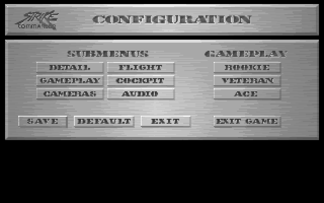
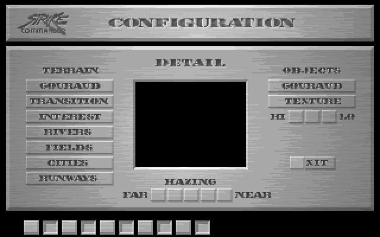

# Panneau CONFIGURATION du vol (ALT+O, STRIKE.EXE)

Lu le 2026-11-03 dans `analysis/annotated_segments/seg047_annotated.asm` (touches),
`ovr267_annotated.asm` (panneau) et `ovr266_annotated.asm` (dessin, sauvegarde). Les chaînes du
segment de données (noms de fichiers) ne sont pas dans les fichiers annotés : elles ont été lues dans
`source/strike.asm`, autour de `aMainopt`. Valeurs en décimal.



Image composée avec `FONTS\MAINOPT.SHP` aux positions du code, sur fond noir, avec
`PALETTE\PALETTE.IFF` : la fonction du panneau ne charge aucune palette ; dans le jeu, le panneau est
dessiné par-dessus l'image figée du vol.

## 1. De la touche au panneau : `Input_AltKeyCommands_26F7E`

Fonction des touches ALT du vol (ancien nom `Config_ReadCalibration`, faux), appelée par les boucles
de vol.

1. Si `byte_6E345` est posé, elle ne fait rien.
2. Elle lit l'événement clavier ; le code de la touche est dans `byte_722D1`.
3. Elle exige **ALT** enfoncé, **sans MAJ ni CTRL** (deux sources : les bits de l'événement
   `byte_722D3` quand `byte_722D0` = 1, sinon l'état des touches gauche et droite).
4. Aiguillage sur le code de la touche (codes clavier du PC) :

| Touche | Code | Effet |
|---|---|---|
| ALT+O | 24 | coupe les effets sonores, **ouvre le panneau CONFIGURATION** ; au retour, relance ou arrête la musique si son interrupteur a changé dans le panneau |
| ALT+S | 31 | effets sonores marche / arrêt |
| ALT+J | 36 | pour chaque manette présente (0 et 1), une fonction de manette pas encore nommée (relais `VROOMM_StubThunk_6B745`) |
| ALT+X | 45 | `Input_CalibrationHandler` ; s'il rend vrai, fin demandée (`byte_6E345` = 1) |
| ALT+M | 50 | musique marche / arrêt |

Ouverture du panneau (cas 24) :

```
mov     al, byte_7236B          ; musique active avant le panneau
mov     [bp+var_7], al
call    SoundFX_StopAll_5AA95
push    5240h                   ; structure de configuration (DGROUP 21056)
call    VROOMM_StubThunk_6B7F0  ; → Options_ConfigurationScreen_90D20
```

La structure de configuration (DGROUP 21056) est celle que le bouton SAVE écrit dans `OPTIONS.CFG`.

## 2. Le panneau : `Options_ConfigurationScreen_90D20`

Ancien nom `Cockpit_LoadAndInitFull_90D20`, faux : rien ne vient de `COCKPITS`.

### 2.1 Ouverture

- `Cockpit_PanAzimuthUpdate` sur l'objet DGROUP 21530 avec la valeur 256 (rôle non établi).
- **Image du vol mise de côté** : `UI_ApplyEncodingHelper_5E576` copie l'écran (`word_70E62`) dans un
  tampon (DGROUP 20886) ; le sens de la copie est déduit de l'ordre des arguments, qui s'inverse au
  dessin (fonction de copie non lue). Quand `byte_721F0` = 2, le code passe à la place par
  `EMS_MapPage` et des appels `int 15h` (AX = 4617) : rôle de ce mode non établi.

### 2.2 Construction (à chaque ouverture et retour de sous-écran)

- Charge `FONTS\MAINOPT.SHP` (chaînes « FONTS », « mainopt », « .shp ») : 28 images.
  - image 0 : bandeau du titre « CONFIGURATION » (310 × 31) ;
  - image 1 : panneau des boutons (310 × 99) ;
  - images 2 à 27 : les 13 boutons, chacun en image normale puis image enfoncée.
- Fenêtre (0, 0)-(319, 199), puis 13 boutons, chacun avec un rectangle, une image, une variable
  mise à 1 par un clic :

| Bouton | Position | Taille | Images | Effet |
|---|---|---|---|---|
| DETAIL | (36, 61) | 66 × 11 | 2, 3 | sous-écran `Options_DetailScreen_91D29` (`DETLOPT.SHP`) |
| FLIGHT | (106, 61) | 66 × 11 | 8, 9 | sous-écran `Options_FlightScreen_90097` (`FLITOPT.SHP`) |
| GAMEPLAY | (36, 74) | 66 × 11 | 4, 5 | sous-écran `Options_GameplayScreen_92E60` (`GAMEOPT.SHP`) |
| COCKPIT | (106, 74) | 66 × 11 | 10, 11 | sous-écran `Options_CockpitScreen_93295` (`COCKOPT.SHP`) |
| CAMERAS | (36, 87) | 66 × 11 | 6, 7 | sous-écran `Options_CamerasScreen_93BA5` (`CAMROPT.SHP`) |
| AUDIO | (106, 87) | 66 × 11 | 12, 13 | sous-écran `Options_AudioScreen_9416A` (`AUDIOPT.SHP`) |
| ROOKIE | (211, 61) | 66 × 11 | 14, 15 | réglages du niveau `Options_PresetRookie_91B2C` (§ 2.4) |
| VETERAN | (211, 74) | 66 × 11 | 16, 17 | réglages du niveau `Options_PresetVeteran_91AE9` |
| ACE | (211, 87) | 66 × 11 | 18, 19 | réglages du niveau `Options_PresetAce_91AA6` |
| SAVE | (18, 114) | 48 × 11 | 20, 21 | `Options_SaveConfig_8FB73` : écrit `OPTIONS.CFG` |
| DEFAULT | (73, 114) | 59 × 11 | 22, 23 | `Options_LoadDefaults_8FD2A` : relit `OPTDFLT.CFG` et applique |
| EXIT | (139, 114) | 49 × 11 | 24, 25 | ferme le panneau |
| EXIT GAME | (211, 114) | 66 × 11 | 26, 27 | sous-écran `Options_ExitGameScreen_9277C` (`RESTART.SHP`) ; son résultat décide la fermeture |

Création d'un bouton (le premier, DETAIL) :

```
push    large 0B0042h           ; taille : 66 × 11
push    large 3D0024h           ; position : (36, 61)
push    ax
call    VROOMM_StubThunk_6C76C
...
mov     word ptr [di+28h], 2    ; image normale
lea     ax, [bp+var_12+2]
mov     [di+2Ah], ax            ; variable mise à jour par le clic
mov     word ptr [di+2Ch], 1    ; valeur écrite
mov     word ptr [di+2Eh], 3    ; image enfoncée
```

### 2.3 Dessin et boucle

À chaque tour, `Options_DrawPanel_8FA4C` :
1. recopie l'image du vol mise de côté à l'ouverture ;
2. dessine l'image 0 en (5, 4) (`push large 40005h`) ;
3. dessine l'image 1 en (5, 39) (`push large 270005h`) ;

puis la fenêtre dessine les 13 boutons par-dessus.

La souris est lue avec `Input_GetCalibratedXValue_67481` (x divisé par 2 : la souris compte de 0 à
639) et `Input_GetCalibratedYValue_67499`.

Après un clic :
- ROOKIE, VETERAN, ACE : réglages appliqués, le panneau reste ouvert ;
- un sous-menu, SAVE ou DEFAULT : le panneau se ferme, l'action est jouée, puis le panneau est
  reconstruit (`MAINOPT.SHP` rechargé) et rouvert ;
- EXIT : fin ;
- EXIT GAME : fin si l'écran de `RESTART.SHP` le décide.

### 2.4 Niveaux ROOKIE, VETERAN, ACE

Chaque bouton écrit des valeurs fixes dans la structure de configuration ; le rôle de ces champs n'a
pas été établi (l'écran GAMEPLAY, qui les montre sans doute, n'est pas lu).

| Champ | ROOKIE | VETERAN | ACE |
|---|---|---|---|
| +100 | 0 | 1 | 1 |
| +101 | 1 | 1 | 0 |
| +102 | 0 | 1 | 1 |
| +104 | 1 | 0 | 0 |
| +105 | 1 | 1 | 0 |
| +106 | 1 | 1 | 0 |
| +107 | 1 | 0 | 0 |
| +108 | 1 | 0 | 0 |
| +109 | 1 | 1 | 0 |
| +110 | 1 | 0 | 0 |
| +111 (mot) | 2 | 1 | 0 |
| +115 | 1 | 1 | 0 |
| +116 | 0 | 1 | 1 |
| +117 | 0 | 1 | 1 |

### 2.5 Fermeture

`Cockpit_ReadControlsFrame_8F720` (applique les réglages : manettes, souris, et
`PilotProfile_RescaleSkillByDifficulty_12FC9` sur les objets du monde), `TextScrollDisplayB_ApplyHelperD_67F60`,
`Cockpit_ApplyEncodingWrapper_8FB2A`, puis `Kneeboard_ProcessSelected` (DGROUP 22989).

## 3. Points ouverts

- Les sept sous-écrans (`Options_*Screen_*`, 470 à 1 017 lignes chacun) ne sont pas lus.
- Rôle des champs écrits par ROOKIE, VETERAN, ACE.
- Mode `byte_721F0` = 2 (pages EMS et `int 15h` à l'ouverture et au dessin).
- Classe des boutons et de la fenêtre (relais `VROOMM_StubThunk_6C76C`, `6C969`, `6C95A`…) : les noms
  actuels de leurs cibles (`PaletteScreen_*`, `GaugeWidget_*`) viennent d'un inventaire rapide et ne
  correspondent pas à cet usage.

## 4. Sous-écran DETAIL : `Options_DetailScreen_91D29`

Lu le 2026-11-03 (`analysis/annotated_segments/ovr268_annotated.asm`). Fichier d'images
`FONTS\DETLOPT.SHP` (52 images). Image composée avec les images aux positions du code, sur fond noir :
`options_images/detlopt.png`.



- **Titres et libellés des colonnes** (DETAIL, TERRAIN, OBJECTS, HAZING, HI, LO, FAR, NEAR) : dans
  l'image 1 ; le rendu, sans police, les montre.
- **Boutons** (paires normale / enfoncée) :

| Bouton | Position | Taille | Images |
|---|---|---|---|
| GOURAUD (terrain) | (22, 67) | 73 × 11 | 2, 3 |
| TRANSITION | (22, 80) | 73 × 11 | 4, 5 |
| INTEREST | (22, 93) | 73 × 11 | 6, 7 |
| RIVERS | (22, 106) | 73 × 11 | 8, 9 |
| FIELDS | (22, 119) | 73 × 11 | 10, 11 |
| CITIES | (22, 132) | 73 × 11 | 12, 13 |
| RUNWAYS | (22, 145) | 73 × 11 | 14, 15 |
| GOURAUD (objets) | (226, 67) | 73 × 11 | 26, 27 |
| TEXTURE | (226, 80) | 73 × 11 | 28, 29 |
| EXIT | (244, 132) | 38 × 11 | 24, 25 |

- **Cases** : les images 16 à 25 font 13 × 12 ; elles servent aux cases HI, LO (3 cases) et HAZING
  (5 cases, entre FAR et NEAR). Le code qui choisit quelle image de la paire montrer n'est pas lu.
- **Jauges** : deux widgets de jauge (`GaugeWidgetVariantD_ConstructAndInit_A4270`) aux positions
  (243, 93) et (127, 159). Leur rôle n'est pas établi.
- **Zone noire au centre** : sur le rendu, c'est l'emplacement de l'aperçu ; elle n'est pas une image
  du fichier. Le code qui la dessine n'est pas lu.
- **Dessin** : `Cockpit_ApplyFormatAndDraw_91B70` (nom actuel, non lu) appelle `TextRenderer_ApplyFormatChange_5E34D`,
  donc du texte peut être dessiné avec la police à cet endroit. Ce qu'elle écrit n'est pas établi.

## 5. Tous les menus ouverts par ALT+O

Inventaire relevé par `tools/options_layout.py` (lit `analysis/annotated_segments/`, écrit
`analysis/options_layout.json`). Images composées avec les fichiers `FONTS\*.SHP` aux positions du code
(`options_images/menu_*.png`, planche `options_images/menus_alt_o.png`).

### 5.1 Méthode de dessin, vérifiée par rendu

1. Image 0 du fichier de l'écran, en (5, 4) : bandeau « CONFIGURATION » (310 × 31).
2. Image 1, en (5, 39) : fond du panneau. **Elle contient déjà tous les libellés** (boutons, titres,
   listes), dans leur aspect neutre. Un rendu avec la seule image 1 les montre tous.
3. Boutons : image normale, puis une image enfoncée au clic. Chaque image de bouton porte aussi son
   libellé (image 2 : GOURAUD relevé, image 3 : le même enfoncé ; image 36 : EXIT).
4. Jauges et images dynamiques : voir § 5.3 et § 5.4.

Tous les écrans sont dessinés à partir de la même palette (`PALETTE\PALETTE.IFF` pour les rendus ; le
jeu envoie la palette du vol, voir § 2.1).

### 5.2 Boutons par écran

Coordonnées (x, y), taille en pixels, images normale / enfoncée. Les noms viennent du rendu : la place
d'un libellé dans la fiche est celle de sa position à l'écran.

Panneau principal (`MAINOPT.SHP`) :

| Libellé | Position | Taille | Images | Sous-écran |
|---|---|---|---|---|
| DETAIL | (36, 61) | 66 × 11 | 2, 3 | Options_DetailScreen_91D29 |
| FLIGHT | (106, 61) | 66 × 11 | 8, 9 | Options_FlightScreen_90097 |
| GAMEPLAY | (36, 74) | 66 × 11 | 4, 5 | Options_GameplayScreen_92E60 |
| COCKPIT | (106, 74) | 66 × 11 | 10, 11 | Options_CockpitScreen_93295 |
| CAMERAS | (36, 87) | 66 × 11 | 6, 7 | Options_CamerasScreen_93BA5 |
| AUDIO | (106, 87) | 66 × 11 | 12, 13 | Options_AudioScreen_9416A |
| ROOKIE | (211, 61) | 66 × 11 | 14, 15 | Options_PresetRookie_91B2C |
| VETERAN | (211, 74) | 66 × 11 | 16, 17 | Options_PresetVeteran_91AE9 |
| ACE | (211, 87) | 66 × 11 | 18, 19 | Options_PresetAce_91AA6 |
| SAVE | (18, 114) | 48 × 11 | 20, 21 | Options_SaveConfig_8FB73 |
| DEFAULT | (73, 114) | 59 × 11 | 22, 23 | Options_LoadDefaults_8FD2A |
| EXIT | (139, 114) | 49 × 11 | 24, 25 | fermeture |
| EXIT GAME | (211, 114) | 66 × 11 | 26, 27 | Options_ExitGameScreen_9277C |

DETAIL (`DETLOPT.SHP`) : TERRAIN GOURAUD (22, 67) 2/3, TRANSITION (22, 80) 4/5, INTEREST (22, 93) 6/7,
RIVERS (22, 106) 8/9, FIELDS (22, 119) 10/11, CITIES (22, 132) 12/13, RUNWAYS (22, 145) 14/15 ;
OBJECTS GOURAUD (226, 67) 26/27, TEXTURE (226, 80) 28/29 ; EXIT (244, 132) 36/37.

FLIGHT (`FLITOPT.SHP`) : MIDAIR COLLISIONS (121, 62) 29/30, EASY LANDINGS (121, 81) 31/32, STALLS (121, 119)
36/37, EXIT (131, 176) 38/39. SHOW WEAPONS (121, 100) 33/34 (fixe, § 5.4) ; CALIBRATE JOYSTICK (93, 146) : images dynamiques (§ 5.4).

GAMEPLAY (`GAMEOPT.SHP`) : UNLIMITED AMMO (48, 70) 2/3, EASY GUN HITS (48, 90) 4/5, EXIT (129, 122) 12/13.

COCKPIT (`COCKOPT.SHP`) : à gauche (45, y) avec y = 62, 75, 88, 101, 114 : images 2/3, 4/5, 6/7, 8/9, 10/11 ;
à droite (162, y) avec les mêmes y : 12/13, 14/15, 16/17, 18/19, 20/21 ; EXIT (129, 142) 22/23.
Libellés d'après le rendu : gauche LADDER, TAPES, AUTO TARGET, 360 TARGET LOCK, SMART TARGETING ;
droite SUN GLARE, G EFFECTS, SMART RADAR, 360 AA RADAR, SMART RAW SCOPE.

CAMERAS (`CAMROPT.SHP`) : AUTO SWITCHING (22, 60) 2/3, VICTIM VIEW (164, 60) 4/5, WEAPON CAMERA (22, 73) 6/7 ;
TERRAIN IN GUN CAMERA (164, 73) : 8/9 ou 10/10 selon la mémoire (§ 5.4) ; EXIT (129, 124) 17/18.

AUDIO (`AUDIOPT.SHP`) : MUSIC (88, 63), SOUND FX (88, 76), SPEECH (165, 63), DIGITAL FX (165, 76) :
toutes dynamiques (§ 5.4) ; EXIT (129, 101) 14/15.

EXIT GAME (`RESTART.SHP`) : RESTART (54, 80) 2/3, ABORT (126, 80) 4/5, CONTINUE (198, 80) 6/7 ;
un élément vertical à droite (290, 55), 11 × 29, dynamique, rôle non établi.

Chaque bouton écrit la valeur 1 au clic (champ `[di+44]`), sauf les boutons à image dynamique dont la
valeur n'est pas relevée.

### 5.3 Jauges : les listes à choix

Un widget jauge (`GaugeWidgetVariantD_ConstructAndInit_A4270`, dessin `GaugeWidget_DrawByMode_A39DC`) n'a
pas de paire d'images dans le code de construction. D'après le rendu, les jauges correspondent aux listes
de choix sans bouton propre :

| Écran | Position | Taille | Liste visible (d'après le rendu) |
|---|---|---|---|
| FLIGHT | (17, 66) | 89 × 65 | FLIGHT CONTROL : KEYBOARD, MOUSE, JOYSTICK, F's PRO, THRUSTMASTER |
| FLIGHT | (212, 66) | 89 × 78 | PANNING CONTROL : KEYBOARD, MOUSE, JOYSTICK, F's PRO, THRUSTMASTER, NONE |
| GAMEPLAY | (197, 74) | 66 × 39 | ENEMY INTELLIGENCE : ROOKIE, VETERAN, ACE |
| CAMERAS | (53, 102) | 210 × 11 | WINDOW SIZE : SMALL, MEDIUM, LARGE |
| DETAIL | (243, 93) | 40 × 11 | probablement la ligne HI / LO (hypothèse) |
| DETAIL | (127, 159) | 68 × 11 | probablement la ligne HAZING, FAR / NEAR (hypothèse) |

Les jauges de DETAIL sont des hypothèses : leur valeur initiale est 0, et le code de dessin n'a pas été lu.
Le rendu ne montre pas la mise en évidence de l'élément choisi : elle est dessinée par la jauge, non lue.

### 5.4 Images dynamiques (choisies à l'exécution)

**AUDIO, résolu.** Les quatre boutons prennent leur paire d'images dans des variables locales préparées
en début de fonction. Deux drapeaux de la configuration (`byte_70996` et `word_70999`, rôle non établi)
les modifient :

| Bouton | Paire par défaut | Si `byte_70996` = 0 | Si `word_70999` = 0 |
|---|---|---|---|
| MUSIC (88, 63) | 2, 3 | 4, 4 | — |
| SOUND FX (88, 76) | 8, 9 | 10, 10 | — |
| SPEECH (165, 63) | 5, 6 | — | 7, 7 |
| DIGITAL FX (165, 76) | 11, 12 | — | 13, 13 |

Une paire dont les deux images sont identiques (4, 4 ; 10, 10 ; 7, 7 ; 13, 13) est sans doute l'état
désactivé, mais l'aspect de ces images n'a pas été vérifié. Quelle paire correspond à « activé » dépend
du sens des drapeaux, non établi.

**FLIGHT (résolu en partie).**

- SHOW WEAPONS (121, 100) : paire 33 / 34, écrite une fois en début de fonction et jamais modifiée.
  Elle est donc fixe, pas dynamique.
- CALIBRATE JOYSTICK (93, 146) : normale = variable de la paire 40 ; enfoncée = variable de la paire 41.
  Si l'octet brut du bouton 0 de la manette (`Joystick_GetButtonRawByte_67B82`, argument 0) est nul,
  les deux variables deviennent 42.
  Vérifié par rendu : l'image 42 porte un libellé différent, « JOYSTICK CALIBRATION », alors que les
  images 40 et 41 portent « CALIBRATE JOYSTICK ». Le fond (image 1) contient aussi « CALIBRATE JOYSTICK » ;
  la superposition réelle sous la condition n'a pas été vérifiée.
  La condition n'est pas nommée : l'octet brut peut indiquer une manette présente (hypothèse).
- Un second drapeau, `byte_72E6C`, change d'autres variables (`var_10`, `var_12`, `var_6`) : quand il est
  nul, `var_12` et `var_10` valent 17, et `var_6` vaut 6. Ces variables sont lues plus loin, et la
  cible de cette lecture n'est pas tracée.

**CAMERAS (résolu en partie).**

- TERRAIN IN GUN CAMERA (164, 73) : normale = variable de la paire 8, enfoncée = variable de la paire 9.
  Si la valeur dword renvoyée par `Memory_TypedAllocDispatchC_5C86D` (appelée avec l'argument 5C44h)
  est inférieure à 40960 (`cmp eax, 0A000h` / `jge`), les deux variables deviennent 10.
  Vérifié par rendu : les images 8 et 9 sont le libellé « TERRAIN IN GUN CAMERA » normal et enfoncé ;
  l'image 10 porte le même libellé avec un aspect plus clair, sans doute l'état désactivé (non vérifié).
  La sémantique de la valeur renvoyée n'est pas établie : la mémoire disponible est une hypothèse.

**EXIT GAME : non résolu.** L'élément vertical (290, 55) prend ses images de `var_A + 70` (lignes 436 et
438 de la fonction), dont le second terme n'est pas tracé.

### 5.5 Points ouverts pour l'implémentation

- Lire `GaugeWidget_DrawByMode_A39DC` : mise en évidence de l'élément choisi, et images utilisées.
- Résoudre les paires dynamiques restantes : EXIT GAME, et les deux conditions de FLIGHT et de CAMERAS (§ 5.4).
- Cible des variables `var_10`, `var_12` et `var_6` de FLIGHT, lues plus loin, et sens de `byte_72E6C`.
- Identifier les drapeaux `byte_70996` et `word_70999`, et le sens des paires « activé » / « désactivé ».
- Rôle des champs écrits par ROOKIE, VETERAN, ACE (§ 2.4).
- Vérifier chaque libellé d'après le rendu (les noms de § 5.2 ne sont pas lus dans le code).
