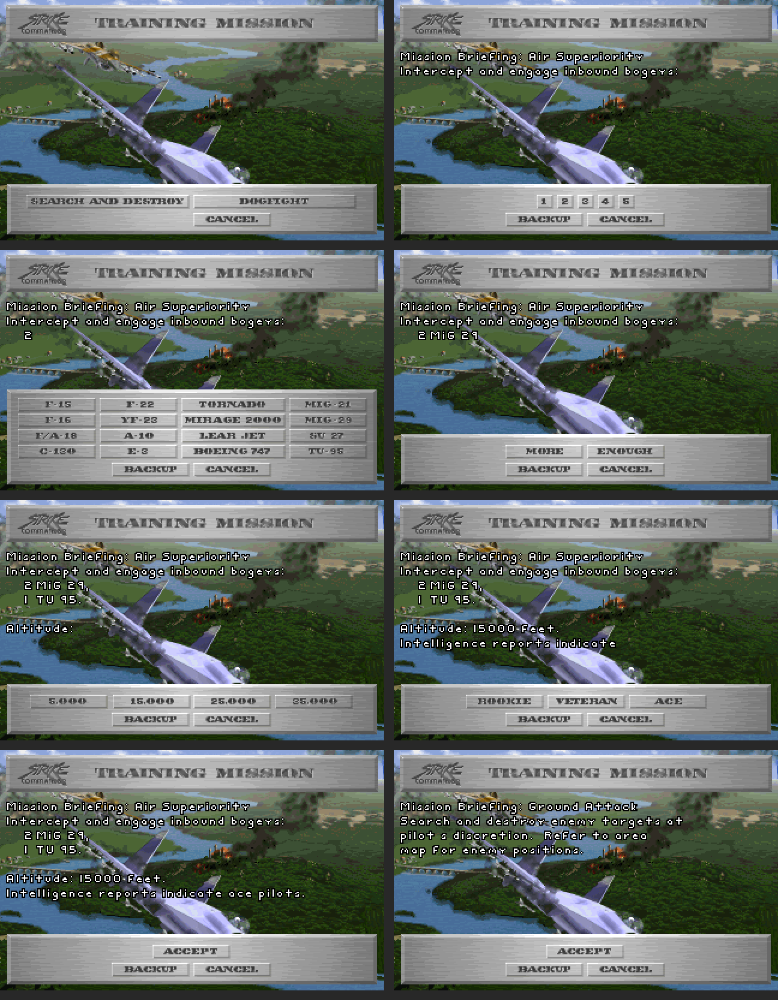

# TRAINING MISSION (OPTEST.EXE) : écrans, réglages et mission transmise à STRIKE.EXE

Lu le 2026-11-04 dans `analysis/optest/annotated_segments/ovr190_annotated.asm` (tout le segment) et dans les fonctions
appelées. Nombres en décimal ; positions d'écran en pixels de l'écran 320 × 200 ; positions du monde en mètres dans
le repère de libRealSpace (Y = altitude ; lecture d'un fichier : `x = c0`, `y = c2`, `z = −c1`).

Outils :
- `tools/instant_mission.py` reproduit la construction du fichier de mission et lit un fichier produit (§ 6) ;
- `analysis/training_images/` : rendus des écrans (§ 3), faits avec les images du jeu aux positions du code.

## 1. Enchaînement

1. Menu d'accueil (`Gameflow_MainMenu_4F1A7`) : le **choix 3** est traité par `Gameflow_MainLoop_3D2E`, qui appelle
   `Training_Run_597B2`.
2. `Training_Run_597B2` :
   - pose `byte_43BAA` = 1 pendant tout l'entraînement (lu par `Gameflow_WeaponLoadout_51AB3` : il ne change pas
     alors l'ambiance musicale) ;
   - charge la banque `..\..\data\midgames\rmusic.pak` (`amusic.pak` quand `byte_46848` = 2 ; rôle de cet octet non
     établi) par `Speech_LoadBank_28D24` ;
   - initialise les réglages (`Training_InitSettings_598FC`, § 4) et ouvre les écrans (`Training_TypeScreen_5547D`, § 3).
3. Réglages acceptés : `Training_Run_597B2` remplit le **stock d'armes** de la partie (§ 7), pose `[partie+252]` = 11
   et ouvre l'**écran d'armement** de la campagne (`Gameflow_WeaponLoadout_51AB3`, argument 0).
4. Armement validé : `Training_BuildInstantMission_58EEA` écrit **`instant.iff`** (§ 6).
5. `Training_Run_597B2` renvoie 1. `Gameflow_MainLoop_3D2E` pose alors `[partie+249]` = 254 (mission à voler) et
   `[partie+232]` = 1 (**départ en vol**, `GAMEFLOW_SYSTEM.md` § 3). Avec 254, le départ ne fait pas avancer la
   campagne (`Gameflow_SaveTmpState_4BBA0` n'est pas appelée), et `Gameflow_WriteMissionOrder_4BBF7` écrit
   l'ordre de mission `op2misn.iff` avec le nom de mission « instant » (§ 7).

CANCEL, à n'importe quel écran, ramène au menu sans vol (`Training_Run_597B2` renvoie 0).

## 2. Fichiers lus

| Fichier | Contenu employé |
|---|---|
| `GAMEFLOW\OBJVIEW.PAK` | entrée 7 : palette ; entrée 6 : image de fond plein écran, en (0, 0) ; entrée 1 : bandeau « TRAINING MISSION », en (4, 3) |
| `GAMEFLOW\TM.SHP` | 99 images : les panneaux et tous les boutons (paires normale / enfoncée) |
| `GAMEFLOW\BWFONT.SHP` | police chargée par le premier écran |
| `MISSIONS\TEMPLATE.IFF` | mission modèle, recopiée dans `instant.iff` (§ 6) |
| `MIDGAMES\RMUSIC.PAK` ou `AMUSIC.PAK` | banque chargée à l'entrée (§ 1) |

Les entrées d'`OBJVIEW.PAK` ne sont pas compressées : l'octet haut de leur position vaut 224 ou 193 (et non 0 ou 32
comme dans d'autres PAK) ; la position est sur les 3 octets bas.

Le fond et le bandeau sont dessinés une fois, par le premier écran. Les écrans suivants ne changent que le
**panneau du bas** et ajoutent des lignes de texte au-dessus.

## 3. Les écrans



Rendus : le texte est dessiné avec `BWFONT.SHP`, mais l'espacement des lettres est supposé (non lu) ; les lettres
absentes de la police (« - », « ' ») sont laissées en blanc. Le reste (fond, panneaux, boutons) est aux positions du
code.

Chaque panneau est un `WidgetPanel_Construct_DAEB` : position, taille, image de `TM.SHP`. Les positions des boutons
sont **relatives au coin du panneau** (vérifié par rendu : les boutons tombent dans les cases du panneau). Un bouton
porte deux images de `TM.SHP` (normale, enfoncée) et une valeur rendue au clic. Dans tous les écrans, **BACKUP**
revient à l'écran précédent (et efface les textes que cet écran a écrits) ; **CANCEL** quitte l'entraînement.

### 3.1 Type de mission (`Training_TypeScreen_5547D`)

Panneau en (6, 153), 308 × 42, image 0.

| Bouton | Position | Taille | Images | Suite |
|---|---|---|---|---|
| SEARCH AND DESTROY | (16, 9) | 136 × 12 | 1, 2 | § 3.8 |
| DOGFIGHT | (155, 9) | 136 × 12 | 3, 4 | § 3.2 |
| CANCEL | (155, 24) | 65 × 12 | 5, 6 | fin |

Le choix est rangé dans les réglages (+40 : 1 = DOGFIGHT, 2 = SEARCH AND DESTROY).

### 3.2 Nombre d'avions du groupe (`Training_GroupCountScreen_56366`)

Avant le premier groupe, `Training_DogfightBriefing_58E2A` écrit « Mission Briefing: Air Superiority » en (5, 43) et
« Intercept and engage inbound bogeys: » en (5, 55).

Panneau en (6, 153), image 7.

| Bouton | Position | Taille | Images |
|---|---|---|---|
| 1 | (113, 9) | 14 × 12 | 8, 9 |
| 2 | (130, 9) | 14 × 12 | 10, 11 |
| 3 | (147, 9) | 14 × 12 | 12, 13 |
| 4 | (164, 9) | 14 × 12 | 14, 15 |
| 5 | (181, 9) | 14 × 12 | 16, 17 |
| BACKUP | (87, 24) | 65 × 12 | 18, 19 |
| CANCEL | (155, 24) | 65 × 12 | 20, 21 |

Le nombre choisi est écrit en (20, 67 + 12 × groupe) ; groupe = 0, 1 ou 2.

### 3.3 Type d'avion du groupe (`Training_AircraftScreen_56B04`)

Panneau plus haut : en (6, 116), 308 × 79, image 22. Seize boutons de 65 × 12 sur 4 colonnes (x = 9, 77, 145, 235) et
4 lignes (y = 7, 20, 33, 46), plus BACKUP en (87, 61), images 55 et 56, et CANCEL en (155, 61), images 57 et 58.

| Colonne x = 9 | Colonne x = 77 | Colonne x = 145 | Colonne x = 235 |
|---|---|---|---|
| F-15 (23, 24) | F-22 (31, 32) | TORNADO (39, 40) | MIG-21 (47, 48) |
| F-16 (25, 26) | YF-23 (33, 34) | MIRAGE 2000 (41, 42) | MIG-29 (49, 50) |
| F/A-18 (27, 28) | A-10 (35, 36) | LEAR JET (43, 44) | SU 27 (51, 52) |
| C-130 (29, 30) | E-3 (37, 38) | BOEING 747 (45, 46) | TU-95 (53, 54) |

Le nom de l'avion (table du § 5) est écrit en (30, 67 + 12 × groupe), suivi de « . » pour le 3e groupe. Après le 1er
et le 2e groupe : § 3.4 ; après le 3e : § 3.5 directement (**3 groupes au plus**).

### 3.4 Autre groupe ? (`Training_MoreEnoughScreen_57FDA`)

Panneau en (6, 153), image 59.

| Bouton | Position | Images | Effet |
|---|---|---|---|
| MORE | (87, 9) | 60, 61 | écrit « , » (après le 1er groupe) ou « , and » (après le 2e), groupe suivant : § 3.2 |
| ENOUGH | (155, 9) | 62, 63 | écrit « . », § 3.5 |
| BACKUP | (87, 24) | 64, 65 | |
| CANCEL | (155, 24) | 66, 67 | |

### 3.5 Altitude (`Training_AltitudeScreen_55C92`)

Écrit « Altitude: » en (5, 103). Panneau en (6, 153), image 68.

| Bouton | Position | Images | Réglage +0 (pieds) |
|---|---|---|---|
| 5,000 | (19, 9) | 69, 70 | 5000 |
| 15,000 | (87, 9) | 71, 72 | 15000 |
| 25,000 | (155, 9) | 73, 74 | 25000 |
| 35,000 | (223, 9) | 75, 76 | 35000 |
| BACKUP | (87, 24) | 77, 78 | |
| CANCEL | (155, 24) | 79, 80 | |

Réglage = choix × 10000 − 5000 (`imul eax, 2710h` puis `add eax, 0FFFFEC78h`), écrit derrière « Altitude: » avec
« %ld feet. ».

### 3.6 Niveau des pilotes (`Training_PilotLevelScreen_584BD`)

Écrit « Intelligence reports indicate » en (5, 115). Panneau en (6, 153), image 81.

| Bouton | Position | Images | Réglage +18 |
|---|---|---|---|
| ROOKIE | (54, 9) | 82, 83 | 0 |
| VETERAN | (122, 9) | 84, 85 | 1 |
| ACE | (190, 9) | 86, 87 | 2 |
| BACKUP | (87, 24) | 88, 89 | |
| CANCEL | (155, 24) | 90, 91 | |

Écrit ensuite « rookie pilots. », « veteran pilots. » ou « ace pilots. » derrière la ligne.

### 3.7 Validation (`Training_AcceptScreen_58A9D`)

Panneau en (6, 153), image 92 : ACCEPT en (121, 9), images 93 et 94 ; BACKUP en (87, 24), 95 et 96 ; CANCEL en
(155, 24), 97 et 98. ACCEPT termine les écrans : § 1, étape 3.

### 3.8 SEARCH AND DESTROY

`Training_SearchBriefing_58E74` écrit 4 lignes, en (5, 43), (5, 55), (5, 67) et (5, 79) :

```
Mission Briefing: Ground Attack
Search and destroy enemy targets at
pilot's discretion.  Refer to area
map for enemy positions.
```

puis ouvre directement la validation (§ 3.7). Ce type n'a **aucun réglage** : ni avions, ni altitude, ni niveau
(l'altitude reste à 5000 pieds, valeur initiale).

### 3.9 Textes

Les textes sont écrits par `Training_PrintText_55BDC` (couleur 255), qui sauvegarde d'abord la zone d'écran couverte
(`Training_SaveRegion_552E0`) ; BACKUP la recopie à l'écran (`Training_EraseLastText_55C7B`), ce qui efface le texte.

## 4. Les réglages (`Training_InitSettings_598FC`, 42 octets)

| Octets | Contenu | Valeur initiale |
|---|---|---|
| 0-3 | altitude en pieds (§ 3.5) | 5000 |
| 6, 8, 10 | type d'avion des groupes 0, 1, 2 (rang dans la table du § 5, 0 à 15) | — |
| 12, 14, 16 | nombre d'avions des groupes 0, 1, 2 | 0 |
| 18 | niveau des pilotes : 0 rookie, 1 veteran, 2 ace | 0 |
| 20 | nombre total d'avions | 0 |
| 22 | groupe en cours | 0 |
| 24-29 | liste des zones d'écran sauvegardées sous les textes | — |
| 30-37 | images `TM.SHP` | — |
| 40 | type : 1 DOGFIGHT, 2 SEARCH AND DESTROY | 0 |

## 5. La table des avions

Dans le segment de données d'OPTEST, 16 enregistrements de 15 octets, dans l'ordre des valeurs des boutons du § 3.3.
Le code lit le mot 0 (nom affiché), le mot 2 (fichier objet), le mot 4 (emport) et l'octet 14 (drapeau). Les deux
dwords des octets 6 à 13 sont rangés dans la table ; ils ne sont pas lus par les fonctions de ce segment.

| N° | Nom affiché | Fichier objet | Emport | Octets 6-9 | Octets 10-13 | Drapeau |
|---|---|---|---|---|---|---|
| 1 | F-15 | f-15 | f15loada | 29000 | 11000 | 1 |
| 2 | F-16 | f-16gray | f16loada | 34400 | 11100 | 1 |
| 3 | F/A-18 | f-18 | f18loada | 33400 | 9400 | 1 |
| 4 | C-130 | c130des | (vide) | 23400 | 6900 | 0 |
| 5 | F-22 | f-22 | f22load | 46300 | 15200 | 1 |
| 6 | YF-23 | yf23 | yf23load | 23400 | 7800 | 1 |
| 7 | A-10 | a-10 | (vide) | 31200 | 10100 | 1 |
| 8 | E-3 | awacs | (vide) | 24500 | 7200 | 0 |
| 9 | Tornado | torncg | tornload | 30700 | 9400 | 1 |
| 10 | Mirage 2000 | mirage | mirloada | 26000 | 6500 | 1 |
| 11 | Lear Jet | learjet | (vide) | 29500 | 9000 | 0 |
| 12 | 747 | 747 | (vide) | 29400 | 9100 | 0 |
| 13 | MiG-21 | mig21 | m21loada | 24100 | 7000 | 1 |
| 14 | MiG-29 | mig29 | m29loada | 33500 | 15300 | 1 |
| 15 | Su-27 | su27 | sumload | 29700 | 12600 | 1 |
| 16 | TU-95 | tu-20 | tu20load | 26500 | 8300 | 0 |

Ce que le drapeau change dans la mission produite (§ 6.4) : pilote CAST au niveau choisi ou « target », programme
de mise à jour 1 ou 2, vitesse initiale 200 ou 100.

## 6. La mission produite : `instant.iff`

`Training_BuildInstantMission_58EEA` lit `..\..\data\missions\template.iff` et écrit `instant.iff` dans le répertoire
courant (sans chemin). Le fichier est **une copie du modèle**, chunk par chunk, avec des ajouts.

### 6.1 Le modèle `TEMPLATE.IFF`

| Chunk | Contenu |
|---|---|
| `INFO` | « arena » |
| `TUNE` | 3 |
| `FORM WRLD` / `FILE` | `ARENA` (théâtre) |
| `AREA` | 13 zones sphériques (Strike Base, Halverston, Roberts Pass, …, Lemons Crevasse) |
| `SPOT` | 22 points |
| `FLAG` | 1 drapeau |
| `CAST` | 3 noms : PLAYER, STRIBASE, NULL |
| `PROG` | 5 programmes (ci-dessous) |
| `PART` | 3 objets : `f-16des` (le joueur), `STRIBASE`, `RWYEXT18` |
| `FORM PLAY` | 14 scènes `SCNE` |
| `LOAD` | 21 noms |

Programmes du modèle employés par les objets ajoutés (`tools/mission_prog.py`) :

Programme 1 (mise à jour des avions armés) :

```
OP_SET_OBJ_DESTROY_TARGET 0
```

Programme 2 (mise à jour des avions non armés) :

```
OP_SET_OBJ_FLY_TO_WP 18
```

Programme 3 (destruction d'un avion ajouté) :

```
OP_MOVE_VALUE_TO_WORK_REGISTER 1
OP_SUB_WORK_FROM_FLAG 1
OP_MOVE_FLAG_TO_WORK_REGISTER 1
OP_CMP_WORK_WITH_VALUE 0
OP_BRANCH_IF_NOT_EQUAL 78
OP_SET_FLAG_TO_TRUE 0
OP_SET_LABEL 78
```

Programme 4 (mise à jour de `STRIBASE`) :

```
OP_TEST_FLAG 0
OP_BRANCH_IF_NOT_EQUAL 78
OP_SET_MESSAGE 20
OP_SET_FLAG_TO_FALSE 0
OP_SET_LABEL 78
```

`FLAG[1]` est le mot ajouté par la construction (§ 6.3) : le nombre d'avions. Chaque destruction le diminue de 1 ;
à 0, `FLAG[0]` passe à 1.

### 6.2 Ordre d'écriture

1. `FORM MISN`.
2. Les chunks du modèle jusqu'à `AREA`, recopiés (`ResourceRecord_CopyChunksUntilTag_3CBF6`) : `VERS`, `INFO`, `TUNE`,
   `FORM WRLD`.
3. `AREA` : les zones du modèle, plus une zone en DOGFIGHT (§ 6.3).
4. Les chunks jusqu'à `FLAG`, recopiés : `SPOT`, `NUMS`, `MSGS`.
5. `FLAG`, `CAST`, `PART`, avec ajouts (§ 6.3, § 6.4).
6. `PROG`, `TEAM`, recopiés.
7. `FORM PLAY` : les scènes du modèle, plus une scène en DOGFIGHT (§ 6.5).
8. `LOAD`, recopié.

Dans le fichier produit, `PART` vient avant `PROG`, alors que le modèle a `PROG` avant `PART`.

### 6.3 Ajouts aux chunks `AREA`, `FLAG` et `CAST`

- **`AREA`** (DOGFIGHT seulement) : une sphère de 49 octets, nom « Destroy bogeys », centre x = −66000, z = −128000,
  **y = le nombre de pieds choisi, recopié sans conversion** (`shl eax, 8` sur la valeur en pieds : 5000 à 35000),
  rayon 45000. C'est la zone n° 13 (numérotée à partir de 0 ; le modèle en a 13).
- **`FLAG`** (les deux types) : un mot ajouté = nombre total d'avions (0 en SEARCH AND DESTROY).
- **`CAST`** (DOGFIGHT) : un nom de 9 octets par avion ajouté, groupe après groupe : « rookie », « veteran » ou « ace »
  si le drapeau de l'avion est posé, « target » sinon. Ce sont des fichiers de `INTEL` (`ROOKIE.IFF`, `VETERAN.IFF`,
  `ACE.IFF`, `TARGET.IFF`).

### 6.4 Les objets `PART`

**Le joueur** (1er objet du modèle, `f-16des`), dans les deux types : position et cap remplacés, le reste gardé
(vitesse initiale 180, camp 1, scripts du modèle).

| Champ | Valeur |
|---|---|
| x | −73000 |
| z | −128000 |
| y (altitude) | pieds × 256 / 839, en 24.8 (`dword_46456` = 839 / 256 ≈ 3,28) |
| cap (fichier) | 90 |

Altitudes obtenues : 5000 pieds → 1525,6 m ; 15000 → 4576,9 m ; 25000 → 7628,1 m ; 35000 → 10679,4 m.
`dword_46456` est posé au démarrage d'OPTEST à 839 / 256 (`loc_22AA3`) ; une fonction pas encore nommée (adresse
C36F7, ovr224) le multiplie par une valeur lue dans un fichier : ce cas n'est pas suivi ici.

Les autres objets du modèle sont recopiés tels quels.

**Les avions ajoutés** (DOGFIGHT), un enregistrement de 62 octets par avion, groupe après groupe (champs : `IMPL_MISSION_PART.md` § 1) :

| Octets | Champ | Valeur |
|---|---|---|
| 0-1 | index CAST | 3 + rang de l'avion (après les 3 noms du modèle) |
| 2-9 | type d'objet | fichier objet de la table (§ 5) |
| 10 | type une fois détruit | chaîne vide |
| 18-25 | emport | emport de la table (vide pour C-130, A-10, E-3, Lear Jet, 747) |
| 26-27 | zone | 65535 (aucune) |
| 28 | mode de placement | 0 |
| 29-40 | position | x = −59000 + 500 × groupe ; z = −(128000 + 300 × rang) ; y = altitude du joueur |
| 41-42 | cap (fichier) | 270 |
| 43-44 | vitesse initiale | 200 si drapeau, 100 sinon |
| 45 | camp | 255 (ennemi) |
| 46, 47 | allié par défaut, octet 47 | 255, 255 |
| 48-53 | poste en formation | 0, 0, 0 |
| 54-61 | scripts PROG | activation 65535 ; mise à jour 1 si drapeau, 2 sinon ; destruction 3 ; début de mission 65535 |

Le rang est compté sur tous les avions ajoutés (0, 1, 2… sans revenir à 0 à chaque groupe) ; le groupe décale en x.
Le premier avion est à 14000 m du joueur sur l'axe x, cap opposé. Conversion du cap pour libRealSpace :
`yaw = 360 − cap` (joueur 270, avions 90).

### 6.5 La scène ajoutée (DOGFIGHT)

Un chunk `SCNE` de 24 octets ajouté à la fin de `FORM PLAY` (15e scène), suivi d'un mot par avion ajouté :

| Octets | Champ | Valeur |
|---|---|---|
| 0 | active | 1 |
| 1-2 | zone | 13 (« Destroy bogeys ») |
| 3-8 | les 3 scripts | 65535 |
| 9 | octet 9 | 0 |
| 10-23 | mot + 3 dwords | 0 |
| 24… | objets de la scène | index PART des avions ajoutés : 3, 4, 5… |

### 6.6 Contrôle

`tools/instant_mission.py` reproduit cette construction sur `TEMPLATE.IFF` :

```
python3 tools/instant_mission.py --donnees <DATA> --sortie INSTANT.IFF dogfight --groupe 2 mig-29 --groupe 1 tu-95 --altitude 15000 --niveau ace
python3 tools/instant_mission.py --donnees <DATA> --sortie INSTANT.IFF search
python3 tools/instant_mission.py --lire INSTANT.IFF
```

Les deux fichiers ainsi produits ont été lus par `RSMission` de libRealSpace, version modifiée de
`tools/mission_ref` (essais `mission_part_test`, `mission_areas_test`, `mission_load_test`) : 0 erreur.

## 7. Ce que reçoit STRIKE.EXE

- **Stock d'armes** de la partie, posé par `Training_Run_597B2` avant l'écran d'armement (`[partie+609 + 2 × arme]`,
  noms de la table DGROUP 712, `GAMEFLOW_SYSTEM.md`) :

| Arme | Stock |
|---|---|
| SWINDERJ | 6 |
| SWINDERM | 6 |
| AGM-65D | 12 |
| DURANDAL | 12 |
| MK20 | 24 |
| MK82 | 24 |
| GBU-15G | 4 |
| POD | 8 |
| AMRAAM | 6 |

- **`op2misn.iff`** (`Gameflow_WriteMissionOrder_4BBF7`) : quand `[partie+249]` = 254, les valeurs habituellement lues
  dans `GAMEFLOW.IFF` (`MLST` / `DATA` : nom du fichier de mission ; `PRTL` : 8 octets puis 1 octet) sont remplacées
  par « instant », « arena » et 21. Le nom « instant » est écrit dans le chunk `INFO` d'`op2misn.iff`, puis les armes
  restantes (`WPNS`). Où « arena » et 21 sont écrits dans le fichier n'est pas relu ici.
- **`instant.iff`** : la mission du § 6, dans le répertoire courant.

## 8. Points ouverts

- Rôle des deux dwords de la table des avions (§ 5) et de l'octet `byte_46848` (§ 1).
- Rôle de `[partie+252]` = 11 pour l'écran d'armement.
- Ce que fait la boucle principale au retour d'un vol d'entraînement (script joué, compte rendu).
- Écriture de « arena » et de 21 dans `op2misn.iff`, et lecture d'`instant.iff` par STRIKE.EXE.
- L'altitude de la zone « Destroy bogeys » est en pieds recopiés comme des mètres, celle des avions est convertie :
  constaté dans le code, conséquence en vol non vérifiée.
