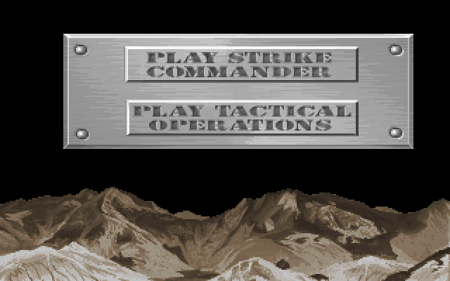

# MENU.EXE (version CD-ROM) : intro et choix du jeu

Exécutable fourni par Rémi le 2026-11-03 (non inclus dans le dépôt), lu sans IDA avec
`tools/exe_disasm.py` (adresses = décalages dans l'image chargée de **cet** exécutable). Borland C++
1991, un seul bloc : pas d'overlays VROOMM (aucune donnée après l'image MZ de 165 728 octets).

## Ce qu'il fait

Boucle de présentation de la version CD qui contient Strike Commander et Tactical Operations :

1. **Joue l'animation d'introduction** `..\..\data\flic\theflic.flx` (`DATA\FLIC\THEFLIC.FLX`,
   8 998 900 octets dans `BIGTRE.TRE`). Le code de lecture vient de l'outil « PLAYFLIC version 1.0b
   (PJS) » : son message d'usage est resté (`playflic <filename>{.flx} -f -rn`, `-s`, `-d`) et la
   ligne de commande est analysée de la même façon (nom de fichier complété par `.flx`).
2. **Lance la musique** : `amusic`, `rmusic` ou `mmusic.pak` selon la carte son (switch sur l'octet
   DGROUP:1FA0, valeurs 1 à 5), morceau 23 (`push 17h` en 03B2D).
3. **Affiche le menu** (fonction en 047A4) : palettes `OPTPALS` 21 et 24, `MID1` 59, `TOMENU` 2 ;
   fond `OPTSHPS` 44 (montagnes, y 133 à 199) ; panneau `TOMENU` 0 (249 × 82) dans une fenêtre
   (45, 24)-(293, 105) ; deux boutons, images de `TOMENU` 1 :

   | Bouton | Position dans le panneau | Taille | Valeur rendue | Code de sortie |
   |---|---|---|---|---|
   | « PLAY STRIKE COMMANDER » | (44, 9) | 166 × 26 | 1 | **10** |
   | « PLAY TACTICAL OPERATIONS » | (45, 47) | 165 × 26 | 2 | **11** |

   `TOMENU` 1 a 4 images ; les boutons prennent les images 0 et 1 (`mov word ptr [si+28h], 0` / `1`),
   rôle des images 2 et 3 non établi.
4. **Sans choix**, le menu rend 3 : sans musique, après 120 000 unités de l'horloge lue en 11BB9
   (`add edx, 1D4C0h`) ; avec musique, quand la fonction 0C893 rend 0 (fin du morceau, d'après
   l'usage). Le programme **rejoue alors l'introduction** et le menu (boucle 03A9D–03B78).
5. **Sortie** : valeur 1 → 10, valeur 2 → 11 (03B89–03B9C), puis `exit` du C (19809 → 003B7 →
   `int 21h`, `ah = 4Ch`) : le code de sortie DOS (ERRORLEVEL) dit quel jeu lancer. Le programme qui
   lit ce code (fichier de commandes ou `SC.EXE` du CD) n'a pas été vu.

Image composée avec les données de `BIGTRE.TRE` : `GAMEFLOW\TOMENU.PAK` (3 entrées : panneau, boutons,
palette), `GAMEFLOW\OPTSHPS.PAK` 44. L'ordre d'application des palettes est celui du code ; la palette
de `TOMENU` couvre les 256 couleurs.

## Autres chaînes

Gestion d'erreurs, mémoire, son, clavier, souris et manette communes aux autres exécutables
(`errors.txt`, « Game Paused », « Exit to DOS? (Y/N) », `JOYCALIB.SHP`, `MOUSE.SHP`,
`crackthe.nut`, `sc.cfg`) ; chaîne `d:theflic2.flx` présente, emploi non trouvé.
