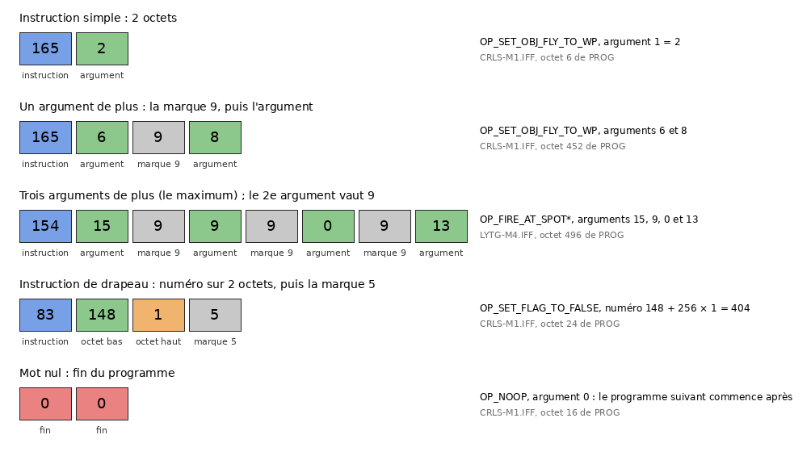
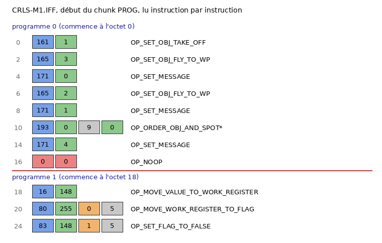
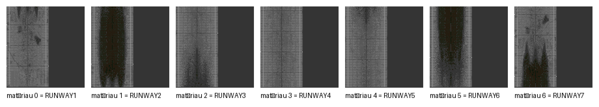
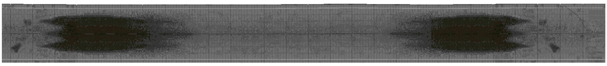
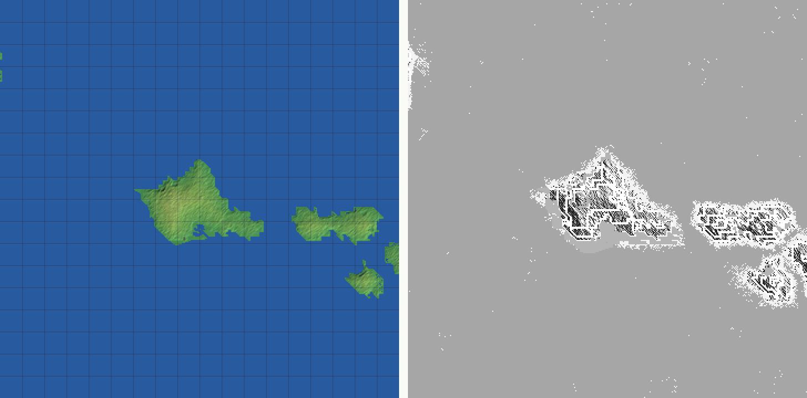
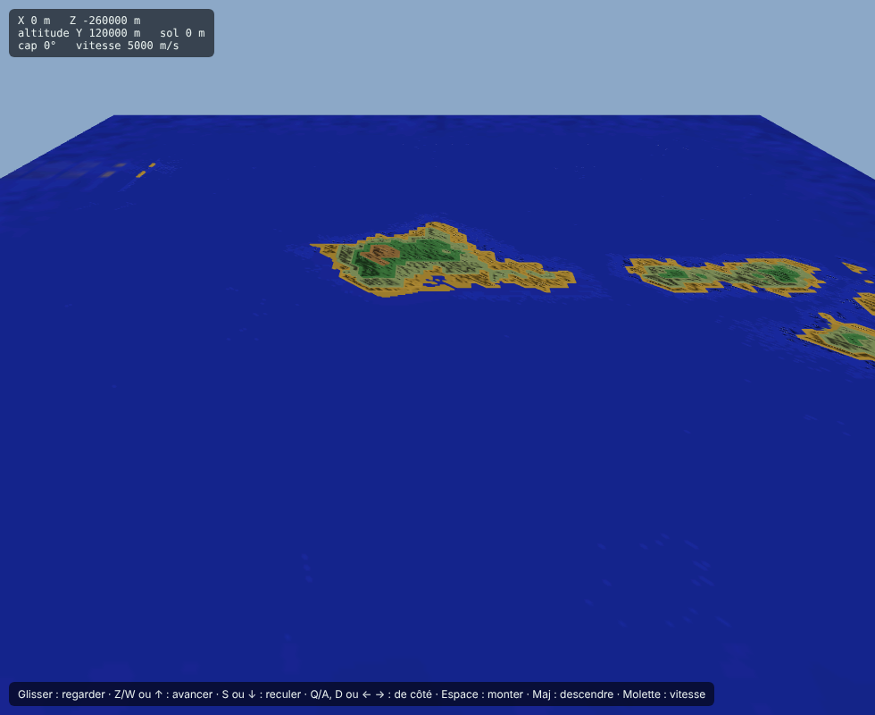

# Pacific Strike (PACIFIC.EXE) — déroulement et conversations

Rédigé le 2026-11-05. Version illustrée : `PACIFIC_GAMEFLOW_CONV.html` (images dans `images/`, `tools/ps_doc_images.py`). Exécutable `PACIFIC.EXE` (1 001 792 octets) et données `PACIFIC.DAT` fournis par Rémi.
Ni l'un ni l'autre n'est dans le dépôt. Les nombres sont en décimal ; les commandes sont désignées par leur nom
(noms de Strike Commander, `GAMEFLOW_SYSTEM.md` § 5.2 et `CONV_SYSTEM.md` § 2, quand la commande fait la même
chose ; sinon nom proposé, marqué \*).

## 1. L'exécutable et les données

- **Un seul exécutable** pour le vol et le hors-vol (Strike Commander en a deux : `STRIKE.EXE` et `OPTEST.EXE`).
  Même compilateur (Borland C++ 1991) et mêmes overlays VROOMM : image de 551 680 octets, en-tête `FBOV` juste
  après.
- Listing reconstruit par `tools/vroomm_listing.py` (pas de base IDA) : `source/pacific.asm`, 588 segments dont
  176 overlays, 6 069 fonctions. Outils : `--exe pacific`.
- Noms repris par `tools/match_functions.py --write` : 1 077 fonctions identiques à celles de `STRIKE.EXE`
  (`strike_matches.json`), puis 423 à celles d'`OPTEST.EXE` (`optest_matches.json`) ; 1 138 entrées au total.
  Elles commencent par « Reprise de » : à revérifier dans Pacific Strike.
- `PACIFIC.DAT` est une archive TRE au même format que `BIGTRE.TRE` (`tools/tre_extract.py`) : 600 fichiers,
  dont `GAMEFLOW\GAMEFLOW.IFF`, `OPTIONS.IFF`, `CONV.PAK`, `CONVDATA.IFF`, `CONVSHPS.PAK`, `CONVPALS.PAK`.

## 2. Variables et drapeaux

Les scripts (déroulement et conversations) désignent par un même numéro sur 2 octets soit une variable, soit un
drapeau. Les quatre fonctions d'accès, pas encore nommées, sont dans seg126 :

| Fonction (proposée) | Rôle |
|---|---|
| `GameVar_Get_56414` | numéro < 256 : rend la variable (mot) ; numéro ≥ 256 : rend 1 si le bit (numéro − 256) est posé, sinon 0 |
| `GameVar_SetFlag_5646D` | variable = 1, ou bit posé |
| `GameVar_ClearFlag_56520` | variable = 0, ou bit effacé |
| `GameVar_Set_564BB` | (numéro, valeur) : variable = valeur ; pour un bit, posé si valeur ≠ 0 |

Preuve (`GameVar_Get_56414`) : `cmp si, 0FFh / jbe` → `shl ax, 1` et lecture du mot dans le tableau
`word_7D00A` ; sinon `sub si, 100h`, `shr ax, 3` (octet) et `and ax, 7` (bit) dans le tableau `word_7D00E`.

Dans les données, les drapeaux vont de 74 à 6 969. Variables vues dans le code : 81 et 86 (posées par
`SET_VARIABLE`\*), 82 et 83 (mois et année, § 3.3), 130 (mission mise de côté, § 3.3).

### 2.1 Une seule table pour le déroulement, les conversations et les missions

Les scripts de mission (`PROG`) lisent et écrivent **la même table** que le déroulement et les conversations.
L'interpréteur des scripts de mission (`Expr_VM_Interpreter_51F24`, seg125, à la place qu'occupe
`Expr_VM_Interpreter_51106` dans STRIKE.EXE, juste après `Expr_VM_PopValue_51EB4`, mêmes instructions) appelle
`GameVar_Get_56414` et `GameVar_Set_564BB` pour toutes les instructions de drapeau (`OP_MOVE_FLAG_TO_WORK_REGISTER`,
`OP_SET_FLAG_TO_TRUE`, `OP_SET_FLAG_TO_FALSE`, `OP_ADD_1_TO_FLAG`, `OP_TEST_FLAG`… : 22 instructions). Dans Strike
Commander, ces instructions travaillent sur le chunk `FLAG` de la mission (`MISSION_SCRIPT_OPCODES.md`), et la
mission ne transmet au déroulement que les 8 valeurs `STAT` de `misn2op.iff`.

- **Encodage** : une instruction de drapeau occupe 4 octets : instruction, numéro (2 octets, bas puis haut), puis
  l'octet 5 (vérifié : `cmp byte ptr es:[bx], 5`, sinon erreur). Les autres instructions gardent l'encodage de
  Strike Commander (instruction, argument, puis 9 et un argument de plus). Les 64 fichiers de `MISSIONS` se lisent
  ainsi sans erreur de séparateur.
- **Le chunk `FLAG` des 51 fichiers de mission (`*-M*.IFF`) est vide (0 octet).**

Ce que les données montrent (numéros écrits par les `PROG` des missions, lus ailleurs) :

| Numéros | Écrits par | Lus par |
|---|---|---|
| 401 à 431 | une mission chacun : 401 = `PRLH-M1`, 402 = `PRLH-M2` … 431 = `IJOK-M4` | les conversations (`IF_FLAG`\*) ; `SET_DATE`\* (drapeaux 401 à 400 + mission courante) ; le déroulement pour 406 |
| 432 | les missions de fin de campagne (`*-ML`) | ces mêmes missions |
| 433, 434 | `LOSE-M1A` à `LOSE-M1C`, `LOSE-M2A` à `LOSE-M2C` | les conversations ; 433 par le déroulement |
| 435, 436 | `ENDG-M1`, `ENDG-M2` | 435 par le déroulement |
| 440 à 458 | quelques missions | les conversations |
| variables 170 à 182 | toutes les missions | les conversations (170, 173 à 176) ; `SET_DATE`\* (soustraites) |
| variables 185 à 194 | toutes les missions | le déroulement (185) ; `SET_DATE`\* (ajoutées deux fois) |
| variable 31 | toutes les missions | le déroulement (`IF_NOT_FLAG`) |
| variable 195, 201, drapeau 500 | les missions | les conversations |

Dans le sens inverse, le déroulement pose des numéros que les missions lisent (variable 187) et que les conversations
lisent (74 à 79, 440, 2 158 à 2 160, 2 210).

Exemple, `PRLH-M1` : au début, `OP_SET_FLAG_TO_FALSE 401` ; plus loin :

```
OP_TEST_FLAG 1
OP_BRANCH_IF_NOT_EQUAL 90
OP_TEST_FLAG 195
OP_BRANCH_IF_EQUAL 90
OP_SET_FLAG_TO_TRUE 401
OP_SET_LABEL 90
```

Le drapeau 401 est posé si la variable 1 vaut 1 et la variable 195 ne vaut pas 1 ; les conversations qui suivent la
mission testent ce drapeau. Dans `CRLS-M1`, les programmes 46 à 49 mettent une des variables 173 à 176 à 2, retirent
1 à la variable 31 et ajoutent 1 à la variable 200 ; le rôle de ces variables n'est pas établi.

## 3. Déroulement (`GAMEFLOW.IFF`)

### 3.1 Structure du fichier

`FORM GAME` → 41 `FORM MISS` (`INFO`, `EFCT`, `FORM SCEN`*) ; `FORM SCEN` → `INFO`, `FORM SPRT`*, **`TUNE`**
(1 octet, nouveau, 170 scènes) ; `FORM SPRT` → `INFO`, `EFCT`, `REQU`. `FORM MLST` (`DATA`, `PRTL`) existe
toujours. `WRLD`, `LOAD`, `WNGS` et `STAT` ne sont pas dans le fichier.

Lecture des chunks : une fonction pas encore nommée (`sub_C73DD`, ovr359, proposé `Gameflow_LoadScene_C73DD`)
lit `SCEN`, `SPRT`, `REQU` et `EFCT` (`push large 55514552h` = « REQU », `push large 54434645h` = « EFCT »).

### 3.2 Conditions `REQU`

Suite de conditions de **3 octets** : 1 octet de condition, puis le numéro de drapeau sur 2 octets (bas, puis
haut). Strike Commander : 2 octets. Les 2 597 chunks des données se lisent sans reste ; seules les conditions
`REQUIRE_NOT_SET` (2 393) et `REQUIRE_SET` (4 447) y figurent.

### 3.3 Scripts `EFCT`

Interpréteur : une fonction pas encore nommée (`sub_604D4`, seg143), proposé **`Gameflow_RunScript_604D4`**,
l'équivalent de `Gameflow_RunScriptPairs_36CF` d'OPTEST. Même boucle et mêmes blocs conditionnels (`ELSE` 30,
`ENDIF` 31, `OR_GROUP` 33 lu avant la table). Table de 42 commandes (`cmp bx, 29h / jbe` puis
`jmp cs:off_60C85[bx]`).

**Longueur.** La commande lit toujours 3 octets : `[script+i]` (commande), `[script+i+1]` (`var_A`),
`[script+i+2]` (`var_B`), et le mot `var_A | var_B << 8` (`shl dx, 8 / add ax, dx` → `di`). Le pas est de 2
octets, **3 pour les commandes 0, 6, 7, 9, 10, 35 et 36** (`inc [bp+var_8]` en `loc_60AF9`, puis
`add [bp+var_8], 2`), y compris quand elles sont sautées (`cmp [bp+var_9], 6` … `24h` → `loc_60AF9`). Les
3 379 scripts des données se lisent avec cette règle sans reste.

| Valeur | Nom | Octets d'argument | Effet constaté dans le code |
|---|---|---|---|
| 0 | `PLAY_CONV` | 2 (mot) | conversation n (`Gameflow_PlayConversation_C781E`, puis `Conv_PlayScript_C2ED0`) ; `[partie+1248]` = 1 |
| 1 | `PLAY_SCENE` | 1 | scène `[partie+1265]` = n ; **arrêt du script** (`[bp+var_3]` = 1) ; `[partie+1248]` = 1 |
| 2 | `PLAY_ENDING`\* | 1 | `Gameflow_PlayEndingOrFuneral_C798D` : n de 1 à 5 → texte de fin `ENDTEXTn.IFF` (`Gameflow_PlayEndText_E3517`) ; autre n → cinématique `FUNERAL.PAK` (`Gameflow_PlayFuneral_E4EBB`) ; données : 0 (après la conversation de la mort du joueur), 1, 2, 4, 5 |
| 3 | `FLY_MISSION_NOW` | 1 | mission `[partie+1262]` = n, `[partie+1254]` = 1 |
| 4 | `NOP_4` | 1 | rien |
| 5 | `CAMPAIGN_RESULT`\* | 1 | selon la mission `[partie+1263]` (tranches 0 à 11, 12 à 17, 18 à 19, 20 à 23, 24 à 27), compte des variables et drapeaux et pose l'un des drapeaux 2 156, 2 220 à 2 226 ; argument non lu |
| 6 | `SET_FLAG` | 2 (mot) | `GameVar_SetFlag_5646D`(n) |
| 7 | `CLEAR_FLAG` | 2 (mot) | `GameVar_ClearFlag_56520`(n) |
| 8 | `PLAY_SHOT` | 1 | `Gameflow_PlayShot_C7A2C` : `OPTIONS.IFF`, chunks `ESTB`, `SHOT`, `TUNE`, `SHPS`, `PALS` |
| 9 | `IF_NOT_FLAG` | 2 (mot) | test : réussit si `GameVar_Get_56414`(n) = 0 |
| 10 | `IF_FLAG` | 2 (mot) | test : réussit si `GameVar_Get_56414`(n) ≠ 0 |
| 11 | `RETURN_TO_MENU`\* | 1 | `[partie+1254]` = 0, arrêt du script, `[partie+1248]` = 1 (`NOP_11` dans SC) |
| 12 | `SELECT_MISSION` | 1 | mission `[partie+1262]` = n |
| 13 | `SET_NEXT_MISSION` | 1 | `[partie+1264]` = n |
| 14 | `START_FLIGHT` | 1 | `[partie+1254]` = 1 |
| 15 | `GOTO_NEXT_MISSION` | 1 | `[partie+1254]` = 2 et **arrêt du script** |
| 16 | `SAVE_GAME` | 1 | choix d'un fichier (`sub_DEF72`), puis sauvegarde (`sub_CD720`, pas encore nommées) |
| 17 | `LOAD_GAME` | 1 | choix d'un fichier (`sub_DEEAD`) ; s'il est donné, `[partie+1254]` = 3 |
| 18 | `TRAVEL`\* | 1 | `Gameflow_Travel_D3E8B` : morceau 8 ; départ (`DEPART.PAK`, lieu `PLAC`[variable 86] et date `DATE`[variable 82], jour variable 81, année variable 83, chunks de `STRING.IFF`) ; carte n (`MAPDATA.IFF` : `FORM MAPS` d'`INFO` n, `LABL`, `LINE` ; `MIDMAP.PAK`, police `MAPFONT`) ; arrivée (`ARRIVE.PAK`) |
| 19 | `LOOK_AT_KILLBOARD` | 1 | `Gameflow_KillBoard_D47D0` : tableau `BLKBRD`, polices `BOARDFNT`, `CSMLGP` |
| 20 | `IF_MISSION_ACCEPTED` | 1 | test : réussit si `[partie+1630]` ≠ 0 |
| 21 | `IF_MISSION_REFUSED` | 1 | test : réussit si `[partie+1630]` = 0 |
| 22 | `LAUNCH_MISSION`\* | 1 | `Gameflow_LaunchMission_CAD9D` : chunk `FPLN` de `STRING.IFF` (fichiers d'avion) ; avion du joueur choisi par les drapeaux 2 100 à 2 106, 2 200, 2 201 (`Gameflow_ChooseAircraft_CAAF2`) ; mission réécrite dans `instant` ou `test` (`Gameflow_WriteInstantMission_CAEBB` : `MISN`, `CAST`, `CAMP`, `PROG`, `PART`, `TEAM`, `PLAY`, `LOAD`) ; `[partie+1254]` = 1 ; cinématique du pont (`sub_D9A80` : `BACKGRND`, `ELEVATOR`, image de l'avion). Argument non lu |
| 23 | `MEDIT_SCREEN`\* | 1 | `Gameflow_MeditScreen_E3D9D` : `MEDIT.PAK`, police `SM-FONT`, liste `MLST`, lecture d'un fichier de mission, carte `NAVMAP` ; rôle de l'écran non établi |
| 24 | `SET_MUSIC_MOOD` | 1 | `[partie+1255]` = n, puis `Music_SetPendingTune_5ED30`(n) |
| 25 | `SET_SCENE`\* | 1 | scène `[partie+1265]` = n, **sans** arrêt du script (`LOOK_AT_LEDGER` dans SC) |
| 26 | `SHOW_KILL_MARKS` | 1 | si `[partie+1259]` ≠ 0 et `[partie+1261]` ≠ 2 : `Gameflow_EmptyKillMarks_CA3D2`, fonction vide (`mov ax, [bp+arg_0] / retf`) |
| 27, 28 | — | — | erreur (`push 0DA18h` / `sub_1DDFE`) : `REMOVE_PILOT` et `IF_TRUE` n'existent plus |
| 29 | `SHOW_DOSSIER`\* | 1 | `Gameflow_ShowDossier_D3F00` : page n (1 à 8) de `DOSSIER.PAK` (8 entrées), police `FOPTIONS` ; dans les données, chaque sprite pose un drapeau de 2 180 à 2 187 puis ouvre la page 1 à 8 |
| 30, 31 | `ELSE`, `ENDIF` | 1 | traités avant la table |
| 32 | `IF_MISSION_SUCCESS` | 1 | test : réussit si l'octet `[partie+1266+n]` = 1 |
| 33 | — | — | erreur dans la table ; `OR_GROUP` est traité avant |
| 34 | `APPLY_CHANGE` | 1 | `Gameflow_ApplyChange_CA290` : chunks `STAT`, `CHNG`, `INFO` du fichier dont le chemin est en `[partie+1008]` ; absente des données |
| 35 | `SET_VARIABLE`\* | 2 (deux octets) | `GameVar_Set_564BB`(a, b) : variable a = b |
| 36 | `SET_DATE`\* | 2 (deux octets) | date à partir du mois a et de l'année b (§ 3.4) |
| 37 | `ADVANCE_MONTHS`\* | 1 | date + n mois (§ 3.4) |
| 38 | `SET_BYTE_1382`\* | 1 | `[partie+1382]` = n ; rôle non établi |
| 39 | — | — | erreur |
| 40 | `SAVE_MISSION_INDEX`\* | 1 | variable 130 = `[partie+1263]` |
| 41 | `RESTORE_MISSION_INDEX`\* | 1 | `[partie+1263]` = variable 130 |

Tests comptés pendant un saut (pour les `ENDIF` imbriqués) : 9, 10, 20, 21, 22, 28, 32 (même liste qu'OPTEST
sans 35 ni 37).

### 3.4 La date (commandes 36 et 37)

Variable 82 = mois, variable 83 = année. Les données écrivent `SET_DATE` avec l'année sur 2 chiffres
(42 à 45, donc 1942 à 1945), le mois avant :

```
SET_VARIABLE 81 16
SET_DATE 1 42
```

`SET_DATE a b` (`loc_60AFF`) : un total t est formé de b × 12 + a, augmenté d'un compte tiré des drapeaux 401 à
400 + `[partie+1263]` (rang pair : + 2 si le drapeau n'est pas posé ; rang impair : − 1 s'il est posé), des
variables 170 à 182 (soustraites) et 185 à 194 (ajoutées deux fois) ; t est au moins la date courante + 1 mois
(`cmp [bp+var_12], di / jge`). Puis année = t ÷ 12 et mois = t − année × 12. `ADVANCE_MONTHS n`
(`loc_60BF1`) : t = année × 12 + mois + n, même découpage.

## 4. Conversations (`CONV.PAK`)

### 4.1 Le fichier

283 entrées pleines, 31 vides (marque 7 dans la table du PAK). Chaque entrée pleine : 4 octets de taille, puis
un flux PKWARE DCL (« implode », octets `00 06`). libRealSpace décompresse déjà ce flux (`SCConvPlayer::SetID`,
`PKWareDecompressor`).

### 4.2 L'interpréteur

Fonction pas encore nommée `sub_C2ED0` (ovr351), proposé **`Conv_PlayScript_C2ED0`**, l'équivalent de
`Conv_PlayScript_5AA4E` d'OPTEST : lit un octet de commande, `cmp bx, 11h / jbe` puis `jmp cs:off_C4370[bx]`
(18 cas). Chaque commande remplit un enregistrement par une petite fonction de lecture (ovr355).

| Valeur | Nom | Champs (dans l'ordre) | Lu par (proposé) |
|---|---|---|---|
| 0 | `GROUP_SHOT` | décor (9) ; puis les commandes 1, 10 et 17 qui suivent | `ConvRec_ReadName_C5800` |
| 1 | `GROUP_SHOT_ADD_CHARACTER` | figure (9), x (mot), y (mot) | `ConvRec_ReadFigure_C59CE` |
| 3 | `CLOSEUP` | visage (9), image (1), décor (9), x (mot), y (mot), texte, couleur (1), voix (4) ; puis les commandes 10 qui suivent | `ConvRec_ReadCloseup_C5827` |
| 5 | `IF_FLAG`\* | numéro (mot) | `ConvRec_ReadNumber_C5BAE` |
| 10 | `SHOW_TEXT` | couleur (1), texte, voix (4) | `ConvRec_ReadText_C5B07` |
| 12 | `ELSE`\* | aucun | — |
| 13 | `ENDIF`\* | aucun | — |
| 16 | `NOP_16` | aucun | — |
| 17 | `GROUP_SHOT_COMMANDER`\* | n (mot), n numéros d'image (mot), x (mot), y (mot) | `ConvRec_ReadMarks_C5960` |
| autre | — | erreur (`push 9999h` / `sub_1DDFE`) | — |

Différences avec Strike Commander :

- **Pas d'identifiant de voix devant le texte** : le texte vient directement, terminé par 0.
- **4 octets après chaque texte**, lus comme deux mots (`[rec+15h]`, `[rec+17h]` pour `CLOSEUP`). Le code les
  passe ensemble (`push large [bp+var_CF]`) à la lecture d'une voix (chemin construit avec « strtspch ») si le
  premier mot ≠ 65 535 et que la parole est active (`byte_7CB1B`, `word_79E69`). Dans les données : 65 535 dans
  2 722 cas sur 2 731, 1 ou 2 dans les autres ; le second mot n'a pas de valeur suivie (restes de texte).
- **`CLOSEUP` lit les mêmes champs que Strike Commander** (visage, image, décor, x, y, texte, couleur). Les
  `SHOW_TEXT` (10) qui le suivent sont lus avec lui (`cmp byte ptr es:[bx], 0Ah` en `loc_C3EFF` et `loc_C3FE0`) ;
  il n'y en a pas dans les données. `CLOSEUP_CONTINUATION` (4), `YESNOCHOICE_BRANCH1` (11) et
  `GROUP_SHOT_CHARACTER_TALK` (2) tombent dans le cas d'erreur de la table.
- **Blocs conditionnels** : `IF_FLAG`\* n met `[bp+var_15]` = 1 si `GameVar_Get_56414`(n) = 0
  (`ConvRec_FlagNotSet_C5B91`) ; `ELSE`\* inverse `[bp+var_15]` ; `ENDIF`\* le remet à 0. Tant que `[bp+var_15]`
  est posé, `GROUP_SHOT` et `CLOSEUP` sont lus sans être affichés. Pas d'imbrication.
- **`GROUP_SHOT`** : le décor seul ; les figurants (1), les textes (10) et le commandant (17) qui suivent sont lus
  par la scène de groupe (`cmp ax, 11h`, `cmp ax, 0Ah` dans `loc_C304E`).
- **`GROUP_SHOT_COMMANDER`\* (17)** : le commandant devant une carte de briefing (`ph2map1`, `cs1map1`…), qui
  pointe la cible (x, y) avec sa baguette. Calque créé par `PointerLayer_Construct_62E1B` :
  - figure `yucmndr` si le drapeau 2 128 est posé, sinon `commndr` (`push 850h` / `GameVar_Get_56414`) ; ses images
    couvrent l'écran (en-tête 0 à 319 × 0 à 199) : image 0 = le commandant, 1 à 15 = le bras ;
  - les n mots = liste d'images, montrées dans l'ordre (`PointerLayer_Advance_62F57` avance d'une étape et reste sur
    la dernière) ;
  - `GAMEFLOW\PTR.IFF` (`FORM CPTR`, chunk `DATA`) : x, y (2 octets chacun) du point de la main pour chaque image,
    en coordonnées d'écran (`PointerLayer_LoadHandPoints_62F7E`, rangés en `[calque+35+4×image]`) ;
  - dessin (`PointerLayer_Draw_62EF2`), dans cet ordre : la baguette, trait de couleur 15
    (`PointerLayer_DrawStick_630DA`) depuis le point de la main de l'image courante, jusqu'à la cible à la dernière
    étape, sinon jusqu'au point de la main décalé de |point de la dernière image − cible|
    (`PointerLayer_StickOffset_6308B`) ; puis **l'image 0** (`sub_6A514` avec l'image 0 : le mot 0 laissé sur la
    pile par `push large 0` / `add sp, 0Ah`) ; puis l'image courante (`Layer_DrawAtOwnPos_66BEC`). À la dernière
    étape, y de la cible moins `[groupe+6]` (valeur non lue ; avec 0, la baguette de la conversation 4 tombe sur
    Kwajalein, cible (115, 70)).
- Plus de saut relatif (`YESNOCHOICE_BRANCH2`), d'escadre (`SELECT_WING`) ni de choix d'équipier
  (`CHOOSE_WINGMAN`) : 12, 14 et 15 sont des erreurs ou ont un autre sens.

Avec cette grammaire, les 283 conversations se lisent jusqu'au dernier octet.

## 6. Scripts de mission : chargement et exécution par les objets

Lu le 2026-11-05, en comparant avec STRIKE.EXE (`MISSION_SCRIPT_OPCODES.md`). La mécanique est celle de Strike
Commander ; les écarts sont listés au § 6.5.

### 6.1 Chargement (`MissionScenario_LoadFromIFF_BD743`)

Lit les chunks du fichier de mission (`MISN` : `VERS`, `NAME`, `CAMP`, `TUNE`, `WRLD`, `FILE`, `CAST`, `AREA`, `SPOT`,
`NUMS`, `MSGS`, `PROG`, `PART`, `TEAM`, `PLAY`, `LOAD`, `HOME`). Appelée au départ en vol (par `sub_877A0`, pas encore
nommée) et par l'écran `MEDIT` (`Gameflow_MeditScreen_E3D9D`).

- **`PROG`** (`ProgBuffer_LoadRawAndCountMarkers_BF8E9`) : comme Strike Commander. Le bloc est copié tel quel ; le
  chargeur compte les octets nuls aux positions paires (`cmp byte ptr es:[bx], 0` / `add dx, 2`) : ce sont les
  séparateurs entre les programmes. Un programme est désigné par son rang (`ProgBuffer_FindSubProgramByIndex_51C42`).
- **`PART`** (`PartEntry_AllocateArray_BF7F9`) : nombre d'objets = taille du chunk ÷ 62 (`mov bx, 3Eh` / `div bx`,
  erreur si le reste n'est pas nul) ; **89 octets par objet en mémoire** (`imul ax, ax, 59h` ; Strike Commander : 85).
  Chaque objet est lu par `PartEntry_LoadAndResolveNames_BF3D5`.

**Le chunk `PART` n'a pas changé** : 62 octets par objet, lus dans le même ordre aux mêmes places (mêmes variables de
pile que `PartEntry_LoadAndResolveNames_A9E3C` de STRIKE.EXE). Seule la structure en mémoire change :

| Champ en mémoire | Strike Commander | Pacific Strike |
|---|---|---|
| noms, camp, zone, position, cap, champs +45 à +56 | +0 à +56 | identiques |
| bits d'état (actif, détruit…) | +57 | +57 |
| +62, +64 (mis à 0) | oui | oui |
| mot mis à 0 au chargement | — | **+66** (rôle non établi) |
| référence vers un autre objet | — | **+68** (`sub_39519` ; posée par les ordres 174 et 175, § 6.5) |
| script 1 : `on_is_activated` | +66 | **+70** |
| script 2 : `on_mission_update` | +70 | **+74** |
| script 3 : `on_is_destroyed` | +74 | **+78** |
| script 4 : `on_missions_init` | +78 | **+82** |
| objet du monde (contrôleur) | +82 | **+86** |
| état de l'ordre en cours (255 = posé) | +84 | **+88** |

Les 4 scripts sont résolus une fois, au chargement, en pointeurs vers leur programme
(`Expr_LookupNamedValue_530A7` sur la liste des programmes) ; noms des scripts : ceux de libRealSpace.
`PartEntry_ResetState_BF382` remet l'objet au repos (comme `PartEntry_ResetState_A9DFD`, plus la référence +68).

### 6.2 Exécution, à chaque image (`MAIN_GAME_TICK_54FD2`)

Même ordre que `MAIN_GAME_TICK` de STRIKE.EXE :

```
MAIN_GAME_TICK_54FD2
  Scene_RunUpdateScript_54AD7              scène globale
  Scene_DetectAndActivateChange_54BCF      scène courante d'après la position du joueur
  Scene_RunUpdateScript_54AD7              scène courante
  PartEntry_DispatchMissionUpdateTick_5471E   chaque objet de PART (pas de 89 octets) dont le bit 0 de +57 est posé
    Expr_Node_UpdateAndPropagate_54338
      Expr_VM_ExecuteSingleInstruction_530DB  prépare l'état d'exécution (programme, objet)
        Expr_VM_Interpreter_51F24             joue le programme
```

`Expr_Node_UpdateAndPropagate_54338`, pour un objet actif :

- bit 1 de +57 posé → `Expr_Node_RecomputeIfDirty_53780` ;
- sinon, bit 3 posé → script 4 (+82), puis si l'objet est plus loin que la distance limite (`dword_7CC84`) :
  `PartEntry_Deactivate_536C9` ;
- sinon → script 2 (+74) ; ensuite, si l'objet du monde est celui de `[mission+101]` (l'objet dont la position sert
  de référence aux distances), l'octet +88 prend `[mission+128]` quand `[mission+127]` vaut 165, 166 ou 162, sinon 255.

### 6.3 Les autres événements d'un objet

| Événement | Fonction | Ce qu'elle fait |
|---|---|---|
| activation | `Shared_TriggerExprInstruction_53749` | pose le bit 0 de +57, efface les bits 2 et 3, met +58 à 0, joue le script 1 (+70) |
| destruction | `Expr_Node_RecomputeIfDirty_53780` | si le bit 0 est posé : l'efface, pose le bit 1, joue le script 3 (+78) |
| apparition dans le monde | `PartEntry_ResolveSpawnPositionAndActivate_5313D` | calcule la position et crée l'objet du monde (+86) ; **seulement si le drapeau 260 n'est pas posé** (`push 104h` / `GameVar_Get_56414` / `jnz`) |

Les scènes (`SCNE`) gardent leurs trois scripts : `Scene_TriggerActivation_54AB2` (+8), `Scene_RunUpdateScript_54AD7`
(+12), `Scene_RunLeavingScript_54AF6` (+16), chacun par `Expr_VM_ExecuteSingleInstruction_530DB`.

### 6.4 Lecture d'une instruction

**Les instructions sont de longueur variable** : de 2 à 8 octets selon le nombre d'arguments, 4 octets pour une
instruction de drapeau. C'est le principal changement par rapport à Strike Commander (tableau en fin de section).
Il y a **trois formes d'instruction**, lues par `Expr_VM_ReadNextToken_51D33` et, pour la forme 3, par le code de
l'instruction elle-même.

**Forme 1 : instruction simple, 2 octets.** Un octet pour le numéro de l'instruction, un octet pour son argument.

```
+-------------+----------+
| instruction | argument |
+-------------+----------+
     165           2          OP_SET_OBJ_FLY_TO_WP, argument 2
```

**Forme 2 : instruction avec des arguments supplémentaires.** Après les 2 premiers octets, le lecteur regarde
l'octet suivant. S'il vaut 9, c'est une **marque** : elle est sautée, et l'octet qui la suit est un argument de plus.
Le lecteur recommence 3 fois au plus. Chaque argument supplémentaire prend donc 2 octets (la marque 9 et sa
valeur). Un argument absent vaut 65 535.

```
+-------------+------------+---+------------+---+------------+---+------------+
| instruction | argument 1 | 9 | argument 2 | 9 | argument 3 | 9 | argument 4 |
+-------------+------------+---+------------+---+------------+---+------------+
     154            15       9       9        9       0        9       13
                                  OP_FIRE_AT_SPOT*, arguments 15, 9, 0 et 13
```

L'octet qui suit une marque est toujours une valeur, même s'il vaut 9 : dans cet exemple, l'argument 2 vaut 9.

**Forme 3 : instruction de drapeau, 4 octets.** Les 22 instructions qui lisent ou écrivent une variable ou un drapeau
(liste au § 6.7, règle 5) ont besoin d'un numéro qui peut dépasser 255 (table commune du § 2.1). Le 2ᵉ octet est
l'octet bas du numéro, le 3ᵉ son octet haut, et le 4ᵉ vaut toujours 5. Le lecteur commun ne lit que les 2 premiers
octets ; c'est le code de chaque instruction de drapeau qui lit le 3ᵉ, vérifie que le 4ᵉ vaut 5 (erreur sinon) et
le saute.

```
+-------------+-----------+------------+---+
| instruction | octet bas | octet haut | 5 |
+-------------+-----------+------------+---+
      83          148           1        5     OP_SET_FLAG_TO_FALSE, numéro 148 + 256 × 1 = 404
```

**Fin d'un programme : le mot nul.** `OP_NOOP` avec l'argument 0 (2 octets nuls) termine le programme (ou revient
à l'appelant, `Expr_VM_PopValue_51EB4`). Le programme suivant commence à l'octet qui le suit.



Le chunk `PROG` se lit donc d'un bout à l'autre, instruction après instruction ; chaque mot nul ferme un programme :

```
octet   octets lus      instruction
  0     161 1           OP_SET_OBJ_TAKE_OFF
  2     165 3           OP_SET_OBJ_FLY_TO_WP
  4     171 0           OP_SET_MESSAGE
  6     165 2           OP_SET_OBJ_FLY_TO_WP
  8     171 1           OP_SET_MESSAGE
 10     193 0 9 0       OP_ORDER_OBJ_AND_SPOT*      (forme 2)
 14     171 4           OP_SET_MESSAGE
 16     0 0             OP_NOOP                     fin du programme 0
 18     16 148          OP_MOVE_VALUE_TO_WORK_REGISTER
 20     80 255 0 5      OP_MOVE_WORK_REGISTER_TO_FLAG (forme 3)
 24     83 148 1 5      OP_SET_FLAG_TO_FALSE        (forme 3)
...
```



**Ce qui change par rapport à Strike Commander.** Le lecteur de STRIKE.EXE (`Expr_VM_ReadNextToken_50F85`) ne
cherche la marque 9 **qu'une fois** (un seul `cmp byte ptr es:[bx], 9`, un seul champ `[di+0Ah]`), et son
interpréteur ne teste jamais la marque 5 : dans Strike Commander, une instruction de drapeau a 2 octets et un numéro
de 0 à 255.

| | Strike Commander | Pacific Strike |
|---|---|---|
| arguments supplémentaires | 1 au plus | 3 au plus |
| longueurs possibles | 2 ou 4 octets | 2, 4, 6 ou 8 octets |
| instruction de drapeau | 2 octets, numéro sur 1 octet | 4 octets, numéro sur 2 octets, puis la marque 5 |
| exemple | `OP_SET_OBJ_FLY_TO_WP` avec 1 argument de plus | `OP_FIRE_AT_SPOT`\* avec 3 arguments de plus |

Conséquence pour libRealSpace : aujourd'hui, `RSMission::paseMissionScript` lit l'argument supplémentaire de Strike
Commander comme une instruction à part (`OP_SPOT_DATA`, 9), et `SCProg::execute` va le chercher dans l'instruction
suivante (`has_second`, `this->prog[i + 1].arg`). Ce contournement tient pour un argument ; avec 3 arguments
supplémentaires et des numéros sur 2 octets, il faut que la structure `PROG` porte elle-même tous les arguments d'une
instruction, et que `SCProg` les y lise. Ce changement sera décrit avec l'implémentation.

Deux détails pour un lecteur exact (aucun des deux ne se produit dans les données) : le lecteur cherche la marque 9
**avant** de lire l'octet haut d'une instruction de drapeau, donc un octet haut égal à 9 serait pris pour une marque ;
et la recherche d'étiquette (§ 6.7, règle 6) avance par paires d'octets, donc un octet haut égal à 8 serait pris pour
une étiquette.

### 6.5 Instructions : ce qui change

La table de l'interpréteur a toujours 209 cas (`cmp bx, 0D0h`). Toutes les instructions de Strike Commander sont
traitées, et 12 de plus :

- **Instruction inconnue = erreur.** Dans Strike Commander, le cas par défaut passe à l'instruction suivante. Dans
  Pacific Strike, il appelle la fonction d'erreur (`push 911Bh` / `sub_1DDFE`). Les instructions 5 et `OP_SET_LABEL`
  (8), qui ne font rien, ont donc maintenant leur propre cas.
- **Ordres** (`MissionScript_CallNativeHandler_53B0B`) : au lieu d'un `switch` sur 161 à 191, une liste de 22 valeurs
  cherchée une à une (`word_542E0`). On y trouve tous les ordres de Strike Commander, plus 112, 173, 174, 175 et 193.

| Valeur | Nom | Données | Constaté dans le code |
|---|---|---|---|
| 5 | `OP_NOOP_5`\* | 0 | rien |
| 112 | `OP_ORDER_FRIENDLY_OF_TYPE`\* | 0 | ordre : pour un objet du monde de la classe 16 (`test byte ptr [bx+2], 10h`), choisit au hasard un objet du même camp et du type donné (`MissionScript_PickRandomObjectOfType_545A4`) et prend sa position ; sinon l'ordre échoue |
| 153 | `OP_SPAWN_EFFECT_ON_OBJ`\* | 12 | **objet, `SPOT`, rang dans `LOAD`** : crée l'objet `LOAD`[rang] (classe 15 exigée, sinon erreur 9039h ; dans les données : `GUNSPARK`, éclair de tir) au point `SPOT` pris **dans le repère de l'objet** (position tournée par l'orientation de l'objet, puis ajoutée à sa position), avec l'orientation de l'objet ; réglage de départ par `sub_4BD5F` (champs +75 et +77 de la description, non lus) ; son n° 2 selon la distance à la caméra (`sub_5EB62`) ; ajouté aux objets du monde (`MissionScript_SpawnEffectOnObj_537DF`) |
| 154 | `OP_FIRE_AT_SPOT`\* | 69 | **objet, `SPOT` de départ, rang dans `LOAD`, `SPOT` visé** : crée l'objet `LOAD`[rang] (classe 9 exigée, sinon erreur 9038h ; dans les données : `DDSHELL`, `B1000LB`) au `SPOT` de départ pris dans le repère de l'objet, et lui donne comme but la position du `SPOT` visé, en coordonnées du monde (méthode +84 de l'objet créé) ; puis `sub_3FEC1` ; ajouté aux objets du monde (`MissionScript_FireAtSpot_539B4`). Exemple `SLMN-M4` : l'artillerie (`ARTILL`) tire des obus vers un point |
| 155 | `OP_SPAWN_AT_SPOT`\* | 4 | crée un objet (`Debris_LoadAndInstantiateAlt`) à la position d'un `SPOT` |
| 156 | `OP_DETACH_CARRIED`\* | 4 | libère l'objet porté par l'objet du monde (`[objet+120]`, `sub_74144`) et le remet à 0. Exemple `IJOK-M3` : avant que le `BETTY` lâche son `BAKA` |
| 157 | `OP_LAUNCH_FROM_OBJ`\* | 16 | **objet A, objet B, `SPOT`** : fait apparaître A (`PartEntry_ResolveSpawnPositionAndActivate_5313D`), le place au point `SPOT` pris dans le repère de B, et lui donne l'orientation de B (méthodes +60 et +64). Exemples : `IJOK-M3` lâche l'avion-suicide `BAKA` sous le bombardier `BETTY` ; `IJOK-M4` fait partir un siège éjectable (`EJECSEAJ`) d'un `BETTY` |
| 173 | `OP_SET_OBJ_DESTROY_TARGET_B`\* | 1 | même traitement que `OP_SET_OBJ_DESTROY_TARGET` (167) |
| 174 | `OP_ATTACK_RANDOM_ENEMY_OF_TYPE`\* | 1 279 | si +68 est vide : choisit au hasard un objet du camp adverse et du type n (`MissionScript_PickRandomObjectOfType_545A4`) et le garde en +68 ; puis vise sa position. Rien de trouvé : l'ordre échoue. Côté IA : même traitement que `OP_SET_OBJ_DESTROY_TARGET` (§ 6.6) |
| 175 | `OP_DIVE_ON_RANDOM_ENEMY_OF_TYPE`\* | 4 | même choix de cible que 174 ; côté IA, contre une cible au sol, l'attaque passe directement aux phases 6 et 7 sans exiger d'arme (§ 6.6). Données : `175 8`, dans `IJOK-M1`, `IJOK-M3`, `LYTG-M2` |
| 193 | `OP_ORDER_OBJ_AND_SPOT`\* | 48 | ordre avec un objet (2ᵉ argument) et un `SPOT` (3ᵉ argument ; 65 535 = erreur) |

**Numéros d'objet.** Dans les scripts, un objet est désigné par le numéro écrit dans les 2 premiers octets de son
enregistrement `PART`, pas par son rang (dans `IJOK-M3`, l'objet 33 est le 38ᵉ enregistrement) ; 255 désigne
l'objet qui joue le script (valeur par défaut d'`Expr_VM_ReadVarOrOverride_51EEA`). **`SPOT` en repère local** : 153,
154 et 157 prennent la position d'un `SPOT` comme un décalage dans le repère d'un objet ; seul le `SPOT` visé de 154
est une position du monde.

« Données » = nombre d'emplois dans les 64 fichiers de `MISSIONS`. `MissionScript_PickRandomObjectOfType_545A4` parcourt les
objets du monde (`WorldObjects_FindNextOfType_1E6E1`) et retient ceux dont l'octet +53 de la description vaut n et, pour les objets de la
classe 16, dont le camp (`[objet+81]`) est celui demandé ; elle en garde 6 au plus et en tire un au hasard
(`CRT_Rand`). Pour 174 et 175, le camp demandé est l'inverse de celui de l'objet (−1 ↔ 1).

### 6.6 Fin du gestionnaire d'ordres, et ce que l'IA fait de 174 et 175

**Fin de `MissionScript_CallNativeHandler_53B0B`** (même code que la fin de `MissionScript_CallNativeHandler_52513`) :
chaque ordre calcule une position (et parfois un objet cible, et un pointeur de données), puis :

- résultat −2 (cible introuvable) : l'ordre rend 0 ;
- résultat −1 : l'ordre rend 1 sans rien transmettre ;
- sinon : appel de la méthode +140 de l'objet du monde (`call dword ptr [bx+8Ch]` ; +136 dans STRIKE.EXE) avec le
  numéro de l'ordre, l'objet du monde de la cible, la position et le pointeur de données ; sa valeur est rendue.
  Un ordre absent de la liste des 22 arrive aussi ici, sans position calculée (comme le cas par défaut de STRIKE.EXE).

Pour un avion, cette méthode transmet l'ordre à son entité IA. **`Goal_SetObjective_C2A8`** (pas de nom avant ; même
rôle que `Goal_SetObjective_A307`) cherche le numéro dans une liste de 21 ordres :

| Ordres | Traitement commun |
|---|---|
| `OP_SET_OBJ_DESTROY_TARGET` (167), 173, 174, 175 | cible → `[entité+291]` ; numéro de l'ordre → `[entité+265]` (ordre en cours) |
| `OP_SET_OBJ_DEFEND_TARGET` (168), 112 | même cas |
| `OP_SET_OBJ_DEFEND_AREA` (169), `OP_SET_OBJ_PATROL_POSITION` (191) | même cas |
| 193 | son propre cas |

Si l'octet `[entité+355]` n'est pas nul, aucun ordre n'est pris (comme le bit 5 de `[entité+651]` dans STRIKE.EXE).
`Goal_IsComplete_C73C` traite aussi 167, 173, 174 et 175 de la même façon.

**La différence est dans le traitement de l'ordre en cours, `Goal_ExecuteObjective_C9E4`** : 174 y partage le cas de
167, 175 celui de 173. Les deux cas lisent la cible (`[entité+291]`) et, si c'est une cible au sol (octet +23 de sa
description = 2), préparent une demande pour le nœud d'IA **n° 19, l'attaque au sol** (objet `[entité+196]`, créé par
`PilotProfile_LoadFromPROF_843EA` avec l'identifiant 19 ; dans STRIKE.EXE `GroundAttack_CanEngage_77000`) :

| | 167 et 174 | 173 et 175 |
|---|---|---|
| octet +10 de la demande (mode) | 0 | **1** |
| cible qui n'est pas au sol | `sub_B968` (pas encore nommée) | la fonction rend 0 |
| `dword_776AF` | mis à 1 si le registre `dl` n'est pas nul en entrant dans le cas (origine non lue) | non touché |

Ce que le nœud fait du mode :

- `GroundAttack_CanEngage_137A1` (méthode +4) : si l'avion n'a pas d'arme utilisable (`[emport+36]` < 1), ou si la
  cible est un navire (classe 23 ou 24) sans arme des masques 31 ou 64, l'attaque est acceptée (valeur 10) **si le mode
  vaut 1, ou si l'octet +101 de la description de l'avion vaut 4** ; sinon refusée (0). Avec une arme adaptée, les
  valeurs 9, 7 ou 1 viennent des armes.
- `GroundAttack_Start_13956` (méthode +8) : même condition (mode 1 ou octet +101 = 4) → l'attaque commence
  **directement à la phase 6**, avec la valeur 4,0 en `[nœud+45]` ; sinon, déroulement normal.
- `GroundAttack_PhaseDispatch_13C9B` (méthode +12) joue la phase en cours (12 phases) :
  - phase 6 (`GroundAttack_Phase6_14FBE`) : l'avion se dirige vers la cible (`sub_A41D`) ; aligné et assez près,
    passe à la phase 7 ;
  - phase 7 (`GroundAttack_Phase7_1542B`) : garde le cap vers la cible et augmente de 20 par tour un réglage de l'avion
    (`[avion+99]` → +62) jusqu'à son maximum (+3), quand `dword_7C837` < 250.
  - **Aucun largage d'arme n'est appelé dans ces deux phases.**

En résumé : 174 = attaquer une cible ennemie tirée au hasard, comme un ordre de destruction ordinaire ; 175 = même
cible, mais contre une cible au sol l'avion fonce dessus (phases 6 et 7) sans avoir besoin d'arme. Les 3 missions qui
emploient 175 (`IJOK-M1`, `IJOK-M3`, `LYTG-M2`) sont celles d'Iwo Jima, d'Okinawa et de Leyte, et l'octet +101 = 4 donne
le même comportement à certains avions : **cela ressemble à une attaque kamikaze, mais ce n'est pas établi** (ni
l'impact ni le sens de la valeur 4 n'ont été lus).

### 6.7 Règles de lecture pour avoir le bon programme en mémoire

Ce que le jeu fait, pas à pas, pour passer du fichier de mission au programme joué par un objet. Chaque règle est
suivie de la fonction qui la prouve. Les vérifications sur les données portent sur les 51 missions de `PACIFIC.DAT`.

**1. Le chunk `PROG` est gardé tel quel.** Aucun découpage au chargement : le bloc est copié en mémoire et le
chargeur compte seulement les octets nuls aux positions paires (`ProgBuffer_LoadRawAndCountMarkers_BF8E9`). Ce compte
sert de borne (règle 3), pas de liste des programmes.

**2. Le programme n commence juste après le n-ième mot nul.** `ProgBuffer_FindSubProgramByIndex_51C42` parcourt le
bloc **par mots de 2 octets** depuis le début (`repne scasw` avec `ax = 0`), n fois ; le programme 0 commence à
l'octet 0. Un mot nul, c'est l'instruction de fin de programme (instruction 0, argument 0) : dans les données, chaque
mot nul est exactement une telle instruction, et chaque programme se termine par elle (aussi le dernier).

**3. Un numéro de programme est valable s'il est plus petit que le compte de la règle 1**
(`Expr_LookupNamedValue_530A7` : `cmp [si], dx` / `jbe` → programme nul). Le numéro 65 535 du fichier veut donc dire
« pas de script ». Attention : ce compte **n'est pas** le nombre de programmes. Une instruction de drapeau dont
l'octet haut du numéro vaut 0 laisse aussi un octet nul à une position paire (règle 5) : dans les 51 missions, le
compte est plus grand que le nombre de programmes. Pour le portage, découper sur les mots nuls (règle 2) et traiter
comme « pas de script » tout numéro qui ne désigne pas un programme existant donne le même résultat sur les données :
le plus grand numéro employé est 80 et aucun ne dépasse le nombre de programmes.

**4. Une instruction = 2 octets, plus 2 octets par argument supplémentaire** (`Expr_VM_ReadNextToken_51D33`, schéma au § 6.4) :

```
octet 0 : numéro de l'instruction
octet 1 : argument
tant que l'octet suivant vaut 9 (3 fois au plus) :
    octet 9, sauté
    octet : argument suivant
```

Les arguments absents valent 65 535 (`mov word ptr [di+0Ah], 0FFFFh`, idem +0Ch et +0Eh). Les données contiennent 433
de ces extensions.

**5. Les 22 instructions de drapeau ont 2 octets de plus** (schéma au § 6.4). Après la lecture de la règle 4, le cas de l'instruction
lit un octet de plus, l'octet haut du numéro de variable, puis exige l'octet 5 et le saute
(`shl dx, 8` / `add dx, [arg]`, puis `cmp byte ptr es:[bx], 5` ; sinon erreur ; puis `inc word ptr [di]` en
`loc_5275A`). Le numéro est donc **octet bas d'abord** :

```
octet 0 : numéro de l'instruction
octet 1 : numéro de variable, octet bas
octet 2 : numéro de variable, octet haut
octet 3 : 5
numéro = octet 1 + 256 × octet 2      (table commune du § 2.1 : < 256 variable, ≥ 256 drapeau)
```

Les 22 instructions de drapeau :

```
OP_MOVE_FLAG_TO_WORK_REGISTER
OP_SWAP_WORK_AND_FLAG*
OP_ADD_FLAG_TO_WORK*
OP_ADD_VALUE_TO_FLAG*
OP_ADD_WORK_REGISTER_TO_FLAG
OP_SUB_FLAG_FROM_WORK*
OP_SUB_VALUE_FROM_FLAG*
OP_SUB_WORK_FROM_FLAG*
OP_OR_FLAG_WITH_WORK*
OP_AND_FLAG_WITH_WORK*
OP_XOR_FLAG_WITH_WORK*
OP_MUL_FLAG_WITH_WORK*
OP_DIV_WORK_BY_FLAG*
OP_CMP_WORK_WITH_FLAG*
OP_CMP_FLAG_WITH_WORK*
OP_TEST_FLAG
OP_MOVE_WORK_REGISTER_TO_FLAG
OP_MOVE_RESULT_TO_FLAG*
OP_SET_FLAG_TO_TRUE
OP_SET_FLAG_TO_FALSE
OP_ADD_1_TO_FLAG
OP_REMOVE_1_TO_FLAG
```

Chaque forme occupe un nombre entier de mots de 2 octets (1 à 4) : un lecteur qui avance instruction par instruction
retombe toujours sur le début d'un mot, et donc sur les mots nuls de la règle 2.

**6. Les sauts cherchent l'étiquette vers l'avant, dans le programme courant.** Les instructions de saut
(`OP_GOTO_IF_CURRENT_COMMAND_IN_PROGRESS`, `OP_BRANCH_IF_EQUAL` et les autres `OP_BRANCH_IF_*`) passent leur argument à
`Expr_VM_SeekLabel_51DD3` ; `OP_BRANCH` lui passe le
registre de travail. Elle part de la position courante, lit des paires d'octets et s'arrête sur la première paire
(instruction `OP_SET_LABEL`, argument n), ou sur un mot nul (fin du programme) : étiquette absente = erreur. Pas de
retour en arrière : le programme est rejoué depuis son début à chaque image (§ 6.2). C'est ce que fait déjà
`SCProg` de libRealSpace (`jump_to`, exécution suspendue jusqu'à l'étiquette). La recherche lit des paires, pas des
instructions : un octet haut de drapeau égal à 8 serait pris pour une étiquette. Les données n'en ont aucun ; elles
n'ont pas non plus d'octet haut égal à 9, qui serait lu comme une extension par la règle 4.

**7. Le chunk `PART` donne les 4 scripts sur 2 octets.** Dans chaque objet de 62 octets, les octets 54, 56, 58 et 60
sont 4 numéros de programme sur 2 octets (`on_is_activated`, `on_mission_update`, `on_is_destroyed`,
`on_missions_init`), résolus en pointeurs au chargement (règle 3). Dans les données : 65 535 (pas de script) ou un
numéro de 0 à 80.

**8. Un script désigne un objet par son octet 0, pas par son rang dans `PART`.** L'octet 0 de l'objet est rangé en
+27 ; la recherche d'un objet (`Expr_LookupNamedValue_546A8`) parcourt la liste (pas de 89 octets) et compare cet
octet. La valeur 255 désigne l'objet qui joue le script (`Expr_VM_ReadVarOrOverride_51EEA`).

**Écarts avec libRealSpace** (lecture actuelle, à corriger une fois la documentation relue) :

- `RSMission::paseMissionScript` (Strike Commander) lit des paires et découpe sur la paire (0, 0) : juste pour les
  instructions de 2 octets, mais une extension (9, x) devient une instruction à part.
- `PSMissionParser::paseMissionScript` :
  - 9 instructions seulement ont 4 octets ; 8 sont des instructions de drapeau, la 9ᵉ,
    `OP_SAVE_VALUE_TO_GAMFLOW_REGISTER`, n'en est pas une dans le jeu (absente des données) ;
  - il manque `OP_ADD_FLAG_TO_WORK`\*, `OP_SUB_VALUE_FROM_FLAG`\*, `OP_SUB_WORK_FROM_FLAG`\*,
    `OP_CMP_WORK_WITH_FLAG`\* et `OP_CMP_FLAG_WITH_WORK`\*, présentes 43 fois dans les données (et 8 autres qui n'y sont
    pas) : leur octet haut et l'octet 5 deviennent une fausse instruction ;
  - numéro de variable lu octet haut d'abord (`data[i+2] | data[i+1] << 8`) : le jeu lit octet bas d'abord (règle 5) ;
  - les extensions de la règle 4 ne sont pas lues.
- `RSMission::parseMISN_PART` lit l'octet bas de chaque numéro de script et saute l'octet haut : 65 535 devient 255.
  Sans conséquence sur les données (numéros de 0 à 80), mais le jeu lit 2 octets (règle 7).

## 7. Terrain

Lu le 2026-11-05 sur la première mission, `PRLH-M1` (« Scramble »). Chaîne des noms : chunk `WRLD`/`FILE` de la mission
= `OAHU` → `MISSIONS\OAHU.IFF` (`FORM WRLD`) → chunk `TERA` = `oahu` → `TERRAIN\OAHU.ZIP`.

- **`TERRAIN\<nom>.ZIP` n'est pas une archive ZIP** : le fichier entier est compressé en PKWARE DCL (il commence par
  `00 06`, comme les entrées compressées des PAK, § 1). Décompressé, c'est **le même PAK que les terrains de Strike
  Commander** : 7 ressources dans le même ordre (`TERA`, altitudes `ELV`, `MED`, `LOW`, régions `.TRI`, objets
  posés, un mot par cellule).
- **Altitudes** : lues sans changement par `tools/terrain_map.py` (constat sur les données) : 18 × 18 cellules de
  20 × 20 sommets, 1000 m entre deux sommets, altitudes de 0 à 1120 m. Oahu, Molokai, Lanai et le bord de Kauai sont
  reconnaissables. Le sens des octets « éclairage » et « couleur » des sommets n'a pas été relu dans PACIFIC.EXE : la
  vue 3D applique les règles de Strike Commander, et les textures (`TXM`) ne sont pas dessinées.
- **Régions `.TRI` (pistes)** : lues par `TRI_ParseOverlayGeometry_A7710` (ovr286). Elles changent :

| | Strike Commander | Pacific Strike |
|---|---|---|
| en-tête | 4 mots : sommets, faces, côté de la grille, longueur de la table des listes | 5 mots : sommets, faces, un mot non lu, côté de la grille, longueur de la table des listes |
| sommet | 13 octets | 13 octets, identique |
| face | 16 octets | 28 octets, toujours un triangle |
| couleur de la face | mot à l'octet 8 | mot à l'octet 20, numéro de matériau (14 à 17 = double face) |
| u, v des 3 sommets | octets 10 à 15 | octets 22 à 27 |
| type de la face | octet 7 | octet 19 (rangé à la même place de la face en mémoire, +0) |
| autres champs | groupe (octet 0) | groupe (octet 0) ; octets 7 à 18 non lus par ce chargeur |

  `OAHU.ZIP` n'a qu'une région (cellule 188) : 28 sommets, 14 triangles, une piste d'environ 80 m sur 1 600 m à
  121 m d'altitude, au bord de Pearl Harbor ; matériaux 0 à 6, deux triangles par matériau.
- **Objets posés** : aucun dans `OAHU.ZIP` (ressource vide).

**Lecture d'une région de pistes, pour le portage** (ordre de `TRI_ParseOverlayGeometry_A7710`) :

```
en-tête, 10 octets
    mot : nombre de sommets
    mot : nombre de faces
    mot : non lu
    mot : côté de la grille
    mot : longueur de la table des listes (en mots)
sommets, 13 octets chacun (comme Strike Commander)
    i32 X, i32 (plan horizontal, Z de libRealSpace = −valeur), i32 altitude Y, tous ÷ 256
    octet : éclairage
faces, 28 octets chacune
    octet 0       : groupe de détail
    mots 1, 3, 5  : les 3 sommets
    octets 7 à 18 : non lus
    octet 19      : type
    mot 20        : matériau (14 à 17 = double face)
    octets 22 à 27: u, v des 3 sommets
table des listes : longueur × mot
grille : côté × côté mots
```

**Écart avec libRealSpace.** `PSMission` charge bien `TERRAIN\<nom>.ZIP` (`RSArea::InitFromZipFileName`), mais les
pistes passent par `RSArea::ParseTriFile`, qui lit le format de Strike Commander. Sur `OAHU.ZIP` :

- l'en-tête est lu sur 4 mots : le mot non lu (35) devient le côté de la grille, et le côté de la grille (1) devient
  la longueur de la table des listes ;
- les sommets commencent 2 octets trop tôt : le premier sommet est lu à X = 7 934 464 m, altitude 7 930 111 m ;
- les faces sont lues sur 16 octets au lieu de 28 ;
- la lecture attend 3 048 octets alors que l'entrée en fait 798 : elle déborde de l'entrée.

**Implémentation prévue** (décision de Rémi) : `RSArea` garde sa lecture, qui est juste pour Strike Commander. Une
classe `PSArea` étend `RSArea` et remplace seulement `ParseTriFile` ; `PSMission::loadMission` crée un `PSArea` au lieu
d'un `RSArea` (`this->area = new RSArea();` aujourd'hui). Tout le reste vient de `RSArea` : `InitFromZipFileName`,
le terrain, et l'appel de `ParseTriFile` pour chaque région par `RSArea::ParseTrigo`.

À changer dans `RSArea.h` pour le permettre : `ParseTriFile` y est `private` et non virtuelle ; la déclarer `virtual`
et la passer en `protected`. Strike Commander appelle toujours le même code. Le résultat va dans `objectOverlay`,
déjà `public`.

`PSArea::ParseTriFile` remplit les mêmes structures que `RSArea::ParseTriFile` (`AreaOverlay`, `AoVPoints`,
`AreaOverlayTriangles`), avec les règles de `TRI_ParseOverlayGeometry_A7710` :

| Champ de libRealSpace | Strike Commander (`RSArea`) | Pacific Strike (`PSArea`) |
|---|---|---|
| nombre de sommets | mot 0 de l'en-tête | mot 0 de l'en-tête |
| nombre de faces | mot 2 | mot 2 |
| — | — | mot 4 : sauté (non lu par le jeu) |
| `param2` (côté de la grille) | mot 4 | mot 6 |
| `param3` (longueur de la table des listes) | mot 6 | mot 8 |
| sommets (`AoVPoints`) | 13 octets, à partir de l'octet 8 | 13 octets, à partir de l'octet 10, lecture identique |
| `flag0` | octet 0 de la face | octet 0 de la face |
| `verticesIdx[0..2]` | mots aux octets 1, 3, 5 | mots aux octets 1, 3, 5 |
| — | — | octets 7 à 18 : sautés (non lus par le jeu) |
| `type` | octet 7 | octet 19 |
| `color` | mot à l'octet 8 | mot à l'octet 20 (numéro de matériau) |
| `uv[0..2]` | octets 10 à 15 | octets 22 à 27 |
| taille d'une face | 16 octets | 28 octets |
| `param3Table`, `grid`, `drawList` | après les faces | après les faces, même lecture |

Contrôle sur `OAHU.ZIP` : avec ces règles, la région se lit exactement jusqu'à la fin de son entrée (798 octets).
Le numéro de matériau et le dessin de la piste : ci-dessous.

### 7.1 Dessin d'une piste avec son matériau

**1. La table des matériaux** (`TerrainTextures_LoadAccList_A7090`, au chargement du terrain). Elle vient de deux
fichiers du dossier `TXM` :

- `TXM\ACC_LIST.IFF`, un `FORM TXMS` :
  - chunk `INFO` : 2 mots, le nombre d'images simples (19), puis le nombre d'images animées (0) ;
  - chunk `MAPS` : enregistrements de 15 octets, un mot (numéro), le nom, puis à l'octet 11 le nombre d'images.
- `TXM\ACCPACK.PAK` : les images.

Lecture de `MAPS` : la **place** dans la table = numéro de l'enregistrement moins le numéro du premier (255 = sauté).
Si le nombre d'images vaut 1, une image à cette place ; si le bit 7 est posé, une image animée ; sinon n images
nommées nom + 1 … nom + n (format `%s%d`), aux places suivantes. Dans `ACC_LIST.IFF` :

```
numéro 256   RUNWAY   7 images   places 0 à 6     RUNWAY1 … RUNWAY7
numéro 263   water   10 images   places 7 à 16    water1 … water10
numéro 273   CRATER   1 image    place 17
numéro 274   SKY      1 image    place 18
```

Chaque image est **l'entrée de `ACCPACK.PAK` qui porte le numéro de sa place** (`TextureRecord_LoadFromPakOrFile_BAE1C`
se place sur l'entrée, le nom ne sert pas à la trouver). Une image = largeur et hauteur sur 2 octets chacune, puis un
octet de palette par point (`TextureRecord_ReadImage_BAD4F`) ; les 7 images `RUNWAY` font 120 × 126 points.

**2. Le matériau d'une face** (`TRI_ParseOverlayGeometry_A7710`) : un numéro plus petit que le nombre d'images
simples désigne l'image simple de cette place ; au-delà, une image animée (numéro − nombre d'images simples) ; au-delà
encore, aucune image. La face garde l'image ; « double face » = pas d'image, ou matériau 14 à 17.

**3. Le dessin** (`TriOverlay_RenderRegion_30C62`, comme `TriOverlay_RenderRegion_31BFF` de STRIKE.EXE) : pour chaque
face de la liste, tests du groupe de détail (altitude de l'observateur sous la hauteur du groupe, face dans le rayon du
groupe), puis `Render_FacePipeline_2EEB8`. Celle-ci prend l'image de la face et les **u, v en points de l'image**
(`mov ax, gs:[si+18h]` / `shl ax, 8` : passage en virgule fixe, sans mise à l'échelle). Le découpage et le tracé
eux-mêmes n'ont pas été lus.

**Contrôle sur la piste d'Oahu** : 7 tronçons de 2 triangles, matériaux 6, 5, 4, 3, 2, 1, 0 du nord au sud, u de 0 à
64 et v de 0 à 125. Dans chaque image `RUNWAY`, la piste occupe justement les 64 premières colonnes (le reste est un
fond uni) ; dessinés avec ces règles, les 7 tronçons forment une piste continue, traces de pneus aux deux bouts.





**Écart avec libRealSpace** (`SCRenderer`, dessin de `objectOverlay`) : l'image est cherchée par
`area->GetImageByID(tri.color + 255)`, dans les images de `TXMPACK` puis de `ACCPACK`, et une face est texturée si
`color` ≠ 255. Les u, v sont divisés par 128 (`TRI_UV_SCALE`). Pour Pacific Strike, le jeu fait autrement : matériau m
= entrée m de `ACCPACK.PAK` (par la table de `ACC_LIST.IFF`), et u, v en points de l'image, donc divisés par sa largeur
(120) et sa hauteur (126). Avec 128, la bande de piste serait coupée à 60 colonnes au lieu de 64. Ces règles n'ont été
relues que dans PACIFIC.EXE ; Strike Commander n'est pas concerné.





Outils : `tools/terrain_map.py` et `tools/terrain_viewer.py` lisent directement `TERRAIN\<nom>.ZIP` ;
`tri_map.read_region_ps` lit une région `.TRI` de Pacific Strike.

## 5. Rapport avec libRealSpace

- `PSGameFlowParser::parseOpCode` : les longueurs sont celles du code pour 0, 6, 7, 9, 10, 35 et 36 (2 octets).
  Une commande absente de sa table n'est pas ajoutée à la liste (`continue`) et son argument n'est pas sauté :
  c'est le cas de 5, 11, 25, 37, 38, 40 et 41, présentes dans les données.
- `PSGameFlowParser::parseRequBytes` : 3 octets, comme le code.
- Commandes de conversation à ajouter : `IF_FLAG`\*, `ELSE`\*, `ENDIF`\*, `GROUP_SHOT_COMMANDER`\*.
- `PSConvPlayer::SetArchive` découpe les répliques en cherchant le mot 65 535 : le code lit chaque champ à sa place
  (tableau du § 4.2), et le mot 65 535 est le numéro de voix absent, pas une marque de fin.
