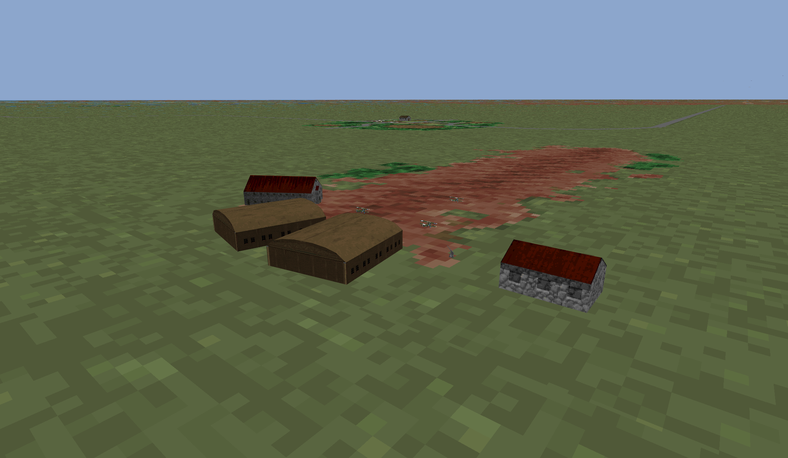
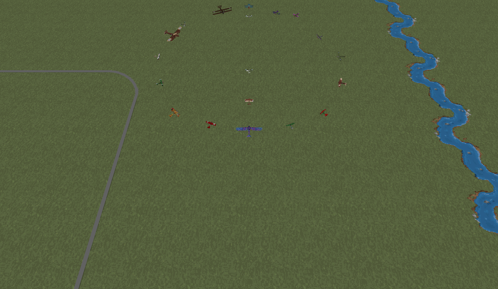

# Wings of Glory (WINGS_OF.EXE)

Ajouté le 2026-11-05. Exécutable fourni par Rémi ; il n'est pas dans le dépôt (comme les données).

## 1. L'exécutable

- `WINGS_OF.EXE`, 603 888 octets. Borland C++ 1991, gestionnaire d'overlays VROOMM (en-tête `FBOV` après l'image),
  comme STRIKE.EXE, OPTEST.EXE et PACIFIC.EXE. Lancé par `WG` (« Please type WG to run Wings of Glory. »).
- `WINGS_OF.EXE` est le programme **hors vol** (déroulement, conversations, cinématiques, options, entraînement) :
  on y trouve les noms `convdata.iff`, `faces.iff`, `convfont.shp`, `cvno%04d.pak`, `bkglist.iff`, `instant.iff`,
  `options.cfg`, `optdflt.cfg`, `wg.cfg`, et la liste des avions (Sopwith Pup, Sopwith Camel, SPAD XIII, Albatros D III,
  Albatros C III, Albatros D V, Fokker D VII, Fokker D VIII, Fokker Dr. I, Zeppelin L71). Le vol est un autre
  programme, `GLORY.EXE` (§ 6 et § 7).
- Listing au format IDA reconstruit par `tools/vroomm_listing.py` : `source/wings.asm` (330 segments dont 71
  overlays, 2 988 fonctions repérées). Tous les outils prennent `--exe wings` (`tools/exe_paths.py`).

## 2. Noms repris

`tools/match_functions.py --from <source> --to wings --write`, passé dans cet ordre : OPTEST.EXE, STRIKE.EXE, puis
PACIFIC.EXE en dernier (ses noms, plus récents et plus précis, l'emportent sur une même fonction). Résultat :
810 fonctions nommées sur 3 378 déclarations `proc` (719 reprises de PACIFIC.EXE, 83 de STRIKE.EXE, 8 d'OPTEST.EXE).
Ce sont surtout les bibliothèques communes (IFF, mémoire, son AIL, outils) ; le modèle de vol, la machine à scripts
de mission et le terrain n'ont pas été retrouvés par cette comparaison : leur code diffère, il est à lire.

Fichiers : `known_functions.json`, `function_index.json`, `segment_boundaries.json`, `annotated_segments/`,
`pacific_matches.json`, `strike_matches.json`, `optest_matches.json` (candidats non tranchés compris).

## 3. Accès aux fichiers et archives TRE (lu le 2026-11-05)

**Le lecteur d'archive TRE de `WINGS_OF.EXE` cherche les fichiers par leur NOM EN CLAIR, par dichotomie dans un index
trié ; aucun hachage n'a été vu dans ce code.** Les fonctions sont dans seg004 (nommées `Tre_*` dans
`known_functions.json`).

### 3.1 Monter une archive : fichier `WG.CFG`

Aucun nom d'archive n'est écrit dans l'exécutable : la liste des archives est lue dans un **fichier de
configuration**, `wg.cfg` par défaut.

- `sub_69F3D` (fonction pas encore nommée ; proposé : `Config_OpenArgumentFile_69F3D`) ouvre ce fichier avec le
  lecteur de flux. Le nom vient du segment de données (`mov di, 16E8h` → chaîne `wg.cfg`). Exception : s'il y a plus de
  2 arguments et que le 1er commence par les 4 octets `Fugi` (`cmp dword ptr [bx], 69677546h`), c'est le 2ᵉ argument
  qui donne le fichier. Fichier absent : message « Wings of Glory was unable to find %s. Refer to the Install Guide
  for more details. »
- La lecture des réglages (`sub_6A0EB`, fonction pas encore nommée) teste le premier caractère de chaque élément lu :
  `cmp ax, 3Dh` (`=`) mène à `Tre_OpenArchive_4BB2` avec le reste du texte. Une ligne `=FICHIER.TRE` monte donc
  l'archive `FICHIER.TRE`. Les autres premiers caractères sont `+` et `-` (autres réglages).
- **8 archives au plus** (table de 8 mots à `DS:5298h`, `cmp word_59E58, 8` dans `Tre_RegisterArchive_4863`).

Les noms des archives de Wings of Glory sont donc dans le `WG.CFG` écrit par l'installation, pas dans l'exécutable.

`Tre_OpenArchive_4BB2` :

```
ouvrir le fichier en lecture        StreamReader_ReadDispatch_5274A (mode 1)
ajouter l'archive à la table        Tre_RegisterArchive_4863
lire l'en-tête, 8 octets à 0        Tre_ReadHeader_49D1 : u32 nombre d'enregistrements, u32 (fin de l'index)
lire l'index juste après            Tre_LoadIndex_4B01 : nombre × 74 octets (imul eax, eax, 4Ah)
```

Messages d'erreur : « No memory for buffer! », « Error in treefile header! » (lecture de l'index trop courte).

### 3.2 Format de l'index (constaté dans le code)

En-tête de 8 octets, puis un enregistrement de **74 octets** par fichier :

| Octets | Contenu | Preuve |
|---|---|---|
| 0 | 1 octet (non lu par la recherche) | le nom est lu à partir de l'octet 1 (`add ax, 6Ah` pour un enregistrement copié en `+69h`) |
| 1 à 65 | nom du fichier, chaîne terminée par 0 | `CRT_StrICmp_2D03(nom, enregistrement + 1)` |
| 66 | u32 position du fichier dans l'archive | `mov eax, [si+0ABh]` (`0ABh − 69h = 66`) |
| 70 | u32 taille | `add eax, [si+0AFh]` (`0AFh − 69h = 70`) |

C'est le même format que `BIGTRE.TRE` de Strike Commander et `PACIFIC.DAT` (`tools/tre_extract.py`).

### 3.3 Chercher un fichier : `Tre_FindEntry_49FD`

1. Le chemin demandé est celui que construit le jeu : `..\..\DATA\<dossier>\<nom>.<ext>`, par
   `Path_BuildDataPath_1F0C4` / `Path_Concat3_1F089` (dossiers `..\..\data\gameflow\`, `..\..\data\cestalk\`,
   `..\..\data\fonts\`, `..\..\data\midgames\`, `..\..\data\missions\`, `..\..\data\noise\`, ou `OBJECTS`,
   `MISSIONS`, `COCKPITS`, `SOUND`…). Exemple : `..\..\data\gameflow\convdata.IFF`.
2. Il est mis en majuscules sur place (`CRT_StrUpr_2F35`, `a`..`z` seulement).
3. Dichotomie sur les enregistrements (`n` = nombre, `bas` = 0) :

```
tant que n > 0 :
    milieu = bas + (n / 2) × 74
    c = stricmp(nom cherché, nom de l'enregistrement du milieu)
    si c == 0 : trouvé
    si c < 0  : n = n / 2                       (moitié basse)
    si c > 0  : bas = milieu + 74 ; n = n − (n / 2 + 1)   (moitié haute)
```

   La comparaison (`CRT_StrICmp_2D03`) ignore la casse (`a`..`z` ramenés à `A`..`Z`) et compare les octets sans signe.
   L'index doit donc être **trié par nom** dans cet ordre.
4. Trouvé : le flux devient la tranche `[position, position + taille)` de l'archive (`sub_5252A`).

`Tre_OpenEntryByName_48C1` essaie les archives dans l'ordre où elles ont été montées et ne cherche jamais un nom qui
finit par `TRE` (comparaison des 3 derniers caractères avec la chaîne `TRE`).

### 3.4 Archive d'abord, disque ensuite

`StreamReader_OpenFromTreeOrDisk_526A2` : en lecture (`cmp byte ptr [si+4Ch], 1`), cherche d'abord dans les archives
(`Tre_OpenEntryByName_48C1`) ; pas trouvé, ou écriture : le chemin est ouvert sur le disque
(`FileHandle_OpenByPath_52BBB` → `Dos_Open_51BDA`, `mov ah, 3Dh / int 21h`, ou `Dos_Create_51BAE`, `mov ah, 3Ch`).
Les sauvegardes (`saved\`, `tapes\`) passent par le disque.

Un cache de fichiers en mémoire EMS (`EmsFileCache_FindOrAdd_53245`) compare aussi les noms en clair (`strncmp` sur
40 caractères).

### 3.5 Écart avec les données de Rémi

Rémi décrit des archives TRE dont l'index contient des **hachages des noms**. Ce `WINGS_OF.EXE` (603 888 octets) ne
peut pas les lire : sa recherche compare des noms. Pour trouver le hachage, il faut l'exécutable livré avec ces
archives (autre version du jeu). Recherches faites sans résultat ici : table de CRC 32 (octets `96h, 30h, 7, 77h`),
polynômes `0EDB88320h` / `4C11DB7h`.

## 4. Déroulement (scripts `EFCT` et conditions `REQU`) — lu le 2026-11-05

### 4.1 Variables

Une seule table de variables, lue et écrite par quatre fonctions de seg018 :

| Fonction | Rôle |
|---|---|
| `GameVar_Get_A40C` | lit la variable n |
| `GameVar_SetFlag_A455` | met la variable n à 1 |
| `GameVar_Clear_A4F0` | met la variable n à 0 |
| `GameVar_Set_A49C` | variable n = valeur |

Numéros 0 à 255 : des **mots** (table `word_5FD3C`, `shl ax, 1`). Numéros 256 et plus : des **bits**
(table `word_5FD40`, octet `(n − 256) / 8`, bit `(n − 256) mod 8`) ; écrire une valeur non nulle pose le bit.

### 4.2 Conditions `REQU` (`Gameflow_TestRequ_A911`)

Mêmes 4 conditions que Strike Commander (`GAMEFLOW_SYSTEM.md` § 4.2), mais **chaque entrée fait 3 octets** :
la condition (1 octet), puis le numéro sur un mot (`[bx+si+1] | [bx+si+2] << 8`, `add si, 3`).

| Valeur | Nom |
|---|---|
| 0 | `REQUIRE_NOT_SET` |
| 1 | `REQUIRE_SET` |
| 2 | `OR_NOT_SET` |
| 3 | `OR_SET` |
| autre | rien |

### 4.3 Scripts `EFCT` (`Gameflow_RunScript_A9C9`)

Lit la commande et deux octets a, b (`[script+i+1]`, `[script+i+2]`), et le mot `a | b << 8`. Pas de **2**
octets, **3** pour les commandes 0, 6, 7, 9, 10, 19, 50, 51 et 55 (`inc di` en `loc_AE4E`, puis `add di, 2`), y compris
quand elles sont sautées. `ELSE` (30), `ENDIF` (31) et `OR_GROUP` (33) sont traités avant la table ; la table compte
**59 commandes** (`cmp bx, 3Ah / jbe`, `jmp cs:off_AED6[bx]`).

Tests comptés pendant un saut (pour les `ENDIF` imbriqués) et seuls admis dans un groupe `OR_GROUP`
(« Faulty OR structure in gameflow file ») : 9, 10, 20, 21, 28, 32, 35, 37, 52, 53, 54.

**Registre.** Nouveauté par rapport à Pacific Strike : un mot de la partie, `[partie+282]` (`[si+11Ah]`), sert de
registre (commandes 50 à 55).

Noms : ceux de Pacific Strike quand l'effet est le même ; \* = nom proposé.

| Valeur | Nom | Argument | Effet constaté dans le code |
|---|---|---|---|
| 0 | `PLAY_CONV` | mot | conversation n (`Gameflow_PlayConversation_6719B` → `Conv_PlayScript_14F62`) |
| 1 | `PLAY_SCENE` | octet | scène `[partie+271]` = n, arrêt du script (`[partie+247]` = 1) |
| 2 | `PLAY_MIDGAME`\* | octet | `Gameflow_PlayMidgame_6741E`(n, registre) : n = 1 à 14 → cinématique `MIDGAMnn.PAK` (14 rejoue `MIDGAM03`), 15 → générique (`mycredit`) |
| 3 | `FLY_MISSION_NOW` | octet | mission `[partie+268]` = n, `[partie+252]` = 1 |
| 4 | `NOP_4` | octet | rien |
| 5 | `SELECT_MISSION_5`\* | octet | mission `[partie+268]` = n (même code que 12) |
| 6 | `SET_FLAG` | mot | `GameVar_SetFlag_A455`(n) |
| 7 | `CLEAR_FLAG` | mot | `GameVar_Clear_A4F0`(n) |
| 8 | `NOP_8` | octet | rien |
| 9 | `IF_NOT_FLAG` | mot | réussit si la variable n = 0 |
| 10 | `IF_FLAG` | mot | réussit si la variable n ≠ 0 |
| 11 | `QUIT_TO_DOS`\* | octet | message « You just chose CMD_quit_to_dos. » (`sub_9D78`) |
| 12 | `SELECT_MISSION` | octet | mission `[partie+268]` = n |
| 13 | `SET_NEXT_MISSION` | octet | `[partie+270]` = n |
| 14 | `START_FLIGHT` | octet | `[partie+252]` = 1 |
| 15 | `GOTO_NEXT_MISSION` | octet | `sub_13C38`(0) ; si `sub_D20A` rend une valeur non nulle, `Gameflow_PlayMidgame_6741E`(4, cette valeur) ; `[partie+252]` = 2 |
| 16 | `SAVE_GAME` | octet | choix d'un fichier (`sub_BA82`), sauvegarde dans `saved\` puis `gensave.tmp` (`sub_BBDF`) |
| 17 | `LOAD_GAME` | octet | choix d'un fichier (`sub_BE70`) ; s'il est donné, `[partie+252]` = 3 |
| 18 | `TRAVEL`\* | octet | `Gameflow_Map_D51A`(n) : chunks `MAPS`, `INFO`, `WRLD`, `DATA`, `SPED` |
| 19 | `LOOK_AT_KILLBOARD` | 2 octets a, b | `Gameflow_KillBoard_C6D9`(a, b) : `WWISHPS.PAK`, `WWIPALS.PAK`, police `BOARDFNT`, « Return to tent » / « Return to common room » |
| 20 | `IF_MISSION_ACCEPTED` | octet | réussit si `[partie+874]` ≠ 0 |
| 21 | `IF_MISSION_REFUSED` | octet | réussit si `[partie+874]` = 0 |
| 22 | — | — | erreur |
| 23 | `NOP_23` | octet | `sub_D174`, fonction vide |
| 24 | `SET_MUSIC`\* | octet | `Music_LoadTune_13AF4`(n) (`AMUSIC.PAK` / `RMUSIC.PAK` de `midgames`), puis lancement (`sub_13BB6`) |
| 25 | `CLEAR_FLAGS_760_764`\* | octet | efface les variables 760 à 764 (`sub_D17C`) |
| 26 | `SHOW_KILL_MARKS` | octet | si `[partie+256]` ≠ 0 et `[partie+267]` ≠ 2 : `sub_C6D1`, fonction vide |
| 27 | `CLEAR_SLOT`\* | octet | si n < 8 : mot `[partie+690+26×n]` = 0 |
| 28 | `IF_AT_MOST_658`\* | octet | réussit si n ≤ `[partie+658]` |
| 29 | `CLEAR_FLAGS_261_269`\* | octet | efface les variables 261 à 269 (`sub_D1B1`) |
| 30 | `ELSE` | octet | traité avant la table |
| 31 | `ENDIF` | octet | traité avant la table |
| 32 | `IF_MISSION_SUCCESS` | octet | réussit si l'octet `[partie+540+n]` = 1 |
| 33 | `OR_GROUP` | octet | traité avant la table : les n tests suivants forment un OU |
| 34 | `APPLY_CHANGE` | octet | `Gameflow_ApplyChange_C426`(n) : chunks `PILT`, `STAT`, `CHNG`, `INFO` |
| 35 | `IF_NEVER`\* | octet | échoue toujours (`cmp word ptr [si+0FDh], 0` puis `jmp short loc_AE41` sans condition) |
| 36 | `LOST_PLANE_WARNING`\* | octet | si `[partie+253]` ≠ 0 : message « CMD_lost_plane_warning » (`sub_9D78`) |
| 37 | `IF_BYTE_982`\* | octet | réussit si `[partie+982]` ≠ 0 |
| 38 | `NOP_38` | octet | rien |
| 39 à 43 | — | — | erreur (`push 12h` / `sub_9D78`) |
| 44 | `SET_SLOT`\* | octet | si n < 8 : mot `[partie+690+26×n]` = 1 |
| 45 à 49 | — | — | erreur |
| 50 | `LOAD_VARIABLE`\* | mot | registre = variable n (`GameVar_Get_A40C`) |
| 51 | `STORE_VARIABLE`\* | mot | variable n = registre (`GameVar_Set_A49C`) |
| 52 | `IF_REGISTER_GREATER`\* | octet | réussit si registre > n |
| 53 | `IF_REGISTER_EQUAL`\* | octet | réussit si registre = n |
| 54 | `IF_REGISTER_LESS`\* | octet | réussit si registre < n |
| 55 | `LOAD_CONSTANT`\* | mot | registre = n |
| 56 | `SET_SLOT_56`\* | octet | mot `[partie+690+26×n]` = 1 (sans borne) |
| 57 | `CLEAR_SLOT_57`\* | octet | mot `[partie+690+26×n]` = 0 (sans borne) |
| 58 | `SET_RANK`\* | octet | texte du grade en `[partie+965]` : 1 « 1st Lt. », 2 « Captain », 3 « Major », 4 « Lt. Colonel », autre « 2nd Lt. » |

Les lignes « erreur » ont été vues dans la table (`loc_AEAD`) ; les blocs `[partie+690+26×n]` (8 enregistrements de
26 octets) ne sont pas encore identifiés.

## 5. Conversations (`Conv_PlayScript_14F62`) — lu le 2026-11-05

Lit un octet de commande, `cmp bx, 13h / jbe` puis `jmp cs:off_16757[bx]` : **20 valeurs**, dont 8 utilisées.
Lecteurs des champs dans seg031.

| Valeur | Nom | Champs (dans l'ordre) | Lu par |
|---|---|---|---|
| 0 | `GROUP_SHOT` | décor (9) ; puis les commandes 1 qui suivent | `ConvRec_ReadName_18AAF` ; figures du chunk `FIGR` de `CONVDATA.IFF` |
| 1 | `GROUP_SHOT_ADD_CHARACTER` | figure (9), x (mot), y (mot) | `ConvRec_ReadFigure_18C04` (seulement derrière 0 ou 18) |
| 3 | `CLOSEUP` | visage (9), image (1), décor (9), x (mot), y (mot), texte, couleur (1) ; puis les commandes 19 et 4 qui suivent | `ConvRec_ReadCloseup_18AD6` |
| 4 | `CLOSEUP_CONTINUATION` | texte (seulement derrière 3) | `ConvRec_ReadCloseup_18AD6` (2ᵉ appel : texte seul) |
| 10 | `SHOW_TEXT` | couleur (1), texte | `ConvRec_ReadText_18D3D` |
| 12 | `JUMP`\* | n (mot) : le pointeur du script avance de n octets (`add [di+4], ax`) | `ConvRec_ReadNumber_18DDA` |
| 16 | `NOP_16` | aucun | — |
| 18 | `GROUP_SHOT_WWI`\* | décor (9) ; puis les commandes 1 qui suivent, figures prises dans `WWISHPS.PAK` | `ConvRec_ReadName_18AAF` |
| 19 | `CLOSEUP_SAME`\* | texte (seulement derrière 3) | `ConvRec_ReadCloseup_18AD6` |
| autre | — | « Got lost while running the conversation! » | — |

4 ou 19 rencontrés seuls : « CONT or SAME out of place! ».

Différences avec Pacific Strike :
- pas de 4 octets de voix après le texte ;
- pas de blocs conditionnels (`IF_FLAG`, `ELSE`, `ENDIF`) ;
- pas de commandant devant la carte (17) ;
- nouveaux : 18 (plan de groupe avec `WWISHPS.PAK`), 19 (suite du gros plan) et 12 (saut relatif).

## 6. Scripts de mission : pas dans `WINGS_OF.EXE`

`WINGS_OF.EXE` est le programme **hors vol** (comme `OPTEST.EXE` de Strike Commander) :

1. Quand un script `EFCT` lance un vol (`[partie+252]` = 1), la boucle du déroulement (`Gameflow_MainLoop_B155`) appelle
   `Gameflow_WriteOp2Misn_681AA`. Celle-ci écrit `op2misn.iff` (chunks `MLST`, `NAME`, `SNAM`, `RANK`, `INVN`).
2. La boucle rend son code, et le programme se termine par `CRT_Exit` (`sub_9DCA` →
   `PagedResourceC_RefreshAndFinalize_47E2A`).
3. Au retour, `Gameflow_ReadMisn2Op_67CD9` lit `misn2op.iff` (chunks `MLST`, `EXIT`, `INVN`, `JETS`, `KILL`).

Les étiquettes `PROG`, `PART`, `CAST` et `AREA` n'apparaissent que dans l'écriture de la mission d'entraînement
(`sub_12D3D`). Celle-ci recopie des chunks de `dogfight.iff`, `bombrun.iff` ou `gauntlet.iff` dans `instant.iff`,
sans les interpréter. Aucun aiguillage d'instructions de mission n'existe dans cet exécutable, et il ne contient
aucune étiquette du modèle de vol (`DYNM`, `JDYN`).

**Les instructions des scripts de mission sont dans l'exécutable du vol**, `GLORY.EXE` (§ 7), lancé ensuite par le
lanceur `WG.EXE`.

## 7. Archives XTRE et programme du vol (`GLORY.EXE`) — lu le 2026-11-06

### 7.1 Les deux sortes d'archives

`WG.CFG` (fourni par Rémi) liste deux sortes d'archives :

```
@C:\WINGS\flighthd.tre
@D:\flightcd.tre
=D:\wogdata1.tre
=D:\wogdata2.tre
=C:\WINGS\wogdata3.tre
```

- Lignes `=` : archives **TRE** à noms en clair (en-tête de 8 octets, enregistrements de 74 octets), montées par
  `WINGS_OF.EXE` (§ 3 ; `WOGDATA1.TRE`, `WOGDATA3.TRE` vérifiés).
- Lignes `@` : archives **XTRE** à noms hachés (`FLIGHTHD.TRE`, `FLIGHTCD.TRE`), lues par `GLORY.EXE`, le programme
  du vol. Le code de lecture de la ligne `@` dans `GLORY.EXE` n'a pas été lu ; la lecture de la ligne de commande de
  `WINGS_OF.EXE` ne connaît que `=`, `+` et `-`.

`GLORY.EXE` est un programme **32 bits en mode protégé** : extenseur DOS Phar Lap (en-tête `P3` à l'octet 6 560,
image de 750 380 octets à l'octet 7 072), compilé avec MetaWare High C. Les offsets ci-dessous sont des offsets dans
cette image (`push ebp / mov ebp, esp`, code 32 bits).

### 7.2 Format XTRE (constaté dans `GLORY.EXE` et sur les deux archives)

En-tête de 24 octets, lu en `[objet+114h]` et vérifié à l'offset 914DCh (`cmp dword ptr [esi+114h], 45525458h`,
`cmp dword ptr [esi+118h], 0`) :

| Octets | Contenu |
|---|---|
| 0 | `XTRE` |
| 4 | 0 |
| 8 | début de l'index des hachages (24) |
| 12 | fin de l'index des hachages |
| 16 | début de la table des fichiers |
| 20 | début des données ; tout ce qui précède (index et table) est chargé en mémoire d'un bloc |

**Index des hachages** : enregistrements de 8 octets, u32 hachage puis u32 position de l'enregistrement du fichier
(0FFFFFFFFh = case vide). Rangés en **arbre binaire dans un tableau** (recherche à l'offset 91B9Eh) : on part de la
case 1 ; hachage égal → trouvé ; hachage cherché plus petit (comparaison sans signe) → case 2i ; plus grand → case
2i + 1 ; on s'arrête à la fin de l'index. Si la position trouvée est avant la table des fichiers, elle désigne une
liste de noms en clair (collisions) : octet longueur, nom, u32 position ; aucune dans les deux archives fournies.

**Table des fichiers** : enregistrements de 8 octets (offset 918E6h) :

| Octets | Contenu |
|---|---|
| 0 | u32 position du fichier dans l'archive ; la longueur stockée = position suivante − celle-ci (fin de l'archive pour le dernier) |
| 4 | u32 : taille décompressée sur les 30 bits bas (`and ecx, 3FFFFFFFh`), mode de stockage dans les bits 31 et 30 |

| Mode | Stockage | Décodeur |
|---|---|---|
| 0 | en clair | — |
| 2 (bit 31) | LZW, codes de 9 à 12 bits lus du bit bas au bit haut, 256 = remise à zéro (retour à 9 bits), 257 = fin, premier code libre 258 | offset 93046h |
| 3 (bits 31 et 30) | LZ77 à 4 formes de commande (ci-dessous) | offset 932FCh |

Mode 3, octet de tête b0 (les « octets copiés » viennent du flux, la « copie » vient de ce qui est déjà décodé) :

| b0 | Octets lus | Copiés du flux | Copie : longueur | Copie : distance en arrière |
|---|---|---|---|---|
| `0xxxxxxx` | b0, b1 | b0 & 3 | ((b0 & 1Ch) >> 2) + 3 | ((b0 & 60h) << 3) + b1 + 1 |
| `10xxxxxx` | b0, b1, b2 | b1 >> 6 | (b0 & 3Fh) + 4 | ((b1 & 3Fh) << 8) + b2 + 1 |
| `110xxxxx` | b0, b1, b2, b3 | b0 & 3 | ((b0 & 0Ch) << 6) + b3 + 5 | ((b0 & 10h) << 12) + (b1 << 8) + b2 + 1 |
| `111xxxxx` | b0 | ((b0 & 1Fh) << 2) + 4 ; si plus de 112 : b0 & 3 puis fin | — | — |

Vérifié sur les 400 fichiers des deux archives : chaque fichier décompressé a exactement la taille annoncée.

### 7.3 Le hachage des noms (offset 91CD6h)

```
h = 0
pour chaque octet c du nom :
    h = rotation à gauche de h de 3 bits (32 bits)
    h = h + c          (octet sans signe, résultat sur 32 bits)
```

Le nom haché est le **chemin complet en majuscules**, tel que le jeu le construit : par exemple
`..\..\DATA\AIRDENS.TBL`, `..\..\DATA\TERRAIN\MAP2.PAK`. Avant le hachage, le nom est recopié (80 octets au plus,
offset 91D22h) puis passé à une fonction que l'image compactée ne permet pas de lire ; la mise en majuscules est
établie par les données (le hachage du nom en majuscules est dans l'index, pas celui en minuscules).

En C++ (style de libRealSpace) :

```cpp
uint32_t XtreHash(const char *name) {
    uint32_t h = 0;
    for (const unsigned char *p = (const unsigned char *)name; *p != 0; p++) {
        h = (h << 3) | (h >> 29);
        h = h + (uint32_t)toupper(*p);
    }
    return h;
}
```

Le hachage est faible : deux noms courts peuvent donner la même valeur (`..\..\DATA\TERRAIN\MAP2.PAK` et
`..\..\DATA\TERRAIN\KRH2.PAK` ont tous deux F04CA7B4h). Pour un portage, il suffit de hacher le nom demandé et de
chercher la valeur : le jeu fait de même.

### 7.4 Noms retrouvés

`tools/xtre_extract.py` liste et extrait une archive XTRE. Les noms ne sont pas dans l'archive : l'outil hache les
noms des archives à noms en clair (`WOGDATA1.TRE`, `BIGTRE.TRE`, `PACIFIC.DAT`, `TOBIGTRE.TRE`) et les noms de
`analysis/wings/xtre_noms_supplementaires.txt` (retrouvés en hachant les mots des exécutables : `MAP2.PAK`,
`CLOUD1.IFF` à `CLOUD3.IFF`, `CRATER.TXM`, `FCHKEXIT.SHP`, `FRESTART.SHP`, `OPTMENUF.PAK`).

| Archive | Fichiers | Noms retrouvés |
|---|---|---|
| `FLIGHTHD.TRE` | 260 | 215 |
| `FLIGHTCD.TRE` | 140 (135 dans l'index des hachages) | 122 |

`..\..\DATA\TERRAIN\MAP2.PAK` est dans `FLIGHTHD.TRE` (mode 3, 31 663 octets stockés, 313 058 décompressés ; table
`PAK` à l'octet 0).

```
python3 tools/xtre_extract.py FLIGHTHD.TRE --noms WOGDATA1.TRE BIGTRE.TRE PACIFIC.DAT TOBIGTRE.TRE \
        analysis/wings/xtre_noms_supplementaires.txt --extraire DONNEES
```

Les fichiers sans nom retrouvé sont écrits dans `INCONNU/<hachage>` (et `SANS_HACHAGE/<position>` pour les
enregistrements de fichier qu'aucune case de l'index ne désigne).

### 7.5 Rendu de `MAP2.PAK` (constaté sur le fichier, pas encore relu dans `GLORY.EXE`)


`tools/wog_map_render.py MAP2.PAK -o map2.png` (fichier extrait par `tools/xtre_extract.py`).

`MAP2.PAK` est un `PAK` de 7 entrées. Les fichiers cités par `FORM BLOX` (`NEWMAP.ELV`, `NEWMAP.AVG`, `NEWMAP.TRI`,
`NEWMAP.OBJ`) n'existent dans aucune archive (cherchés par leur hachage dans `FLIGHTHD.TRE` et `FLIGHTCD.TRE`, et
par leur nom dans `WOGDATA1.TRE` et `WOGDATA3.TRE`) : comme dans Strike Commander (`DATA_MODEL.md`, `MAURITAN.PAK`),
ce sont les noms des entrées du `PAK` lui-même.

| Entrée | Taille | Contenu |
|---|---|---|
| 0 | 508 | `FORM TERA` : `VERS` (2), `INFO`, `FORM BLOX` (un seul `ELEV`, puis `ATRI`, `OBJS`), `FORM TXMS` (`INFO`, `MAPS`) |
| 1 | 259 200 | grille de 360 × 360 sommets de 2 octets (`ELEV` : 18 cellules, `dw 18`, de 20 sommets, `dw 20`, espacés de 1 000, `dw 1000` ; 18 × 20 = 360). Lue d'un bloc, ligne après ligne, l'image est continue. Strike Commander : `PAK` de cellules, 6 octets par sommet |
| 2 et 3 | 0 | vides (Strike Commander : niveaux de détail moyen et bas) |
| 4 | 1 300 | non décodée |
| 5 | 51 370 | `PAK` de 324 cellules (18 × 18), dont 80 non vides : listes d'objets posés (`u16` nombre, puis enregistrements avec un nom : `SMHOUS1` à `SMHOUS5`, `SMHOUSD1`, `HOUSE1`, `BRIDGE`, `DBRIDGE`…), comme l'entrée 5 d'`ALASKA.PAK` |
| 6 | 648 | non décodée ; contient des noms d'objets (`BRIDGE`, `SMHOUS1`…) ; Strike Commander : 324 `u16` |

Le chunk `MAPS` cite 23 noms : `BEACH`, `GR2RTH`, `RCK2RTH`, `GTRNCH`, `INRSXN`, `INTGRSS`, `INTTREE`, `INTRCK`,
`RDXRV`, `FARMS`, `RIVER`, `TOWN`, `DTOWN`, `ATRNCH`, `RUNWAY`, `TRACK`, `ROAD`, `NOMAN`, `CROSS`, `NML`, `GROAD`,
`COAST`, `TOWNS`.

Grille (rôles non établis, couleurs choisies pour l'image) :

- 1ᵉʳ octet, 2 bits bas : 0 (3 202 cases, coin en haut à gauche, bleu foncé sur l'image), 1, 2 (deux grandes régions) ;
- 1ᵉʳ octet, bits 40h / 80h : deux zones séparées par une limite qui part de la côte et descend vers le sud-est
  (vert / ocre sur l'image) ; cases sans ces bits = marge sombre ;
- 2ᵉ octet : 255 sur 119 328 cases ; les autres valeurs (6 à 252) forment des lignes. Elles sont dessinées par bande de
  valeurs : 6 à 53 crème, 54 à 99 gris, 174 à 209 rouge, 210 à 254 noir. Le lien avec les noms de `MAPS` n'est pas
  établi.

La ligne 0 de la grille est en haut de l'image ; l'orientation n'est pas vérifiée.

### 7.6 Chargeur du terrain de `GLORY.EXE` (lu le 2026-11-06)

**Image du programme.** L'image Phar Lap est compactée par blocs. Mot n : si le bit 15 est nul, n octets suivent tels
quels ; sinon un octet k, puis k octets de motif répétés jusqu'à n & 7FFFh octets (k = 0 : octets nuls). Décompactée,
elle fait 768 442 octets, la taille demandée par l'en-tête. Elle est chargée à l'adresse 1000h : une adresse du code
vaut l'offset dans l'image décompactée + 1000h (vérifié sur les chaînes : 0B09E8h « %s: Bad TreeFile format. »,
0B00C4h « TERRAIN », 0BC234h « .ELV »). Les adresses ci-dessous sont celles du code. Aucune fonction n'a de nom : les
noms proposés sont suivis de l'adresse.

**`Terrain_Load_8D004`** (objet terrain, nom) :

1. ouvre le fichier `PAK` (dossier « TERRAIN », chaîne 0B00C4h) et lit l'IFF de l'entrée 0 ;
2. exige `FORM TERA` (`cmp` avec 41524554h), puis `VERS` ≥ 200h (`cmp ax, 200h` ; sinon erreur 0E00Bh, et 0E00Ch
   si `VERS` manque) ;
3. `INFO` : un dword rangé en `[terrain+4CF8h]` (rôle non établi) ;
4. `FORM BLOX` puis `ELEV` : appelle `Terrain_LoadElevationGrid_88DF0` ; puis `Terrain_LoadObjectGrid_8CA84` (`OBJS`).
   L'étiquette `ATRI` n'apparaît nulle part dans le code (ni en valeur immédiate ni en chaîne).

**`Terrain_LoadElevationGrid_88DF0`** : le contenu du chunk `ELEV` n'est pas lu. Les dimensions sont des constantes :

| Champ | Valeur | Preuve |
|---|---|---|
| sommets par côté | 360 | `mov eax, 168h` → `[grille+4]`, `[grille+10h]` |
| pas | 1 000 m | `mov dword ptr [ebx+0Ch], 3E8h` |
| bord ouest, en sommets | −180 | `mov dword ptr [ebx+4AECh], 0FFFFFF4Ch` |
| bord nord, en sommets | 180 | `mov dword ptr [ebx+4AF0h], 0B4h` |

La grille réserve 360 × 360 × 2 octets (`imul eax, eax / shl eax, 1`) et lit d'un bloc **l'entrée 1 du `PAK`**.

**`Terrain_PakEntryForExtension_88850`** : l'extension d'un nom cité dans l'IFF choisit l'entrée du `PAK` :

| Extension | Entrée |
|---|---|
| `.ELV` | 1 |
| `.MED` | 2 |
| `.LOW` | 3 |
| `.TRI` | 4 |
| `.OBJ` | 5 |

`OBJS` (27 octets lus d'un bloc) : mot 18 (cellules par côté), dword 20 000 (taille d'une cellule), deux dwords, nom
`NEWMAP.OBJ` → entrée 5, une liste d'objets par cellule (18 × 18). Strike Commander a la même disposition dans les
données (`DATA_MODEL.md`, `ALASKA.PAK` : `[4]` = régions `.TRI`, `[5]` = objets posés). L'entrée 6 n'est pas
désignée par cette fonction ; son lecteur n'est pas trouvé.

**Un sommet = 2 octets** ; adresse = grille + (colonne + ligne × 360) × 2. Colonne = X ÷ 1 000 + 180 (vers l'est) ;
ligne = 180 − c1 ÷ 1 000 (`neg ecx` à 89768h) : la ligne 0 est au nord (c1 = +180 000). En libRealSpace
(`z = −c1`) : colonne = x ÷ 1 000 + 180, ligne = z ÷ 1 000 + 180. Aucun des deux octets n'est une altitude dans le code
lu.

| Octet | Bits | Rôle constaté |
|---|---|---|
| 0 | 0 à 3 | **classe de sol** (`and al, 0Fh`) : 0, 1 ou 2 |
| 0 | 6 et 7 | **zone** 0, 1 ou 2 (`sar ecx, 6`) ; voir « Requête de sol » |
| 1 | 8 bits | **texture** ; 255 = aucune (`cmp al, 0FFh`) |

**Dessin** (`Terrain_BuildWindow_89xxx` vers 89660h, `Terrain_DrawCells` vers 8B270h) :

- fenêtre de 25 × 25 sommets autour de la caméra (`mov ecx, 19h`), de −12 à +12 sommets, bornée aux bords ;
- un compteur par texture (`[0BF3C8h + n]`) suit les cases de la fenêtre qui l'utilisent, pour charger les textures ;
  une case sans texture compte celle de sa classe : classe 0 → textures 0 à 3 ensemble, classe 1 → texture 101
  (`[0BF42Dh]`), classe 2 → texture 100 (`[0BF42Ch]`) ;
- couleur sans texture, par classe (`mov dword ptr [ebp-18Ch], …` et `[ebp-16Ch]`) :

  | Classe | Couleur de base | Nombre de teintes |
  |---|---|---|
  | 0 | 183 | 8 |
  | 1 | 110 | 17 |
  | 2 | 74 | 21 |

  index de palette d'un sommet = couleur de base + d, avec d selon la profondeur du sommet (marque `[sommet+1Bh]`,
  posée à 8AE4Ah) : avant le seuil proche `[0BF504h]`, d = 0 ; entre le seuil proche et le seuil lointain
  `[0BF508h]` (marque 80h), d = (profondeur − seuil proche) ÷ (seuil lointain − seuil proche) × nombre de teintes ;
  au-delà (marque 40h), d = nombre de teintes. Les seuils dépendent de l'altitude de la caméra (89520h à 8965Ah) ;
- de près, la texture de l'octet 1 (si elle existe et selon le niveau de détail `[0B00CCh]`), sinon celle de la classe.

**Requête de sol** (`Terrain_GroundTypeAt_8BF78`, appelée par `8D964h`) : rend le numéro de texture de la case
(octet 1), ou la classe (octet 0 & 0Fh) si l'octet 1 vaut 255 ou si le niveau de détail vaut 1, ou 2 si le niveau de
détail vaut 0 ; hors carte : 255. Elle range aussi **octet 0 >> 6** dans `[0B00A4h]` (0 hors carte). Appelants :

| Adresse | Usage constaté |
|---|---|
| 11384h | zone = 1 (bit 40h) → `sub_AF9C(…, 4)` ; sinon, si `[objet+30h]` ≠ 0 → `sub_AF9C(…, 3)` (rôle non établi) |
| 40926h | type de sol testé avant de créer un objet |
| 6346Ch | type de sol = 2 → recherche dans une liste d'objets |
| 76E2Eh | types 1, 2, 174 à 179 et 248 → `[objet+20h]` = 1 ; 224 et plus → autre branche |
| 8D687h | types 0, 6 à 14, 136 à 147, 185, 186, 191 à 199, 246, 247… → résultat 0 |

Sens des classes 0, 1, 2 et des zones : non établi dans le code. Sur `MAP2.PAK` (§ 7.5) : la classe 0 occupe le coin
nord-ouest et elle a quatre textures animées par défaut ; les zones 1 et 2 sont séparées par une limite continue.

### 7.7 Rendu de `MAP2.PAK` avec les règles du jeu

`tools/wog_terrain_render.py` applique les règles du § 7.6 (pose vérifiée dans le code) : texture n = entrée n de
`TXM\TXMPACK.PAK` ; une texture entière par case de 1 km, coins (1, 1), (l − 2, 1), (l − 2, h − 2), (1, h − 2) sur
v0 = (r, c), v1 = (r, c + 1), v2 = (r + 1, c + 1), v3 = (r + 1, c), donc u vers l'est et v vers le sud ; sans
texture, texture de la classe (0 → 0 à 3 tour à tour, 1 → 101, 2 → 100) ; palette `PALETTE\PALETTE.IFF` (6 bits).
Les rivières, routes et tranchées se raccordent d'une case à l'autre, ce qui confirme le sens.

Couleurs lointaines (couleur de base de la classe : 183, 110, 74) :


Textures (chaque case réduite à 4 × 4 pixels) :


Vue 3D (page WebGL autonome produite par l'outil, `--html`) :


```
python3 tools/wog_terrain_render.py MAP2.PAK --txmpack TXMPACK.PAK --palette PALETTE.IFF \
        --couleurs map2_couleurs.png --textures map2_textures.png --html map2_3d.html
```

Limites de la vue 3D : le terrain est plat (aucune hauteur dans la grille) ; tout est texturé quelle que soit la
distance (le jeu ne texture qu'une fenêtre de 25 × 25 sommets et passe aux couleurs lointaines au-delà ; la case à
cocher montre ces couleurs) ; l'animation de la classe 0 change d'image toutes les 0,25 s, car l'unité du pas de
temps `[0AEB30h]` n'est pas établie ; les objets posés (entrée 5) ne sont pas dessinés.

## 8. Scripts de mission de `GLORY.EXE` (lu le 2026-11-06)

Adresses du code de `GLORY.EXE` (§ 7.6). Aucune fonction n'a de nom.

### 8.1 Chargement (chunk `PROG`, 13338h et 14EBCh)

- La taille du chunk doit être un multiple de 4 (`test byte ptr [ebp-8Ch], 3`, sinon erreur 9116h). Vérifié : les
  43 chunks `PROG` des 47 missions de `FLIGHTHD.TRE` et `FLIGHTCD.TRE` le sont.
- Le chunk est copié tel quel, puis découpé : un mot tous les 4 octets est examiné ; un mot nul termine un programme,
  le suivant commence 4 octets plus loin. 24 programmes au plus (`cmp edx, 18h`, sinon erreur 9011h). Les
  programmes sont numérotés à partir de 1.

### 8.2 Lecture d'une instruction (0E61Ch)

```
opcode   = mot signé
argument = mot signé suivant
si le mot suivant vaut 9 : argument supplémentaire = le mot d'après (sinon −1)
```

Mots de 16 bits, comme Strike Commander ; un seul argument supplémentaire (Pacific Strike : jusqu'à 3). Une
instruction fait donc 4 octets, ou 8 avec l'argument supplémentaire : la taille du chunk reste un multiple de 4.
Vérifié sur les 43 chunks : tous se lisent sans reste ; 107 instructions ont l'argument supplémentaire.

Étiquette (0E65Ch) : recherche **depuis le début du programme**, par paires (opcode, argument), de l'opcode 8 dont
l'argument vaut n ; introuvable : erreur 901Fh (Strike Commander : recherche en avant depuis l'instruction courante).

### 8.3 La machine (0E790h)

Contexte d'exécution : `[ctx+4]` pointeur d'instruction, `[ctx+8]` opcode, `[ctx+0Ch]` argument, `[ctx+10h]`
argument supplémentaire, `[ctx+14h]` registre, `[ctx+18h]` résultat du dernier ordre natif, `[ctx+1Ch]` fin,
`[ctx+20h]` objet courant, `[ctx+24h]` résultat de comparaison (bit 1 = inférieur, bit 2 = égal, bit 4 = supérieur).
Les instructions s'enchaînent jusqu'à la fin du script, y compris après un ordre natif.

Aiguillage : `cmp ecx, 0D0h` puis `jmp dword ptr cs:[ecx*4 + 0F18Ch]` : **209 valeurs**, dont 97 traitées ; les 112
autres mènent à l'erreur 911Bh. Une erreur (9501Ch → 94F70h) affiche « Error #%04x » et **termine le programme**.

Variables : variable n < 256 = mot signé (table `[0BFF0Ch]`) ; n ≥ 256 = bit (table `[0BFED0h]`), comme le
déroulement de `WINGS_OF.EXE` (§ 4.1). Lecture 29BE0h, écriture 29C6Ch.

Noms : ceux de Strike Commander (`MISSION_SCRIPT_OPCODES.md`) quand l'effet est le même ; \* = nom proposé.

| Valeur | Nom | Effet constaté |
|---|---|---|
| 0 | `OP_NOOP` | retour : fin du programme, ou retour d'un appel (0E734h) |
| 1 | `OP_EXIT_PROG` | même code que 0 |
| 2 | `OP_EXEC_SUB_PROG` | appel du programme n (pile de 24 appels, 0E6C8h) |
| 3 | `OP_EXEC_SUB_PROG_WORK` | appel du programme numéro registre |
| 4 | `OP_STOP_SCRIPT` | arrêt du script (`[ctx+1Ch]` = 1) |
| 5 | `—` | rien |
| 8 | `OP_SET_LABEL` | étiquette n (rien à l'exécution) |
| 15 | `OP_SET_EXIT_CODE` | octet `[0AEBD0h]` = n |
| 16 | `OP_MOVE_VALUE_TO_WORK_REGISTER` | registre = n |
| 17 | `OP_MOVE_FLAG_TO_WORK_REGISTER` | registre = variable n |
| 18 | `OP_SWAP_WORK_AND_FLAG` | échange registre et variable n |
| 19 | `OP_MOVE_RESULT_TO_WORK` | registre = résultat du dernier ordre natif |
| 21 | `OP_RANDOM_TO_WORK` | registre = hasard (164BCh, avec n + 1) |
| 32 | `OP_ADD_VALUE_TO_WORK` | registre += n |
| 33 | `OP_ADD_FLAG_TO_WORK` | registre += variable n |
| 34 | `OP_ADD_VALUE_TO_FLAG` | variable n += n |
| 35 | `OP_ADD_WORK_REGISTER_TO_FLAG` | variable n += registre |
| 36 | `OP_SUB_VALUE_FROM_WORK` | registre −= n |
| 37 | `OP_SUB_FLAG_FROM_WORK` | registre −= variable n |
| 38 | `OP_SUB_VALUE_FROM_FLAG` | variable n −= n |
| 39 | `OP_SUB_WORK_FROM_FLAG` | variable n −= registre |
| 40 | `OP_OR_VALUE_WITH_WORK` | registre \|= n |
| 41 | `OP_OR_FLAG_WITH_WORK` | registre \|= variable n |
| 42 | `OP_AND_VALUE_WITH_WORK` | registre &= n |
| 43 | `OP_AND_FLAG_WITH_WORK` | registre &= variable n |
| 44 | `OP_XOR_VALUE_WITH_WORK` | registre ^= n |
| 45 | `OP_XOR_FLAG_WITH_WORK` | registre ^= variable n |
| 46 | `OP_MUL_VALUE_WITH_WORK` | registre ×= n |
| 47 | `OP_MUL_FLAG_WITH_WORK` | registre ×= variable n |
| 48 | `OP_DIV_WORK_BY_VALUE` | registre /= n |
| 49 | `OP_DIV_WORK_BY_FLAG` | registre /= variable n |
| 64 | `OP_CMP_WORK_WITH_VALUE` | comparer registre à n |
| 65 | `OP_CMP_VALUE_WITH_WORK` | comparer n à registre |
| 66 | `OP_CMP_WORK_WITH_FLAG` | comparer registre à variable n |
| 67 | `OP_CMP_FLAG_WITH_WORK` | comparer variable n à registre |
| 68 | `OP_CMP_RESULT_WITH_VALUE` | comparer le résultat natif à n |
| 69 | `OP_TEST_FLAG` | comparer variable n à 1 |
| 70 | `OP_GOTO_IF_CURRENT_COMMAND_IN_PROGRESS` | aller à l'étiquette n si le résultat natif ≠ 0 |
| 71 | `OP_GOTO_IF_CURRENT_COMMAND_DONE` | aller à l'étiquette n si le résultat natif = 0 |
| 72 | `OP_BRANCH_IF_EQUAL` | aller à l'étiquette n si égal (bit 2) |
| 73 | `OP_BRANCH_IF_NOT_EQUAL` | … si différent |
| 74 | `OP_BRANCH_IF_LESS` | … si inférieur (bit 1) |
| 75 | `OP_BRANCH_IF_GREATER` | … si supérieur (bit 4) |
| 76 | `OP_BRANCH_IF_LESS_EQUAL` | … si inférieur ou égal (bits 1 ou 2) |
| 77 | `OP_BRANCH_IF_GREATER_EQUAL` | … si supérieur ou égal (bits 2 ou 4) |
| 78 | `OP_BRANCH` | aller à l'étiquette n |
| 79 | `OP_EXECUTE_CALL` | aller à l'étiquette numéro registre (saut, pas appel) |
| 80 | `OP_MOVE_WORK_REGISTER_TO_FLAG` | variable n = registre |
| 81 | `OP_MOVE_RESULT_TO_FLAG` | variable n = résultat natif |
| 82 | `OP_SET_FLAG_TO_TRUE` | variable n = 1 |
| 83 | `OP_SET_FLAG_TO_FALSE` | variable n = 0 |
| 84 | `OP_TOGGLE_FLAG` | variable n inversée (29D14h) |
| 85 | `OP_ADD_1_TO_FLAG` | variable n += 1 |
| 86 | `OP_REMOVE_1_TO_FLAG` | variable n −= 1 |
| 128 | `OP_ACTIVATE_SCENE` | zone n (`[mission+34h]`, 10D5Ch), puis son entrée dans `[mission+74h]` (10FDCh) : octet d'état = 1 |
| 129 | `OP_DEACTIVATE_SCENE` | même entrée : octet d'état = 0 |
| 130 | `OP_IS_SCENE_ACTIVE`\* | bit « égal » = octet d'état de la même entrée ≠ 0 |
| 136 | `OP_OBJ_136`\* | objet n → fonction 0FAF0h (rôle non établi) |
| 137 | `OP_OBJ_137`\* | registre = 43E44h(objet n) (rôle non établi ; 0 si l'objet n'existe pas) |
| 144 | `OP_ACTIVATE_OBJ` | activation de l'objet n (0F5C0h) |
| 145 | `OP_DEACTIVATE_OBJ` | désactivation de l'objet n (0FA9Ch) |
| 146 | `OP_IF_TARGET_IN_AREA` | bit « égal » = bit 1 de `[objet n+48h]` (rôle du bit non établi) |
| 147 | `OP_IS_TARGET_ALIVE` | bit « égal » = bit 2 de `[objet n+48h]` (le bit qui interdit les ordres natifs : objet détruit) |
| 148 | `OP_INSTANT_DESTROY_TARGET` | objet n → 10064h |
| 149 | `OP_DIST_TO_TARGET` | registre = distance objet n – objet courant ÷ 1 000, plafonnée à 255 |
| 150 | `OP_ALTITUDE_OF_TARGET`\* | registre = (altitude de l'objet n − 2 250 m) ÷ 100 m, plafonnée à 255 |
| 151 | `OP_DIST_TO_SPOT` | registre = distance objet courant – SPOT n ÷ 1 000, plafonnée à 255 |
| 152 | `OP_IS_TARGET_ACTIVE` | bit « égal » = objet n existant (`[objet+68h]` ≠ 0) |
| 153 | `OP_DIST_TO_TARGET_METRES`\* | comme 149, sans la division par 1 000 |
| 154 | `OP_OBJ_136_WORK`\* | comme 136, objet numéro registre |
| 155 | `OP_IF_TARGET_IN_AREA_WORK`\* | comme 146, objet numéro registre |
| 156 | `OP_ACTIVATE_OBJ_WORK`\* | comme 144, objet numéro registre |
| 160 | `OP_SET_WAIT_FOR_SECONDS` | minuterie de l'objet courant (`[objet+4Ch]`) ; résultat 1 tant qu'elle court, 0 à la fin ; n = 0 la remet à zéro |
| 161 | `OP_SET_OBJ_TAKE_OFF` | ordre natif : position SPOT n |
| 162 | `OP_SET_OBJ_LAND` | ordre natif : SPOT n, et SPOT supplémentaire (obligatoire, erreur 901Ch sinon) |
| 163 | `OP_SET_OBJ_163`\* | ordre natif : si l'objet n'est pas dans la zone n, ordre 164 vers le centre de la zone, SPOT supplémentaire obligatoire (901Eh) |
| 164 | `OP_SET_OBJ_164`\* | ordre natif : SPOT n et SPOT supplémentaire (obligatoire, 901Dh) |
| 165 | `OP_SET_OBJ_FLY_TO_WP` | ordre natif : comme 164 |
| 167 | `OP_SET_OBJ_DESTROY_TARGET` | ordre natif : cible = objet n, position = la sienne |
| 168 | `OP_SET_OBJ_DEFEND_TARGET` | ordre natif : comme 167 ; objet absent → résultat 1 |
| 169 | `OP_SET_OBJ_DEFEND_AREA` | ordre natif : SPOT n |
| 170 | `OP_SET_OBJ_FOLLOW_ALLY` | ordre natif : cible = objet n (255 = allié par défaut `[objet+39h]`) |
| 171 | `OP_SET_MESSAGE` | ordre natif : message n, vers l'objet `[mission+0F8h]` (le joueur) |
| 172 | `OP_SET_OBJ_172`\* | ordre natif : comme 164 |
| 177 | `OP_SET_OBJ_177`\* | ordre natif : valeur n d'une liste de la mission (`[mission+58h]`) dans la 2ᵉ composante de la position |
| 178 | `OP_SET_OBJ_178`\* | ordre natif : même liste, dans la 1ʳᵉ composante |
| 179 | `OP_SET_OBJ_179`\* | `[objet courant+39h]` = n, puis ordre natif vers la position de l'objet n |
| 180 | `OP_SET_OBJ_180`\* | ordre natif : SPOT n |
| 181 | `OP_SET_OBJ_181`\* | ordre natif : position de l'objet n |
| 182 | `OP_SHOW_ON_NAV_MAP` | `[objet n+48h]` \|= 10h |
| 183 | `OP_HIDE_FROM_NAV_MAP` | `[objet n+48h]` &= ~10h |
| 184 | `OP_JOIN_PLAYER_TEAM` | `[objet n+48h]` \|= 20h |
| 185 | `OP_LEAVE_PLAYER_TEAM` | `[objet n+48h]` &= ~20h |
| 190 | `OP_PACIFY_TARGET` | ordre natif donné à l'objet n (s'il n'est pas détruit) |
| 191 | `OP_SET_OBJ_PATROL_POSITION` | ordre natif : SPOT n |
| 192 | `OP_MISSION_192`\* | 11288h(mission, n) (rôle non établi) |
| 208 | `OP_SELECT_FLAG_208` | octet `[0AF6EDh]` = n |

Absents de la table (erreur fatale), alors qu'ils existent dans Strike Commander : `OP_SAVE_VALUE_TO_GAMFLOW_REGISTER`
(20) et 166 (voir 8.5).

### 8.4 Ordres natifs (10098h)

Refusés (résultat 0) si l'objet courant n'existe pas (`[objet+68h]` = 0) ou est détruit (bit 2 de `[objet+48h]`).
Aiguillage par opcode − 161 (table en 10570h, ordres 161 à 191). Chaque ordre calcule une position (SPOT, centre de
zone ou position d'un objet ; SPOT = enregistrement de 16 octets de `[mission+3Ch]`), éventuellement un objet cible
et une seconde position, puis appelle la méthode +90h du contrôleur de l'objet : (contrôleur, code de l'ordre, objet
cible, position, seconde position ou numéro de message). Le résultat est rangé en `[ctx+18h]`.

### 8.5 Le plan de vol du joueur (55C28h à 56060h)

Distinct de la machine : le programme `[objet du joueur+64h]` est lu comme une **liste d'étapes**. Une étape =
une instruction (octet bas de l'opcode, octet bas de l'argument), suivie éventuellement d'un argument
supplémentaire (marqueur 9) et d'un **message** (l'argument d'un `OP_SET_MESSAGE` qui suit ; 255 sinon). Le plan
avance quand la condition de l'étape est remplie (55E2Ch, puis 55E04h) :

| Étape | Terminée quand |
|---|---|
| 161 | le joueur a quitté le sol (`[contrôleur+68h → +20h]` = 0) |
| 162 | le joueur est au sol |
| 163 | erreur 710Dh |
| 164 | erreur 710Dh |
| 165 | distance horizontale joueur – SPOT n < 1 750 m (`cmp dword ptr [ebp-24h], 6D600h`) |
| 166 | la zone n contient le joueur (méthode +8 de la zone) |
| 167 | l'objet n est détruit |
| 168 | l'objet n est détruit |
| 169 | jamais |
| 170 | l'objet n est détruit |

`OP_SET_OBJ_FLY_TO_AREA` (166) n'est traité que par ce plan : la machine s'arrêterait dessus. Exemple d'un programme
de cette forme, `BOMBRUN.IFF`, programme 1 (quel objet le porte n'a pas été vérifié) :

```
OP_SET_OBJ_TAKE_OFF 1
OP_SET_OBJ_FLY_TO_AREA 3
OP_SET_MESSAGE 0
OP_SET_OBJ_FLY_TO_AREA 7
OP_SET_MESSAGE 4
…
OP_SET_OBJ_FLY_TO_WP 2
OP_SET_MESSAGE 6
OP_SET_OBJ_LAND 2, 1
```

### 8.6 Opcodes employés par les missions

Relevé sur les 43 chunks `PROG` (`FLIGHTHD.TRE`, `FLIGHTCD.TRE`) : 0, 1, 2, 8, 16, 17, 21, 32, 35, 36, 37, 39, 64, 66,
69, 70, 72 à 80, 82 à 85, 130, 137, 144 à 147, 149, 151, 154, 155, 160 à 162, 165 à 171, 182 à 185, 190, 191, 208. Tous sont
dans la table de la machine, sauf 166 (75 emplois, tous dans le plan de vol).

### 8.7 Chunks d'un fichier de mission (`MISSIONS\MISN-1.IFF`, comparé à `MISN-1A.IFF` de Strike Commander)

Arbre de `MISN-1.IFF` (tailles en octets) :

```
FORM MISN 2996
  HOME 14
  VERS 2
  TUNE 1
  NAME 14
  FNAM 12
  GNAM 10
  MOBJ 18
  FMOB 20
  GMOB 23
  TYPE 1
  FORM WRLD 20
    FILE 8
  AREA 114
  FARE 114
  GARE 114
  SPOT 84
  NUMS 0
  MSGS 35
  FMSG 37
  GMSG 43
  FLAG 0
  CAST 153
  PROG 780
  PART 930
  TEAM 8
  FORM PLAY 122
    SCNE 32
    SCNE 38
    SCNE 24
  LOAD 108
```

**Mêmes formats que Strike Commander** (vérifié sur les valeurs) :

| Chunk | Format | Constat sur `MISN-1.IFF` |
|---|---|---|
| `AREA` | forme, nom de 32 octets, point (3 int32 24.8), dimensions selon la forme | une boîte `B` « Base » (65 octets) + une sphère `S` « Enemies » (49 octets) = 114 |
| `SPOT` | enregistrements de 14 octets | 6 |
| `CAST` | noms de 9 octets | 17 (`CHARLES`, `LIFESON`, `ROOK-A`, `MESSAGE`, `PLAYER`, `GEN-A`…) |
| `PART` | enregistrements de 62 octets (`IMPL_MISSION_PART.md` § 1) | 15 ; noms (`HANGAR`/`DHANGAR`, `AERODROM`, `albad3`), positions vers x = −146 900 m, camps 1 / 255, allié par défaut 12 et postes en formation (0, −100, 50) pour l'escadrille, 4 programmes |
| `SCNE` | en-tête de 24 octets + liste de mots | 32, 38, 24 octets |
| `LOAD` | enregistrements de 9 octets | 12 (`FUELEXP1`, `EXPLODE1`, `ALBAD3`, `CRASH`…) |
| `FORM WRLD` / `FILE` | nom du monde | `brit0` |
| `TEAM` | mots | 7, 8, 9, 10 |
| `PROG` | § 8.1 et 8.2 | — |

**Différences** :

| Chunk | Constat | Lecture par `GLORY.EXE` |
|---|---|---|
| `VERS` | `00 05` (Strike Commander : `00 02`) | mot ≥ 500h exigé (`cmp eax, 500h`), sinon message d'erreur et fin du programme : une mission de Strike Commander est refusée |
| `HOME` (nouveau) | mot 23, puis 3 int32 24.8 = (−146 000, 111 000, 0) m, le point de référence de la zone « Base » | mot → zone de ce numéro (10D5Ch, nulle si le numéro dépasse le nombre de zones) en `[mission+0FCh]` ; les 3 int32 en `[mission+100h]` à `[mission+108h]` ; rôle non établi au-delà du nom |
| `TYPE` (nouveau) | 1 octet, 0 | octet en `[0AEBF0h]`, ramené à 0 s'il dépasse 2 (chaîne « BOGUS MISSION TYPE » dans l'exécutable) |
| `MOBJ` (nouveau) | objectif : « defend \naerodrome » | lu (12F8Bh) |
| `NAME` / `FNAM` / `GNAM` | nom anglais / français / allemand (« Western Front », « Front Ouest », « Westfront ») | `FNAM` d'abord, sinon `NAME`, sinon « UNK » ; `GNAM` jamais lu |
| `MOBJ` / `FMOB` / `GMOB` | objectif en trois langues (l'allemand en CP437 : « ü » = 81h) | `FMOB` d'abord, sinon `MOBJ` ; `GMOB` jamais lu |
| `AREA` / `FARE` / `GARE` | même contenu, seuls les noms des zones changent (« Enemies », « Ennemis », « Feinde ») | `FARE` d'abord, sinon `AREA` ; `GARE` jamais lu |
| `MSGS` / `FMSG` / `GMSG` | messages en trois langues | `FMSG` d'abord, sinon `MSGS` ; `GMSG` jamais lu |
| `INFO` | absent (Strike Commander : 11 octets) | — |
| `CACH` | absent (Strike Commander : 420 octets) | étiquette absente du code |
| `FLAG` | présent, vide | étiquette absente du code |

Ce `GLORY.EXE` cherche donc les chunks français en premier, sans variable de langue : c'est une version française ;
les chunks allemands servent sans doute à une version allemande de l'exécutable (non vue).

### 8.8 Placement des objets d'une mission (lu le 2026-11-06)

Les fonctions de `GLORY.EXE` n'ont pas de nom (pas de base IDA) : chacune est donnée par un nom proposé, puis son
adresse dans l'image chargée à 1000h.

**Du fichier de mission au terrain.** `FORM WRLD` / `FILE` nomme le monde (`brit0`) = `MISSIONS\BRIT0.IFF` ; son
chunk `TERA` nomme le terrain (`map`) = `TERRAIN\MAP.PAK`. Le lecteur de `TERA` (`World_ReadTera`, D420h) lit le
nom sur 8 octets, le compare au terrain déjà chargé et, s'il change, crée l'objet terrain de 19708 octets et appelle
le chargeur du § 7.6 (`call 8D004h`). `MAP.PAK` (dans `FLIGHTHD.TRE`) est identique octet pour octet à `MAP2.PAK`.

**Zones (`FARE`, sinon `AREA`).** Lecteur `Mission_ReadAreas` (14208h) : un premier passage compte les
enregistrements, un second les crée. Enregistrement : forme (1 octet), puis `Area_ReadCommon` (13FE4h) : nom de
32 octets et point de référence 3 × int32 24.8 (rangés en `+20h`, `+24h`, `+28h` de la zone), puis selon la forme :

| Forme | Valeurs lues ensuite | Taille | Comme Strike Commander |
|---|---|---|---|
| `S` | 1 int32 | 49 octets | oui |
| `C` | 2 int32 | 53 octets | oui |
| `B` | 5 int32 | 65 octets | oui |
| `P` (nouvelle) | 5 int32, un mot n, puis n × 2 int32 | 67 + 8 × n octets | — ; rôle des valeurs non lu |

Une autre lettre arrête le programme (message d'erreur 900Fh).

**Lecture d'un `PART`.** `Mission_ReadParts` (14DC8h) exige une taille multiple de 62 (sinon erreur 9036h) et lit
chaque enregistrement par `Mission_ReadPartRecord` (14888h) dans une structure de 112 octets. Découpage identique à
Strike Commander (`IMPL_MISSION_PART.md` § 1), avec ces constats :

- l'index CAST (octets 0-1) n'est gardé que sur son **octet bas** (`mov byte ptr [esi+1Bh], al`) ;
- l'allié par défaut (octets 46-47) est lu en mot et seul l'octet bas est gardé (`mov byte ptr [esi+39h], al`) :
  l'octet 47 n'est pas recopié, comme dans Strike Commander ;
- le numéro de zone (octets 26-27) devient un pointeur sur la zone (`call 10D5Ch`), nul si le numéro dépasse le
  nombre de zones : **65535 = aucune zone** ;
- le nom d'objet **`plch`** désigne l'avion du joueur. Mission lancée par `OP2MISN.IFF` (déroulement de
  `WINGS_OF.EXE`) : le nom devient `pup`, `camel`, `spadxiii`, `se5a`, `fokkdr1` ou `planex` selon le premier des
  bits 760, 761, 762, 763, 764, 766 du déroulement qui vaut 1 (`push 2F8h` … `push 2FEh` / `call 29BE0h`) ; aucun :
  le nom reste `plch`. Mission lancée sans `OP2MISN.IFF` : toujours `camel` (149E4h). La même substitution est
  faite sur le joueur après le chargement (13538h).

**Le joueur** est le premier `PART` dont le nom CAST est `PLAYER` (`Mission_FindPlayerPart`, 138D4h :
recherche de la chaîne `PLAYER` sur 8 octets dans les noms CAST, 108E8h).

**Placement** (`Part_Activate`, F5C0h), selon l'octet 28 :

- **octet 28 = 0** : position = décalage du fichier + point de référence de la zone, ou décalage seul sans zone
  (`Part_ZonePosition`, E5C0h). En libRealSpace (Y-up, mètres) : `x = ref.c0 + d.c0`, `y = ref.c2 + d.c2`,
  `z = −(ref.c1 + d.c1)` ;
- **octet 28 ≠ 0** : la zone est ignorée ; position = position du joueur au moment de l'activation + décalage
  tourné par l'orientation du joueur (côté, nez, haut ; F625h à F884h), **altitude au moins 300 m**
  (`cmp dword ptr [ebp-20h], 12C00h` / `jge` / `mov … 12C00h`) ; cap = cap du fichier + cap du joueur (calculé
  depuis le nez du joueur, `call 16940h`). Pour un joueur de cap P à plat, en libRealSpace :
  `x = jx + d.c0·cos P + d.c1·sin P`, `z = jz + d.c0·sin P − d.c1·cos P`, `y = max(jy + d.c2, 300)`.

**Cap.** Octets 41-42, `int16` en degrés. L'orientation part de l'identité et tourne de **−cap** autour de la
verticale (`neg eax` puis `call 1815Ch`, qui combine les deux premières lignes de la matrice avec le cosinus et le
sinus de la table de Strike Commander, 15E0Eh et 15DC8h). Le nez du modèle est son axe +c1 (vérifié sur `CAMEL.IFF` :
dérive et empennage étroits vers −c1). Donc **cap 0 = nord, cap 90 = est**, sens des aiguilles d'une montre ; nez en
libRealSpace = `(sin cap, 0, −cos cap)`.

Contrôles sur les données :

- `MISN-2.IFF` pose ses hangars par rapport à la zone « Aerodrome » (point de référence (−146 000, 111 000) en c0,
  c1) avec un décalage (−945, 550) ; `MISN-1.IFF` pose les mêmes hangars en absolu à (−146 945, 111 550) : même
  endroit ;
- `GAUNTLET.IFF` place 18 ennemis en cercle de 1 000 m autour du joueur (octet 28 = 1) avec le cap qui les tourne
  vers le centre (ennemi au nord : cap 180 ; à l'est : cap 270) ; la vue ci-dessous les montre tous tournés vers le
  joueur.

**Modèles** (`OBJECTS\<nom>.IFF`, `FORM REAL` / `APPR` / `POLY`), lecteur 2EF00h à 31CA0h :

- `VERT` : 3 × int32 24.8 par sommet ; `TRIS` / `FACE` : 8 octets (type, couleur, 3 mots sommet, 2F3F8h ; le type
  est comparé à 10 avant un aiguillage, rôle non lu) ; `QUAD` / `FACE` : 10 octets ;
- `MAPS` : 16 octets par triangle (mot face, mot texture, 3 × (u, v)), 20 par quadrilatère (31B2Ch, 31CA0h) ; u et v
  sont bornés à largeur − 1 et hauteur − 1 ; texture n < nombre de `TXMP` = n-ième `TXMP`, sinon n-ième `TXMA`
  après les `TXMP` (les deux nombres viennent du `INFO` de `TXMS`) ;
- `TXMP` : nom de 8 octets, largeur, hauteur (mots), puis largeur × hauteur pixels **bruts** (2917Ch). `TXMA` : même
  en-tête + mot nombre d'images, images à la suite (293A0h, 29458h). **Différence avec Pacific Strike**, dont les
  pixels sont compressés (PKWARE DCL, une ligne sur deux).

### 8.9 Rendu 3D d'une mission

`tools/wog_mission_render.py` applique le § 8.8 et dessine les objets sur le terrain du § 7.7 (page WebGL autonome,
liste des objets cliquable pour s'y rendre) :

```
python3 tools/wog_mission_render.py <DATA> MISN-1 --html misn1_3d.html [--avion camel]
```

`MISN-1` (« Front Ouest ») : hangars, dépôt, maison et quatre Camel du joueur et de son escadrille au sol (y = 3 m,
cap 90), ennemis à 300-400 m vers l'est :



`GAUNTLET`, vu d'en haut (objets agrandis 5 fois) : le joueur au centre, 18 avions placés dans son repère :



Limites : tous les objets `PART` sont dessinés, quel que soit le moment de leur activation par les scripts ; ceux
placés dans le repère du joueur le sont par rapport à sa position de départ ; l'éclairage des objets est une
lumière simple (celui du jeu n'est pas lu) ; l'indice 255 des textures d'objets est rendu transparent (supposé,
case à cocher) ; seul le niveau de détail `LVL0` et la 1re image des `TXMA` sont dessinés ; ombres (`*SHA*.IFF`) et
objets de l'entrée 5 du terrain non dessinés.

## 9. Le reste n'est pas lu

Aucune autre fonction propre à Wings of Glory n'a été lue. Les données du jeu n'ont pas été fournies.
