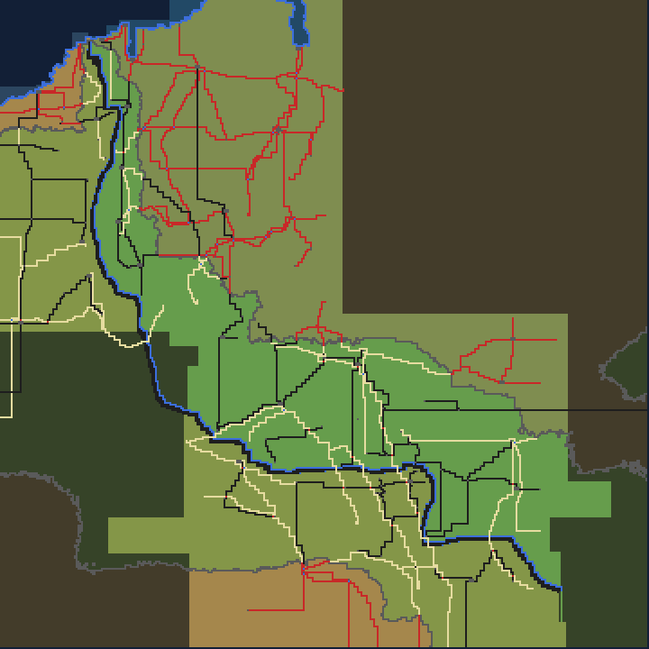
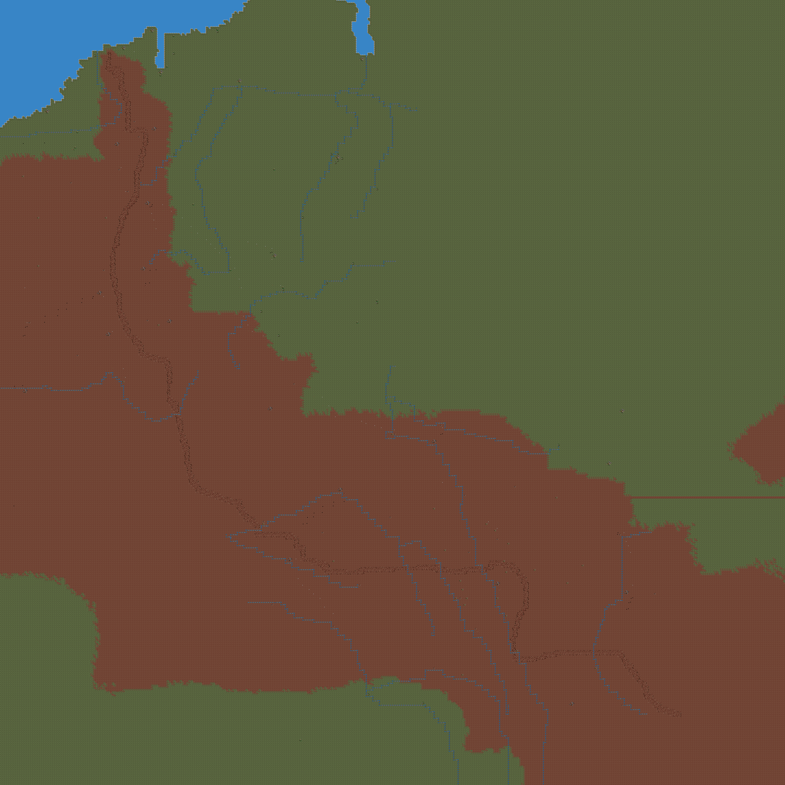
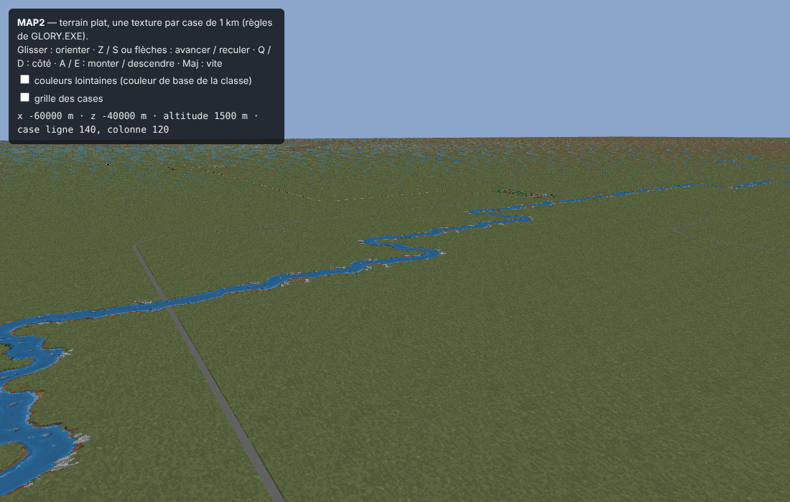

# Wings of Glory (WINGS_OF.EXE)

Ajouté le 2026-11-05. Exécutable fourni par Rémi ; il n'est pas dans le dépôt (comme les données).

## 1. L'exécutable

- `WINGS_OF.EXE`, 603 888 octets. Borland C++ 1991, gestionnaire d'overlays VROOMM (en-tête `FBOV` après l'image),
  comme STRIKE.EXE, OPTEST.EXE et PACIFIC.EXE. Lancé par `WG` (« Please type WG to run Wings of Glory. »).
- `WINGS_OF.EXE` est le programme **hors vol** (déroulement, conversations, cinématiques, options, entraînement) :
  on y trouve les noms `convdata.iff`, `faces.iff`, `convfont.shp`, `cvno%04d.pak`, `bkglist.iff`, `instant.iff`,
  `options.cfg`, `optdflt.cfg`, `wg.cfg`, et la liste des avions (Sopwith Pup, Sopwith Camel, SPAD XIII, Albatros D III,
  Albatros C III, Albatros D V, Fokker D VII, Fokker D VIII, Fokker Dr. I, Zeppelin L71). Le vol est un autre
  programme, `GLORY.EXE` (§ 6 et § 7).
- Listing au format IDA reconstruit par `tools/vroomm_listing.py` : `source/wings.asm` (330 segments dont 71
  overlays, 2 988 fonctions repérées). Tous les outils prennent `--exe wings` (`tools/exe_paths.py`).

## 2. Noms repris

`tools/match_functions.py --from <source> --to wings --write`, passé dans cet ordre : OPTEST.EXE, STRIKE.EXE, puis
PACIFIC.EXE en dernier (ses noms, plus récents et plus précis, l'emportent sur une même fonction). Résultat :
810 fonctions nommées sur 3 378 déclarations `proc` (719 reprises de PACIFIC.EXE, 83 de STRIKE.EXE, 8 d'OPTEST.EXE).
Ce sont surtout les bibliothèques communes (IFF, mémoire, son AIL, outils) ; le modèle de vol, la machine à scripts
de mission et le terrain n'ont pas été retrouvés par cette comparaison : leur code diffère, il est à lire.

Fichiers : `known_functions.json`, `function_index.json`, `segment_boundaries.json`, `annotated_segments/`,
`pacific_matches.json`, `strike_matches.json`, `optest_matches.json` (candidats non tranchés compris).

## 3. Accès aux fichiers et archives TRE (lu le 2026-11-05)

**Le lecteur d'archive TRE de `WINGS_OF.EXE` cherche les fichiers par leur NOM EN CLAIR, par dichotomie dans un index
trié ; aucun hachage n'a été vu dans ce code.** Les fonctions sont dans seg004 (nommées `Tre_*` dans
`known_functions.json`).

### 3.1 Monter une archive : fichier `WG.CFG`

Aucun nom d'archive n'est écrit dans l'exécutable : la liste des archives est lue dans un **fichier de
configuration**, `wg.cfg` par défaut.

- `sub_69F3D` (fonction pas encore nommée ; proposé : `Config_OpenArgumentFile_69F3D`) ouvre ce fichier avec le
  lecteur de flux. Le nom vient du segment de données (`mov di, 16E8h` → chaîne `wg.cfg`). Exception : s'il y a plus de
  2 arguments et que le 1er commence par les 4 octets `Fugi` (`cmp dword ptr [bx], 69677546h`), c'est le 2ᵉ argument
  qui donne le fichier. Fichier absent : message « Wings of Glory was unable to find %s. Refer to the Install Guide
  for more details. »
- La lecture des réglages (`sub_6A0EB`, fonction pas encore nommée) teste le premier caractère de chaque élément lu :
  `cmp ax, 3Dh` (`=`) mène à `Tre_OpenArchive_4BB2` avec le reste du texte. Une ligne `=FICHIER.TRE` monte donc
  l'archive `FICHIER.TRE`. Les autres premiers caractères sont `+` et `-` (autres réglages).
- **8 archives au plus** (table de 8 mots à `DS:5298h`, `cmp word_59E58, 8` dans `Tre_RegisterArchive_4863`).

Les noms des archives de Wings of Glory sont donc dans le `WG.CFG` écrit par l'installation, pas dans l'exécutable.

`Tre_OpenArchive_4BB2` :

```
ouvrir le fichier en lecture        StreamReader_ReadDispatch_5274A (mode 1)
ajouter l'archive à la table        Tre_RegisterArchive_4863
lire l'en-tête, 8 octets à 0        Tre_ReadHeader_49D1 : u32 nombre d'enregistrements, u32 (fin de l'index)
lire l'index juste après            Tre_LoadIndex_4B01 : nombre × 74 octets (imul eax, eax, 4Ah)
```

Messages d'erreur : « No memory for buffer! », « Error in treefile header! » (lecture de l'index trop courte).

### 3.2 Format de l'index (constaté dans le code)

En-tête de 8 octets, puis un enregistrement de **74 octets** par fichier :

| Octets | Contenu | Preuve |
|---|---|---|
| 0 | 1 octet (non lu par la recherche) | le nom est lu à partir de l'octet 1 (`add ax, 6Ah` pour un enregistrement copié en `+69h`) |
| 1 à 65 | nom du fichier, chaîne terminée par 0 | `CRT_StrICmp_2D03(nom, enregistrement + 1)` |
| 66 | u32 position du fichier dans l'archive | `mov eax, [si+0ABh]` (`0ABh − 69h = 66`) |
| 70 | u32 taille | `add eax, [si+0AFh]` (`0AFh − 69h = 70`) |

C'est le même format que `BIGTRE.TRE` de Strike Commander et `PACIFIC.DAT` (`tools/tre_extract.py`).

### 3.3 Chercher un fichier : `Tre_FindEntry_49FD`

1. Le chemin demandé est celui que construit le jeu : `..\..\DATA\<dossier>\<nom>.<ext>`, par
   `Path_BuildDataPath_1F0C4` / `Path_Concat3_1F089` (dossiers `..\..\data\gameflow\`, `..\..\data\cestalk\`,
   `..\..\data\fonts\`, `..\..\data\midgames\`, `..\..\data\missions\`, `..\..\data\noise\`, ou `OBJECTS`,
   `MISSIONS`, `COCKPITS`, `SOUND`…). Exemple : `..\..\data\gameflow\convdata.IFF`.
2. Il est mis en majuscules sur place (`CRT_StrUpr_2F35`, `a`..`z` seulement).
3. Dichotomie sur les enregistrements (`n` = nombre, `bas` = 0) :

```
tant que n > 0 :
    milieu = bas + (n / 2) × 74
    c = stricmp(nom cherché, nom de l'enregistrement du milieu)
    si c == 0 : trouvé
    si c < 0  : n = n / 2                       (moitié basse)
    si c > 0  : bas = milieu + 74 ; n = n − (n / 2 + 1)   (moitié haute)
```

   La comparaison (`CRT_StrICmp_2D03`) ignore la casse (`a`..`z` ramenés à `A`..`Z`) et compare les octets sans signe.
   L'index doit donc être **trié par nom** dans cet ordre.
4. Trouvé : le flux devient la tranche `[position, position + taille)` de l'archive (`sub_5252A`).

`Tre_OpenEntryByName_48C1` essaie les archives dans l'ordre où elles ont été montées et ne cherche jamais un nom qui
finit par `TRE` (comparaison des 3 derniers caractères avec la chaîne `TRE`).

### 3.4 Archive d'abord, disque ensuite

`StreamReader_OpenFromTreeOrDisk_526A2` : en lecture (`cmp byte ptr [si+4Ch], 1`), cherche d'abord dans les archives
(`Tre_OpenEntryByName_48C1`) ; pas trouvé, ou écriture : le chemin est ouvert sur le disque
(`FileHandle_OpenByPath_52BBB` → `Dos_Open_51BDA`, `mov ah, 3Dh / int 21h`, ou `Dos_Create_51BAE`, `mov ah, 3Ch`).
Les sauvegardes (`saved\`, `tapes\`) passent par le disque.

Un cache de fichiers en mémoire EMS (`EmsFileCache_FindOrAdd_53245`) compare aussi les noms en clair (`strncmp` sur
40 caractères).

### 3.5 Écart avec les données de Rémi

Rémi décrit des archives TRE dont l'index contient des **hachages des noms**. Ce `WINGS_OF.EXE` (603 888 octets) ne
peut pas les lire : sa recherche compare des noms. Pour trouver le hachage, il faut l'exécutable livré avec ces
archives (autre version du jeu). Recherches faites sans résultat ici : table de CRC 32 (octets `96h, 30h, 7, 77h`),
polynômes `0EDB88320h` / `4C11DB7h`.

## 4. Déroulement (scripts `EFCT` et conditions `REQU`) — lu le 2026-11-05

### 4.1 Variables

Une seule table de variables, lue et écrite par quatre fonctions de seg018 :

| Fonction | Rôle |
|---|---|
| `GameVar_Get_A40C` | lit la variable n |
| `GameVar_SetFlag_A455` | met la variable n à 1 |
| `GameVar_Clear_A4F0` | met la variable n à 0 |
| `GameVar_Set_A49C` | variable n = valeur |

Numéros 0 à 255 : des **mots** (table `word_5FD3C`, `shl ax, 1`). Numéros 256 et plus : des **bits**
(table `word_5FD40`, octet `(n − 256) / 8`, bit `(n − 256) mod 8`) ; écrire une valeur non nulle pose le bit.

### 4.2 Conditions `REQU` (`Gameflow_TestRequ_A911`)

Mêmes 4 conditions que Strike Commander (`GAMEFLOW_SYSTEM.md` § 4.2), mais **chaque entrée fait 3 octets** :
la condition (1 octet), puis le numéro sur un mot (`[bx+si+1] | [bx+si+2] << 8`, `add si, 3`).

| Valeur | Nom |
|---|---|
| 0 | `REQUIRE_NOT_SET` |
| 1 | `REQUIRE_SET` |
| 2 | `OR_NOT_SET` |
| 3 | `OR_SET` |
| autre | rien |

### 4.3 Scripts `EFCT` (`Gameflow_RunScript_A9C9`)

Lit la commande et deux octets a, b (`[script+i+1]`, `[script+i+2]`), et le mot `a | b << 8`. Pas de **2**
octets, **3** pour les commandes 0, 6, 7, 9, 10, 19, 50, 51 et 55 (`inc di` en `loc_AE4E`, puis `add di, 2`), y compris
quand elles sont sautées. `ELSE` (30), `ENDIF` (31) et `OR_GROUP` (33) sont traités avant la table ; la table compte
**59 commandes** (`cmp bx, 3Ah / jbe`, `jmp cs:off_AED6[bx]`).

Tests comptés pendant un saut (pour les `ENDIF` imbriqués) et seuls admis dans un groupe `OR_GROUP`
(« Faulty OR structure in gameflow file ») : 9, 10, 20, 21, 28, 32, 35, 37, 52, 53, 54.

**Registre.** Nouveauté par rapport à Pacific Strike : un mot de la partie, `[partie+282]` (`[si+11Ah]`), sert de
registre (commandes 50 à 55).

Noms : ceux de Pacific Strike quand l'effet est le même ; \* = nom proposé.

| Valeur | Nom | Argument | Effet constaté dans le code |
|---|---|---|---|
| 0 | `PLAY_CONV` | mot | conversation n (`Gameflow_PlayConversation_6719B` → `Conv_PlayScript_14F62`) |
| 1 | `PLAY_SCENE` | octet | scène `[partie+271]` = n, arrêt du script (`[partie+247]` = 1) |
| 2 | `PLAY_MIDGAME`\* | octet | `Gameflow_PlayMidgame_6741E`(n, registre) : n = 1 à 14 → cinématique `MIDGAMnn.PAK` (14 rejoue `MIDGAM03`), 15 → générique (`mycredit`) |
| 3 | `FLY_MISSION_NOW` | octet | mission `[partie+268]` = n, `[partie+252]` = 1 |
| 4 | `NOP_4` | octet | rien |
| 5 | `SELECT_MISSION_5`\* | octet | mission `[partie+268]` = n (même code que 12) |
| 6 | `SET_FLAG` | mot | `GameVar_SetFlag_A455`(n) |
| 7 | `CLEAR_FLAG` | mot | `GameVar_Clear_A4F0`(n) |
| 8 | `NOP_8` | octet | rien |
| 9 | `IF_NOT_FLAG` | mot | réussit si la variable n = 0 |
| 10 | `IF_FLAG` | mot | réussit si la variable n ≠ 0 |
| 11 | `QUIT_TO_DOS`\* | octet | message « You just chose CMD_quit_to_dos. » (`sub_9D78`) |
| 12 | `SELECT_MISSION` | octet | mission `[partie+268]` = n |
| 13 | `SET_NEXT_MISSION` | octet | `[partie+270]` = n |
| 14 | `START_FLIGHT` | octet | `[partie+252]` = 1 |
| 15 | `GOTO_NEXT_MISSION` | octet | `sub_13C38`(0) ; si `sub_D20A` rend une valeur non nulle, `Gameflow_PlayMidgame_6741E`(4, cette valeur) ; `[partie+252]` = 2 |
| 16 | `SAVE_GAME` | octet | choix d'un fichier (`sub_BA82`), sauvegarde dans `saved\` puis `gensave.tmp` (`sub_BBDF`) |
| 17 | `LOAD_GAME` | octet | choix d'un fichier (`sub_BE70`) ; s'il est donné, `[partie+252]` = 3 |
| 18 | `TRAVEL`\* | octet | `Gameflow_Map_D51A`(n) : chunks `MAPS`, `INFO`, `WRLD`, `DATA`, `SPED` |
| 19 | `LOOK_AT_KILLBOARD` | 2 octets a, b | `Gameflow_KillBoard_C6D9`(a, b) : `WWISHPS.PAK`, `WWIPALS.PAK`, police `BOARDFNT`, « Return to tent » / « Return to common room » |
| 20 | `IF_MISSION_ACCEPTED` | octet | réussit si `[partie+874]` ≠ 0 |
| 21 | `IF_MISSION_REFUSED` | octet | réussit si `[partie+874]` = 0 |
| 22 | — | — | erreur |
| 23 | `NOP_23` | octet | `sub_D174`, fonction vide |
| 24 | `SET_MUSIC`\* | octet | `Music_LoadTune_13AF4`(n) (`AMUSIC.PAK` / `RMUSIC.PAK` de `midgames`), puis lancement (`sub_13BB6`) |
| 25 | `CLEAR_FLAGS_760_764`\* | octet | efface les variables 760 à 764 (`sub_D17C`) |
| 26 | `SHOW_KILL_MARKS` | octet | si `[partie+256]` ≠ 0 et `[partie+267]` ≠ 2 : `sub_C6D1`, fonction vide |
| 27 | `CLEAR_SLOT`\* | octet | si n < 8 : mot `[partie+690+26×n]` = 0 |
| 28 | `IF_AT_MOST_658`\* | octet | réussit si n ≤ `[partie+658]` |
| 29 | `CLEAR_FLAGS_261_269`\* | octet | efface les variables 261 à 269 (`sub_D1B1`) |
| 30 | `ELSE` | octet | traité avant la table |
| 31 | `ENDIF` | octet | traité avant la table |
| 32 | `IF_MISSION_SUCCESS` | octet | réussit si l'octet `[partie+540+n]` = 1 |
| 33 | `OR_GROUP` | octet | traité avant la table : les n tests suivants forment un OU |
| 34 | `APPLY_CHANGE` | octet | `Gameflow_ApplyChange_C426`(n) : chunks `PILT`, `STAT`, `CHNG`, `INFO` |
| 35 | `IF_NEVER`\* | octet | échoue toujours (`cmp word ptr [si+0FDh], 0` puis `jmp short loc_AE41` sans condition) |
| 36 | `LOST_PLANE_WARNING`\* | octet | si `[partie+253]` ≠ 0 : message « CMD_lost_plane_warning » (`sub_9D78`) |
| 37 | `IF_BYTE_982`\* | octet | réussit si `[partie+982]` ≠ 0 |
| 38 | `NOP_38` | octet | rien |
| 39 à 43 | — | — | erreur (`push 12h` / `sub_9D78`) |
| 44 | `SET_SLOT`\* | octet | si n < 8 : mot `[partie+690+26×n]` = 1 |
| 45 à 49 | — | — | erreur |
| 50 | `LOAD_VARIABLE`\* | mot | registre = variable n (`GameVar_Get_A40C`) |
| 51 | `STORE_VARIABLE`\* | mot | variable n = registre (`GameVar_Set_A49C`) |
| 52 | `IF_REGISTER_GREATER`\* | octet | réussit si registre > n |
| 53 | `IF_REGISTER_EQUAL`\* | octet | réussit si registre = n |
| 54 | `IF_REGISTER_LESS`\* | octet | réussit si registre < n |
| 55 | `LOAD_CONSTANT`\* | mot | registre = n |
| 56 | `SET_SLOT_56`\* | octet | mot `[partie+690+26×n]` = 1 (sans borne) |
| 57 | `CLEAR_SLOT_57`\* | octet | mot `[partie+690+26×n]` = 0 (sans borne) |
| 58 | `SET_RANK`\* | octet | texte du grade en `[partie+965]` : 1 « 1st Lt. », 2 « Captain », 3 « Major », 4 « Lt. Colonel », autre « 2nd Lt. » |

Les lignes « erreur » ont été vues dans la table (`loc_AEAD`) ; les blocs `[partie+690+26×n]` (8 enregistrements de
26 octets) ne sont pas encore identifiés.

## 5. Conversations (`Conv_PlayScript_14F62`) — lu le 2026-11-05

Lit un octet de commande, `cmp bx, 13h / jbe` puis `jmp cs:off_16757[bx]` : **20 valeurs**, dont 8 utilisées.
Lecteurs des champs dans seg031.

| Valeur | Nom | Champs (dans l'ordre) | Lu par |
|---|---|---|---|
| 0 | `GROUP_SHOT` | décor (9) ; puis les commandes 1 qui suivent | `ConvRec_ReadName_18AAF` ; figures du chunk `FIGR` de `CONVDATA.IFF` |
| 1 | `GROUP_SHOT_ADD_CHARACTER` | figure (9), x (mot), y (mot) | `ConvRec_ReadFigure_18C04` (seulement derrière 0 ou 18) |
| 3 | `CLOSEUP` | visage (9), image (1), décor (9), x (mot), y (mot), texte, couleur (1) ; puis les commandes 19 et 4 qui suivent | `ConvRec_ReadCloseup_18AD6` |
| 4 | `CLOSEUP_CONTINUATION` | texte (seulement derrière 3) | `ConvRec_ReadCloseup_18AD6` (2ᵉ appel : texte seul) |
| 10 | `SHOW_TEXT` | couleur (1), texte | `ConvRec_ReadText_18D3D` |
| 12 | `JUMP`\* | n (mot) : le pointeur du script avance de n octets (`add [di+4], ax`) | `ConvRec_ReadNumber_18DDA` |
| 16 | `NOP_16` | aucun | — |
| 18 | `GROUP_SHOT_WWI`\* | décor (9) ; puis les commandes 1 qui suivent, figures prises dans `WWISHPS.PAK` | `ConvRec_ReadName_18AAF` |
| 19 | `CLOSEUP_SAME`\* | texte (seulement derrière 3) | `ConvRec_ReadCloseup_18AD6` |
| autre | — | « Got lost while running the conversation! » | — |

4 ou 19 rencontrés seuls : « CONT or SAME out of place! ».

Différences avec Pacific Strike :
- pas de 4 octets de voix après le texte ;
- pas de blocs conditionnels (`IF_FLAG`, `ELSE`, `ENDIF`) ;
- pas de commandant devant la carte (17) ;
- nouveaux : 18 (plan de groupe avec `WWISHPS.PAK`), 19 (suite du gros plan) et 12 (saut relatif).

## 6. Scripts de mission : pas dans `WINGS_OF.EXE`

`WINGS_OF.EXE` est le programme **hors vol** (comme `OPTEST.EXE` de Strike Commander) :

1. Quand un script `EFCT` lance un vol (`[partie+252]` = 1), la boucle du déroulement (`Gameflow_MainLoop_B155`) appelle
   `Gameflow_WriteOp2Misn_681AA`. Celle-ci écrit `op2misn.iff` (chunks `MLST`, `NAME`, `SNAM`, `RANK`, `INVN`).
2. La boucle rend son code, et le programme se termine par `CRT_Exit` (`sub_9DCA` →
   `PagedResourceC_RefreshAndFinalize_47E2A`).
3. Au retour, `Gameflow_ReadMisn2Op_67CD9` lit `misn2op.iff` (chunks `MLST`, `EXIT`, `INVN`, `JETS`, `KILL`).

Les étiquettes `PROG`, `PART`, `CAST` et `AREA` n'apparaissent que dans l'écriture de la mission d'entraînement
(`sub_12D3D`). Celle-ci recopie des chunks de `dogfight.iff`, `bombrun.iff` ou `gauntlet.iff` dans `instant.iff`,
sans les interpréter. Aucun aiguillage d'instructions de mission n'existe dans cet exécutable, et il ne contient
aucune étiquette du modèle de vol (`DYNM`, `JDYN`).

**Les instructions des scripts de mission sont dans l'exécutable du vol**, `GLORY.EXE` (§ 7), lancé ensuite par le
lanceur `WG.EXE`.

## 7. Archives XTRE et programme du vol (`GLORY.EXE`) — lu le 2026-11-06

### 7.1 Les deux sortes d'archives

`WG.CFG` (fourni par Rémi) liste deux sortes d'archives :

```
@C:\WINGS\flighthd.tre
@D:\flightcd.tre
=D:\wogdata1.tre
=D:\wogdata2.tre
=C:\WINGS\wogdata3.tre
```

- Lignes `=` : archives **TRE** à noms en clair (en-tête de 8 octets, enregistrements de 74 octets), montées par
  `WINGS_OF.EXE` (§ 3 ; `WOGDATA1.TRE`, `WOGDATA3.TRE` vérifiés).
- Lignes `@` : archives **XTRE** à noms hachés (`FLIGHTHD.TRE`, `FLIGHTCD.TRE`), lues par `GLORY.EXE`, le programme
  du vol. Le code de lecture de la ligne `@` dans `GLORY.EXE` n'a pas été lu ; la lecture de la ligne de commande de
  `WINGS_OF.EXE` ne connaît que `=`, `+` et `-`.

`GLORY.EXE` est un programme **32 bits en mode protégé** : extenseur DOS Phar Lap (en-tête `P3` à l'octet 6 560,
image de 750 380 octets à l'octet 7 072), compilé avec MetaWare High C. Les offsets ci-dessous sont des offsets dans
cette image (`push ebp / mov ebp, esp`, code 32 bits).

### 7.2 Format XTRE (constaté dans `GLORY.EXE` et sur les deux archives)

En-tête de 24 octets, lu en `[objet+114h]` et vérifié à l'offset 914DCh (`cmp dword ptr [esi+114h], 45525458h`,
`cmp dword ptr [esi+118h], 0`) :

| Octets | Contenu |
|---|---|
| 0 | `XTRE` |
| 4 | 0 |
| 8 | début de l'index des hachages (24) |
| 12 | fin de l'index des hachages |
| 16 | début de la table des fichiers |
| 20 | début des données ; tout ce qui précède (index et table) est chargé en mémoire d'un bloc |

**Index des hachages** : enregistrements de 8 octets, u32 hachage puis u32 position de l'enregistrement du fichier
(0FFFFFFFFh = case vide). Rangés en **arbre binaire dans un tableau** (recherche à l'offset 91B9Eh) : on part de la
case 1 ; hachage égal → trouvé ; hachage cherché plus petit (comparaison sans signe) → case 2i ; plus grand → case
2i + 1 ; on s'arrête à la fin de l'index. Si la position trouvée est avant la table des fichiers, elle désigne une
liste de noms en clair (collisions) : octet longueur, nom, u32 position ; aucune dans les deux archives fournies.

**Table des fichiers** : enregistrements de 8 octets (offset 918E6h) :

| Octets | Contenu |
|---|---|
| 0 | u32 position du fichier dans l'archive ; la longueur stockée = position suivante − celle-ci (fin de l'archive pour le dernier) |
| 4 | u32 : taille décompressée sur les 30 bits bas (`and ecx, 3FFFFFFFh`), mode de stockage dans les bits 31 et 30 |

| Mode | Stockage | Décodeur |
|---|---|---|
| 0 | en clair | — |
| 2 (bit 31) | LZW, codes de 9 à 12 bits lus du bit bas au bit haut, 256 = remise à zéro (retour à 9 bits), 257 = fin, premier code libre 258 | offset 93046h |
| 3 (bits 31 et 30) | LZ77 à 4 formes de commande (ci-dessous) | offset 932FCh |

Mode 3, octet de tête b0 (les « octets copiés » viennent du flux, la « copie » vient de ce qui est déjà décodé) :

| b0 | Octets lus | Copiés du flux | Copie : longueur | Copie : distance en arrière |
|---|---|---|---|---|
| `0xxxxxxx` | b0, b1 | b0 & 3 | ((b0 & 1Ch) >> 2) + 3 | ((b0 & 60h) << 3) + b1 + 1 |
| `10xxxxxx` | b0, b1, b2 | b1 >> 6 | (b0 & 3Fh) + 4 | ((b1 & 3Fh) << 8) + b2 + 1 |
| `110xxxxx` | b0, b1, b2, b3 | b0 & 3 | ((b0 & 0Ch) << 6) + b3 + 5 | ((b0 & 10h) << 12) + (b1 << 8) + b2 + 1 |
| `111xxxxx` | b0 | ((b0 & 1Fh) << 2) + 4 ; si plus de 112 : b0 & 3 puis fin | — | — |

Vérifié sur les 400 fichiers des deux archives : chaque fichier décompressé a exactement la taille annoncée.

### 7.3 Le hachage des noms (offset 91CD6h)

```
h = 0
pour chaque octet c du nom :
    h = rotation à gauche de h de 3 bits (32 bits)
    h = h + c          (octet sans signe, résultat sur 32 bits)
```

Le nom haché est le **chemin complet en majuscules**, tel que le jeu le construit : par exemple
`..\..\DATA\AIRDENS.TBL`, `..\..\DATA\TERRAIN\MAP2.PAK`. Avant le hachage, le nom est recopié (80 octets au plus,
offset 91D22h) puis passé à une fonction que l'image compactée ne permet pas de lire ; la mise en majuscules est
établie par les données (le hachage du nom en majuscules est dans l'index, pas celui en minuscules).

En C++ (style de libRealSpace) :

```cpp
uint32_t XtreHash(const char *name) {
    uint32_t h = 0;
    for (const unsigned char *p = (const unsigned char *)name; *p != 0; p++) {
        h = (h << 3) | (h >> 29);
        h = h + (uint32_t)toupper(*p);
    }
    return h;
}
```

Le hachage est faible : deux noms courts peuvent donner la même valeur (`..\..\DATA\TERRAIN\MAP2.PAK` et
`..\..\DATA\TERRAIN\KRH2.PAK` ont tous deux F04CA7B4h). Pour un portage, il suffit de hacher le nom demandé et de
chercher la valeur : le jeu fait de même.

### 7.4 Noms retrouvés

`tools/xtre_extract.py` liste et extrait une archive XTRE. Les noms ne sont pas dans l'archive : l'outil hache les
noms des archives à noms en clair (`WOGDATA1.TRE`, `BIGTRE.TRE`, `PACIFIC.DAT`, `TOBIGTRE.TRE`) et les noms de
`analysis/wings/xtre_noms_supplementaires.txt` (retrouvés en hachant les mots des exécutables : `MAP2.PAK`,
`CLOUD1.IFF` à `CLOUD3.IFF`, `CRATER.TXM`, `FCHKEXIT.SHP`, `FRESTART.SHP`, `OPTMENUF.PAK`).

| Archive | Fichiers | Noms retrouvés |
|---|---|---|
| `FLIGHTHD.TRE` | 260 | 215 |
| `FLIGHTCD.TRE` | 140 (135 dans l'index des hachages) | 122 |

`..\..\DATA\TERRAIN\MAP2.PAK` est dans `FLIGHTHD.TRE` (mode 3, 31 663 octets stockés, 313 058 décompressés ; table
`PAK` à l'octet 0).

```
python3 tools/xtre_extract.py FLIGHTHD.TRE --noms WOGDATA1.TRE BIGTRE.TRE PACIFIC.DAT TOBIGTRE.TRE \
        analysis/wings/xtre_noms_supplementaires.txt --extraire DONNEES
```

Les fichiers sans nom retrouvé sont écrits dans `INCONNU/<hachage>` (et `SANS_HACHAGE/<position>` pour les
enregistrements de fichier qu'aucune case de l'index ne désigne).

### 7.5 Rendu de `MAP2.PAK` (constaté sur le fichier, pas encore relu dans `GLORY.EXE`)



`tools/wog_map_render.py MAP2.PAK -o map2.png` (fichier extrait par `tools/xtre_extract.py`).

`MAP2.PAK` est un `PAK` de 7 entrées. Les fichiers cités par `FORM BLOX` (`NEWMAP.ELV`, `NEWMAP.AVG`, `NEWMAP.TRI`,
`NEWMAP.OBJ`) n'existent dans aucune archive (cherchés par leur hachage dans `FLIGHTHD.TRE` et `FLIGHTCD.TRE`, et
par leur nom dans `WOGDATA1.TRE` et `WOGDATA3.TRE`) : comme dans Strike Commander (`DATA_MODEL.md`, `MAURITAN.PAK`),
ce sont les noms des entrées du `PAK` lui-même.

| Entrée | Taille | Contenu |
|---|---|---|
| 0 | 508 | `FORM TERA` : `VERS` (2), `INFO`, `FORM BLOX` (un seul `ELEV`, puis `ATRI`, `OBJS`), `FORM TXMS` (`INFO`, `MAPS`) |
| 1 | 259 200 | grille de 360 × 360 sommets de 2 octets (`ELEV` : 18 cellules, `dw 18`, de 20 sommets, `dw 20`, espacés de 1 000, `dw 1000` ; 18 × 20 = 360). Lue d'un bloc, ligne après ligne, l'image est continue. Strike Commander : `PAK` de cellules, 6 octets par sommet |
| 2 et 3 | 0 | vides (Strike Commander : niveaux de détail moyen et bas) |
| 4 | 1 300 | non décodée |
| 5 | 51 370 | `PAK` de 324 cellules (18 × 18), dont 80 non vides : listes d'objets posés (`u16` nombre, puis enregistrements avec un nom : `SMHOUS1` à `SMHOUS5`, `SMHOUSD1`, `HOUSE1`, `BRIDGE`, `DBRIDGE`…), comme l'entrée 5 d'`ALASKA.PAK` |
| 6 | 648 | non décodée ; contient des noms d'objets (`BRIDGE`, `SMHOUS1`…) ; Strike Commander : 324 `u16` |

Le chunk `MAPS` cite 23 noms : `BEACH`, `GR2RTH`, `RCK2RTH`, `GTRNCH`, `INRSXN`, `INTGRSS`, `INTTREE`, `INTRCK`,
`RDXRV`, `FARMS`, `RIVER`, `TOWN`, `DTOWN`, `ATRNCH`, `RUNWAY`, `TRACK`, `ROAD`, `NOMAN`, `CROSS`, `NML`, `GROAD`,
`COAST`, `TOWNS`.

Grille (rôles non établis, couleurs choisies pour l'image) :

- 1ᵉʳ octet, 2 bits bas : 0 (3 202 cases, coin en haut à gauche, bleu foncé sur l'image), 1, 2 (deux grandes régions) ;
- 1ᵉʳ octet, bits 40h / 80h : deux zones séparées par une limite qui part de la côte et descend vers le sud-est
  (vert / ocre sur l'image) ; cases sans ces bits = marge sombre ;
- 2ᵉ octet : 255 sur 119 328 cases ; les autres valeurs (6 à 252) forment des lignes. Elles sont dessinées par bande de
  valeurs : 6 à 53 crème, 54 à 99 gris, 174 à 209 rouge, 210 à 254 noir. Le lien avec les noms de `MAPS` n'est pas
  établi.

La ligne 0 de la grille est en haut de l'image ; l'orientation n'est pas vérifiée.

### 7.6 Chargeur du terrain de `GLORY.EXE` (lu le 2026-11-06)

**Image du programme.** L'image Phar Lap est compactée par blocs. Mot n : si le bit 15 est nul, n octets suivent tels
quels ; sinon un octet k, puis k octets de motif répétés jusqu'à n & 7FFFh octets (k = 0 : octets nuls). Décompactée,
elle fait 768 442 octets, la taille demandée par l'en-tête. Elle est chargée à l'adresse 1000h : une adresse du code
vaut l'offset dans l'image décompactée + 1000h (vérifié sur les chaînes : 0B09E8h « %s: Bad TreeFile format. »,
0B00C4h « TERRAIN », 0BC234h « .ELV »). Les adresses ci-dessous sont celles du code. Aucune fonction n'a de nom : les
noms proposés sont suivis de l'adresse.

**`Terrain_Load_8D004`** (objet terrain, nom) :

1. ouvre le fichier `PAK` (dossier « TERRAIN », chaîne 0B00C4h) et lit l'IFF de l'entrée 0 ;
2. exige `FORM TERA` (`cmp` avec 41524554h), puis `VERS` ≥ 200h (`cmp ax, 200h` ; sinon erreur 0E00Bh, et 0E00Ch
   si `VERS` manque) ;
3. `INFO` : un dword rangé en `[terrain+4CF8h]` (rôle non établi) ;
4. `FORM BLOX` puis `ELEV` : appelle `Terrain_LoadElevationGrid_88DF0` ; puis `Terrain_LoadObjectGrid_8CA84` (`OBJS`).
   L'étiquette `ATRI` n'apparaît nulle part dans le code (ni en valeur immédiate ni en chaîne).

**`Terrain_LoadElevationGrid_88DF0`** : le contenu du chunk `ELEV` n'est pas lu. Les dimensions sont des constantes :

| Champ | Valeur | Preuve |
|---|---|---|
| sommets par côté | 360 | `mov eax, 168h` → `[grille+4]`, `[grille+10h]` |
| pas | 1 000 m | `mov dword ptr [ebx+0Ch], 3E8h` |
| bord ouest, en sommets | −180 | `mov dword ptr [ebx+4AECh], 0FFFFFF4Ch` |
| bord nord, en sommets | 180 | `mov dword ptr [ebx+4AF0h], 0B4h` |

La grille réserve 360 × 360 × 2 octets (`imul eax, eax / shl eax, 1`) et lit d'un bloc **l'entrée 1 du `PAK`**.

**`Terrain_PakEntryForExtension_88850`** : l'extension d'un nom cité dans l'IFF choisit l'entrée du `PAK` :

| Extension | Entrée |
|---|---|
| `.ELV` | 1 |
| `.MED` | 2 |
| `.LOW` | 3 |
| `.TRI` | 4 |
| `.OBJ` | 5 |

`OBJS` (27 octets lus d'un bloc) : mot 18 (cellules par côté), dword 20 000 (taille d'une cellule), deux dwords, nom
`NEWMAP.OBJ` → entrée 5, une liste d'objets par cellule (18 × 18). Strike Commander a la même disposition dans les
données (`DATA_MODEL.md`, `ALASKA.PAK` : `[4]` = régions `.TRI`, `[5]` = objets posés). L'entrée 6 n'est pas
désignée par cette fonction ; son lecteur n'est pas trouvé.

**Un sommet = 2 octets** ; adresse = grille + (colonne + ligne × 360) × 2. Colonne = X ÷ 1 000 + 180 (vers l'est) ;
ligne = 180 − c1 ÷ 1 000 (`neg ecx` à 89768h) : la ligne 0 est au nord (c1 = +180 000). En libRealSpace
(`z = −c1`) : colonne = x ÷ 1 000 + 180, ligne = z ÷ 1 000 + 180. Aucun des deux octets n'est une altitude dans le code
lu.

| Octet | Bits | Rôle constaté |
|---|---|---|
| 0 | 0 à 3 | **classe de sol** (`and al, 0Fh`) : 0, 1 ou 2 |
| 0 | 6 et 7 | **zone** 0, 1 ou 2 (`sar ecx, 6`) ; voir « Requête de sol » |
| 1 | 8 bits | **texture** ; 255 = aucune (`cmp al, 0FFh`) |

**Dessin** (`Terrain_BuildWindow_89xxx` vers 89660h, `Terrain_DrawCells` vers 8B270h) :

- fenêtre de 25 × 25 sommets autour de la caméra (`mov ecx, 19h`), de −12 à +12 sommets, bornée aux bords ;
- un compteur par texture (`[0BF3C8h + n]`) suit les cases de la fenêtre qui l'utilisent, pour charger les textures ;
  une case sans texture compte celle de sa classe : classe 0 → textures 0 à 3 ensemble, classe 1 → texture 101
  (`[0BF42Dh]`), classe 2 → texture 100 (`[0BF42Ch]`) ;
- couleur sans texture, par classe (`mov dword ptr [ebp-18Ch], …` et `[ebp-16Ch]`) :

  | Classe | Couleur de base | Nombre de teintes |
  |---|---|---|
  | 0 | 183 | 8 |
  | 1 | 110 | 17 |
  | 2 | 74 | 21 |

  index de palette d'un sommet = couleur de base + d, avec d selon la profondeur du sommet (marque `[sommet+1Bh]`,
  posée à 8AE4Ah) : avant le seuil proche `[0BF504h]`, d = 0 ; entre le seuil proche et le seuil lointain
  `[0BF508h]` (marque 80h), d = (profondeur − seuil proche) ÷ (seuil lointain − seuil proche) × nombre de teintes ;
  au-delà (marque 40h), d = nombre de teintes. Les seuils dépendent de l'altitude de la caméra (89520h à 8965Ah) ;
- de près, la texture de l'octet 1 (si elle existe et selon le niveau de détail `[0B00CCh]`), sinon celle de la classe.

**Requête de sol** (`Terrain_GroundTypeAt_8BF78`, appelée par `8D964h`) : rend le numéro de texture de la case
(octet 1), ou la classe (octet 0 & 0Fh) si l'octet 1 vaut 255 ou si le niveau de détail vaut 1, ou 2 si le niveau de
détail vaut 0 ; hors carte : 255. Elle range aussi **octet 0 >> 6** dans `[0B00A4h]` (0 hors carte). Appelants :

| Adresse | Usage constaté |
|---|---|
| 11384h | zone = 1 (bit 40h) → `sub_AF9C(…, 4)` ; sinon, si `[objet+30h]` ≠ 0 → `sub_AF9C(…, 3)` (rôle non établi) |
| 40926h | type de sol testé avant de créer un objet |
| 6346Ch | type de sol = 2 → recherche dans une liste d'objets |
| 76E2Eh | types 1, 2, 174 à 179 et 248 → `[objet+20h]` = 1 ; 224 et plus → autre branche |
| 8D687h | types 0, 6 à 14, 136 à 147, 185, 186, 191 à 199, 246, 247… → résultat 0 |

Sens des classes 0, 1, 2 et des zones : non établi dans le code. Sur `MAP2.PAK` (§ 7.5) : la classe 0 occupe le coin
nord-ouest et elle a quatre textures animées par défaut ; les zones 1 et 2 sont séparées par une limite continue.

### 7.7 Rendu de `MAP2.PAK` avec les règles du jeu

`tools/wog_terrain_render.py` applique les règles du § 7.6 (pose vérifiée dans le code) : texture n = entrée n de
`TXM\TXMPACK.PAK` ; une texture entière par case de 1 km, coins (1, 1), (l − 2, 1), (l − 2, h − 2), (1, h − 2) sur
v0 = (r, c), v1 = (r, c + 1), v2 = (r + 1, c + 1), v3 = (r + 1, c), donc u vers l'est et v vers le sud ; sans
texture, texture de la classe (0 → 0 à 3 tour à tour, 1 → 101, 2 → 100) ; palette `PALETTE\PALETTE.IFF` (6 bits).
Les rivières, routes et tranchées se raccordent d'une case à l'autre, ce qui confirme le sens.

Couleurs lointaines (couleur de base de la classe : 183, 110, 74) :


Textures (chaque case réduite à 4 × 4 pixels) :



Vue 3D (page WebGL autonome produite par l'outil, `--html`) :



```
python3 tools/wog_terrain_render.py MAP2.PAK --txmpack TXMPACK.PAK --palette PALETTE.IFF \
        --couleurs map2_couleurs.png --textures map2_textures.png --html map2_3d.html
```

Limites de la vue 3D : le terrain est plat (aucune hauteur dans la grille) ; tout est texturé quelle que soit la
distance (le jeu ne texture qu'une fenêtre de 25 × 25 sommets et passe aux couleurs lointaines au-delà ; la case à
cocher montre ces couleurs) ; l'animation de la classe 0 change d'image toutes les 0,25 s, car l'unité du pas de
temps `[0AEB30h]` n'est pas établie ; les objets posés (entrée 5) ne sont pas dessinés.

## 8. Le reste n'est pas lu

Aucune autre fonction propre à Wings of Glory n'a été lue. Les données du jeu n'ont pas été fournies.
